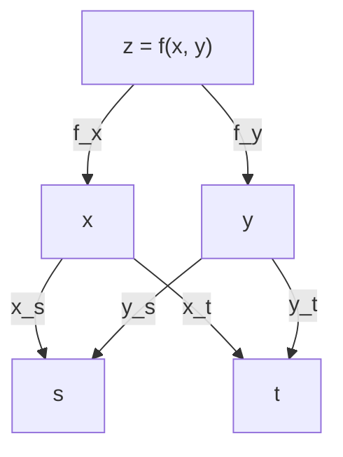

## Learning Objectives

- Define the partial derivatives $f_x$ and $f_y$ as limits, compute them by freezing the other variable, and read each as the slope of a slice of the graph.
- State the equality of mixed partials with its hypothesis, and recognize a function where it fails.
- Build the tangent plane as the linear approximation of $f$, and explain why differentiability asks for more than the existence of partial derivatives.
- Apply the multivariable chain rule for one and two parameters, including the implicit slope of a level curve.
- Use the chain rule to differentiate a small computation graph, the idea behind backpropagation.

## Context & Motivation

A function of several variables has no single slope at a point: the slope depends on which way you walk. The simplest way to tame this is to walk along one coordinate axis at a time, holding every other variable fixed. The result is a **partial derivative**, which is an ordinary single-variable derivative applied to a slice of the surface from `functions-of-several-variables-and-level-curves`. The existing lesson `gradients-extending-derivatives-to-several-variables` uses partial derivatives informally, as "how fast $f$ changes if you nudge one variable". Here the limit definition comes back, together with the question that informal treatment skips: when does the list of partial derivatives actually describe how $f$ behaves in every direction?

The second half of the lesson is the chain rule. Real computations are compositions: a loss depends on a prediction, which depends on a score, which depends on weights. Every derivative needed to train such a model comes from the chain rule applied through intermediate variables. The single-variable version is in `differentiation-rules-and-the-chain-rule`, and the new difficulty is that an intermediate quantity can depend on the input through several routes at once.

## Core Theory

### Partial derivatives

For $f(x, y)$ at $(a, b)$,

$$f_x(a, b) = \lim_{h \to 0} \frac{f(a + h, b) - f(a, b)}{h}, \qquad f_y(a, b) = \lim_{h \to 0} \frac{f(a, b + h) - f(a, b)}{h},$$

when the limits exist. Geometrically, $f_x(a, b)$ is the slope at $x = a$ of the curve where the vertical plane $y = b$ cuts the graph. In practice, differentiate with respect to one variable and treat the other as a constant. Other notations are $\partial f/\partial x$ and $\partial_x f$. Notice what the definition uses: $f$ along two lines through the point and nothing else. On a contour map, $f_x$ can be estimated by stepping east from the point to the next level curve: the change in height divided by the distance walked. Contours packed closely along the east-west direction mean a large $\lvert f_x \rvert$, and the sign says whether the surface rises or falls as you go east.

### Mixed partials

Differentiating twice gives $f_{xx}$, $f_{yy}$ and the mixed partials $f_{xy} = (f_x)_y$ and $f_{yx} = (f_y)_x$. **Clairaut's theorem:** if $f$ is defined on a disk around $(a, b)$ and both $f_{xy}$ and $f_{yx}$ are continuous on that disk, then $f_{xy}(a, b) = f_{yx}(a, b)$. Polynomials, exponentials, sines and their compositions meet the hypothesis everywhere. Also keep the notation straight: $f_{xy}$ means differentiate in $x$ first, then in $y$, and some books write the opposite order. Example 3 shows what happens when it fails.

### Differentiability and the tangent plane

The right generalization of "differentiable" is linear approximability. $f$ is **differentiable** at $(a, b)$ if there are numbers $A$ and $B$ with

$$\lim_{(x,y) \to (a,b)} \frac{f(x, y) - f(a, b) - A(x - a) - B(y - b)}{\sqrt{(x-a)^2 + (y-b)^2}} = 0.$$

If this holds, then $A = f_x(a, b)$ and $B = f_y(a, b)$, and the plane

$$L(x, y) = f(a, b) + f_x(a, b)(x - a) + f_y(a, b)(y - b)$$

is the **tangent plane**, the best linear approximation: the error shrinks faster than the distance to the point. A differentiable function is continuous. The existence of $f_x$ and $f_y$ is *not* enough, since they only see two directions. A usable sufficient condition: if $f_x$ and $f_y$ exist in a neighborhood of $(a, b)$ and are continuous at $(a, b)$, then $f$ is differentiable there. Functions with continuous first partials are called $C^1$. In terms of the approximation, the change of a differentiable function is $\Delta f \approx f_x \Delta x + f_y \Delta y$ for small steps, and the right-hand side is the **differential** $df$. It is what turns a measurement error in $x$ and $y$ into an error in $f$.

### The chain rule

Let $z = f(x, y)$ be differentiable at $(x(t_0), y(t_0))$, with $x(t)$ and $y(t)$ differentiable at $t_0$. Then $z(t) = f(x(t), y(t))$ is differentiable at $t_0$ and

$$\frac{dz}{dt} = f_x \frac{dx}{dt} + f_y \frac{dy}{dt}.$$

With two parameters, $x = x(s, t)$ and $y = y(s, t)$, each parameter gets its own sum:

$$\frac{\partial z}{\partial s} = f_x \frac{\partial x}{\partial s} + f_y \frac{\partial y}{\partial s}.$$

Here is why differentiability is the right hypothesis. For a small step $h$ in $t$, the linear approximation gives $z(t_0 + h) - z(t_0) \approx f_x\,\Delta x + f_y\,\Delta y$ with $\Delta x \approx x'(t_0)\,h$ and $\Delta y \approx y'(t_0)\,h$. Dividing by $h$ and letting $h \to 0$ gives the formula. If $f$ only has partials, the first approximation is not available. The rule is: add one product for every route from $z$ to the parameter, multiplying the derivatives along the route.



**Implicit slope.** Suppose $F(x, y) = c$ defines $y$ as a differentiable function of $x$ near a point where $F$ is $C^1$ and $F_y \ne 0$. Differentiating $F(x, y(x)) = c$ with the chain rule gives $F_x + F_y\, y' = 0$, so $y' = -F_x/F_y$. This is the slope of the level curve from the previous lesson. Where $F_y = 0$ the formula breaks, and the level curve may have a vertical tangent.

## Worked Examples

### Example 1: linear approximation of a distance

Let $f(x, y) = \sqrt{x^2 + y^2}$, the distance from the origin, at $(3, 4)$ where $f = 5$. Then $f_x = x/\sqrt{x^2+y^2} = 3/5$ and $f_y = 4/5$ there, so

$$L(x, y) = 5 + \tfrac35 (x - 3) + \tfrac45 (y - 4).$$

At $(3.1, 3.9)$: $L = 5 + 0.06 - 0.08 = 4.98$, and the true value is $\sqrt{24.82} \approx 4.98197$, an error of about $0.0020$. The numbers also have a meaning: stepping east raises the distance by $0.6$ per unit, less than $1$ because east is not straight away from the origin. Stepping straight away, in the direction $(3, 4)/5$, changes it at rate $\tfrac35\cdot\tfrac35 + \tfrac45\cdot\tfrac45 = 1$, as it must for a distance. The next lesson explains this combination. Halving the displacement should quarter the error, and it does:

```text
displacement (d, -d)   true f      L          error
d = 0.1                4.981967    4.980000   0.001967
d = 0.05               4.990491    4.990000   0.000491
d = 0.025              4.995123    4.995000   0.000123
```

### Example 2: mixed partials

Let $g(x, y) = x^3 y^2 + e^{xy}$. Then $g_x = 3x^2y^2 + y e^{xy}$ and $g_y = 2x^3 y + x e^{xy}$. Differentiating again,

$$g_{xy} = 6x^2 y + e^{xy} + xy\, e^{xy} = g_{yx}.$$

Both are continuous everywhere, so Clairaut applies and the equality is guaranteed, not a coincidence.

### Example 3: a function where mixed partials differ

Let $u(x, y) = \dfrac{xy(x^2 - y^2)}{x^2 + y^2}$ for $(x, y) \ne (0, 0)$ and $u(0, 0) = 0$. For $y \ne 0$, $u(h, y)/h$ tends to $-y$ as $h \to 0$, and $u(0, y) = 0$, so $u_x(0, y) = -y$ for all $y$. Symmetrically $u_y(x, 0) = x$ for all $x$. Therefore

$$u_{xy}(0, 0) = \frac{d}{dy}(-y) = -1, \qquad u_{yx}(0, 0) = \frac{d}{dx}(x) = 1.$$

A numerical check with an inner step of $10^{-5}$ and an outer step of $10^{-3}$ gives $-0.9998$ and $0.9998$ (the value is $\pm(h^2 - k^2)/(h^2 + k^2)$ for inner step $h$ and outer step $k$, so equal steps would give exactly $0$). Both mixed partials exist but are not continuous at the origin, which is exactly the hypothesis that Clairaut needs.

### Example 4: the chain rule with two parameters

Let $z = x^2 y$ with $x = st$ and $y = s + t$, at $(s, t) = (1, 2)$, where $x = 2$ and $y = 3$.

$$z_s = 2xy \cdot t + x^2 \cdot 1 = 2(2)(3)(2) + 4 = 28, \qquad z_t = 2xy \cdot s + x^2 \cdot 1 = 12 + 4 = 16.$$

Substituting first gives $z = s^3 t^2 + s^2 t^3$, so $z_s = 3s^2t^2 + 2st^3 = 12 + 16 = 28$ and $z_t = 2s^3 t + 3s^2 t^2 = 4 + 12 = 16$. A centered finite difference agrees.

### Example 5: the chain rule through a neuron

A single sigmoid neuron has score $z = wx + b$, output $p = \sigma(z) = 1/(1 + e^{-z})$ and loss $L = (p - y)^2$. The route from $L$ to $w$ passes through $p$ and $z$, so

$$\frac{\partial L}{\partial w} = \underbrace{2(p - y)}_{\partial L/\partial p}\; \underbrace{p(1 - p)}_{\partial p/\partial z}\; \underbrace{x}_{\partial z/\partial w}, \qquad \frac{\partial L}{\partial b} = 2(p - y)\,p(1 - p).$$

Take $x = 2$, $w = 0.5$, $b = -1$, $y = 1$. Then $z = 0$, $p = 0.5$, $L = 0.25$, and

$$\frac{\partial L}{\partial w} = 2(-0.5)(0.25)(2) = -0.5, \qquad \frac{\partial L}{\partial b} = -0.25.$$

Centered finite differences give $-0.5000$ and $-0.2500$. Both are negative: increasing $w$ or $b$ lowers the loss here. Backpropagation is this same product of local derivatives, computed from the loss backward and reused across all the routes.

The finite-difference check is also a standard debugging tool: compare the analytic derivative with $(L(w + \varepsilon) - L(w - \varepsilon))/(2\varepsilon)$. The centered form has error of order $\varepsilon^2$, but it costs two evaluations of the loss per parameter, which is why it is used to test a gradient and not to compute one for a model with millions of parameters.

### Example 6: the implicit slope, and a broken chain rule

For $x^2 + 4y^2 = 8$ at $(2, 1)$: $F_x = 2x = 4$ and $F_y = 8y = 8$, so $y' = -4/8 = -1/2$ and the tangent line is $x + 2y = 4$.

Now the hypothesis. Take $q(x, y) = xy/(x^2 + y^2)$ with $q(0, 0) = 0$. Its partials at the origin are both $0$, because $q(h, 0) = q(0, h) = 0$. Along $x = t$, $y = t$ the composite is $g(t) = 1/2$ for $t \ne 0$ and $g(0) = 0$, which is not even continuous at $t = 0$, yet the formula $q_x \cdot 1 + q_y \cdot 1$ would produce $0$. The chain rule failed because $q$ is not differentiable at the origin.

## Common Misconceptions & Pitfalls

- **"If both partials exist, $f$ is differentiable (or at least continuous)."** The function $q$ of Example 6 has both partials at the origin and is not continuous there.
- **"Mixed partials are always equal."** Only under the continuity hypothesis. Example 3 gives $-1$ and $1$.
- **"The $\partial$ symbols cancel like fractions."** Writing $\frac{\partial z}{\partial x}\frac{\partial x}{\partial s}$ and cancelling $\partial x$ drops the route through $y$. The chain rule is a sum over routes, not a single product.
- **"The tangent plane approximates well everywhere."** It is a local statement. The error is small near the point and grows away from it.
- **"The chain rule only needs the partial derivatives to exist."** It needs $f$ to be differentiable at the point, which is what fails in Example 6. Continuous first partials are the usual way to guarantee it.
- **"$dz/dt$ and $\partial z/\partial x$ are interchangeable."** Use $d$ when the quantity depends on a single variable, and $\partial$ when the other variables are held fixed.

## Summary

A partial derivative is a single-variable derivative along one coordinate axis, the slope of a slice. Mixed partials agree when both are continuous near the point, and can differ otherwise. Differentiability, meaning a linear approximation whose error vanishes faster than the distance, defines the tangent plane and is guaranteed by continuous first partials, but not by the mere existence of partials. For a differentiable $f$ composed with differentiable inner functions, the chain rule sums one product per route, which gives the implicit slope $-F_x/F_y$ of a level curve and the derivatives of a neuron's loss. The next lesson, `directional-derivatives-and-the-direction-of-steepest-ascent`, assembles the partials into the gradient and uses the chain rule to read off slopes in every direction.

## Documentation Links

- [OpenStax Calculus Volume 3, 4.3 Partial Derivatives](https://openstax.org/books/calculus-volume-3/pages/4-3-partial-derivatives): definition as a limit, higher-order and mixed partials, Clairaut's theorem.
- [OpenStax Calculus Volume 3, 4.4 Tangent Planes and Linear Approximations](https://openstax.org/books/calculus-volume-3/pages/4-4-tangent-planes-and-linear-approximations): tangent planes, differentiability and the sufficient condition on continuous partials.
- [OpenStax Calculus Volume 3, 4.5 The Chain Rule](https://openstax.org/books/calculus-volume-3/pages/4-5-the-chain-rule): chain rule for one and several parameters, tree diagrams, implicit differentiation.
- [Active Calculus Multivariable, First-Order Partial Derivatives](https://activecalculus.org/multi/S-mv_deriv-first_order.html): partial derivatives through guided activities.
- [Active Calculus Multivariable, The Multivariable Chain Rule](https://activecalculus.org/multi/S_mv_deriv-chain_rule.html): the chain rule with activities and examples.
- [MIT OCW 18.02SC, Unit 2 Part B: Chain Rule, Gradient and Directional Derivatives](https://ocw.mit.edu/courses/18-02sc-multivariable-calculus-fall-2010/pages/2.-partial-derivatives/part-b-chain-rule-gradient-and-directional-derivatives/): lecture sessions on the chain rule.
