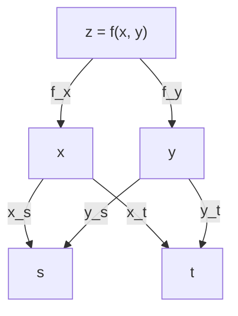

## Objetivos de Aprendizagem

- Definir as derivadas parciais $f_x$ e $f_y$ como limites, calculá-las congelando a outra variável e lê-las como a inclinação de uma fatia do gráfico.
- Enunciar a igualdade das derivadas parciais mistas com sua hipótese e reconhecer uma função em que ela falha.
- Construir o plano tangente como aproximação linear de $f$ e explicar por que diferenciabilidade exige mais do que a existência das derivadas parciais.
- Aplicar a regra da cadeia multivariável para um e dois parâmetros, incluindo a inclinação implícita de uma curva de nível.
- Usar a regra da cadeia para derivar um pequeno grafo de computação, a ideia por trás da retropropagação (backpropagation).

## Contexto e Motivação

Uma função de várias variáveis não tem uma única inclinação num ponto: a inclinação depende da direção em que se caminha. A forma mais simples de domar isso é caminhar ao longo de um eixo coordenado por vez, mantendo fixas todas as outras variáveis. O resultado é uma **derivada parcial**, que é uma derivada comum de uma variável aplicada a uma fatia da superfície de `functions-of-several-variables-and-level-curves`. A lição existente `gradients-extending-derivatives-to-several-variables` usa derivadas parciais de modo informal, como "quão rápido $f$ muda se você mexer em uma variável". Aqui a definição por limite volta, junto com a pergunta que o tratamento informal pula: quando a lista de derivadas parciais realmente descreve o comportamento de $f$ em todas as direções?

A segunda metade da lição é a regra da cadeia. Computações reais são composições: uma perda depende de uma previsão, que depende de um escore, que depende de pesos. Toda derivada necessária para treinar um modelo assim vem da regra da cadeia aplicada através de variáveis intermediárias. A versão de uma variável está em `differentiation-rules-and-the-chain-rule`, e a dificuldade nova é que uma grandeza intermediária pode depender da entrada por várias rotas ao mesmo tempo.

## Teoria Central

### Derivadas parciais

Para $f(x, y)$ em $(a, b)$,

$$f_x(a, b) = \lim_{h \to 0} \frac{f(a + h, b) - f(a, b)}{h}, \qquad f_y(a, b) = \lim_{h \to 0} \frac{f(a, b + h) - f(a, b)}{h},$$

quando os limites existem. Geometricamente, $f_x(a, b)$ é a inclinação em $x = a$ da curva em que o plano vertical $y = b$ corta o gráfico. Na prática, derive em relação a uma variável e trate a outra como constante. Outras notações são $\partial f/\partial x$ e $\partial_x f$. Repare no que a definição usa: $f$ ao longo de duas retas pelo ponto e nada além disso. Num mapa de contorno, $f_x$ pode ser estimada andando para leste a partir do ponto até a próxima curva de nível: a variação de altura dividida pela distância percorrida. Contornos muito próximos na direção leste-oeste significam $\lvert f_x \rvert$ grande, e o sinal diz se a superfície sobe ou desce ao ir para leste.

### Derivadas parciais mistas

Derivar duas vezes dá $f_{xx}$, $f_{yy}$ e as mistas $f_{xy} = (f_x)_y$ e $f_{yx} = (f_y)_x$. **Teorema de Clairaut:** se $f$ está definida num disco em torno de $(a, b)$ e tanto $f_{xy}$ quanto $f_{yx}$ são contínuas nesse disco, então $f_{xy}(a, b) = f_{yx}(a, b)$. Polinômios, exponenciais, senos e suas composições satisfazem a hipótese em toda parte. Cuide também da notação: $f_{xy}$ significa derivar primeiro em $x$ e depois em $y$, e alguns livros escrevem a ordem oposta. O Exemplo 3 mostra o que acontece quando a hipótese falha.

### Diferenciabilidade e o plano tangente

A generalização correta de "derivável" é a aproximabilidade linear. $f$ é **diferenciável** em $(a, b)$ se existem números $A$ e $B$ com

$$\lim_{(x,y) \to (a,b)} \frac{f(x, y) - f(a, b) - A(x - a) - B(y - b)}{\sqrt{(x-a)^2 + (y-b)^2}} = 0.$$

Se isso vale, então $A = f_x(a, b)$ e $B = f_y(a, b)$, e o plano

$$L(x, y) = f(a, b) + f_x(a, b)(x - a) + f_y(a, b)(y - b)$$

é o **plano tangente**, a melhor aproximação linear: o erro encolhe mais rápido que a distância ao ponto. Uma função diferenciável é contínua. A existência de $f_x$ e $f_y$ *não* basta, pois elas enxergam só duas direções. Uma condição suficiente útil: se $f_x$ e $f_y$ existem numa vizinhança de $(a, b)$ e são contínuas em $(a, b)$, então $f$ é diferenciável ali. Funções com primeiras parciais contínuas são chamadas de classe $C^1$. Em termos da aproximação, a variação de uma função diferenciável é $\Delta f \approx f_x \Delta x + f_y \Delta y$ para passos pequenos, e o lado direito é o **diferencial** $df$. É ele que converte um erro de medida em $x$ e $y$ num erro em $f$.

### A regra da cadeia

Seja $z = f(x, y)$ diferenciável em $(x(t_0), y(t_0))$, com $x(t)$ e $y(t)$ deriváveis em $t_0$. Então $z(t) = f(x(t), y(t))$ é derivável em $t_0$ e

$$\frac{dz}{dt} = f_x \frac{dx}{dt} + f_y \frac{dy}{dt}.$$

Com dois parâmetros, $x = x(s, t)$ e $y = y(s, t)$, cada parâmetro tem sua própria soma:

$$\frac{\partial z}{\partial s} = f_x \frac{\partial x}{\partial s} + f_y \frac{\partial y}{\partial s}.$$

Por que a diferenciabilidade é a hipótese certa: para um passo pequeno $h$ em $t$, a aproximação linear dá $z(t_0 + h) - z(t_0) \approx f_x\,\Delta x + f_y\,\Delta y$, com $\Delta x \approx x'(t_0)\,h$ e $\Delta y \approx y'(t_0)\,h$. Dividir por $h$ e fazer $h \to 0$ dá a fórmula. Se $f$ só tem derivadas parciais, a primeira aproximação não está disponível. A regra é: some um produto para cada rota de $z$ até o parâmetro, multiplicando as derivadas ao longo da rota.



**Inclinação implícita.** Suponha que $F(x, y) = c$ defina $y$ como função derivável de $x$ perto de um ponto onde $F$ é $C^1$ e $F_y \ne 0$. Derivar $F(x, y(x)) = c$ com a regra da cadeia dá $F_x + F_y\, y' = 0$, logo $y' = -F_x/F_y$. Essa é a inclinação da curva de nível da lição anterior. Onde $F_y = 0$ a fórmula quebra, e a curva de nível pode ter tangente vertical.

## Exemplos Resolvidos

### Exemplo 1: aproximação linear de uma distância

Seja $f(x, y) = \sqrt{x^2 + y^2}$, a distância até a origem, em $(3, 4)$, onde $f = 5$. Então $f_x = x/\sqrt{x^2+y^2} = 3/5$ e $f_y = 4/5$ ali, de modo que

$$L(x, y) = 5 + \tfrac35 (x - 3) + \tfrac45 (y - 4).$$

Em $(3{,}1;\ 3{,}9)$: $L = 5 + 0{,}06 - 0{,}08 = 4{,}98$, e o valor verdadeiro é $\sqrt{24{,}82} \approx 4{,}98197$, um erro de cerca de $0{,}0020$. Os números também têm um significado: andar para leste aumenta a distância $0{,}6$ por unidade, menos que $1$ porque leste não é diretamente para longe da origem. Andar diretamente para longe, na direção $(3, 4)/5$, muda a distância à taxa $\tfrac35\cdot\tfrac35 + \tfrac45\cdot\tfrac45 = 1$, como deve ser para uma distância. A próxima lição explica essa combinação. Reduzir o deslocamento à metade deve dividir o erro por quatro, e é o que acontece:

```text
deslocamento (d, -d)   f real      L          erro
d = 0.1                4.981967    4.980000   0.001967
d = 0.05               4.990491    4.990000   0.000491
d = 0.025              4.995123    4.995000   0.000123
```

### Exemplo 2: derivadas parciais mistas

Seja $g(x, y) = x^3 y^2 + e^{xy}$. Então $g_x = 3x^2y^2 + y e^{xy}$ e $g_y = 2x^3 y + x e^{xy}$. Derivando de novo,

$$g_{xy} = 6x^2 y + e^{xy} + xy\, e^{xy} = g_{yx}.$$

Ambas são contínuas em toda parte, então Clairaut se aplica e a igualdade é garantida, não uma coincidência.

### Exemplo 3: uma função em que as mistas diferem

Seja $u(x, y) = \dfrac{xy(x^2 - y^2)}{x^2 + y^2}$ para $(x, y) \ne (0, 0)$ e $u(0, 0) = 0$. Para $y \ne 0$, $u(h, y)/h$ tende a $-y$ quando $h \to 0$, e $u(0, y) = 0$, então $u_x(0, y) = -y$ para todo $y$. Simetricamente, $u_y(x, 0) = x$ para todo $x$. Portanto

$$u_{xy}(0, 0) = \frac{d}{dy}(-y) = -1, \qquad u_{yx}(0, 0) = \frac{d}{dx}(x) = 1.$$

Uma verificação numérica com passo interno de $10^{-5}$ e passo externo de $10^{-3}$ dá $-0{,}9998$ e $0{,}9998$ (o valor é $\pm(h^2 - k^2)/(h^2 + k^2)$ para passo interno $h$ e externo $k$, então passos iguais dariam exatamente $0$). As duas mistas existem mas não são contínuas na origem, que é exatamente a hipótese de que Clairaut precisa.

### Exemplo 4: a regra da cadeia com dois parâmetros

Seja $z = x^2 y$ com $x = st$ e $y = s + t$, em $(s, t) = (1, 2)$, onde $x = 2$ e $y = 3$.

$$z_s = 2xy \cdot t + x^2 \cdot 1 = 2(2)(3)(2) + 4 = 28, \qquad z_t = 2xy \cdot s + x^2 \cdot 1 = 12 + 4 = 16.$$

Substituindo antes, $z = s^3 t^2 + s^2 t^3$, e então $z_s = 3s^2t^2 + 2st^3 = 12 + 16 = 28$ e $z_t = 2s^3 t + 3s^2 t^2 = 4 + 12 = 16$. Uma diferença finita centrada concorda.

### Exemplo 5: a regra da cadeia através de um neurônio

Um único neurônio sigmoide tem escore $z = wx + b$, saída $p = \sigma(z) = 1/(1 + e^{-z})$ e perda $L = (p - y)^2$. A rota de $L$ até $w$ passa por $p$ e $z$, então

$$\frac{\partial L}{\partial w} = \underbrace{2(p - y)}_{\partial L/\partial p}\; \underbrace{p(1 - p)}_{\partial p/\partial z}\; \underbrace{x}_{\partial z/\partial w}, \qquad \frac{\partial L}{\partial b} = 2(p - y)\,p(1 - p).$$

Tome $x = 2$, $w = 0{,}5$, $b = -1$, $y = 1$. Então $z = 0$, $p = 0{,}5$, $L = 0{,}25$, e

$$\frac{\partial L}{\partial w} = 2(-0{,}5)(0{,}25)(2) = -0{,}5, \qquad \frac{\partial L}{\partial b} = -0{,}25.$$

Diferenças finitas centradas dão $-0{,}5000$ e $-0{,}2500$. Ambas são negativas: aumentar $w$ ou $b$ reduz a perda aqui. A retropropagação é esse mesmo produto de derivadas locais, calculado da perda para trás e reaproveitado entre todas as rotas.

A checagem por diferenças finitas também é uma ferramenta padrão de depuração: compare a derivada analítica com $(L(w + \varepsilon) - L(w - \varepsilon))/(2\varepsilon)$. A forma centrada tem erro da ordem de $\varepsilon^2$, mas custa duas avaliações da perda por parâmetro, e por isso serve para testar um gradiente e não para calculá-lo num modelo com milhões de parâmetros.

### Exemplo 6: a inclinação implícita e uma regra da cadeia que quebra

Para $x^2 + 4y^2 = 8$ em $(2, 1)$: $F_x = 2x = 4$ e $F_y = 8y = 8$, então $y' = -4/8 = -1/2$ e a reta tangente é $x + 2y = 4$.

Agora a hipótese. Tome $q(x, y) = xy/(x^2 + y^2)$ com $q(0, 0) = 0$. Suas parciais na origem são ambas $0$, porque $q(h, 0) = q(0, h) = 0$. Ao longo de $x = t$, $y = t$, a composta é $g(t) = 1/2$ para $t \ne 0$ e $g(0) = 0$, que nem é contínua em $t = 0$, e no entanto a fórmula $q_x \cdot 1 + q_y \cdot 1$ produziria $0$. A regra da cadeia falhou porque $q$ não é diferenciável na origem.

## Equívocos Comuns e Armadilhas

- **"Se as duas parciais existem, $f$ é diferenciável (ou pelo menos contínua)."** A função $q$ do Exemplo 6 tem as duas parciais na origem e não é contínua ali.
- **"As derivadas mistas são sempre iguais."** Só sob a hipótese de continuidade. O Exemplo 3 dá $-1$ e $1$.
- **"Os símbolos $\partial$ se cancelam como frações."** Escrever $\frac{\partial z}{\partial x}\frac{\partial x}{\partial s}$ e cancelar $\partial x$ descarta a rota por $y$. A regra da cadeia é uma soma sobre rotas, não um único produto.
- **"O plano tangente aproxima bem em toda parte."** É uma afirmação local. O erro é pequeno perto do ponto e cresce longe dele.
- **"A regra da cadeia só precisa que as derivadas parciais existam."** Ela precisa que $f$ seja diferenciável no ponto, que é o que falha no Exemplo 6. Primeiras parciais contínuas são a forma usual de garantir isso.
- **"$dz/dt$ e $\partial z/\partial x$ são intercambiáveis."** Use $d$ quando a grandeza depende de uma única variável, e $\partial$ quando as outras variáveis são mantidas fixas.

## Resumo

Uma derivada parcial é uma derivada de uma variável ao longo de um eixo coordenado, a inclinação de uma fatia. As mistas coincidem quando ambas são contínuas perto do ponto, e podem diferir caso contrário. A diferenciabilidade, isto é, uma aproximação linear cujo erro some mais rápido que a distância, define o plano tangente e é garantida por primeiras parciais contínuas, mas não pela mera existência das parciais. Para uma $f$ diferenciável composta com funções internas deriváveis, a regra da cadeia soma um produto por rota, o que dá a inclinação implícita $-F_x/F_y$ de uma curva de nível e as derivadas da perda de um neurônio. A próxima lição, `directional-derivatives-and-the-direction-of-steepest-ascent`, junta as parciais no gradiente e usa a regra da cadeia para ler a inclinação em todas as direções.

## Documentation Links

- [OpenStax Calculus Volume 3, 4.3 Partial Derivatives](https://openstax.org/books/calculus-volume-3/pages/4-3-partial-derivatives): definição por limite, parciais de ordem superior e mistas, teorema de Clairaut.
- [OpenStax Calculus Volume 3, 4.4 Tangent Planes and Linear Approximations](https://openstax.org/books/calculus-volume-3/pages/4-4-tangent-planes-and-linear-approximations): planos tangentes, diferenciabilidade e a condição suficiente de parciais contínuas.
- [OpenStax Calculus Volume 3, 4.5 The Chain Rule](https://openstax.org/books/calculus-volume-3/pages/4-5-the-chain-rule): regra da cadeia para um e vários parâmetros, diagramas em árvore, derivação implícita.
- [Active Calculus Multivariable, First-Order Partial Derivatives](https://activecalculus.org/multi/S-mv_deriv-first_order.html): derivadas parciais por atividades guiadas.
- [Active Calculus Multivariable, The Multivariable Chain Rule](https://activecalculus.org/multi/S_mv_deriv-chain_rule.html): a regra da cadeia com atividades e exemplos.
- [MIT OCW 18.02SC, Unit 2 Part B: Chain Rule, Gradient and Directional Derivatives](https://ocw.mit.edu/courses/18-02sc-multivariable-calculus-fall-2010/pages/2.-partial-derivatives/part-b-chain-rule-gradient-and-directional-derivatives/): sessões de aula sobre a regra da cadeia.
