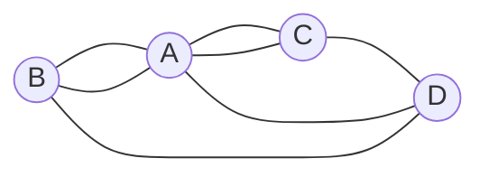
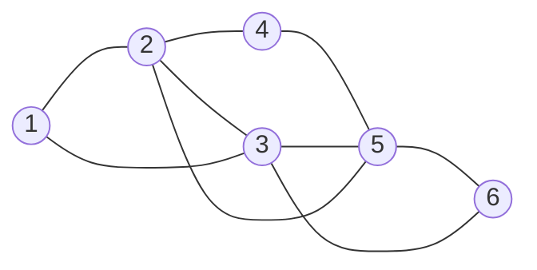

## Learning Objectives

- Define an Euler trail and an Euler circuit, and explain why an "Euler path" is a trail, not a path in the sense of `graphs-terminology-and-representations`.
- State the degree condition for Euler circuits and trails with its full hypothesis (all edges in one connected component), and prove both directions.
- Model the Königsberg bridges as the exact multigraph (4 vertices, 7 edges, degrees 5, 3, 3, 3) and show why collapsing parallel edges gives the wrong answer.
- Run Hierholzer's algorithm by hand on a small graph and check the result against networkx.
- State the separate condition for directed graphs, based on in-degree and out-degree.

## Context & Motivation

Königsberg sat on both sides of the Pregel river, with two islands, and seven bridges joined the four land masses. The puzzle asked for a walk that crosses every bridge exactly once. Euler's answer is usually dated 1736 (as in Diestel's Theorem 1.8.1); the Euler Archive records the paper as written in 1735 and published in 1741, in volume 8 of the St. Petersburg Academy's *Commentarii*. His decisive move was to keep only which land masses each bridge joins. What is left is a graph, and the question becomes one about degrees.

Euler proved that the degree condition is necessary and stated without proof that it is also sufficient. The first complete proof of sufficiency was published in 1873 by Carl Hierholzer, posthumously, and that proof is itself an algorithm. The next lesson, `hamiltonian-paths-and-why-they-are-hard`, asks the same question about vertices and gets the opposite answer.

## Core Theory

### Trails, circuits, and multigraphs

In `graphs-terminology-and-representations` a walk may repeat vertices and edges, and a path repeats no vertex. A **trail** is a walk that repeats no *edge*. An **Euler trail** uses every edge of the graph exactly once; an **Euler circuit** is an Euler trail that ends where it starts. The common name "Euler path" means Euler trail: it may, and usually must, pass through a vertex several times. Lehman, Leighton and Meyer, and Diestel, call the closed version an Euler tour.

This lesson allows **multigraphs**: parallel edges are permitted, and a loop at $v$ adds 2 to $\deg(v)$. Königsberg and the proof below both need this. The handshake theorem $\sum_v \deg(v)=2\lvert E\rvert$ still holds, so the number of odd-degree vertices is even.

### The degree condition

**Theorem 1 (Euler circuits).** Let $G$ be a finite multigraph with at least one edge, whose edges all lie in a single connected component (isolated vertices are allowed). Then $G$ has an Euler circuit if and only if every vertex has even degree.

**Theorem 2 (Euler trails).** Under the same hypothesis, and for vertices $u\neq v$, $G$ has an Euler trail from $u$ to $v$ if and only if $u$ and $v$ have odd degree and every other vertex has even degree.

So the count of odd vertices decides everything: 0 means an Euler circuit, exactly 2 means an Euler trail between them and no circuit, 4 or more means neither.

The hypothesis is about edges, not vertices: a walk never needs to reach an isolated vertex. Two disjoint triangles show why it cannot be dropped: every degree is 2, yet no single walk uses edges from both.

### Proof that the condition is necessary

Suppose $W$ is an Euler circuit. Each time $W$ passes through a vertex $x$, it arrives along one edge and leaves along another, using two edge-ends at $x$. At the start vertex, the first edge out and the last edge in also pair up. Every edge-end at $x$ is used exactly once, so $\deg(x)$ is even. A walk stays inside one component, so all edges lie in one component.

For an Euler trail from $u$ to $v\neq u$, the same pairing works everywhere except at the ends, where the first and the last edge are left unpaired. So $u$ and $v$ are odd and every other vertex is even.

### Proof that the condition is sufficient

**Lemma (no dead ends).** If every vertex has even degree, a trail that starts at $s$ and keeps taking unused edges can only get stuck at $s$.

*Proof.* When the trail enters a vertex $x\neq s$, every earlier visit to $x$ arrived and left (two edge-ends), and the current arrival used one more, so an odd number of edge-ends at $x$ is used. Since $\deg(x)$ is even, one is still free and the trail can leave. The graph is finite, so the trail stops, and the only place left is $s$. ∎

*Proof of Theorem 1, by strong induction on the number of edges $m$.* From any vertex $s$ of positive degree, grow a trail. By the lemma it closes at $s$, giving a closed trail $C$. If $C$ uses every edge, done. Otherwise delete the edges of $C$. Each vertex loses an even number of edge-ends, so the remaining graph $H$ has all degrees even, and each component $K$ of $H$ with an edge has fewer than $m$ edges. By induction $K$ has an Euler circuit $C_K$.

Each $K$ meets $C$: take an edge of $K$ and, in $G$, a path from one of its endpoints to $C$ (the edges of $G$ lie in one component). Before it touches $C$ its edges are not on $C$, so they are edges of $H$ attached to $K$, and the first vertex of $C$ it reaches lies in $K$. Now walk along $C$; the first time it reaches a vertex of some $K$, detour around all of $C_K$ and come back. The result is closed and uses every edge of $G$ once. ∎

*Proof of Theorem 2.* Add a new edge $uv$, parallel if one already exists. Now every degree is even, so Theorem 1 gives an Euler circuit. Orient it so that the new edge is traversed last, from $v$ to $u$, and delete that edge: what remains is an Euler trail from $u$ to $v$. ∎

### Hierholzer's algorithm

The sufficiency proof is an algorithm, the method of Hierholzer's 1873 paper:

1. Start at any vertex of positive degree (with two odd vertices, first add the extra edge from the proof of Theorem 2) and follow unused edges until stuck. The lemma says you are back at the start.
2. While some vertex on the current circuit still has unused edges, grow a closed trail from it and splice that trail in at that vertex.

With adjacency lists that allow constant-time deletion, each edge is handled a constant number of times, so the algorithm runs in $O(n+m)$ time. Fleury's rule (1883) also works, but it tests at each step whether an edge is a bridge of the remaining graph, which costs $O(m^2)$ if bridges are recomputed from scratch.

### Directed graphs

In a directed multigraph each pass through a vertex uses one incoming and one outgoing edge, so the count splits.

**Theorem 3.** Let $D$ be a finite directed multigraph with at least one edge, whose edges all lie in one component of the underlying undirected graph. Then $D$ has an Euler circuit if and only if $\deg^-(x)=\deg^+(x)$ at every vertex $x$. For $u\neq v$, $D$ has an Euler trail from $u$ to $v$ if and only if $\deg^+(u)-\deg^-(u)=1$, $\deg^-(v)-\deg^+(v)=1$, and every other vertex is balanced.

The proofs repeat the ones above with "in-edge paired with out-edge" in place of "two edge-ends", and Hierholzer's algorithm works unchanged. Weak connectivity is enough: once the circuit exists, it is a closed directed walk through every edge, so the vertices with edges are in fact strongly connected.

## Worked Examples

### Example 1: Königsberg, exactly

Of the four land masses (two islands and two banks), call $A$ the one reached by five bridges, $B$ and $C$ the two joined to $A$ by two bridges each, and $D$ the remaining one. The seven bridges give the edge multiset

$$\{AB,\,AB,\,AC,\,AC,\,AD,\,BD,\,CD\}.$$



The degrees are $\deg(A)=5$ and $\deg(B)=\deg(C)=\deg(D)=3$, summing to $14=2\cdot7$. All four vertices are odd, so by Theorems 1 and 2 there is neither an Euler circuit nor an Euler trail: no walk crosses each bridge exactly once, whether or not it returns home.

The parallel edges carry the answer:

```python
import networkx as nx
K = nx.MultiGraph([("A","B"),("A","B"),("A","C"),("A","C"),("A","D"),("B","D"),("C","D")])
print(dict(K.degree()), nx.has_eulerian_path(K))   # {'A': 5, 'B': 3, 'C': 3, 'D': 3} False
S = nx.Graph(K)                                      # parallel edges collapse
print(S.number_of_edges(), dict(S.degree()), nx.has_eulerian_path(S))
# 5 {'A': 3, 'B': 2, 'C': 2, 'D': 3} True
```

The simple graph has 5 edges, only $A$ and $D$ are odd, and networkx finds the trail $A,B,D,A,C,D$, which crosses five bridges, not seven.

### Example 2: Hierholzer step by step

Take vertices $1,\dots,6$ and the nine edges $12,23,31,24,45,52,35,56,63$.



Vertices 1, 4, 6 have degree 2 and vertices 2, 3, 5 have degree 4. All even, graph connected, so Theorem 1 promises an Euler circuit. Rule: take the unused edge to the smallest-numbered neighbor, and splice at the first vertex of the current circuit that still has unused edges.

| Step | Closed trail found | Circuit after splicing | Edges used |
|---|---|---|---|
| 1 | from 1: $1,2,3,1$ (stuck at 1) | $1,2,3,1$ | 3 |
| 2 | vertex 2 has unused 24, 25: $2,4,5,2$ | $1,2,4,5,2,3,1$ | 6 |
| 3 | 1, 2, 4 exhausted; vertex 5 has 53, 56: $5,3,6,5$ | $1,2,4,5,3,6,5,2,3,1$ | 9 |

The stack version splices implicitly: it walks forward while it can and, when stuck, moves the current vertex to the output and backs up, so the next closed trail starts at the first stacked vertex with unused edges. With plain Python lists, `remove` is not constant time here.

```python
import networkx as nx
from collections import Counter

def hierholzer(adj, start):
    unused = {v: sorted(ns) for v, ns in adj.items()}
    stack, circuit = [start], []
    while stack:
        v = stack[-1]
        if unused[v]:                    # walk along an unused edge
            w = unused[v].pop(0)
            unused[w].remove(v)
            stack.append(w)
        else:                            # stuck: v is final, back up
            circuit.append(stack.pop())
    return circuit[::-1]

edges = [(1,2),(2,3),(3,1),(2,4),(4,5),(5,2),(3,5),(5,6),(6,3)]
adj = {}
for u, v in edges:
    adj.setdefault(u, []).append(v)
    adj.setdefault(v, []).append(u)

def uses_each_edge_once(walk):
    used = Counter(frozenset(e) for e in zip(walk, walk[1:]))
    return walk[0] == walk[-1] and used == Counter(frozenset(e) for e in edges)

ours = hierholzer(adj, 1)
theirs = [u for u, v in nx.eulerian_circuit(nx.Graph(edges), source=1)] + [1]
print(ours, uses_each_edge_once(ours))       # [1, 2, 3, 5, 2, 4, 5, 6, 3, 1] True
print(theirs, uses_each_edge_once(theirs))   # [1, 3, 6, 5, 4, 2, 5, 3, 2, 1] True
```

Three runs, three circuits: the table's, the stack's (it splices at the most recently stuck vertex), and networkx's, whose documentation describes a linear-time method adapted from Edmonds and Johnson. All pass the check: the theorem promises existence, not uniqueness.

### Example 3: an Euler trail, and how many there are

The "house" drawn in one stroke is the square $1,2,3,4$ (with $1,2$ at the bottom), both diagonals $13$ and $24$, and a roof vertex $5$ joined to $3$ and $4$: 5 vertices, 8 edges, degrees $3,3,4,4,2$. Exactly two vertices are odd, so every Euler trail runs between 1 and 2 and none closes. With the edges entered as $12,23,34,41,13,24,35,45$, networkx's `eulerian_path` returns $1,2,3,1,4,3,5,4,2$. A recursive script that tries every unused edge finds 44 Euler trails from 1, 44 from 2 (the reverses of the first 44), and none from 3, 4, or 5. A second edge $12$ makes all degrees even (this is the proof of Theorem 2, which needs a multigraph because $12$ is already an edge), and networkx then reports an Euler circuit.

### Example 4: trees and digraphs

**Trees.** By `trees`, a tree with at least two vertices has at least two leaves, and a leaf has odd degree 1, so no tree with an edge has an Euler circuit. A trail in a tree cannot revisit a vertex, since the stretch between two visits would contain a cycle. So an Euler trail of a tree is a path through all its edges, which happens exactly when the tree is itself a path.

**Digraphs.** Take $1\to2$, $2\to3$, $1\to3$. The underlying triangle has an Euler circuit, but $\deg^+(1)-\deg^-(1)=2$, so by Theorem 3 there is neither an Euler circuit nor an Euler trail, and networkx agrees. Now take $1\to2$, $2\to3$, $3\to1$, $3\to4$: vertex 3 has one surplus out-edge, vertex 4 one surplus in-edge, so Theorem 3 promises a trail from 3 to 4, and `eulerian_path` returns $3,1,2,3,4$.

## Common Misconceptions & Pitfalls

- **"An Euler path is a path."** It is a trail. In Example 2 the circuit passes through vertices 2, 3, and 5 twice each, and must, since they have degree 4.
- **"An isolated vertex rules out an Euler circuit."** Not under Theorem 1. Libraries may differ: networkx's `is_eulerian` returns `False` for a triangle plus an isolated vertex, since it requires the whole graph to be connected; its documentation suggests removing isolated vertices first.
- **"Parallel edges can be merged."** In Königsberg that turns 7 bridges into 5 edges and invents an Euler trail.
- **"For digraphs, check that total degrees are even."** The test is in-degree equal to out-degree, or the one-surplus, one-deficit pattern for a trail.

## Summary

For a finite multigraph whose edges lie in one component, an Euler circuit exists exactly when every degree is even, and an Euler trail from $u$ to $v\neq u$ exists exactly when $u$ and $v$ are the only odd vertices. Necessity is edge-end parity; sufficiency is the no-dead-ends lemma plus splicing, which is Hierholzer's linear-time algorithm. Königsberg (degrees 5, 3, 3, 3) has no such walk. For digraphs the condition is in-degree equal to out-degree at every vertex.

## Documentation Links

- [Diestel, Graph Theory (6th ed.), Chapter 1 free preview](https://www.math.uni-hamburg.de/home/diestel/books/graph.theory/preview/Ch1.pdf): Section 1.8, Euler tours, with Theorem 1.8.1, its proof, and the Königsberg graph.
- [Lehman, Leighton, Meyer, Mathematics for Computer Science](https://people.csail.mit.edu/meyer/mcs.pdf): Problems 9.8 and 11.44 guide the proofs for weakly connected digraphs and for undirected graphs.
- [Levin, Discrete Mathematics: An Open Introduction, Euler Paths and Circuits](https://discrete.openmathbooks.org/dmoi3/sec_paths.html): the degree condition, Königsberg, and Hamilton paths.
- [Euler Archive, E53](https://scholarlycommons.pacific.edu/euler-works/53/): catalogue record of Euler's paper, written 1735 and published 1741.
- [Wikipedia, Seven Bridges of Königsberg](https://en.wikipedia.org/wiki/Seven_Bridges_of_K%C3%B6nigsberg): the land masses, the degrees, and the history.
- [Wikipedia, Eulerian path](https://en.wikipedia.org/wiki/Eulerian_path): Hierholzer's 1873 proof and algorithm, Fleury's algorithm, and the directed case.
- [NetworkX, Eulerian algorithms](https://networkx.org/documentation/stable/reference/algorithms/euler.html): `is_eulerian`, `eulerian_circuit`, `has_eulerian_path`, `eulerian_path`.
