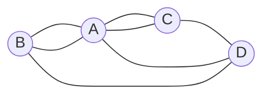
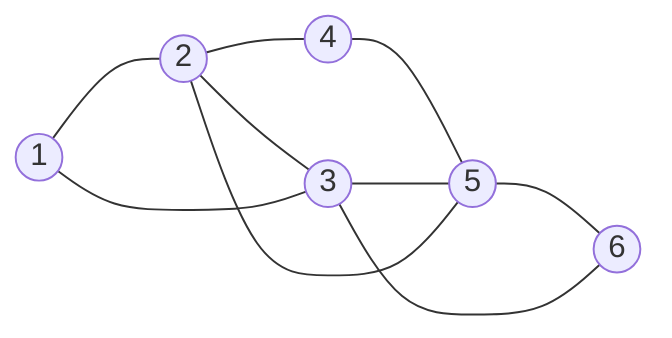

## Objetivos de Aprendizagem

- Definir trilha euleriana e circuito euleriano, e explicar por que um "caminho de Euler" é uma trilha, e não um caminho no sentido de `graphs-terminology-and-representations`.
- Enunciar a condição de grau para circuitos e trilhas de Euler com a hipótese completa (todas as arestas numa só componente conexa) e provar as duas direções.
- Modelar as pontes de Königsberg como o multigrafo exato (4 vértices, 7 arestas, graus 5, 3, 3, 3) e mostrar por que juntar arestas paralelas dá a resposta errada.
- Executar à mão o algoritmo de Hierholzer num grafo pequeno e conferir o resultado com o networkx.
- Enunciar a condição separada para grafos dirigidos, com grau de entrada e grau de saída.

## Contexto e Motivação

Königsberg ficava nas duas margens do rio Pregel, com duas ilhas, e sete pontes ligavam as quatro porções de terra. O desafio era achar um passeio que atravessasse cada ponte exatamente uma vez. A resposta de Euler costuma ser datada de 1736 (como no Teorema 1.8.1 de Diestel); o Euler Archive registra o artigo como escrito em 1735 e publicado em 1741, no volume 8 dos *Commentarii* da Academia de São Petersburgo. O passo decisivo foi guardar só quais porções de terra cada ponte liga. O que sobra é um grafo, e a pergunta vira uma pergunta sobre graus.

Euler provou que a condição de grau é necessária e afirmou, sem prova, que ela também é suficiente. A primeira prova completa da suficiência saiu em 1873, publicada postumamente, por Carl Hierholzer, e essa prova já é um algoritmo. A próxima lição, `hamiltonian-paths-and-why-they-are-hard`, faz a mesma pergunta sobre vértices e chega à resposta oposta.

## Teoria Central

### Trilhas, circuitos e multigrafos

Em `graphs-terminology-and-representations`, um passeio pode repetir vértices e arestas, e um caminho não repete vértice. Uma **trilha** é um passeio que não repete *aresta*. Uma **trilha euleriana** usa cada aresta do grafo exatamente uma vez; um **circuito euleriano** é uma trilha euleriana que termina onde começou. O nome comum "caminho de Euler" quer dizer trilha euleriana: ela pode, e em geral precisa, passar várias vezes pelo mesmo vértice. Lehman, Leighton e Meyer, assim como Diestel, chamam a versão fechada de Euler tour.

Esta lição admite **multigrafos**: arestas paralelas são permitidas, e um laço em $v$ soma 2 a $\deg(v)$. Königsberg e a prova abaixo precisam disso. O teorema do aperto de mãos $\sum_v \deg(v)=2\lvert E\rvert$ continua valendo, então o número de vértices de grau ímpar é par.

### A condição de grau

**Teorema 1 (circuitos de Euler).** Seja $G$ um multigrafo finito com pelo menos uma aresta, cujas arestas estão todas numa só componente conexa (vértices isolados são permitidos). Então $G$ tem circuito euleriano se e somente se todo vértice tem grau par.

**Teorema 2 (trilhas de Euler).** Sob a mesma hipótese, e para vértices $u\neq v$, $G$ tem trilha euleriana de $u$ a $v$ se e somente se $u$ e $v$ têm grau ímpar e todos os outros vértices têm grau par.

A contagem de vértices ímpares decide tudo: 0 significa circuito euleriano, exatamente 2 significa trilha euleriana entre eles e nenhum circuito, 4 ou mais significa nenhum dos dois.

A hipótese fala de arestas, não de vértices: um passeio nunca precisa chegar a um vértice isolado. Dois triângulos disjuntos mostram por que ela não pode cair: todo grau é 2, mas nenhum passeio usa arestas dos dois.

### Prova de que a condição é necessária

Suponha que $W$ é um circuito euleriano. Cada vez que $W$ passa por um vértice $x$, chega por uma aresta e sai por outra, gastando duas extremidades de aresta em $x$. No vértice inicial, a primeira aresta de saída e a última de chegada também formam um par. Cada extremidade em $x$ é usada exatamente uma vez, então $\deg(x)$ é par. Um passeio fica dentro de uma componente, então todas as arestas estão numa componente.

Para uma trilha euleriana de $u$ a $v\neq u$, o mesmo pareamento vale em todo lugar menos nas pontas, onde a primeira e a última aresta ficam sem par. Logo $u$ e $v$ são ímpares e os demais são pares.

### Prova de que a condição é suficiente

**Lema (sem becos sem saída).** Se todo vértice tem grau par, uma trilha que começa em $s$ e segue tomando arestas não usadas só pode ficar presa em $s$.

*Prova.* Quando a trilha entra num vértice $x\neq s$, cada visita anterior a $x$ chegou e saiu (duas extremidades), e a chegada atual usou mais uma, então um número ímpar de extremidades em $x$ está usado. Como $\deg(x)$ é par, sobra uma livre e a trilha consegue sair. O grafo é finito, então a trilha para, e o único lugar que resta é $s$. ∎

*Prova do Teorema 1, por indução forte no número de arestas $m$.* A partir de um vértice $s$ de grau positivo, faça crescer uma trilha. Pelo lema ela se fecha em $s$ e dá uma trilha fechada $C$. Se $C$ usa todas as arestas, acabou. Senão, apague as arestas de $C$. Cada vértice perde um número par de extremidades, então o grafo restante $H$ tem todos os graus pares, e cada componente $K$ de $H$ com aresta tem menos de $m$ arestas. Por indução, $K$ tem um circuito euleriano $C_K$.

Cada $K$ encontra $C$: tome uma aresta de $K$ e, em $G$, um caminho de uma ponta dela até $C$ (as arestas de $G$ estão numa componente). Antes de tocar $C$, as arestas do caminho não estão em $C$, logo são arestas de $H$ ligadas a $K$, e o primeiro vértice de $C$ alcançado está em $K$. Agora percorra $C$; na primeira vez que chegar a um vértice de alguma $K$, dê a volta inteira em $C_K$ e retome. O resultado é fechado e usa cada aresta de $G$ uma vez. ∎

*Prova do Teorema 2.* Acrescente uma aresta nova $uv$, paralela se já existir uma. Agora todo grau é par, e o Teorema 1 dá um circuito euleriano. Oriente-o para que a aresta nova seja a última, de $v$ para $u$, e apague essa aresta: o que sobra é uma trilha euleriana de $u$ a $v$. ∎

### O algoritmo de Hierholzer

A prova da suficiência é um algoritmo, o método do artigo de Hierholzer de 1873:

1. Comece em qualquer vértice de grau positivo (com dois vértices ímpares, acrescente antes a aresta extra da prova do Teorema 2) e siga arestas não usadas até ficar preso. O lema garante que você voltou ao início.
2. Enquanto algum vértice do circuito atual tiver arestas não usadas, faça crescer uma trilha fechada a partir dele e emende-a ali.

Com listas de adjacência que permitem remoção em tempo constante, cada aresta é tratada um número constante de vezes, e o algoritmo roda em tempo $O(n+m)$. A regra de Fleury (1883) também funciona, mas testa a cada passo se uma aresta é ponte do grafo restante, o que custa $O(m^2)$ se as pontes forem recalculadas do zero.

### Grafos dirigidos

Num multigrafo dirigido, cada passagem por um vértice usa uma aresta de entrada e uma de saída, e a contagem se divide.

**Teorema 3.** Seja $D$ um multigrafo dirigido finito com pelo menos uma aresta, cujas arestas estão todas numa componente do grafo não dirigido subjacente. Então $D$ tem circuito euleriano se e somente se $\deg^-(x)=\deg^+(x)$ em todo vértice $x$. Para $u\neq v$, $D$ tem trilha euleriana de $u$ a $v$ se e somente se $\deg^+(u)-\deg^-(u)=1$, $\deg^-(v)-\deg^+(v)=1$ e todos os outros vértices são equilibrados.

As provas repetem as de cima com "aresta de entrada pareada com aresta de saída" no lugar de "duas extremidades", e o algoritmo de Hierholzer funciona sem mudança. Conectividade fraca basta: quando o circuito existe, ele é um passeio dirigido fechado por todas as arestas, então os vértices com arestas são, de fato, fortemente conexos.

## Exemplos Resolvidos

### Exemplo 1: Königsberg, exatamente

Das quatro porções de terra (duas ilhas e duas margens), chame de $A$ a que recebe cinco pontes, de $B$ e $C$ as duas ligadas a $A$ por duas pontes cada, e de $D$ a restante. As sete pontes dão o multiconjunto de arestas

$$\{AB,\,AB,\,AC,\,AC,\,AD,\,BD,\,CD\}.$$



Os graus são $\deg(A)=5$ e $\deg(B)=\deg(C)=\deg(D)=3$, com soma $14=2\cdot7$. Os quatro vértices são ímpares, então pelos Teoremas 1 e 2 não há circuito nem trilha euleriana: nenhum passeio atravessa cada ponte exatamente uma vez, volte ou não ao ponto de partida.

As arestas paralelas carregam a resposta:

```python
import networkx as nx
K = nx.MultiGraph([("A","B"),("A","B"),("A","C"),("A","C"),("A","D"),("B","D"),("C","D")])
print(dict(K.degree()), nx.has_eulerian_path(K))   # {'A': 5, 'B': 3, 'C': 3, 'D': 3} False
S = nx.Graph(K)                                      # as arestas paralelas se fundem
print(S.number_of_edges(), dict(S.degree()), nx.has_eulerian_path(S))
# 5 {'A': 3, 'B': 2, 'C': 2, 'D': 3} True
```

O grafo simples tem 5 arestas, só $A$ e $D$ são ímpares, e o networkx encontra a trilha $A,B,D,A,C,D$, que atravessa cinco pontes, não sete.

### Exemplo 2: Hierholzer passo a passo

Tome os vértices $1,\dots,6$ e as nove arestas $12,23,31,24,45,52,35,56,63$.



Os vértices 1, 4, 6 têm grau 2 e os vértices 2, 3, 5, grau 4. Tudo par, grafo conexo, então o Teorema 1 promete um circuito euleriano. Regra: tome a aresta não usada até o vizinho de menor número, e emende no primeiro vértice do circuito atual que ainda tem arestas não usadas.

| Passo | Trilha fechada encontrada | Circuito depois da emenda | Arestas usadas |
|---|---|---|---|
| 1 | a partir de 1: $1,2,3,1$ (preso em 1) | $1,2,3,1$ | 3 |
| 2 | o vértice 2 tem 24, 25 livres: $2,4,5,2$ | $1,2,4,5,2,3,1$ | 6 |
| 3 | 1, 2, 4 esgotados; o vértice 5 tem 53, 56: $5,3,6,5$ | $1,2,4,5,3,6,5,2,3,1$ | 9 |

A versão com pilha faz a emenda implicitamente: avança enquanto pode e, presa, move o vértice atual para a saída e recua, e a próxima trilha fechada começa no primeiro vértice empilhado com arestas livres. Com listas comuns do Python, `remove` aqui não é de tempo constante.

```python
import networkx as nx
from collections import Counter

def hierholzer(adj, start):
    unused = {v: sorted(ns) for v, ns in adj.items()}
    stack, circuit = [start], []
    while stack:
        v = stack[-1]
        if unused[v]:                    # anda por uma aresta não usada
            w = unused[v].pop(0)
            unused[w].remove(v)
            stack.append(w)
        else:                            # preso: v é definitivo, recua
            circuit.append(stack.pop())
    return circuit[::-1]

edges = [(1,2),(2,3),(3,1),(2,4),(4,5),(5,2),(3,5),(5,6),(6,3)]
adj = {}
for u, v in edges:
    adj.setdefault(u, []).append(v)
    adj.setdefault(v, []).append(u)

def uses_each_edge_once(walk):
    used = Counter(frozenset(e) for e in zip(walk, walk[1:]))
    return walk[0] == walk[-1] and used == Counter(frozenset(e) for e in edges)

ours = hierholzer(adj, 1)
theirs = [u for u, v in nx.eulerian_circuit(nx.Graph(edges), source=1)] + [1]
print(ours, uses_each_edge_once(ours))       # [1, 2, 3, 5, 2, 4, 5, 6, 3, 1] True
print(theirs, uses_each_edge_once(theirs))   # [1, 3, 6, 5, 4, 2, 5, 3, 2, 1] True
```

Três execuções, três circuitos: o da tabela, o da pilha (que emenda no vértice preso mais recente) e o do networkx, cuja documentação descreve um método de tempo linear adaptado de Edmonds e Johnson. Todos passam na conferência: o teorema promete existência, não unicidade.

### Exemplo 3: uma trilha euleriana, e quantas existem

A "casinha" desenhada sem tirar o lápis é o quadrado $1,2,3,4$ (com $1,2$ embaixo), as duas diagonais $13$ e $24$ e um vértice de telhado $5$ ligado a $3$ e $4$: 5 vértices, 8 arestas, graus $3,3,4,4,2$. Exatamente dois vértices são ímpares, então toda trilha euleriana vai de 1 a 2 ou de 2 a 1, e nenhuma se fecha. Com as arestas inseridas na ordem $12,23,34,41,13,24,35,45$, o `eulerian_path` do networkx devolve $1,2,3,1,4,3,5,4,2$. Um script recursivo que tenta cada aresta livre acha 44 trilhas eulerianas a partir de 1, 44 a partir de 2 (as inversas das primeiras) e nenhuma a partir de 3, 4 ou 5. Uma segunda aresta $12$ deixa todos os graus pares (é a prova do Teorema 2, que precisa de multigrafo porque $12$ já é aresta), e o networkx passa a acusar circuito euleriano.

### Exemplo 4: árvores e dígrafos

**Árvores.** Por `trees`, uma árvore com pelo menos dois vértices tem pelo menos duas folhas, e uma folha tem grau 1, ímpar, então nenhuma árvore com aresta tem circuito euleriano. Uma trilha numa árvore não revisita vértice, porque o trecho entre duas visitas conteria um ciclo. Logo, uma trilha euleriana de árvore é um caminho por todas as arestas, o que acontece exatamente quando a árvore é ela própria um caminho.

**Dígrafos.** Tome $1\to2$, $2\to3$, $1\to3$. O triângulo subjacente tem circuito euleriano, mas $\deg^+(1)-\deg^-(1)=2$, então pelo Teorema 3 não há circuito nem trilha euleriana, e o networkx concorda. Agora tome $1\to2$, $2\to3$, $3\to1$, $3\to4$: o vértice 3 tem uma aresta de saída a mais e o 4 uma de entrada a mais, então o Teorema 3 promete uma trilha de 3 a 4, e o `eulerian_path` devolve $3,1,2,3,4$.

## Equívocos Comuns e Armadilhas

- **"Caminho de Euler é um caminho."** É uma trilha. No Exemplo 2, o circuito passa duas vezes pelos vértices 2, 3 e 5, e precisa passar, já que eles têm grau 4.
- **"Um vértice isolado impede o circuito euleriano."** Não pelo Teorema 1. Bibliotecas podem divergir: o `is_eulerian` do networkx devolve `False` para um triângulo mais um vértice isolado, porque exige o grafo inteiro conexo; a documentação sugere remover os isolados antes.
- **"Arestas paralelas podem ser fundidas."** Em Königsberg isso transforma 7 pontes em 5 arestas e inventa uma trilha euleriana.
- **"Em dígrafos, basta conferir que os graus totais são pares."** O teste é grau de entrada igual ao de saída, ou o padrão de um vértice com sobra e um com falta, no caso da trilha.

## Resumo

Num multigrafo finito com as arestas numa só componente, existe circuito euleriano exatamente quando todo grau é par, e existe trilha euleriana de $u$ a $v\neq u$ exatamente quando $u$ e $v$ são os únicos vértices ímpares. A necessidade é paridade de extremidades; a suficiência é o lema sem becos sem saída mais a emenda, que é o algoritmo linear de Hierholzer. Königsberg (graus 5, 3, 3, 3) não tem esse passeio. Em dígrafos, a condição é grau de entrada igual ao de saída em todo vértice.

## Documentation Links

- [Diestel, Graph Theory (6th ed.), Chapter 1 free preview](https://www.math.uni-hamburg.de/home/diestel/books/graph.theory/preview/Ch1.pdf): seção 1.8, Euler tours, com o Teorema 1.8.1, a sua prova e o grafo de Königsberg.
- [Lehman, Leighton, Meyer, Mathematics for Computer Science](https://people.csail.mit.edu/meyer/mcs.pdf): os Problemas 9.8 e 11.44 conduzem as provas para dígrafos fracamente conexos e para grafos não dirigidos.
- [Levin, Discrete Mathematics: An Open Introduction, Euler Paths and Circuits](https://discrete.openmathbooks.org/dmoi3/sec_paths.html): a condição de grau, Königsberg e caminhos de Hamilton.
- [Euler Archive, E53](https://scholarlycommons.pacific.edu/euler-works/53/): registro de catálogo do artigo de Euler, escrito em 1735 e publicado em 1741.
- [Wikipedia, Seven Bridges of Königsberg](https://en.wikipedia.org/wiki/Seven_Bridges_of_K%C3%B6nigsberg): as porções de terra, os graus e a história.
- [Wikipedia, Eulerian path](https://en.wikipedia.org/wiki/Eulerian_path): a prova e o algoritmo de Hierholzer de 1873, o algoritmo de Fleury e o caso dirigido.
- [NetworkX, Eulerian algorithms](https://networkx.org/documentation/stable/reference/algorithms/euler.html): `is_eulerian`, `eulerian_circuit`, `has_eulerian_path`, `eulerian_path`.
