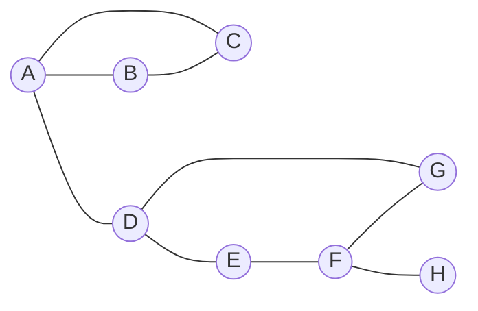

## Learning Objectives

- Define cut vertices and bridges by what their removal does to the number of components.
- Compute vertex connectivity $\kappa(G)$ and edge connectivity $\lambda(G)$ and state Whitney's inequality $\kappa(G)\le\lambda(G)\le\delta(G)$ with its hypothesis.
- Run the DFS low-link algorithm by hand and read off every cut vertex and bridge.
- Apply the special rule for the DFS root and explain why the general rule fails there.
- Say what parallel edges change, and why a common shortcut in bridge-finding code breaks on them.

## Context & Motivation

`graphs-terminology-and-representations` called a graph connected when every pair of vertices is joined by a path. That yes or no answer hides fragility: a network that hangs on one router is connected and one failure away from splitting.

The `trees` lesson showed that a connected graph is a tree exactly when removing any single edge disconnects it: every edge of a tree is a bridge, so trees are the most fragile connected graphs. `hamiltonian-paths-and-why-they-are-hard` asked whether a graph has a cycle through every vertex; a graph with a cut vertex never has one, which gives a quick necessary test for that hard question. And depth-first search, introduced in `graph-traversal-dfs`, finds every cut vertex and bridge in one $O(V+E)$ pass instead of deleting each vertex and edge in turn.

## Core Theory

Graphs are undirected and simple unless stated otherwise.

### Components, cut vertices and bridges

A **connected component** is a maximal connected subgraph; the components are the classes of the equivalence relation "joined by a path", and `connected-components-via-bfs` computes them. A **cut vertex** (articulation point) is a vertex whose removal, with its incident edges, increases the number of components. A **bridge** (cut edge) is an edge whose removal increases the number of components. "Increases the number of components" keeps the definitions meaningful for a disconnected graph: with edges $\{1,2\},\{2,3\},\{4,5\}$ and an isolated vertex $6$, vertex $2$ is a cut vertex and all three edges are bridges, although the graph starts with three components.

Two facts carry most of the reasoning:

- **An edge is a bridge if and only if it lies on no cycle.** If $uv$ is on a cycle, the rest of the cycle still joins $u$ and $v$. If it is on no cycle, any other $u$-$v$ path plus $uv$ would form one.
- **An endpoint of a bridge is a cut vertex unless it has degree 1.** Removing it removes the bridge and separates its other neighbors from the far side.

The converse of the second fact fails: two triangles sharing one vertex have a cut vertex and no bridge.

### Vertex and edge connectivity

Following Diestel's *Graph Theory*: $G$ is **$k$-connected** if it has more than $k$ vertices and stays connected after removing any set of fewer than $k$ vertices, and the **connectivity** $\kappa(G)$ is the largest such $k$. $G$ is **$\ell$-edge-connected** if it has at least two vertices and stays connected after removing any set of fewer than $\ell$ edges, and the **edge connectivity** $\lambda(G)$ is the largest such $\ell$. So a disconnected graph has $\kappa=\lambda=0$, a connected graph with a cut vertex has $\kappa=1$, one with a bridge has $\lambda=1$, and $\kappa(K_n)=n-1$ because the vertex count, not any separating set, caps it.

**Whitney's inequality.** For every graph $G$ with at least two vertices,

$$\kappa(G)\le\lambda(G)\le\delta(G),$$

where $\delta(G)$ is the minimum degree. The right inequality is immediate: deleting the $\delta(G)$ edges at a vertex of minimum degree isolates it. For the left one, take a minimum edge cut $F$ and delete one suitably chosen endpoint of each edge in $F$; this destroys $F$ with at most $\lambda(G)$ vertices, and the only case where no choice leaves vertices on both sides is the complete graph, where $\kappa=\lambda$. This is Diestel's Proposition 1.4.2, with the full argument; Diestel states it without a name, and "Whitney's inequality" is the name it usually goes by. Both inequalities can be strict at once (Example 4).

### Depth-first search, back edges and low values

Run DFS from a root $r$, numbering vertices in order of discovery, $d(v)=1,2,3,\dots$ (unlike the shared discovery and finish clock of `graph-traversal-dfs`; the tests below depend only on the order of discovery). In an **undirected** graph every edge is a tree edge or a **back edge** to an ancestor. There are no cross edges between subtrees: if $u$ is discovered first and $uw$ is an edge, $w$ is discovered before $u$ finishes, so $w$ lands in $u$'s subtree. Define

$$\text{low}(v)=\min\big(\{d(v)\}\cup\{d(w): xw\text{ is a back edge, }x\text{ in the subtree of }v\}\big),$$

the earliest vertex the subtree of $v$ reaches with one back edge. It is computed bottom-up: the minimum of $d(v)$, the low values of $v$'s children, and $d(w)$ for each back edge $vw$ (the tree edge to $v$'s parent is not a back edge). Then:

1. **A non-root $u$ is a cut vertex if and only if some child $w$ has $\text{low}(w)\ge d(u)$.** Then no edge leaves $w$'s subtree to a proper ancestor of $u$, so removing $u$ cuts that subtree off from the root side, which is non-empty. If every subtree reaches strictly above $u$, all stay attached.
2. **The root is a cut vertex if and only if it has at least two children.** Without cross edges, different child subtrees meet only at the root; with one child, what remains is one connected subtree.
3. **A tree edge $uw$, with $w$ the child, is a bridge if and only if $\text{low}(w)>d(u)$.** Back edges are never bridges, since each closes a cycle.

Rule 2 is not optional: every child $w$ of the root has $\text{low}(w)\ge d(r)$ automatically, since $d(r)$ is the smallest discovery time.

```python
def cut_vertices_and_bridges(adj, root):
    d, low, parent = {}, {}, {root: None}
    cut, bridges, time = set(), [], [0]

    def dfs(u):
        time[0] += 1
        d[u] = low[u] = time[0]
        children = 0
        for w in adj[u]:
            if w not in d:                    # tree edge u-w
                parent[w] = u
                children += 1
                dfs(w)
                low[u] = min(low[u], low[w])
                if parent[u] is not None and low[w] >= d[u]:
                    cut.add(u)                # rule 1
                if low[w] > d[u]:
                    bridges.append((u, w))    # rule 3
            elif w != parent[u]:              # back edge (simple graphs only)
                low[u] = min(low[u], d[w])
        if parent[u] is None and children >= 2:
            cut.add(u)                        # rule 2

    dfs(root)
    return cut, bridges
```

The cost is $O(V+E)$. For a disconnected graph, start a new root at every undiscovered vertex. The networkx documentation of `articulation_points` cites Hopcroft and Tarjan (1973) for this method, while its `bridges` uses chain decomposition, which makes it an independent check.

### Parallel edges and loops

A loop never affects connectivity. Parallel edges matter for bridges and $\lambda$, not for cut vertices or $\kappa$: two copies of $uv$ form a 2-cycle, so neither is a bridge, while deleting a vertex deletes every copy of its edges anyway.

The test `elif w != parent[u]` is a shortcut valid only for simple graphs. It skips *every* edge back to the parent vertex, including a second copy of the tree edge, which is a genuine back edge. On a multigraph, skip only the edge used to arrive, identified by an edge id. The Princeton `Bridge.java` uses the shortcut and warns in its header that parallel edges "would be (incorrectly) identified as bridges".

### Connectivity and Hamiltonian cycles

If $G$ has at least three vertices and a Hamiltonian cycle, removing one vertex leaves a path through all the others, so $G$ is 2-connected. Hence **a graph with a cut vertex has no Hamiltonian cycle**. The converse fails: the Petersen graph has $\kappa=3$ and, by exhaustive search over the $9!=362{,}880$ orders of the other vertices after fixing a start, no Hamiltonian cycle.

## Worked Examples

The running graph has vertices $A$ to $H$ and nine edges: a triangle $A$-$B$-$C$, the edge $A$-$D$, a 4-cycle $D$-$E$-$F$-$G$-$D$, and a pendant edge $F$-$H$.



Brute force gives the answer to check against: removing $A$, $D$ or $F$ leaves 2 components and any other vertex leaves 1; removing $A$-$D$ or $F$-$H$ leaves 2 components and any other edge leaves 1. Since $H$ has degree 1, $\kappa=\lambda=\delta=1$.

### Example 1: the low-link run from A

Neighbors are visited in alphabetical order:

```text
discover A d=1, discover B d=2, discover C d=3
  C: back edge C-A, low[C] = 1; finish C
  B: child C has low 1, low[B] = 1; finish B
  A: child B has low 1 >= d[A] = 1, but A is the root (rule 2 decides)
discover D d=4, discover E d=5, discover F d=6, discover G d=7
  G: back edge G-D, low[G] = 4; finish G
  F: child G has low 4 < d[F] = 6
discover H d=8
  H: no back edges, low[H] = 8; finish H
  F: child H has low 8 >= 6, so F is a cut vertex; 8 > 6, so F-H is a bridge
  F: low[F] = min(6, 4, 8) = 4; finish F
  E: child F has low 4 < 5; low[E] = 4
  D: child E has low 4 >= d[D] = 4, so D is a cut vertex; 4 > 4 fails, D-E is not a bridge
  A: child D has low 4 > d[A] = 1, so A-D is a bridge
A has 2 children (B and D), so A is a cut vertex
```

| vertex | A | B | C | D | E | F | G | H |
|---|---|---|---|---|---|---|---|---|
| $d$ | 1 | 2 | 3 | 4 | 5 | 6 | 7 | 8 |
| low | 1 | 1 | 1 | 4 | 4 | 4 | 4 | 8 |

Cut vertices $\{A,D,F\}$, bridges $A$-$D$ and $F$-$H$: the same as brute force, `networkx.articulation_points` and `networkx.bridges` (networkx 3.4.2). The function above, started from each of the eight vertices, returned the same sets every time. Note $D$: the 4-cycle lets $E$'s subtree climb back to $D$ ($\text{low}(E)=4=d(D)$) but not above it, so $D$ is a cut vertex while $D$-$E$ is not a bridge.

### Example 2: the root case

Start from $B$ instead. $B$ gets $d=1$, $A$ gets $d=2$, $C$ gets $d=3$ and its back edge to $B$ gives $\text{low}(C)=1$; from $D$ on the numbers are as before. $B$ has **one** child, $A$, since $C$ is reached through $A$, so by rule 2 $B$ is not a cut vertex. That is correct: removing $B$ leaves $A$-$C$ attached to the rest.

Applying rule 1 at the root would test $\text{low}(A)=1\ge d(B)=1$, which holds, and report $\{A,B,D,F\}$. From root $A$ the same bug gives the right answer, because $A$ really is a cut vertex, so testing from one root can hide it.

### Example 3: a parallel edge

Add a second $A$-$D$ edge. Deleting one copy leaves the graph connected, so the only bridge is $F$-$H$; the cut vertices are still $A$, $D$, $F$. Running from $A$, with incident edges ordered by the other endpoint:

| back-edge test | low$(D)$ | bridges reported |
|---|---|---|
| skip any edge to the parent vertex | 4 | $F$-$H$, $A$-$D$ (wrong) |
| skip only the arriving edge, by id | 1 | $F$-$H$ |

With the edge-id test, $D$ sees the second copy as a back edge to $A$, so $\text{low}(D)=1$ and $1>1$ fails. `networkx.bridges` on the `MultiGraph` also returns only $F$-$H$; its documentation says it converts to a simple graph and then discards bridges that are multi-edges.

### Example 4: Whitney's inequality with both gaps strict

Take two copies of $K_4$, on $a_1,\dots,a_4$ and $b_1,\dots,b_4$, plus the edges $a_1b_1$ and $a_1b_2$ (8 vertices, 14 edges).

- $\delta=3$: $a_2,a_3,a_4,b_3,b_4$ have degree 3, while $a_1$ has degree 5 and $b_1,b_2$ have degree 4.
- $\lambda=2$: removing $a_1b_1$ and $a_1b_2$ disconnects the graph; no single edge does, since each lies on a cycle.
- $\kappa=1$: removing $a_1$ separates $\{a_2,a_3,a_4\}$ from the $b$ side.

So $1<2<3$, as networkx's `node_connectivity` and `edge_connectivity` confirm. By contrast the Petersen graph has $\kappa=\lambda=\delta=3$.

## Common Misconceptions & Pitfalls

- **"A cut vertex is one whose removal disconnects the graph."** A disconnected graph is already disconnected. Use "increases the number of components".
- **"The DFS root is a cut vertex if some child has low at least $d(\text{root})$."** That always holds at the root (Example 2). The root needs two or more children.
- **"Skipping the parent vertex is the same as skipping the parent edge."** Only in simple graphs; with a parallel edge it reports a false bridge (Example 3).
- **"Minimum degree $k$ means $k$-connected."** Example 4 has $\delta=3$ and $\kappa=1$. Whitney's inequality bounds connectivity from above by $\delta$, not from below.
- **"Library functions handle multigraphs."** Check each one. In networkx 3.4.2, `edge_connectivity` on the multigraph of Example 3 with $H$ removed returned 1, while exhaustive search over edge sets gives 2 (the pair of $A$-$D$ copies is one of ten 2-edge cuts).
- **"2-connected implies Hamiltonian."** Necessary, not sufficient: the Petersen graph is 3-connected and not Hamiltonian.

## Summary

Cut vertices and bridges are the vertices and edges whose removal increases the number of components; a bridge is an edge on no cycle. Whitney's inequality $\kappa\le\lambda\le\delta$ holds for every graph with at least two vertices, with both gaps possibly strict. One DFS finds all cut vertices and bridges in $O(V+E)$: a non-root $u$ is a cut vertex when a child has $\text{low}\ge d(u)$, the root when it has two or more children, and a tree edge $uw$ is a bridge when $\text{low}(w)>d(u)$. Parallel edges never form bridges, but they break the "skip the parent vertex" shortcut. A cut vertex rules out a Hamiltonian cycle. `graph-coloring-and-the-chromatic-number` uses components and cut vertices to split a coloring problem into smaller ones.

## Documentation Links

- [Lehman, Leighton and Meyer, Mathematics for Computer Science](https://people.csail.mit.edu/meyer/mcs.pdf): Section 11.9, connected components, k-edge-connected graphs and cut edges.
- [Diestel, Graph Theory, Chapter 1 (free preview)](https://www.math.uni-hamburg.de/home/diestel/books/graph.theory/preview/Ch1.pdf): Section 1.4, the definitions of connectivity and Proposition 1.4.2 with its proof.
- [Sedgewick and Wayne, Algorithms, 4.1 Undirected Graphs](https://algs4.cs.princeton.edu/41graph/): depth-first search and its use for bridges and biconnectivity.
- [Sedgewick and Wayne, Biconnected.java](https://algs4.cs.princeton.edu/41graph/Biconnected.java.html): articulation points by low values, with the separate root rule.
- [Sedgewick and Wayne, Bridge.java](https://algs4.cs.princeton.edu/41graph/Bridge.java.html): bridges by low values, with the warning about parallel edges.
- [NetworkX, articulation_points](https://networkx.org/documentation/stable/reference/algorithms/generated/networkx.algorithms.components.articulation_points.html): the checking function, with its reference to Hopcroft and Tarjan.
- [NetworkX, bridges](https://networkx.org/documentation/stable/reference/algorithms/generated/networkx.algorithms.bridges.bridges.html): bridges by chain decomposition and how multigraphs are handled.
