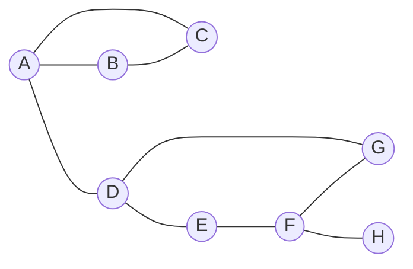

## Objetivos de Aprendizagem

- Definir pontos de articulação e pontes pelo efeito que a remoção tem no número de componentes.
- Calcular a conectividade de vértices $\kappa(G)$ e a de arestas $\lambda(G)$ e enunciar a desigualdade de Whitney $\kappa(G)\le\lambda(G)\le\delta(G)$ com sua hipótese.
- Executar à mão o algoritmo de low-link por DFS e ler dele todos os pontos de articulação e pontes.
- Aplicar a regra especial da raiz da DFS e explicar por que a regra geral falha ali.
- Dizer o que arestas paralelas mudam e por que um atalho comum em código de busca de pontes quebra com elas.

## Contexto e Motivação

`graphs-terminology-and-representations` chamou um grafo de conexo quando todo par de vértices é ligado por um caminho. Essa resposta esconde a fragilidade: uma rede pendurada num único roteador é conexa e está a uma falha de se partir.

A lição `trees` mostrou que um grafo conexo é árvore exatamente quando remover qualquer aresta o desconecta: toda aresta de uma árvore é ponte, e as árvores são os grafos conexos mais frágeis. `hamiltonian-paths-and-why-they-are-hard` perguntou se um grafo tem um ciclo passando por todos os vértices; um grafo com ponto de articulação nunca tem, o que dá um teste necessário e rápido para essa pergunta difícil. E a busca em profundidade, apresentada em `graph-traversal-dfs`, encontra todos os pontos de articulação e pontes numa passada $O(V+E)$, em vez de apagar cada vértice e cada aresta por vez.

## Teoria Central

Os grafos são não dirigidos e simples, salvo menção em contrário.

### Componentes, pontos de articulação e pontes

Uma **componente conexa** é um subgrafo conexo maximal; as componentes são as classes da relação de equivalência "ligados por um caminho", e `connected-components-via-bfs` as calcula. Um **ponto de articulação** (cut vertex) é um vértice cuja remoção, junto com as arestas incidentes, aumenta o número de componentes. Uma **ponte** é uma aresta cuja remoção aumenta o número de componentes. "Aumenta o número de componentes" mantém as definições úteis num grafo desconexo: com as arestas $\{1,2\},\{2,3\},\{4,5\}$ e um vértice isolado $6$, o vértice $2$ é ponto de articulação e as três arestas são pontes, embora o grafo já comece com três componentes.

Dois fatos sustentam quase todo o raciocínio:

- **Uma aresta é ponte se e somente se não está em nenhum ciclo.** Se $uv$ está num ciclo, o resto do ciclo ainda liga $u$ e $v$. Se não está, qualquer outro caminho de $u$ a $v$ somado a $uv$ formaria um.
- **Uma extremidade de ponte é ponto de articulação, a menos que tenha grau 1.** Removê-la remove a ponte e separa seus outros vizinhos do outro lado.

A recíproca do segundo fato é falsa: dois triângulos com um vértice em comum têm um ponto de articulação e nenhuma ponte.

### Conectividade de vértices e de arestas

Seguindo o *Graph Theory* de Diestel: $G$ é **$k$-conexo** se tem mais de $k$ vértices e continua conexo após a remoção de qualquer conjunto com menos de $k$ vértices, e a **conectividade** $\kappa(G)$ é o maior $k$ assim. $G$ é **$\ell$-aresta-conexo** se tem pelo menos dois vértices e continua conexo após a remoção de qualquer conjunto com menos de $\ell$ arestas, e a **conectividade de arestas** $\lambda(G)$ é o maior $\ell$ assim. Então um grafo desconexo tem $\kappa=\lambda=0$, um grafo conexo com ponto de articulação tem $\kappa=1$, um com ponte tem $\lambda=1$, e $\kappa(K_n)=n-1$ porque quem limita o valor é o número de vértices, não um conjunto separador.

**Desigualdade de Whitney.** Para todo grafo $G$ com pelo menos dois vértices,

$$\kappa(G)\le\lambda(G)\le\delta(G),$$

em que $\delta(G)$ é o grau mínimo. A desigualdade da direita é imediata: apagar as $\delta(G)$ arestas de um vértice de grau mínimo o isola. Para a da esquerda, tome um corte mínimo de arestas $F$ e apague uma extremidade bem escolhida de cada aresta de $F$; isso destrói $F$ com no máximo $\lambda(G)$ vértices, e o único caso em que nenhuma escolha deixa vértices dos dois lados é o grafo completo, onde $\kappa=\lambda$. É a Proposição 1.4.2 de Diestel, com o argumento completo; Diestel a enuncia sem nome, e "desigualdade de Whitney" é o nome pelo qual costuma ser chamada. As duas desigualdades podem ser estritas ao mesmo tempo (Exemplo 4).

### Busca em profundidade, arestas de retorno e valores low

Rode a DFS a partir de uma raiz $r$, numerando os vértices na ordem de descoberta, $d(v)=1,2,3,\dots$ (diferente do relógio único de descoberta e término de `graph-traversal-dfs`; os testes abaixo dependem só da ordem de descoberta). Num grafo **não dirigido**, toda aresta é aresta de árvore ou **aresta de retorno** para um ancestral. Não há arestas cruzadas entre subárvores: se $u$ é descoberto primeiro e $uw$ é aresta, $w$ é descoberto antes de $u$ terminar, então $w$ cai na subárvore de $u$. Defina

$$\text{low}(v)=\min\big(\{d(v)\}\cup\{d(w): xw\text{ é aresta de retorno, }x\text{ na subárvore de }v\}\big),$$

o vértice mais antigo que a subárvore de $v$ alcança com uma aresta de retorno. O cálculo é de baixo para cima: o mínimo entre $d(v)$, os valores low dos filhos de $v$ e $d(w)$ para cada aresta de retorno $vw$ (a aresta de árvore até o pai de $v$ não é de retorno). Então:

1. **Um $u$ que não é raiz é ponto de articulação se e somente se algum filho $w$ tem $\text{low}(w)\ge d(u)$.** Nesse caso nenhuma aresta sai da subárvore de $w$ para um ancestral próprio de $u$, e remover $u$ separa essa subárvore do lado da raiz, que não é vazio. Se cada subárvore alcança algo estritamente acima de $u$, todas continuam presas.
2. **A raiz é ponto de articulação se e somente se tem pelo menos dois filhos.** Sem arestas cruzadas, subárvores de filhos diferentes só se encontram na raiz; com um filho só, sobra uma subárvore conexa.
3. **Uma aresta de árvore $uw$, com $w$ filho, é ponte se e somente se $\text{low}(w)>d(u)$.** Arestas de retorno nunca são pontes, pois cada uma fecha um ciclo.

A regra 2 não é opcional: todo filho $w$ da raiz tem $\text{low}(w)\ge d(r)$ automaticamente, já que $d(r)$ é o menor tempo de descoberta.

```python
def cut_vertices_and_bridges(adj, root):
    d, low, parent = {}, {}, {root: None}
    cut, bridges, time = set(), [], [0]

    def dfs(u):
        time[0] += 1
        d[u] = low[u] = time[0]
        children = 0
        for w in adj[u]:
            if w not in d:                    # aresta de árvore u-w
                parent[w] = u
                children += 1
                dfs(w)
                low[u] = min(low[u], low[w])
                if parent[u] is not None and low[w] >= d[u]:
                    cut.add(u)                # regra 1
                if low[w] > d[u]:
                    bridges.append((u, w))    # regra 3
            elif w != parent[u]:              # aresta de retorno (só grafo simples)
                low[u] = min(low[u], d[w])
        if parent[u] is None and children >= 2:
            cut.add(u)                        # regra 2

    dfs(root)
    return cut, bridges
```

O custo é $O(V+E)$. Num grafo desconexo, comece uma nova raiz em cada vértice ainda não descoberto. A documentação de `articulation_points` do networkx cita Hopcroft e Tarjan (1973) para esse método, enquanto o `bridges` dele usa decomposição em cadeias, o que o torna uma conferência independente.

### Arestas paralelas e laços

Um laço nunca afeta a conectividade. Arestas paralelas importam para pontes e para $\lambda$, não para pontos de articulação nem para $\kappa$: duas cópias de $uv$ formam um ciclo de comprimento 2, então nenhuma é ponte, e apagar um vértice apaga todas as cópias das suas arestas de qualquer jeito.

O teste `elif w != parent[u]` é um atalho que só vale para grafo simples. Ele pula *toda* aresta de volta ao vértice pai, inclusive uma segunda cópia da aresta de árvore, que é uma aresta de retorno legítima. Num multigrafo, pule só a aresta usada para chegar, identificada por um id. O `Bridge.java` de Princeton usa o atalho e avisa no cabeçalho que arestas paralelas "would be (incorrectly) identified as bridges".

### Conectividade e ciclos hamiltonianos

Se $G$ tem pelo menos três vértices e um ciclo hamiltoniano, remover um vértice deixa um caminho por todos os outros, então $G$ é 2-conexo. Logo, **um grafo com ponto de articulação não tem ciclo hamiltoniano**. A recíproca falha: o grafo de Petersen tem $\kappa=3$ e, por busca exaustiva nas $9!=362.880$ ordens dos demais vértices com o início fixado, nenhum ciclo hamiltoniano.

## Exemplos Resolvidos

O grafo de trabalho tem os vértices $A$ a $H$ e nove arestas: um triângulo $A$-$B$-$C$, a aresta $A$-$D$, um 4-ciclo $D$-$E$-$F$-$G$-$D$ e uma aresta pendente $F$-$H$.



A força bruta dá a resposta de referência: remover $A$, $D$ ou $F$ deixa 2 componentes e qualquer outro vértice deixa 1; remover $A$-$D$ ou $F$-$H$ deixa 2 componentes e qualquer outra aresta deixa 1. Como $H$ tem grau 1, $\kappa=\lambda=\delta=1$.

### Exemplo 1: o low-link a partir de A

Os vizinhos são visitados em ordem alfabética:

```text
descobre A d=1, descobre B d=2, descobre C d=3
  C: aresta de retorno C-A, low[C] = 1; termina C
  B: filho C tem low 1, low[B] = 1; termina B
  A: filho B tem low 1 >= d[A] = 1, mas A é a raiz (a regra 2 decide)
descobre D d=4, descobre E d=5, descobre F d=6, descobre G d=7
  G: aresta de retorno G-D, low[G] = 4; termina G
  F: filho G tem low 4 < d[F] = 6
descobre H d=8
  H: sem arestas de retorno, low[H] = 8; termina H
  F: filho H tem low 8 >= 6, então F é ponto de articulação; 8 > 6, então F-H é ponte
  F: low[F] = min(6, 4, 8) = 4; termina F
  E: filho F tem low 4 < 5; low[E] = 4
  D: filho E tem low 4 >= d[D] = 4, então D é ponto de articulação; 4 > 4 falha, D-E não é ponte
  A: filho D tem low 4 > d[A] = 1, então A-D é ponte
A tem 2 filhos (B e D), então A é ponto de articulação
```

| vértice | A | B | C | D | E | F | G | H |
|---|---|---|---|---|---|---|---|---|
| $d$ | 1 | 2 | 3 | 4 | 5 | 6 | 7 | 8 |
| low | 1 | 1 | 1 | 4 | 4 | 4 | 4 | 8 |

Pontos de articulação $\{A,D,F\}$, pontes $A$-$D$ e $F$-$H$: o mesmo que a força bruta, `networkx.articulation_points` e `networkx.bridges` (networkx 3.4.2). A função acima, iniciada em cada um dos oito vértices, devolveu os mesmos conjuntos todas as vezes. Repare em $D$: o 4-ciclo deixa a subárvore de $E$ voltar até $D$ ($\text{low}(E)=4=d(D)$), mas não acima dele, então $D$ é ponto de articulação enquanto $D$-$E$ não é ponte.

### Exemplo 2: o caso da raiz

Comece agora em $B$. $B$ recebe $d=1$, $A$ recebe $d=2$, $C$ recebe $d=3$ e sua aresta de retorno para $B$ dá $\text{low}(C)=1$; de $D$ em diante os números são os de antes. $B$ tem **um** filho, $A$, pois $C$ é alcançado por $A$, então pela regra 2 $B$ não é ponto de articulação. Está certo: remover $B$ deixa $A$-$C$ preso ao resto.

Aplicar a regra 1 na raiz testaria $\text{low}(A)=1\ge d(B)=1$, que vale, e devolveria $\{A,B,D,F\}$. Com raiz $A$ o mesmo erro dá a resposta certa, porque $A$ é mesmo ponto de articulação, então testar a partir de uma raiz só pode escondê-lo.

### Exemplo 3: uma aresta paralela

Acrescente uma segunda aresta $A$-$D$. Apagar uma cópia deixa o grafo conexo, então a única ponte é $F$-$H$; os pontos de articulação continuam $A$, $D$, $F$. Rodando a partir de $A$, com as arestas incidentes ordenadas pela outra extremidade:

| teste de aresta de retorno | low$(D)$ | pontes devolvidas |
|---|---|---|
| pula qualquer aresta para o vértice pai | 4 | $F$-$H$, $A$-$D$ (errado) |
| pula só a aresta de chegada, pelo id | 1 | $F$-$H$ |

Com o teste por id, $D$ vê a segunda cópia como aresta de retorno para $A$, então $\text{low}(D)=1$ e $1>1$ falha. `networkx.bridges` no `MultiGraph` também devolve só $F$-$H$; a documentação diz que ele converte para grafo simples e depois descarta as pontes que são arestas múltiplas.

### Exemplo 4: Whitney com as duas folgas estritas

Tome duas cópias de $K_4$, em $a_1,\dots,a_4$ e $b_1,\dots,b_4$, mais as arestas $a_1b_1$ e $a_1b_2$ (8 vértices, 14 arestas).

- $\delta=3$: $a_2,a_3,a_4,b_3,b_4$ têm grau 3, enquanto $a_1$ tem grau 5 e $b_1,b_2$ têm grau 4.
- $\lambda=2$: remover $a_1b_1$ e $a_1b_2$ desconecta o grafo; nenhuma aresta sozinha desconecta, pois cada uma está num ciclo.
- $\kappa=1$: remover $a_1$ separa $\{a_2,a_3,a_4\}$ do lado $b$.

Então $1<2<3$, como confirmam `node_connectivity` e `edge_connectivity` do networkx. Em contraste, o grafo de Petersen tem $\kappa=\lambda=\delta=3$.

## Equívocos Comuns e Armadilhas

- **"Ponto de articulação é o vértice cuja remoção desconecta o grafo."** Um grafo desconexo já está desconectado. Use "aumenta o número de componentes".
- **"A raiz da DFS é ponto de articulação se algum filho tem low maior ou igual a $d(\text{raiz})$."** Isso sempre vale na raiz (Exemplo 2). A raiz precisa de dois ou mais filhos.
- **"Pular o vértice pai é o mesmo que pular a aresta pai."** Só em grafo simples; com aresta paralela aparece uma ponte falsa (Exemplo 3).
- **"Grau mínimo $k$ significa $k$-conexo."** O Exemplo 4 tem $\delta=3$ e $\kappa=1$. A desigualdade de Whitney dá uma cota superior para a conectividade em função de $\delta$, não uma cota inferior.
- **"As funções de biblioteca tratam multigrafos."** Confira cada uma. No networkx 3.4.2, `edge_connectivity` no multigrafo do Exemplo 3 sem o vértice $H$ devolveu 1, enquanto a busca exaustiva sobre conjuntos de arestas dá 2 (o par de cópias de $A$-$D$ é um dos dez cortes de 2 arestas).
- **"2-conexo implica hamiltoniano."** É necessário, não suficiente: o grafo de Petersen é 3-conexo e não é hamiltoniano.

## Resumo

Pontos de articulação e pontes são os vértices e arestas cuja remoção aumenta o número de componentes; uma ponte é uma aresta fora de qualquer ciclo. A desigualdade de Whitney $\kappa\le\lambda\le\delta$ vale para todo grafo com pelo menos dois vértices, com as duas folgas podendo ser estritas. Uma única DFS encontra todos os pontos de articulação e pontes em $O(V+E)$: um $u$ que não é raiz é ponto de articulação quando algum filho tem $\text{low}\ge d(u)$, a raiz quando tem dois ou mais filhos, e uma aresta de árvore $uw$ é ponte quando $\text{low}(w)>d(u)$. Arestas paralelas nunca formam pontes, mas quebram o atalho de "pular o vértice pai". Um ponto de articulação impede ciclo hamiltoniano. `graph-coloring-and-the-chromatic-number` usa componentes e pontos de articulação para quebrar a coloração em partes.

## Documentation Links

- [Lehman, Leighton and Meyer, Mathematics for Computer Science](https://people.csail.mit.edu/meyer/mcs.pdf): Seção 11.9, componentes conexas, grafos k-aresta-conexos e arestas de corte.
- [Diestel, Graph Theory, Chapter 1 (free preview)](https://www.math.uni-hamburg.de/home/diestel/books/graph.theory/preview/Ch1.pdf): Seção 1.4, definições de conectividade e a Proposição 1.4.2 com a prova.
- [Sedgewick and Wayne, Algorithms, 4.1 Undirected Graphs](https://algs4.cs.princeton.edu/41graph/): busca em profundidade e seu uso para pontes e biconectividade.
- [Sedgewick and Wayne, Biconnected.java](https://algs4.cs.princeton.edu/41graph/Biconnected.java.html): pontos de articulação por valores low, com a regra separada da raiz.
- [Sedgewick and Wayne, Bridge.java](https://algs4.cs.princeton.edu/41graph/Bridge.java.html): pontes por valores low, com o aviso sobre arestas paralelas.
- [NetworkX, articulation_points](https://networkx.org/documentation/stable/reference/algorithms/generated/networkx.algorithms.components.articulation_points.html): a função usada na conferência, com a referência a Hopcroft e Tarjan.
- [NetworkX, bridges](https://networkx.org/documentation/stable/reference/algorithms/generated/networkx.algorithms.bridges.bridges.html): pontes por decomposição em cadeias e o tratamento de multigrafos.
