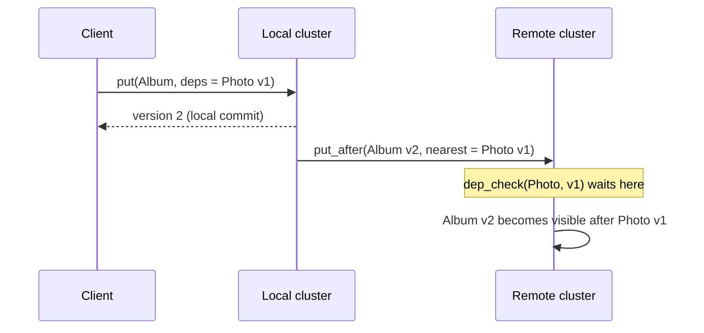

## Learning Objectives

- Define the causality order of a history from program order and writes-into order, and state the causal memory condition exactly.
- Decide by exhaustive check whether a small history is causal, PRAM, or sequentially consistent.
- Trace how vector timestamps and explicit dependency metadata hold back a remote write until its causes are visible.
- State the bound proved by Mahajan, Alvisi and Dahlin with its assumptions, and explain why it names real-time causal consistency rather than causal consistency.

## Context & Motivation

`lamport-logical-clocks-and-the-happens-before-relation` ordered events by what could have influenced what, and `vector-clocks-and-detecting-concurrent-writes` made that order computable. `sequential-consistency-and-why-it-is-weaker` and `eventual-consistency-and-its-real-guarantees` left a wide gap: one demands a single order of everything, the other says nothing about order before convergence. Causal consistency orders only what is related. A reader who sees a reference to a photo can also see the photo, while two unrelated writes need no agreed order, so a replica can keep accepting writes when cut off from the others.

## Core Theory

### Potential causality in a store

Ahamad, Neiger, Burns, Kohli and Hutto move Lamport's relation from messages to shared memory: a read plays the receive, and the write it returned plays the send. A **writes-into** order maps each read to one write of that value to that location, and a read with no such write must return the initial value ⊥. A **causality order** ⇝ is the transitive closure of program order and writes-into; if the result has a cycle, it is not a causality order. Operations unrelated by ⇝ are concurrent. Lloyd, Freedman, Kaminsky and Andersen restate this for key-value stores in the COPS paper, as three rules (execution thread, gets from, transitivity), and call the relation potential causality.

### The condition

A serialization is a sequence in which every read returns the most recent preceding write. Let A_i+w be all operations of process p_i plus every write in the history.

```text
SC:    one serialization of all operations respects every
       program order.
CM:    for each p_i, a serialization S_i of A_i+w respects ⇝.
PRAM:  for each p_i, a serialization S_i of A_i+w respects
       every program order.
```

Each process serializes its own view, so processes may disagree on concurrent writes. Ahamad et al. place causal memory between sequential consistency and PRAM, and they prove a useful bridge: every history of a data-race-free program on causal memory is sequentially consistent.

### Concurrent writes do not converge by themselves

Causal consistency leaves concurrent writes unordered, so one replica may return `put(x,1)` forever while another returns `put(x,2)`. Lloyd et al. add **convergent conflict handling**: an associative, commutative handler h treats conflicting puts identically everywhere. They name the combination **causal+**. Default COPS uses last-writer-wins, with Lamport timestamps as version numbers.

### Tracking dependencies

Ahamad et al. use vector timestamps over full replicas. Process p_i increments t[i] on each write and broadcasts the write with its timestamp s. A write from p_j is applied only when `s[j] = t[j] + 1` and `s[k] ≤ t[k]` for all k ≠ j. Reads and writes finish locally, and the implementation requires reliable processes and channels.

COPS targets a datacenter cluster where a single serialized log would be the bottleneck, so it carries explicit metadata instead. A client library records what the client read and wrote. Each put lists dependencies, and a remote node commits a version only after `dep_check` confirms its **nearest** dependencies locally. Waiting happens in background replication, so client reads never block.



### What the impossibility result proves

Causal consistency is often called the strongest model that stays available. Mahajan, Alvisi and Dahlin prove something narrower. Their model is asynchronous with an unreliable network and omission failures, and the theorem holds even if all nodes are correct. Semantics C_s is stronger than C_w when the executions C_s accepts are a subset of those C_w accepts. A system is **always available** if all reads and writes complete regardless of which messages are lost, and **one-way convergent** if updates can flow from s to d so that s has semi-pairwise converged with d, meaning a return flow from d leaves both reading the same values.

Theorem 3.1 reads: "No consistency semantics stronger than real time causal consistency can be implemented using a one-way convergent and always available distributed storage implementation." Theorem 3.5 gives the other half: RTC "can be enforced by an always available and one-way convergent implementation." RTC adds one check to causal consistency, so the tight bound is not causal itself:

```text
CC3: u.endTime < v.startTime  =>  v does not precede u
```

Four limits follow from the paper:

- Without a convergence requirement the bound vanishes. A system that never communicates and returns each reader's own last write is always available and technically stronger than causal.
- Under the weaker two-way convergence, RTC is not the strongest, although the paper has found only artificial strengthenings there.
- "Stronger" means subset, so semantics incomparable with RTC are not excluded. The paper leaves natural ones as an open question.
- With Byzantine nodes, Theorem 4.1 rules out fork-causal and anything stronger under the same liveness properties.

Reads in this model return the whole set of latest concurrent writes, and conflict resolution sits above it. That detail matters for real systems: Lloyd et al. state that default COPS is causal+ but not RTC, while a return-them-all handler would provide both. Their abstract calls causal+ "the strongest achieved under these constraints", but the same paper credits the strongest-achievable proof to Mahajan et al. and calls RTC stronger than causal+, so that phrase is no impossibility bound.

## Worked Examples

Each result below enumerates every candidate serialization, arrival order, or graph.

### Example 1: checking Ahamad's two figures by exhaustion

```text
Figure 1   p1: w(x)0  r(x)1
           p2: w(x)1  r(x)0
  SC: no serialization of all 4 operations works.
  Causal: yes.
    S1 = w1(x)0, w2(x)1, r1(x)1
    S2 = w2(x)1, w1(x)0, r2(x)0

Figure 2   p1: w(x)0  w(x)1
           p2: r(x)1  w(y)2
           p3: r(y)2  r(x)0
  PRAM: yes. S3 = w1(x)0, w2(y)2, r3(y)2, r3(x)0, w1(x)1
  Causal: no. The only writes-into order forces
    w1(x)0 ⇝ w1(x)1 ⇝ w2(y)2.
  Exactly 1 ordering of p3's 5 operations respects ⇝:
    w1(x)0, w1(x)1, w2(y)2, r3(y)2, r3(x)0
  It is illegal, because r3(x) would have to return 1.
```

### Example 2: the apply rule blocks that same anomaly

Figure 2's writes carry timestamps x0 = [1,0,0], x1 = [2,0,0], y2 = [2,1,0]. Replica p3 receives them in the worst order and reads y and x after each arrival.

```text
recv y2  s=[2,1,0], t=[0,0,0]: p1's slot 2 > 0, so buffer it
         read y=⊥, x=⊥
recv x0  apply, t=[1,0,0]
         read y=⊥, x=0
recv x1  apply, t=[2,0,0], then y2 applies, t=[2,1,0]
         read y=2, x=1

All 6 arrival orders, y=2 observed while x≠1:
  with the apply rule:      0 of 6
  applying on arrival:      5 of 6
```

The reads returning ⊥ are legal. Causal memory constrains order, not freshness.

### Example 3: nearest dependencies in COPS Figure 6

```text
Full dependencies of z4: t2, u1, v6, w1, x3, y1   (6)
Remove any dependency already implied by another:
  t2, u1 are implied by v6.   x3, w1 are implied by y1.
Nearest dependencies of z4:  v6, y1                (2)
```

Two `dep_check` calls replace six, and the result matches the paper's table.

### Example 4: causal but not RTC

This is the execution the paper uses to answer why causal is not the strongest.

```text
p1: w1(X=3)  ends before w2 starts
p2: w2(X=5), then r(X) returns {w1}, value 3

Of the 19 strict partial orders on {w1, w2, r}:
  CC1 and CC2 pass for exactly 1: w2 ≺ w1, w1 ≺ r, w2 ≺ r
  CC3 rejects it: w1 ended before w2 began, yet w2 ≺ w1.

Same execution, other read results:
  r returns {w1, w2}: 1 causal graph, 1 RTC graph
  r returns {w2}:     4 causal graphs, 2 RTC graphs
```

The paper notes that an implementation could produce this execution by letting the lowest node ID dominate concurrent updates. Returning both writes stays legal under RTC, which agrees with the return-them-all remark above.

## Common Misconceptions & Pitfalls

- **"Causal consistency is the strongest model an available system can offer."** The tight bound is RTC, in a stated model, with one-way convergence and "stronger" meaning subset. Example 4 is causal and outside RTC.
- **"Causal consistency guarantees replicas converge."** It does not. Convergence comes from a separate condition, and that is why causal+ and the convergence property in the theorem exist.
- **"A causally consistent read returns the latest causal write."** Example 2 returns ⊥ after y has been written. Ahamad et al. also note hidden writes: a value overwritten before anyone reads it is never observed.
- **"Tracking causality requires vector clocks."** COPS uses explicit dependencies with Lamport version numbers, because its problem is dependencies across servers of a partitioned cluster.

## Summary

Causal consistency requires each process to see some serialization of its own operations and all writes that respects the transitive closure of program order and writes-into. It sits between sequential consistency and PRAM, permits disagreement on concurrent writes, and needs a convergent handler to stop replicas diverging, which gives causal+. Vector timestamps or explicit dependencies enforce it without blocking client operations. The theorem usually cited for it names a different model: in an asynchronous system with omission failures, nothing stronger than real-time causal consistency is achievable with always-available, one-way convergent storage. `transactional-causal-consistency` extends these guarantees from single operations to groups of keys.

## Documentation Links

- [Ahamad, Neiger, Burns, Kohli and Hutto: Causal Memory (technical report GIT-CC-93/55, revised 1994)](https://citeseerx.ist.psu.edu/document?doi=c6a76a29e39f6f0954cea15b7d5fd78249ab5da5&repid=rep1&type=pdf): the writes-into and causality definitions, condition CM, Figures 1 and 2, the vector timestamp apply rule, and the data-race-free theorem. Published in Distributed Computing in 1995.
- [Lloyd, Freedman, Kaminsky and Andersen: Don't Settle for Eventual (SOSP 2011)](https://www.cs.cmu.edu/~dga/papers/cops-sosp2011.pdf): potential causality rules, causal+, nearest dependencies, `dep_check`, and the comparison with RTC.
- [Mahajan, Alvisi and Dahlin: Consistency, Availability, and Convergence (UTCS TR-11-22)](https://www.cs.utexas.edu/~dahlin/papers/cac-tr.pdf): the formal definitions of causal and real-time causal consistency, always availability, one-way convergence, and Theorems 3.1, 3.5 and 4.1.
