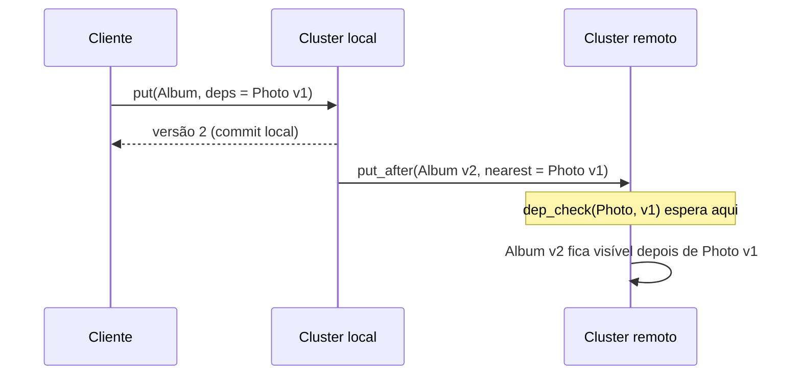

## Objetivos de Aprendizagem

- Definir a ordem de causalidade de um histórico a partir da ordem de programa e da ordem writes-into, e enunciar com exatidão a condição de causal memory.
- Decidir por verificação exaustiva se um histórico pequeno é causal, PRAM ou sequencialmente consistente.
- Acompanhar como vector timestamps e metadados explícitos de dependência seguram uma escrita remota até que as causas dela estejam visíveis.
- Enunciar, com as hipóteses, o limite provado por Mahajan, Alvisi e Dahlin, e explicar por que ele cita a consistência causal em tempo real, e não a consistência causal.

## Contexto e Motivação

`lamport-logical-clocks-and-the-happens-before-relation` ordenou eventos pelo que poderia ter influenciado o quê, e `vector-clocks-and-detecting-concurrent-writes` tornou essa ordem computável. `sequential-consistency-and-why-it-is-weaker` e `eventual-consistency-and-its-real-guarantees` deixaram um vão enorme: a primeira exige uma única ordem para tudo, a segunda não diz nada sobre ordem antes da convergência. A consistência causal ordena só o que tem relação. Quem vê a referência a uma foto também consegue ver a foto, enquanto duas escritas sem relação dispensam uma ordem combinada, e por isso uma réplica pode continuar aceitando escritas mesmo isolada das outras.

## Teoria Central

### Causalidade potencial em um store

Ahamad, Neiger, Burns, Kohli e Hutto levam a relação de Lamport das mensagens para a memória compartilhada: uma leitura faz o papel do recebimento, e a escrita que ela retornou faz o papel do envio. Uma ordem **writes-into** associa cada leitura a uma escrita daquele valor naquela posição, e uma leitura sem escrita correspondente precisa retornar o valor inicial ⊥. Uma **ordem de causalidade** ⇝ é o fecho transitivo da ordem de programa com a writes-into; se o resultado tiver ciclo, não é ordem de causalidade. Operações não relacionadas por ⇝ são concorrentes. Lloyd, Freedman, Kaminsky e Andersen reescrevem isso para stores chave-valor no paper do COPS, em três regras (thread de execução, gets from, transitividade), e chamam a relação de causalidade potencial.

### A condição

Uma serialização é uma sequência em que toda leitura retorna a escrita precedente mais recente. Seja A_i+w o conjunto das operações do processo p_i mais todas as escritas do histórico.

```text
SC:    uma serialização de todas as operações respeita todas
       as ordens de programa.
CM:    para cada p_i, uma serialização S_i de A_i+w respeita ⇝.
PRAM:  para cada p_i, uma serialização S_i de A_i+w respeita
       todas as ordens de programa.
```

Cada processo serializa a própria visão, então processos podem discordar sobre escritas concorrentes. Ahamad et al. situam a causal memory entre a consistência sequencial e a PRAM, e provam uma ponte útil: todo histórico de um programa data-race-free sobre causal memory é sequencialmente consistente.

### Escritas concorrentes não convergem sozinhas

A consistência causal deixa escritas concorrentes sem ordem, então uma réplica pode retornar `put(x,1)` para sempre enquanto outra retorna `put(x,2)`. Lloyd et al. acrescentam o **tratamento convergente de conflitos**: um handler h associativo e comutativo trata puts conflitantes da mesma forma em todo lugar. A combinação recebe o nome de **causal+**. O COPS padrão usa last-writer-wins, com timestamps de Lamport como números de versão.

### Rastreando dependências

Ahamad et al. usam vector timestamps sobre réplicas completas. O processo p_i incrementa t[i] a cada escrita e faz broadcast dela com o timestamp s. Uma escrita vinda de p_j só é aplicada quando `s[j] = t[j] + 1` e `s[k] ≤ t[k]` para todo k ≠ j. Leituras e escritas terminam localmente, e a implementação exige processos e canais confiáveis.

O COPS mira um cluster de datacenter em que um único log serializado seria o gargalo, então carrega metadados explícitos. Uma biblioteca cliente registra o que o cliente leu e escreveu. Cada put lista dependências, e um nó remoto só faz commit de uma versão depois que `dep_check` confirma localmente as dependências **nearest**. A espera acontece na replicação em background, então as leituras dos clientes nunca bloqueiam.



### O que o resultado de impossibilidade prova

A consistência causal costuma ser chamada de modelo mais forte que continua disponível. Mahajan, Alvisi e Dahlin provam algo mais estreito. O modelo deles é assíncrono, com rede não confiável e falhas de omissão, e o teorema vale mesmo com todos os nós corretos. A semântica C_s é mais forte que C_w quando as execuções aceitas por C_s são um subconjunto das aceitas por C_w. Um sistema é **always available** se todas as leituras e escritas terminam, não importa quais mensagens se percam, e **one-way convergent** se atualizações podem fluir de s para d de modo que s fique semi-pairwise converged com d, ou seja, um fluxo de volta de d faz os dois lerem os mesmos valores.

O Teorema 3.1 diz: "No consistency semantics stronger than real time causal consistency can be implemented using a one-way convergent and always available distributed storage implementation." O Teorema 3.5 dá a outra metade: a RTC "can be enforced by an always available and one-way convergent implementation." A RTC acrescenta uma verificação à consistência causal, então o limite justo não é a própria causal:

```text
CC3: u.endTime < v.startTime  =>  v não precede u
```

Quatro limites saem do paper:

- Sem exigir convergência, o limite desaparece. Um sistema que nunca se comunica e devolve a última escrita do próprio leitor é sempre disponível e, tecnicamente, mais forte que o causal.
- Sob a convergência two-way, mais fraca, a RTC não é a mais forte, embora o paper só tenha encontrado fortalecimentos artificiais nesse caso.
- "Mais forte" significa subconjunto, então semânticas incomparáveis com a RTC não estão excluídas. O paper deixa as naturais como questão em aberto.
- Com nós bizantinos, o Teorema 4.1 descarta fork-causal e tudo que for mais forte sob as mesmas propriedades de liveness.

Nesse modelo, uma leitura retorna o conjunto inteiro das últimas escritas concorrentes, e a resolução de conflitos fica numa camada acima. Esse detalhe pesa em sistemas reais: Lloyd et al. afirmam que o COPS padrão é causal+ mas não RTC, enquanto um handler que devolvesse todas as versões daria as duas coisas. O abstract deles chama o causal+ de "the strongest achieved under these constraints", só que o mesmo paper atribui a prova do mais forte alcançável a Mahajan et al. e diz que a RTC é mais forte que o causal+, então essa frase não é um limite de impossibilidade.

## Exemplos Resolvidos

Cada resultado abaixo enumera todas as serializações, ordens de chegada ou grafos candidatos.

### Exemplo 1: conferindo as duas figuras de Ahamad por exaustão

```text
Figura 1   p1: w(x)0  r(x)1
           p2: w(x)1  r(x)0
  SC: nenhuma serialização das 4 operações funciona.
  Causal: sim.
    S1 = w1(x)0, w2(x)1, r1(x)1
    S2 = w2(x)1, w1(x)0, r2(x)0

Figura 2   p1: w(x)0  w(x)1
           p2: r(x)1  w(y)2
           p3: r(y)2  r(x)0
  PRAM: sim. S3 = w1(x)0, w2(y)2, r3(y)2, r3(x)0, w1(x)1
  Causal: não. A única ordem writes-into força
    w1(x)0 ⇝ w1(x)1 ⇝ w2(y)2.
  Exatamente 1 ordenação das 5 operações de p3 respeita ⇝:
    w1(x)0, w1(x)1, w2(y)2, r3(y)2, r3(x)0
  Ela é ilegal, porque r3(x) teria de retornar 1.
```

### Exemplo 2: a regra de aplicação bloqueia essa mesma anomalia

As escritas da Figura 2 carregam os timestamps x0 = [1,0,0], x1 = [2,0,0] e y2 = [2,1,0]. A réplica p3 as recebe na pior ordem e lê y e x depois de cada chegada.

```text
recv y2  s=[2,1,0], t=[0,0,0]: slot de p1 2 > 0, fica no buffer
         leitura y=⊥, x=⊥
recv x0  aplica, t=[1,0,0]
         leitura y=⊥, x=0
recv x1  aplica, t=[2,0,0], depois y2 aplica, t=[2,1,0]
         leitura y=2, x=1

As 6 ordens de chegada, y=2 observado com x≠1:
  com a regra de aplicação:  0 de 6
  aplicando na chegada:      5 de 6
```

As leituras que retornam ⊥ são legais. A causal memory restringe ordem, não frescor.

### Exemplo 3: dependências nearest na Figura 6 do COPS

```text
Dependências completas de z4: t2, u1, v6, w1, x3, y1   (6)
Remova toda dependência já implicada por outra:
  t2, u1 são implicadas por v6.   x3, w1 são implicadas por y1.
Dependências nearest de z4:   v6, y1                   (2)
```

Duas chamadas de `dep_check` substituem seis, e o resultado bate com a tabela do paper.

### Exemplo 4: causal mas não RTC

Esta é a execução que o paper usa para responder por que o causal não é o mais forte.

```text
p1: w1(X=3)  termina antes de w2 começar
p2: w2(X=5), depois r(X) retorna {w1}, valor 3

Das 19 ordens parciais estritas sobre {w1, w2, r}:
  CC1 e CC2 passam para exatamente 1: w2 ≺ w1, w1 ≺ r, w2 ≺ r
  CC3 a rejeita: w1 terminou antes de w2 começar, mas w2 ≺ w1.

A mesma execução, com outros resultados de leitura:
  r retorna {w1, w2}: 1 grafo causal, 1 grafo RTC
  r retorna {w2}:     4 grafos causais, 2 grafos RTC
```

O paper observa que uma implementação poderia produzir essa execução deixando o menor ID de nó dominar atualizações concorrentes. Devolver as duas escritas continua legal sob RTC, o que concorda com a observação sobre o handler que devolve todas as versões.

## Equívocos Comuns e Armadilhas

- **"A consistência causal é o modelo mais forte que um sistema disponível pode oferecer."** O limite justo é a RTC, num modelo declarado, com convergência one-way e "mais forte" significando subconjunto. O Exemplo 4 é causal e está fora da RTC.
- **"A consistência causal garante que as réplicas convergem."** Não garante. A convergência vem de uma condição separada, e é por isso que existem o causal+ e a propriedade de convergência do teorema.
- **"Uma leitura causalmente consistente retorna a última escrita causal."** O Exemplo 2 retorna ⊥ depois que y já foi escrito. Ahamad et al. também apontam as hidden writes: um valor sobrescrito antes de alguém ler nunca é observado.
- **"Rastrear causalidade exige vector clocks."** O COPS usa dependências explícitas com números de versão de Lamport, porque o problema dele são dependências entre servidores de um cluster particionado.

## Resumo

A consistência causal exige que cada processo veja alguma serialização das próprias operações e de todas as escritas que respeite o fecho transitivo da ordem de programa com a writes-into. Ela fica entre a consistência sequencial e a PRAM, permite discordância sobre escritas concorrentes e precisa de um handler convergente para impedir que réplicas divirjam, o que dá o causal+. Vector timestamps ou dependências explícitas a garantem sem bloquear as operações dos clientes. O teorema normalmente citado para ela cita outro modelo: num sistema assíncrono com falhas de omissão, nada mais forte que a consistência causal em tempo real é alcançável com armazenamento sempre disponível e one-way convergent. `transactional-causal-consistency` estende essas garantias de operações isoladas para grupos de chaves.

## Documentation Links

- [Ahamad, Neiger, Burns, Kohli and Hutto: Causal Memory (technical report GIT-CC-93/55, revised 1994)](https://citeseerx.ist.psu.edu/document?doi=c6a76a29e39f6f0954cea15b7d5fd78249ab5da5&repid=rep1&type=pdf): as definições de writes-into e de causalidade, a condição CM, as Figuras 1 e 2, a regra de aplicação com vector timestamps e o teorema sobre programas data-race-free. Publicado na Distributed Computing em 1995.
- [Lloyd, Freedman, Kaminsky and Andersen: Don't Settle for Eventual (SOSP 2011)](https://www.cs.cmu.edu/~dga/papers/cops-sosp2011.pdf): as regras de causalidade potencial, o causal+, as dependências nearest, o `dep_check` e a comparação com a RTC.
- [Mahajan, Alvisi and Dahlin: Consistency, Availability, and Convergence (UTCS TR-11-22)](https://www.cs.utexas.edu/~dahlin/papers/cac-tr.pdf): as definições formais de consistência causal e causal em tempo real, de always available e de one-way convergent, e os Teoremas 3.1, 3.5 e 4.1.
