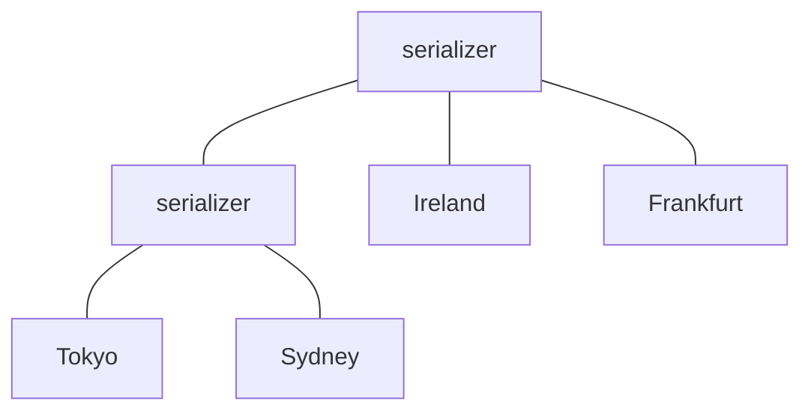

## Learning Objectives

- State the trade-off between metadata size and visibility latency, and define a false dependency.
- Explain how [Saturn](/papers/saturn-distributed-metadata-service-for-causal-consistency) separates data from metadata, and why a small label is enough when a tree of serializers carries the order.
- Compute visibility times for different causal serializations of the same updates, and say which one a datacenter should get.
- Explain why serializer placement is an optimization problem, and what mismatch measures.
- State Saturn's costs and read its reported numbers with their conditions.

## Context & Motivation

`causal-consistency` covers the guarantee, and `transactional-causal-consistency` extends it to transactions. This lesson is about the bookkeeping. Keeping a datacenter from showing an update before its causes takes metadata, and `vector-clocks-and-detecting-concurrent-writes` showed the precise answer and its cost: one entry per replica.

Earlier lessons in this group moved ordering work along a log's timeline or into the network. Saturn, a EuroSys 2017 paper, moves it into a separate service. The order is carried by the path that metadata takes, not by the size of the metadata.

## Core Theory

### The trade-off

Saturn's paper frames the dilemma with two systems. GentleRain compresses metadata into one scalar. Cure keeps a vector clock with one entry per datacenter. Compressing creates **false dependencies**: two concurrent operations get serialized as an artifact of the metadata, so one update waits for another it never depended on. Fine-grained tracking avoids most of that wait, but computing and storing the metadata lowers throughput. Partial replication makes it worse, because a site can end up delayed by updates to items it does not store.

### Separate data from metadata

Saturn is attached to an existing store and handles only **labels**. Data travels through the application's own bulk transfer. A datacenter generates a label for each update, attaches it to the payload, and hands it to Saturn, and it applies a remote update once it holds both payload and label.

A label is a constant-size tuple ⟨type, src, ts, target⟩, with a scalar timestamp. A client keeps only the greatest label it has observed, and a new update gets a timestamp above the client's label, so timestamp order respects causality. As with Lamport clocks, the converse does not hold.

This is where the paper's central idea appears. Causal order is partial, so many serial orders respect it, and timestamp order is only one of them. Saturn gives each datacenter its own serialization, chosen for that datacenter.

### Which serialization: optimal visibility time

If a label arrives too late, freshness suffers. If it arrives too early, it creates a false dependency, because everything behind it waits for a payload still in flight. The paper defines the optimal visibility time of update i at replica r:

```text
vt(i, r) = max( t(i) + delay(origin, r),  max of vt(x, r) for x in i's causal past )
```

Ideally each label reaches each datacenter exactly then.

### A tree of serializers

Serializers forward labels in the order they receive them, over FIFO channels, in a tree with datacenters as leaves. Consider causally related updates a and b, with b generated at some datacenter after a became visible there. The lowest common ancestor of that datacenter and any datacenter interested in both updates sees a's label before b's, and FIFO preserves this downward. The tree thus gives causal delivery with no dependency list in the label. The paper gives this as a footnote and omits the full proof.



Labels skip branches with no interested datacenter, which gives genuine partial replication: a site handles no metadata for items it does not replicate.

### Configuration is where the trade-off went

A single serializer cannot be near every datacenter, so Saturn uses several, and it may add artificial delays so that a label does not outrun its data. For a path between datacenters i and j, `mismatch(i,j) = |metadata path latency - bulk data latency|`. The goal is the tree, placement and delays that minimize the sum of mismatches weighted by each path's importance. The problem is NP-hard, and the number of trees explodes (2,027,025 for nine datacenters), so a heuristic prunes candidates using a constraint solver. Matching every pair is "unlikely (impossible in most cases)".

The configuration is computed offline, and a substantial workload change calls for a new tree, which can be swapped through an epoch change label. If the service has an outage, labels also travel with payloads, so datacenters fall back to timestamp order. Each datacenter must be linearizable and export a serial stream of updates.

### Numbers and their conditions

Each experiment ran on EC2 in seven regions, against an eventually consistent store built by the authors as the baseline.

```text
                         Synthetic        Facebook-based
Throughput overhead      2.2%             1.8%
vs GentleRain, more ops  4.8%             10.9%
vs Cure, more ops        24.7%            41.9%
Added visibility (avg)
  Saturn                 7.3 ms           16.1 ms
  Cure                   21.3 ms          23.7 ms
  GentleRain             97.9 ms          79.2 ms
```

The synthetic defaults are 2-byte values, a 9:1 read/write ratio and no remote reads, and at 2048 bytes all systems handle almost the same load. Saturn's worst paths lose: on Ireland to Sydney, Cure is 3.6 ms lower at the 90th percentile, and on Ireland to Tokyo in the Facebook run, Saturn adds 0.9 ms over GentleRain and 9.9 ms over Cure. Failure paths were not measured.

## Worked Examples

### Example 1: three valid orders, one right answer

The paper's scenario. Update a happens at dc1 at t=2, with bulk delay 10 to dc4. Updates b (t=4) and c (t=6) happen at dc3, with bulk delay 1 to dc4. Since b causes c and a is concurrent with both, three serializations respect causality. A script computes visibility at dc4:

```text
Payload arrival at dc4:  a=12  b=5  c=7

Order  visible a  b   c    extra wait b  c
abc    12         12  12   7             5
bac    12         5   12   0             5
bca    12         5   7    0             0
```

Order `abc` matches real time and is the worst: b and c wait for an update they do not depend on. Order `bca` makes every update visible when its payload arrives, which equals `vt` for all three. Delivering a's label early buys nothing, since a cannot be applied before t=12.

### Example 2: why the path gives causality

Update a is issued at dc1. dc2 sees it and issues b, and dc3 must see a before b. A script draws each link delay uniformly from 10 to 100 ms, over 100,000 trials:

```text
Labels sent directly between datacenters:  b's label first in 11,553 trials
Labels through one FIFO serializer:        b's label first in 0 trials
```

The direct case needs dependency metadata to reorder at dc3. Through a serializer, a's label reached it before dc2 could even learn of a, so no extra information is needed. The cost moves from bytes to latency: every label now travels through a shared path.

### Example 3: mismatch on real latencies

Using half round-trip times from the paper's Table 1, and taking them as the bulk data delay (an assumption of this example, not a result from the paper), compare two configurations for four regions:

```text
Pair               optimal   one serializer    two serializers
                             in Ireland        Ireland + Tokyo
Ireland-Frankfurt  10        10                10
Ireland-Tokyo      107       107               107
Ireland-Sydney     154       154               159
Frankfurt-Tokyo    118       117               117
Frankfurt-Sydney   161       164               169
Tokyo-Sydney       52        261               52
Sum of mismatches            213               14
```

One serializer in Ireland ruins the nearby pair in the far region, because Tokyo to Sydney detours through Europe. Two serializers fix it, at a small loss on Frankfurt to Sydney. The paper's measurement has the same shape: its multi-serializer tree over seven regions deviates 8.2 ms from optimal on average, while timestamp order alone tends toward the longest travel time, 161 ms.

## Common Misconceptions & Pitfalls

- **"Saturn eliminates the tradeoff."** The abstract says so, but the results show a much smaller trade-off that moved into configuration, and on its worst paths Cure, and in the Facebook run GentleRain, do slightly better.
- **"Saturn beats Cure by 38.3%."** That introduction figure is not reproduced by the results: the two reported means are 24.7% and 41.9%, which average 33.3%. The introduction's other figures do match such blends (2%, 11.7 ms, 76.9 ms), though the paper never says so. Quote per-experiment numbers instead.
- **"Each datacenter applies updates in the same order."** Each gets its own serialization, and all of them respect causality.
- **"A small label means causal metadata got cheap."** Precision moved from the label into the tree. A poor tree brings the delay back, as late labels or as false dependencies.
- **"Saturn needs to be up for data to flow."** A timestamp fallback keeps updates flowing, at the freshness of timestamp order.

## Summary

Causal stores trade metadata size against visibility latency: a scalar creates false dependencies, and a vector costs throughput. Saturn takes metadata out of the data path and keeps labels constant in size. A tree of FIFO serializers delivers labels in causal order, and each datacenter gets its own serialization, aimed at delivering each label when its data arrives. The hard part becomes configuration, an offline NP-hard placement problem that no tree solves for every pair, which is why the worst paths give some of the gain back. Read its results per experiment, with their workload, and treat the headline figures with care.

## Documentation Links

- [Bravo, Rodrigues and Van Roy: Saturn: a Distributed Metadata Service for Causal Consistency (EuroSys 2017)](https://webperso.info.ucl.ac.be/~pvr/p111-Bravo.pdf): labels, the serializer tree, optimal visibility time, configuration, and the evaluation against GentleRain and Cure.
