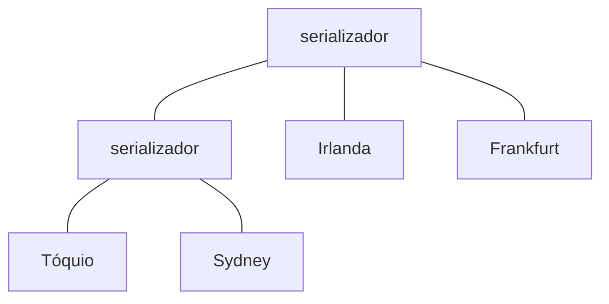

## Objetivos de Aprendizagem

- Enunciar a troca entre tamanho de metadados e latência de visibilidade, e definir falsa dependência.
- Explicar como o [Saturn](/papers/saturn-distributed-metadata-service-for-causal-consistency) separa dados de metadados, e por que um label pequeno basta quando uma árvore de serializadores carrega a ordem.
- Calcular tempos de visibilidade para diferentes serializações causais das mesmas atualizações e dizer qual delas um datacenter deveria receber.
- Explicar por que a colocação dos serializadores é um problema de otimização e o que o mismatch mede.
- Dizer quanto o Saturn custa e ler seus números com as respectivas condições.

## Contexto e Motivação

`causal-consistency` cobre a garantia, e `transactional-causal-consistency` a estende a transações. Esta lição é sobre a contabilidade. Impedir que um datacenter mostre uma atualização antes das suas causas exige metadados, e `vector-clocks-and-detecting-concurrent-writes` mostrou a resposta precisa e o seu custo: uma entrada por réplica.

Lições anteriores deste grupo moveram trabalho de ordenação ao longo da linha do tempo de um log ou para dentro da rede. O Saturn, paper do EuroSys 2017, o move para um serviço separado. A ordem é carregada pelo caminho que os metadados percorrem, não pelo tamanho deles.

## Teoria Central

### A troca

O paper do Saturn apresenta o dilema com dois sistemas. O GentleRain comprime os metadados num único escalar. O Cure mantém um vector clock com uma entrada por datacenter. Comprimir cria **falsas dependências**: duas operações concorrentes acabam serializadas como efeito colateral dos metadados, e uma atualização espera outra da qual nunca dependeu. O rastreamento fino evita a maior parte dessa espera, mas calcular e guardar os metadados reduz a vazão. A replicação parcial piora tudo, porque um site pode ficar atrasado por atualizações em itens que nem armazena.

### Separar dados de metadados

O Saturn é acoplado a um banco existente e lida só com **labels**. Os dados viajam pela transferência em massa (bulk transfer) da própria aplicação. Um datacenter gera um label para cada atualização, anexa-o ao payload e o entrega ao Saturn, e aplica uma atualização remota quando tem tanto o payload quanto o label.

Um label é uma tupla de tamanho constante ⟨type, src, ts, target⟩, com timestamp escalar. O cliente guarda só o maior label que observou, e uma nova atualização recebe timestamp acima do label do cliente, então a ordem de timestamps respeita a causalidade. Como nos relógios de Lamport, a recíproca não vale.

Aqui aparece a ideia central do paper. A ordem causal é parcial, então muitas ordens seriais a respeitam, e a ordem de timestamps é só uma delas. O Saturn dá a cada datacenter a própria serialização, escolhida para aquele datacenter.

### Qual serialização: tempo ótimo de visibilidade

Se um label chega tarde demais, a atualidade dos dados sofre. Se chega cedo demais, cria uma falsa dependência, porque tudo o que vem atrás dele espera um payload ainda a caminho. O paper define o tempo ótimo de visibilidade da atualização i na réplica r:

```text
vt(i, r) = max( t(i) + atraso(origem, r),  max de vt(x, r) para x no passado causal de i )
```

O ideal é que cada label chegue a cada datacenter exatamente nesse instante.

### Uma árvore de serializadores

Os serializadores repassam labels na ordem em que os recebem, por canais FIFO, numa árvore com os datacenters como folhas. Considere atualizações causalmente ligadas a e b, com b gerada em algum datacenter depois que a ficou visível ali. O menor ancestral comum desse datacenter e de qualquer datacenter interessado nas duas vê o label de a antes do de b, e o FIFO preserva isso na descida. A árvore dá entrega causal sem lista de dependências no label. O paper traz isso numa nota de rodapé e omite a prova completa.



Os labels pulam ramos sem datacenter interessado, o que dá replicação parcial genuína: um site não lida com metadados de itens que não replica.

### A troca foi parar na configuração

Um único serializador não fica perto de todos os datacenters, então o Saturn usa vários, e pode acrescentar atrasos artificiais para que um label não ultrapasse seus dados. Para um caminho entre os datacenters i e j, `mismatch(i,j) = |latência do caminho de metadados - latência dos dados|`. O objetivo é a árvore, a colocação e os atrasos que minimizam a soma dos mismatches ponderada pela importância de cada caminho. O problema é NP-difícil e o número de árvores explode (2.027.025 para nove datacenters), então uma heurística poda candidatas com um constraint solver. Casar todos os pares é "unlikely (impossible in most cases)".

A configuração é calculada offline, e uma mudança substancial de carga pede uma nova árvore, que pode ser trocada por meio de um label de mudança de época. Numa queda do serviço, os labels também viajam com os payloads, então os datacenters recorrem à ordem de timestamps. Cada datacenter precisa ser linearizável e exportar um fluxo serial de atualizações.

### Números e suas condições

Cada experimento rodou no EC2 em sete regiões, contra um banco eventualmente consistente construído pelos autores como base.

```text
                            Sintético        Baseado no Facebook
Sobrecarga de vazão         2,2%             1,8%
vs GentleRain, mais ops     4,8%             10,9%
vs Cure, mais ops           24,7%            41,9%
Visibilidade extra (média)
  Saturn                    7,3 ms           16,1 ms
  Cure                      21,3 ms          23,7 ms
  GentleRain                97,9 ms          79,2 ms
```

Os padrões do sintético são valores de 2 bytes, proporção leitura/escrita de 9:1 e nenhuma leitura remota, e com 2048 bytes todos os sistemas lidam com quase a mesma carga. Os piores caminhos do Saturn perdem: de Irlanda a Sydney, o Cure fica 3,6 ms abaixo no percentil 90, e de Irlanda a Tóquio, na execução do Facebook, o Saturn adiciona 0,9 ms sobre o GentleRain e 9,9 ms sobre o Cure. Caminhos de falha não foram medidos.

## Exemplos Resolvidos

### Exemplo 1: três ordens válidas, uma resposta certa

O cenário do paper. A atualização a acontece em dc1 no instante t=2, com atraso de transferência de 10 até dc4. As atualizações b (t=4) e c (t=6) acontecem em dc3, com atraso de transferência de 1 até dc4. Como b causa c e a é concorrente com ambas, três serializações respeitam a causalidade. Um script calcula a visibilidade em dc4:

```text
Chegada do payload em dc4:  a=12  b=5  c=7

Ordem  visível a  b   c    espera extra b  c
abc    12         12  12   7               5
bac    12         5   12   0               5
bca    12         5   7    0               0
```

A ordem `abc` coincide com o tempo real e é a pior: b e c esperam uma atualização da qual não dependem. A ordem `bca` torna cada atualização visível quando seu payload chega, o que iguala `vt` para as três. Entregar cedo o label de a não rende nada, já que a não pode ser aplicada antes de t=12.

### Exemplo 2: por que o caminho dá causalidade

A atualização a sai de dc1. dc2 a vê e emite b, e dc3 precisa ver a antes de b. Um script sorteia cada atraso de enlace uniformemente entre 10 e 100 ms, em 100.000 tentativas:

```text
Labels enviados direto entre datacenters:  label de b primeiro em 11.553 tentativas
Labels por um serializador FIFO:           label de b primeiro em 0 tentativas
```

O caso direto precisa de metadados de dependência para reordenar em dc3. Com um serializador, o label de a chegou a ele antes que dc2 pudesse saber de a, então nenhuma informação extra é necessária. O custo sai dos bytes e vai para a latência: todo label agora percorre um caminho compartilhado.

### Exemplo 3: mismatch com latências reais

Usando os tempos de meio round trip da Tabela 1 do paper, tomados como atraso da transferência de dados (uma suposição deste exemplo, não um resultado do paper), compare duas configurações para quatro regiões:

```text
Par                 ótimo   um serializador   dois serializadores
                            na Irlanda        Irlanda + Tóquio
Irlanda-Frankfurt   10      10                10
Irlanda-Tóquio      107     107               107
Irlanda-Sydney      154     154               159
Frankfurt-Tóquio    118     117               117
Frankfurt-Sydney    161     164               169
Tóquio-Sydney       52      261               52
Soma dos mismatches         213               14
```

Um serializador na Irlanda arruína o par próximo na região distante, porque Tóquio a Sydney faz um desvio pela Europa. Dois serializadores corrigem isso, com pequena perda em Frankfurt a Sydney. A medição do paper tem a mesma forma: sua árvore com vários serializadores em sete regiões se afasta 8,2 ms do ótimo em média, enquanto a ordem de timestamps sozinha tende ao maior tempo de viagem, 161 ms.

## Equívocos Comuns e Armadilhas

- **"O Saturn elimina a troca."** O resumo do paper diz isso, mas os resultados mostram uma troca bem menor, que se mudou para a configuração, e nos piores caminhos o Cure, e na execução do Facebook o GentleRain, se saem um pouco melhor.
- **"O Saturn ganha do Cure por 38,3%."** Os resultados não reproduzem esse número da introdução: as duas médias relatadas são 24,7% e 41,9%, cuja média é 33,3%. Os outros números da introdução batem com misturas desse tipo (2%, 11,7 ms, 76,9 ms), embora o paper nunca diga isso. Cite os números por experimento.
- **"Todo datacenter aplica as atualizações na mesma ordem."** Cada um recebe a própria serialização, e todas respeitam a causalidade.
- **"Um label pequeno significa que metadado causal ficou barato."** A precisão saiu do label e foi para a árvore. Uma árvore ruim traz o atraso de volta, como labels tardios ou como falsas dependências.
- **"O Saturn precisa estar no ar para os dados fluírem."** Um fallback por timestamp mantém as atualizações fluindo, com a atualidade da ordem de timestamps.

## Resumo

Bancos causais trocam tamanho de metadados por latência de visibilidade: um escalar cria falsas dependências, e um vetor custa vazão. O Saturn tira os metadados do caminho dos dados e mantém os labels em tamanho constante. Uma árvore de serializadores FIFO entrega os labels em ordem causal, e cada datacenter recebe a própria serialização, feita para entregar cada label quando seus dados chegam. A parte difícil vira a configuração, um problema offline e NP-difícil de colocação que nenhuma árvore resolve para todos os pares, e é por isso que os piores caminhos devolvem parte do ganho. Leia os resultados por experimento, com a carga de cada um, e trate os números da manchete com cuidado.

## Documentation Links

- [Bravo, Rodrigues and Van Roy: Saturn: a Distributed Metadata Service for Causal Consistency (EuroSys 2017)](https://webperso.info.ucl.ac.be/~pvr/p111-Bravo.pdf): labels, a árvore de serializadores, o tempo ótimo de visibilidade, a configuração e a avaliação contra GentleRain e Cure.
