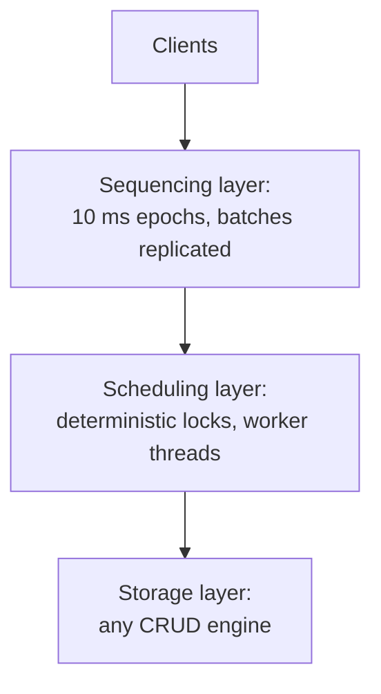

## Learning Objectives

- Explain why [Calvin](/papers/calvin-fast-distributed-transactions-for-partitioned-databases) can drop two-phase commit: which causes of abort it removes, and how the remaining ones are decided without a vote.
- Describe Calvin's three layers and how a global order is built from epoch batches.
- Apply deterministic locking to a concrete transaction order, and show why it keeps replicas identical.
- State what the design costs: declared read and write sets, no reordering around stalls, and execution skew.

## Context & Motivation

`two-phase-commit-and-the-blocking-problem` showed a participant holding locks while it waits for a decision. `spanner-truetime-and-external-consistency` keeps that structure and makes it survivable: Paxos replicates each shard and two-phase commit runs across shards, with locks still held through the agreement.

Calvin, a SIGMOD 2012 paper from Yale, asks a different question. `low-latency-shared-logs-lazylog-and-speclog` let ordering finish after the point where someone was waiting. Calvin moves agreement earlier: machines agree on what to do "outside of transactional boundaries", before they take any lock. Then `the-replicated-state-machine-approach` applies to a whole database. If every replica gets the same inputs in the same order and execution is deterministic, replicas need not exchange results to stay identical.

## Core Theory

### The contention footprint

The paper calls the total time a transaction holds its locks its contention footprint. Two-phase commit needs several network round trips under those locks, often longer than the transaction's own logic, and on a popular record that limits throughput. A synchronous replication round across regions adds latency, but if it happens before locks are taken it does not extend the footprint.

### Why the commit vote can go

A commit protocol exists because a participant might not be able to commit. The paper divides the causes of abort in two:

```text
Nondeterministic (node crash): need not abort. A replica running the
  same plan can finish the work, and the failed node can replay the
  input history when it recovers.
Deterministic (a stock level would fall below zero): the logic decides.
  Nodes wait for one-way messages from the nodes that could
  deterministically abort, with no vote at the end.
```

Once the plan is agreed, a transaction "must be executed to completion according to the plan". The commit decision is a consequence of the input, not something to negotiate.

### Three layers



**The sequencer** runs on every machine. Time is divided into 10 ms epochs, and each machine batches the requests it receives. After a batch is replicated, the sequencer sends each scheduler the transactions it participates in, and every scheduler builds the same order by interleaving all sequencers' batches round-robin. Batching adds an average delay of 5 ms. Replication happens here, on inputs rather than effects: either asynchronously from a master replica, or synchronously through Paxos, using ZooKeeper.

**The scheduler** uses a lock manager, partitioned so that each node locks only its own records, with two rules added to strict two-phase locking:

```text
1. If A precedes B in the global order and both want record R,
   A requests its lock on R first. One thread scans the order and
   requests all of a transaction's locks at once.
2. Locks are granted strictly in request order.
```

Rule 1 needs the full read and write set before execution. Once a transaction holds its locks, a worker reads its local records, forwards them to the other participants, collects theirs, and runs the logic, applying only local writes. Nodes that only hold reads are passive participants and stop after forwarding.

Because locks are requested in one global order, a wait cycle cannot form, which removes the distributed deadlocks the paper lists among the costs of conventional systems. **Storage** knows nothing about transactions.

### What the design costs

- **Declared sets.** A transaction that must read to find its keys uses Optimistic Lock Location Prediction: a cheap reconnaissance query runs first, the transaction is sequenced with the result, and it restarts deterministically if the keys changed.
- **No reordering.** A conventional system can run around a stalled transaction. Calvin must honor the sequence, so a stall blocks every conflicting successor. Its answer is to delay a transaction that may touch disk in the sequencer while its records are warmed up, which trades latency for contention and depends on predicting disk time.
- **Execution skew.** A machine may wait for another that has not reached a shared transaction yet, and higher contention tightens this limit.
- **Multipartition CPU.** Removing two-phase commit does not make cross-partition work cheap.
- **Missing features.** Range locks and phantom protection are future work.

### What the numbers say

Calvin reached around 5,000 TPC-C transactions per second per node, nearly half a million on 100 nodes, but only New Order was run, with 10 warehouses per partition and about 10% multi-warehouse transactions. With 100% multipartition transactions at low contention, the microbenchmark falls from 27,000 to about 5,000 (4 nodes) or 4,000 (8 nodes) per second, a slowdown of 5x to 7x. Throughput did not change between replication modes, including Paxos across regions 100 to 170 ms apart, at a fixed 10,000 transactions per second per node with 10% multipartition. Latency is what those modes pay. No failover time was measured, so failure handling is an argument of the design.

## Worked Examples

### Example 1: one order, two replicas

Epoch 7 has two sequencers. Sequencer A batches T1 and T2, and sequencer B batches T3 and T4, so the global order is T1, T2, T3, T4. Initial state: x=100, y=0, z=50, w=0.

```text
T1: x = x * 2         keys {x}
T2: w = w + 1         keys {w}
T3: x -= 5, z += 5    keys {x, z}   (x and z on different partitions)
T4: y = z             keys {y, z}

Lock queues:  x: T1 T3    w: T2    z: T3 T4    y: T4
```

T1 and T2 share no key, so they may run at once. Worker durations differ per replica, from a seeded random generator:

```text
Replica 1 (ms): T1 0.0-2.1   T2 0.0-7.8   T3 2.1-9.2    T4 9.2-12.2
Replica 2 (ms): T1 0.0-8.6   T2 0.0-8.6   T3 8.6-10.1   T4 10.1-11.8
Both end with:  x=195  y=55  z=55  w=1
```

The result equals serial execution in the global order, and stayed equal in 20 more seeded runs. The timings differ, the state does not. Now let one replica lock in its own arrival order, T3 before T1: it computes x = (100 - 5) * 2 = 190 instead of 195. Same inputs, different order, diverged replicas. That is why the order must be agreed first.

### Example 2: a transfer with no commit protocol

Transfer 100 from x on P1 to z on P2. Both partitions write, so both are active. Each forwards its read in one one-way message, and each runs the same logic on the same values.

```text
x=150, z=20:  P1 commit (x=50, z=120)   P2 commit (x=50, z=120)
x=70,  z=20:  P1 abort                  P2 abort
Messages: 2 one-way reads.
Two-phase commit with two participants: 2 prepares + 2 votes
  + 2 decisions + 2 acks = 8.
```

There is no window in which a participant is unsure of the outcome, so the blocked participant from `two-phase-commit-and-the-blocking-problem` has no equivalent here. If P2 crashes after forwarding, its replica has the same plan. A crashed node can also restart from a checkpoint: replaying a five-operation input log from a checkpoint taken after operation 2 gives x=55, z=120, the same state as the live run.

### Example 3: the stall, with and without prefetching

A, B, C, D arrive in that order, and each executes in 1 ms. A needs a 40 ms disk read and conflicts with B and C on key q. D conflicts with C.

```text
                          finishes at (ms)
                          A    B    C    D
Sequence honored, stall   41   42   43   44
Reordered (conventional)  41   1    2    3
Calvin, 40 ms prefetch    41   1    2    3
```

Prefetching keeps B, C and D as fast as a reordering system, because A enters the sequence after its data is in memory. If the estimate is 25 ms, A enters at 25 and holds its locks during the remaining 15 ms of disk wait, and a conflicting E arriving at 26 finishes at 42. The paper reports 40 ms as the delay its filesystem engine needed at contention index 0.01.

### Example 4: the two-phase commit line is a model

No traditional system was run. The paper's model caps throughput at 1 / (C × D), with contention index C and a lock hold D of about 8 ms, against a baseline of 27,000 transactions per second per machine.

```text
C         cap (txns/s)   slowdown
0.001     125,000        1.0
0.01      12,500         2.16
0.1       1,250          21.6
1         125            216
```

The authors call the model "somewhat naïve" and present it as a lower bound on such a system's slowdown. It is arithmetic, not a measurement of a real two-phase commit database.

## Common Misconceptions & Pitfalls

- **"Calvin removes coordination."** It moves it. Sequencing and replication of inputs still need agreement, and they cost latency. What leaves is agreement while locks are held.
- **"Deterministic means transactions run one at a time."** Example 1 runs T1 and T2 concurrently. Only conflicting transactions follow the global order.
- **"Without two-phase commit, multipartition transactions are cheap."** The 5x to 7x slowdown appears at low contention, and the paper ties it to CPU cost and skew.
- **"Half a million TPC-C transactions per second."** That is New Order only, and "similar" results on the full benchmark are an expectation of the authors.
- **"High availability here means CAP availability."** A footnote says it means failing over to an active replica.

## Summary

Calvin moves agreement to before lock acquisition. A sequencing layer batches and replicates inputs, every scheduler derives the same global order, and deterministic locking makes execution equivalent to that order at every replica. Failures no longer cause aborts, and logic aborts are decided by the logic itself, so no commit vote is needed and the contention footprint shrinks. The price is a transaction model with declared read and write sets, stalls that cannot be reordered around, sensitivity to slow machines, and latency in the sequencing path.

## Documentation Links

- [Thomson et al.: Calvin: Fast Distributed Transactions for Partitioned Database Systems (SIGMOD 2012)](https://cs.yale.edu/homes/thomson/publications/calvin-sigmod12.pdf): the architecture, deterministic locking, OLLP, prefetching, and the evaluation with its two-phase commit model.
