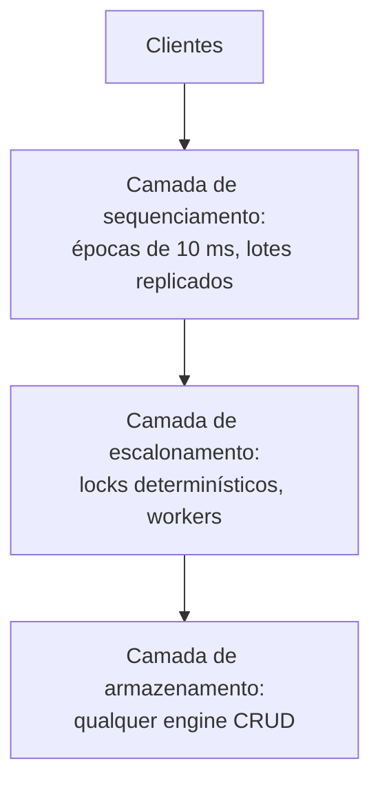

## Objetivos de Aprendizagem

- Explicar por que o [Calvin](/papers/calvin-fast-distributed-transactions-for-partitioned-databases) pode dispensar o two-phase commit: quais causas de abort ele elimina e como as restantes são decididas sem votação.
- Descrever as três camadas do Calvin e como uma ordem global é construída a partir de lotes por época.
- Aplicar o locking determinístico a uma ordem concreta de transações e mostrar por que ele mantém as réplicas idênticas.
- Dizer quanto o projeto custa: conjuntos de leitura e escrita declarados, nada de reordenar em volta de bloqueios e skew de execução.

## Contexto e Motivação

`two-phase-commit-and-the-blocking-problem` mostrou um participante segurando locks enquanto espera uma decisão. `spanner-truetime-and-external-consistency` mantém essa estrutura e a torna capaz de sobreviver a falhas: o Paxos replica cada shard e o two-phase commit roda entre shards, com os locks ainda presos durante o acordo.

O Calvin, paper de Yale no SIGMOD 2012, faz outra pergunta. `low-latency-shared-logs-lazylog-and-speclog` deixou a ordenação terminar depois do ponto em que alguém esperava. O Calvin puxa o acordo para antes: as máquinas decidem o que fazer "outside of transactional boundaries", antes de pegar qualquer lock. Aí `the-replicated-state-machine-approach` passa a valer para um banco inteiro. Se toda réplica recebe as mesmas entradas na mesma ordem e a execução é determinística, as réplicas não precisam trocar resultados para continuar idênticas.

## Teoria Central

### A contention footprint

O paper chama de contention footprint o tempo total em que uma transação segura seus locks. O two-phase commit exige vários round trips de rede sob esses locks, muitas vezes mais longos que a própria lógica da transação, e num registro popular isso limita a vazão. Um round síncrono de replicação entre regiões acrescenta latência, mas, se acontece antes de pegar os locks, não aumenta a footprint.

### Por que a votação de commit pode sair

Um protocolo de commit existe porque um participante pode não conseguir fazer commit. O paper divide as causas de abort em duas:

```text
Não determinística (crash de nó): não precisa abortar. Uma réplica com
  o mesmo plano termina o trabalho, e o nó que falhou pode reexecutar
  o histórico de entradas ao voltar.
Determinística (um estoque ficaria abaixo de zero): a lógica decide.
  Os nós esperam mensagens de ida dos nós que poderiam abortar de
  forma determinística, sem votação no final.
```

Depois de acordado o plano, a transação "must be executed to completion according to the plan". A decisão de commit é consequência da entrada, não algo a negociar.

### Três camadas



**O sequenciador** roda em toda máquina. O tempo é dividido em épocas de 10 ms, e cada máquina agrupa as requisições que recebe. Depois que um lote é replicado, o sequenciador envia a cada scheduler as transações de que ele participa, e todo scheduler monta a mesma ordem intercalando em round-robin os lotes de todos os sequenciadores. O agrupamento acrescenta um atraso médio de 5 ms. A replicação acontece aqui, sobre entradas e não sobre efeitos: de forma assíncrona a partir de uma réplica mestre, ou síncrona via Paxos, usando ZooKeeper.

**O scheduler** usa um gerenciador de locks particionado, em que cada nó trava só os próprios registros, com duas regras somadas ao strict two-phase locking:

```text
1. Se A precede B na ordem global e ambas querem o registro R,
   A pede o lock de R primeiro. Uma thread percorre a ordem e pede
   todos os locks de uma transação de uma vez.
2. Os locks são concedidos estritamente na ordem de pedido.
```

A regra 1 exige o conjunto completo de leitura e escrita antes da execução. Com os locks em mãos, um worker lê os registros locais, encaminha-os aos outros participantes, coleta os deles e roda a lógica, aplicando só as escritas locais. Nós que só têm leituras são participantes passivos e param depois de encaminhar.

Como os locks são pedidos numa única ordem global, não se forma ciclo de espera, o que elimina os deadlocks distribuídos que o paper lista entre os custos dos sistemas convencionais. **O armazenamento** não sabe nada de transações.

### Quanto o projeto custa

- **Conjuntos declarados.** Uma transação que precisa ler para descobrir suas chaves usa Optimistic Lock Location Prediction: uma consulta barata de reconhecimento roda antes, a transação é sequenciada com o resultado e reinicia de forma determinística se as chaves mudaram.
- **Nada de reordenar.** Um sistema convencional pode passar por cima de uma transação parada. O Calvin precisa respeitar a sequência, então um bloqueio segura toda sucessora em conflito. A resposta é atrasar no sequenciador a transação que pode tocar o disco enquanto seus registros são aquecidos, o que troca latência por contenção e depende de prever o tempo de disco.
- **Skew de execução.** Uma máquina pode esperar outra que ainda não chegou a uma transação em comum, e contenção maior aperta esse limite.
- **CPU em multipartição.** Tirar o two-phase commit não torna barato o trabalho entre partições.
- **O que falta.** Range locks e proteção contra phantoms ficaram como trabalho futuro.

### O que os números dizem

O Calvin chegou a cerca de 5.000 transações TPC-C por segundo por nó, quase meio milhão em 100 nós, mas só rodou New Order, com 10 warehouses por partição e cerca de 10% de transações multi-warehouse. Com 100% de transações multipartição sob baixa contenção, o microbenchmark cai de 27.000 para cerca de 5.000 (4 nós) ou 4.000 (8 nós) por segundo, uma desaceleração de 5x a 7x. A vazão não mudou entre os modos de replicação, incluindo Paxos entre regiões a 100 a 170 ms de distância, com carga fixa de 10.000 transações por segundo por nó e 10% de multipartição. É a latência que esses modos pagam. Nenhum tempo de failover foi medido, então o tratamento de falhas é um argumento do projeto.

## Exemplos Resolvidos

### Exemplo 1: uma ordem, duas réplicas

A época 7 tem dois sequenciadores. O sequenciador A agrupa T1 e T2, e o B agrupa T3 e T4, então a ordem global é T1, T2, T3, T4. Estado inicial: x=100, y=0, z=50, w=0.

```text
T1: x = x * 2         chaves {x}
T2: w = w + 1         chaves {w}
T3: x -= 5, z += 5    chaves {x, z}   (x e z em partições diferentes)
T4: y = z             chaves {y, z}

Filas de lock:  x: T1 T3    w: T2    z: T3 T4    y: T4
```

T1 e T2 não compartilham chave, então podem rodar juntas. As durações dos workers diferem por réplica, vindas de um gerador aleatório com semente:

```text
Réplica 1 (ms): T1 0,0-2,1   T2 0,0-7,8   T3 2,1-9,2    T4 9,2-12,2
Réplica 2 (ms): T1 0,0-8,6   T2 0,0-8,6   T3 8,6-10,1   T4 10,1-11,8
Ambas terminam: x=195  y=55  z=55  w=1
```

O resultado é igual à execução serial na ordem global, e continuou igual em mais 20 execuções com sementes diferentes. Os tempos mudam, o estado não. Agora deixe uma réplica travar na própria ordem de chegada, T3 antes de T1: ela calcula x = (100 - 5) * 2 = 190 em vez de 195. Mesmas entradas, outra ordem, réplicas divergentes. Por isso a ordem precisa ser acordada antes.

### Exemplo 2: uma transferência sem protocolo de commit

Transferir 100 de x em P1 para z em P2. As duas partições escrevem, então ambas são ativas. Cada uma encaminha sua leitura numa mensagem de ida, e cada uma roda a mesma lógica sobre os mesmos valores.

```text
x=150, z=20:  P1 commit (x=50, z=120)   P2 commit (x=50, z=120)
x=70,  z=20:  P1 abort                  P2 abort
Depois do sequenciamento, os dois projetos precisam das 2 leituras de ida.
O Calvin não acrescenta mensagens de commit. Two-phase commit, com
coordenador separado, acrescenta 2 prepares + 2 votos + 2 decisões + 2 acks = 8.
```

Isso conta só o caminho de commit: o Calvin pagou antes pelo sequenciamento e pela replicação da entrada. A entrada fixa o resultado antes da execução, mas um participante pode ainda não conhecê-lo: com x=70, P2 segura seu lock em z até x chegar de P1. Essa espera difere do participante bloqueado de `two-phase-commit-and-the-blocking-problem`, porque nenhum voto ou decisão de coordenador está pendente, e uma réplica de P1 pode enviar o valor enquanto alguma estiver viva. Se P2 cai depois de encaminhar, sua réplica tem o mesmo plano. Um nó que caiu também pode recomeçar de um checkpoint e reexecutar o log de entrada depois dele, o que reproduz o estado da execução ao vivo.

### Exemplo 3: o bloqueio, com e sem prefetch

A, B, C, D chegam nessa ordem, e cada uma executa em 1 ms. A precisa de uma leitura de disco de 40 ms antes de travar q, a chave que divide com B e C. D conflita com C.

```text
                             termina em (ms)
                             A    B    C    D
Sequência respeitada, parada 41   42   43   44
Reordenado (convencional)    41   1    2    3
Calvin, prefetch de 40 ms    41   1    2    3
```

Deixando de lado o atraso de batch, que esta tabela omite, o prefetch mantém B, C e D tão rápidas quanto num sistema que reordena, porque A entra na sequência depois que seus dados estão em memória. Se a estimativa for 25 ms, A entra em 25 e segura seus locks durante os 15 ms restantes de disco, e uma E em conflito que chega em 26 termina em 42. O paper relata 40 ms como o atraso de que seu engine de filesystem precisou com índice de contenção 0,01.

### Exemplo 4: a linha do two-phase commit é um modelo

Nenhum sistema tradicional foi rodado. O modelo do paper limita a vazão a 1 / (C × D), com índice de contenção C e lock preso por D de cerca de 8 ms, contra uma base de 27.000 transações por segundo por máquina.

```text
C         teto (txns/s)   desaceleração
0,001     125.000         1,0
0,01      12.500          2,16
0,1       1.250           21,6
1         125             216
```

Os autores chamam o modelo de "somewhat naïve" e o apresentam como limite inferior da desaceleração de um sistema assim. É aritmética, não medição de um banco real com two-phase commit.

## Equívocos Comuns e Armadilhas

- **"O Calvin elimina coordenação."** Ele a move. Sequenciar e replicar entradas ainda exige acordo e custa latência. O que sai é o acordo com locks presos.
- **"Determinístico significa uma transação por vez."** O Exemplo 1 roda T1 e T2 ao mesmo tempo. Só transações em conflito seguem a ordem global.
- **"Sem two-phase commit, multipartição é barato."** A desaceleração de 5x a 7x aparece sob baixa contenção, e o paper a liga ao custo de CPU e ao skew.
- **"Meio milhão de transações TPC-C por segundo."** Isso é só New Order, e resultados parecidos no benchmark completo são uma expectativa dos autores.
- **"Alta disponibilidade aqui é a disponibilidade do CAP."** Uma nota de rodapé diz que significa fazer failover para uma réplica ativa.

## Resumo

O Calvin leva o acordo para antes da aquisição de locks. Uma camada de sequenciamento agrupa e replica entradas, todo scheduler deriva a mesma ordem global, e o locking determinístico torna a execução equivalente a essa ordem em toda réplica. Falhas não causam mais abort, e aborts de lógica são decididos pela própria lógica, então nenhuma votação de commit é necessária e a contention footprint encolhe. O preço é um modelo de transação com conjuntos de leitura e escrita declarados, bloqueios que não podem ser contornados, sensibilidade a máquinas lentas e latência no caminho de sequenciamento.

## Documentation Links

- [Thomson et al.: Calvin: Fast Distributed Transactions for Partitioned Database Systems (SIGMOD 2012)](https://cs.yale.edu/homes/thomson/publications/calvin-sigmod12.pdf): a arquitetura, o locking determinístico, o OLLP, o prefetching e a avaliação com o modelo de two-phase commit.
