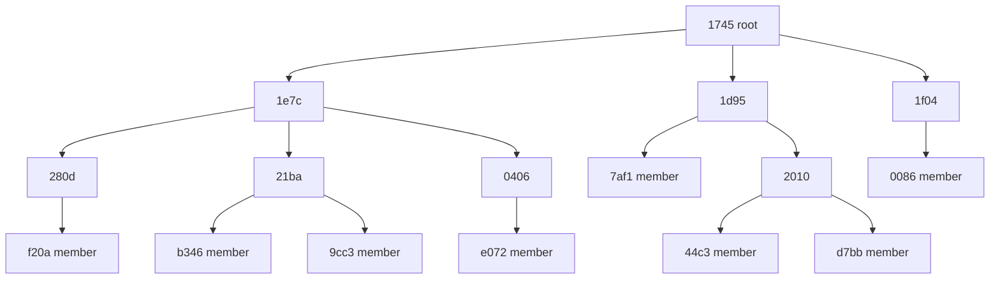

## Learning Objectives

- Describe the roles in Scribe (rendez-vous point, forwarder, member) and how a topic name becomes a tree root.
- Trace how `JOIN` messages build a dissemination tree from Pastry routes, and why the result has no loops.
- Follow a multicast from publisher to members, a `LEAVE`, and the repair after a forwarder or root fails.
- Read Scribe's measured costs against IP multicast and naive unicast.
- Compare the design with a centralized broker on durability, ordering, replay, and where the load lands.

## Context & Motivation

`message-brokers-queues-vs-logs` puts a broker between producers and consumers, so neither side needs to know the other. The broker is also a place: machines someone provisions, operates, and pays for. What if no such place existed, and the participants themselves carried the traffic for every topic?

`kademlia-and-pastry` supplies the raw material: any node can reach the node numerically closest to any key, with logarithmic state and local repair. Castro, Druschel, Kermarrec, and Rowstron built Scribe on that substrate (IEEE JSAC, 2002). They call it application-level multicast, and their word is "group", which plays the role of a topic here. Their motivation was of its time: IP multicast use had been limited by lack of wide-scale deployment and by the problem of tracking group membership, so the overlay would take on that job.

## Core Theory

### Roles and the topic-to-root mapping

Scribe's API has four calls: `create`, `join`, `leave`, and `multicast`. Every node runs the same software, and any node can be a source, a root, a member, a forwarder, or several at once.

A `groupId` is the hash (SHA-1, for example) of the group's textual name concatenated with its creator's name. The node with the nodeId numerically closest to the `groupId` is the group's **rendez-vous point**, and the root of its tree. Any node can compute the `groupId` from the two names, so no naming service is needed. Because nodeIds and `groupId`s are both uniformly distributed, groups spread evenly across nodes. `CREATE` is simply `route(CREATE, groupId)`.

### JOIN builds the tree from Pastry routes

Scribe plugs into Pastry through two upcalls. `deliver` runs at the destination, and `forward` runs at each node on a route, and may stop the message there. A join uses `forward`:

```text
forward(JOIN, key, nextId), at each node on the route:
    if this node is not yet a forwarder for the group:
        record the group, and route a new JOIN from this node
    add msg.source to the children table
    nextId = null              // the original JOIN stops here
```

Each hop therefore adopts the previous node as a child, and a `JOIN` stops at the first node already on the tree. The tree is the union of Pastry routes from members to the root, in the spirit of reverse path forwarding. **Forwarders** need not be members. Membership lists are thus split across the tree, and the root does not handle every join.

There are no loops because each hop of a Pastry route matches a longer prefix of the `groupId`, or the same length and numerically closer, or is the root.

### Multicast and LEAVE

A source routes to the rendez-vous point, asks for its IP address, and caches it so later messages skip Pastry. Each group has one tree, and the root sends every message down it. That single entry point lets the root enforce access control, and it also means every message for a group crosses that one node.

To leave, a node records the departure locally. If its children table is empty, it sends `LEAVE` to its parent, and this repeats upward until a node still has children.

### Repair and the reliability contract

Non-leaf nodes send heartbeats to their children, and multicast messages count as heartbeats. A child that stops hearing them routes a fresh `JOIN`, and Pastry takes it around the dead node to a new parent. Children table entries are soft state, discarded unless refreshed. The root's state (group creator and access control list) is replicated on the `k` nodes closest to it (typical `k = 5`). When the root fails, its children rejoin and Pastry delivers those joins to the new numerically closest node.

Scribe's default is best effort with no specified delivery order. Links between parents and children use TCP, so delivery is reliable and ordered only while those connections hold. Stronger guarantees are left to applications through upcalls. The paper's sketch has the root assign sequence numbers, every tree node buffer recent messages, and each rejoining child report the last number it delivered so its new parent can retransmit. Tolerating root failure then needs root replicas in its leaf set, using something like [Paxos](/papers/paxos-part-time-parliament).

### What the paper measured

The simulation used 100,000 nodes on a 5,050-router topology, 1,500 groups, and sizes from 11 to 100,000:

```text
delay vs IP multicast (RAD, ratio of average delays)   at most 1.68 for 50% of groups, worst 2
children tables per node                               mean 2.4, maximum 40
children table entries per node                        mean 6.2, median 3, maximum 1059
messages per link, Scribe vs IP multicast              mean 2.4 vs 0.7, maximum 4031 vs 950
```

Naive unicast from a source would put at least 100,000 messages on some link. The long tail of 1059 entries motivated a bottleneck remover: an overloaded node hands its farthest child to a sibling, capping children at 64 and raising maximum link stress to 4728.

Small groups are the weak spot. With 30,000 groups of 11 on 50,000 nodes, trees grow long unbranched paths, and average link stress was 6.1 against 2.9 for naive unicast. Collapsing non-member nodes that have a single child brought it down to 3.3.

### Compared with a centralized broker

This table is a synthesis, using Scribe's paper and Kafka's documentation, and neither source makes the comparison:

```text
                 Scribe                                Kafka (log-based broker)
state lives on   peers: children tables                broker cluster: partitions
capacity         contributed by participants           provisioned by an operator
retention        none; a joiner gets later messages    per-topic, read as often as needed
replay           no                                    consumer rewinds its offset
ordering         none specified by default             per partition
durability       best effort                           replicated partitions
delivery         pushed down the tree                  pulled by consumers
per-topic limit  all traffic crosses one root          split across partitions
```

A traditional queue broker adds per-message acknowledgment and redelivery, which Scribe also lacks. Scribe's advantages are structural: no fixed infrastructure, and no node sends to every subscriber. A broker gives up that decentralization for a durable, ordered record. If a consumer that arrives tomorrow needs today's events, Scribe is the wrong shape. Kafka's design documentation also names a log-collection system called Scribe, which is a different project.

## Worked Examples

These run in a simulator of Figures 3 and 4 of the paper, over the 64-node, 16-bit network of `kademlia-and-pastry` (`b = 2`, `|L| = 4`, `|M| = 4`). When a table entry is dead, the rare case picks the eligible node numerically closest to the key.

### Example 1: building a tree

`node-17` (`78e8`) creates `prices`. `SHA-1("prices" + "node-17")` starts `150d`, and the numerically closest node is `1745`, so that is the root. Eight nodes join in this order:

```text
joiner  Pastry route to the root   JOINs sent  stopped at
f20a    280d, 1e7c, 1745              3        root
7af1    1d95, 1745                    2        root
b346    21ba, 1e7c, 1745              2        1e7c (already forwarding)
e072    0406, 1e7c, 1745              2        1e7c
0086    1f04, 1745                    2        root
44c3    2010, 1d95, 1745              2        1d95
9cc3    21ba, 1e7c, 1745              1        21ba
d7bb    2010, 1d95, 1745              1        2010
```

Fifteen `JOIN`s build this tree. Later joiners cost less, because routes merge near the root:



The tree holds 16 nodes: the root, 8 members, and 7 forwarders with no interest in the topic.

### Example 2: publishing and leaving

Publisher `9e05` is not on the tree. Its first message routes through `32ca` and `1d95` to `1745`, and after that it sends to the root directly. The root sends 3 copies, and each message crosses 15 tree edges in total, with no node sending more than 3. A root unicasting to each member would send 8 messages, all from one node. In the plane, the tree's total distance is 4015 against 5028 for those unicasts, and its average root-to-member delay is 1.62 times the direct path. Fan-out and total distance fall, and delay rises.

If `e072` leaves, `0406` has no children left and is not a member, so `LEAVE` climbs to `1e7c`, which keeps two children and stops it. Two messages remove two nodes. If `d7bb` leaves, one message reaches `2010`, which stays for `44c3`.

### Example 3: repair after failures

`1e7c` fails, orphaning `280d`, `21ba`, and `0406`. Each routes a new `JOIN`. Their tables still point at `1e7c`, so all three take the rare case:

```text
280d -> 2010                adopted by a forwarder
21ba -> 1f04                adopted by a forwarder
0406 -> 0a25 -> 1745        0a25 becomes a forwarder, root adopts it
```

All 8 members stay reachable, and depth grows from 3 to 4. Subtrees under the orphans never change. If root `1745` fails instead, the numerically closest live node to `150d` is `1d95`, already its child. `1e7c` and `1f04` rejoin in one message each and depth stays 3.

### Example 4: where the load lands

This simulation is separate from the paper's results: 4,096 nodes in the plane, 32-bit IDs, `b = 4`, `|L| = 16`, with 30 random groups per size.

```text
group  tree   non-member  root      most children  edges per  tree distance /
size   nodes  forwarders  children  on one node    member     root unicasts
  11     28       17         7.2        7.3          2.45         0.95
 100    185       85        21.0       21.1          1.84         0.42
1000   1179      179        34.8       43.4          1.18         0.14
4096   4096        0        46.5       61.0          1.00         0.08
```

For 4,096 subscribers, a broker sends 4,096 copies from one place, and here the busiest node sends 61 on average across the 30 groups. The first row matches the paper's small-group finding: 17 passive forwarders for 11 members, and hardly any distance saved.

With 500 groups of 100 members each, a broker would hold 50,000 subscriptions. Spread over 4,096 peers, each node averages 22.3 children entries in 10.5 tables, and the busiest holds 119. Those 500 groups land on 456 distinct roots, with at most 3 on one node.

## Common Misconceptions & Pitfalls

- **"Scribe stores the subscriber list on the root."** The list is distributed across the tree. The root knows only its children, which is why it does not handle every join.
- **"Every node on the tree cares about the topic."** Example 1 has 7 forwarders with no interest in `prices`, and small groups are dominated by them.
- **"Decentralized means no bottleneck."** Load spreads across groups, but each group's traffic still enters through its one root, and the paper still needed a bottleneck remover for nodes in the long tail.
- **"Tree repair gives reliable delivery."** Repair restores the tree, not the messages sent while it was broken. Recovering those takes the application-level buffering and sequence numbers the paper sketches.
- **"Fewer messages at each node means less delay."** Example 2 shows the opposite trade: the tree cuts fan-out and total distance, and adds delay. The paper's delay penalty is the same price.

## Summary

Scribe hashes a group's name to a Pastry key, makes the numerically closest node the root, and builds a per-group tree from the routes that `JOIN` messages take, stopping each at the first existing forwarder. Multicasts enter at the root and flow down best effort. `LEAVE` prunes upward, heartbeats trigger rejoins, and root state is replicated on nearby nodes. The price is delay, and non-member forwarders that dominate small groups. Against a broker, Scribe gives up retention, replay, and default ordering, and in exchange needs no fixed infrastructure and leaves no node sending to every subscriber.

## Documentation Links

- [Castro, Druschel, Kermarrec, and Rowstron (2002): SCRIBE, a large-scale and decentralized application-level multicast infrastructure](https://www.microsoft.com/en-us/research/wp-content/uploads/2016/02/jsac.pdf): the group and tree protocols, reliability, the bottleneck remover, and the simulation results.
- [Rowstron and Druschel (2001): Pastry, scalable, decentralized object location and routing for large-scale peer-to-peer systems](https://people.mpi-sws.org/~druschel/publications/Pastry.pdf): the routing substrate and the `route`, `deliver`, and `forward` API.
- [Apache Kafka: Introduction](https://kafka.apache.org/42/getting-started/introduction/): topics, partitions, retention, per-partition ordering, and replication.
- [Apache Kafka: Design](https://kafka.apache.org/42/design/design/): consumer pull, offsets and rewinding, and the replicated log.
