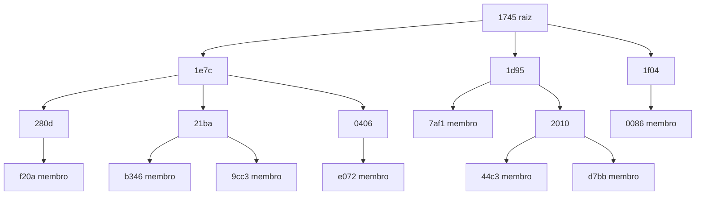

## Objetivos de Aprendizagem

- Descrever os papéis no Scribe (rendez-vous point, forwarder, membro) e como o nome de um tópico vira a raiz de uma árvore.
- Acompanhar como mensagens `JOIN` constroem uma árvore de disseminação a partir de rotas do Pastry, e por que a árvore básica não tem laços.
- Seguir um multicast do publisher até os membros, um `LEAVE`, e o reparo depois da falha de um forwarder ou da raiz.
- Ler os custos medidos do Scribe em relação a IP multicast e a unicast ingênuo.
- Comparar o desenho com um broker centralizado em durabilidade, ordenação, replay e no lugar onde a carga cai.

## Contexto e Motivação

`message-brokers-queues-vs-logs` coloca um broker entre produtores e consumidores, para que nenhum lado precise conhecer o outro. O broker também é um lugar: máquinas que alguém provisiona, opera e paga. E se esse lugar não existisse, e os próprios participantes carregassem o tráfego de cada tópico?

`kademlia-and-pastry` dá a matéria-prima: qualquer nó alcança o nó numericamente mais próximo de qualquer chave, com estado logarítmico e reparo local. Castro, Druschel, Kermarrec e Rowstron construíram o Scribe sobre esse substrato (IEEE JSAC, 2002). Eles o chamam de multicast em nível de aplicação, e a palavra deles é "group", que aqui faz o papel de tópico. A motivação era da época: o uso de IP multicast vinha limitado pela falta de implantação em larga escala e pelo problema de acompanhar quem pertence ao grupo, então o overlay assumiria esse trabalho.

## Teoria Central

### Papéis e o mapeamento de tópico para raiz

A API do Scribe tem quatro chamadas: `create`, `join`, `leave` e `multicast`. Todo nó roda o mesmo software, e qualquer nó pode ser fonte, raiz, membro, forwarder, ou vários deles ao mesmo tempo.

Um `groupId` é o hash (SHA-1, por exemplo) do nome textual do grupo concatenado com o nome do criador. O nó com nodeId numericamente mais próximo do `groupId` é o **rendez-vous point** do grupo e a raiz da árvore. Qualquer nó calcula o `groupId` a partir dos dois nomes, então nenhum serviço de nomes é necessário. Como nodeIds e `groupId`s têm distribuição uniforme, os grupos se espalham por igual entre os nós. `CREATE` é simplesmente `route(CREATE, groupId)`.

### JOIN constrói a árvore a partir de rotas do Pastry

O Scribe se liga ao Pastry por dois upcalls. `deliver` roda no destino, e `forward` roda em cada nó da rota e pode parar a mensagem ali. Um join usa `forward`:

```text
forward(JOIN, key, nextId), em cada nó da rota:
    se este nó ainda não é forwarder do grupo:
        registra o grupo e roteia um novo JOIN a partir deste nó
    adiciona msg.source à children table
    nextId = null              // o JOIN original para aqui
```

Cada hop adota o nó anterior como filho, e um `JOIN` para no primeiro nó que já está na árvore. A árvore é a união das rotas do Pastry dos membros até a raiz, no espírito do reverse path forwarding. **Forwarders** não precisam ser membros. A lista de membros fica assim repartida pela árvore, e a raiz não trata todo join.

Não há laços porque cada hop de uma rota do Pastry casa um prefixo mais longo do `groupId`, ou um do mesmo tamanho e numericamente mais perto, ou é a raiz. Esse argumento cobre o mecanismo básico. O bottleneck remover descrito adiante pode introduzir laços de roteamento, o que, segundo o paper, só acontece sob falhas e com baixa probabilidade, e os pais passam aos filhos o caminho desde a raiz para que os laços sejam detectados.

### Multicast e LEAVE

Uma fonte roteia até o rendez-vous point, pede o endereço IP dele e o guarda em cache, para que as mensagens seguintes evitem o Pastry. Cada grupo tem uma única árvore, e a raiz envia toda mensagem por ela. Esse ponto único de entrada permite à raiz fazer controle de acesso, e também significa que toda mensagem do grupo passa por esse nó.

Para sair, um nó registra a saída localmente. Se a sua children table estiver vazia, ele envia `LEAVE` ao pai, e isso se repete para cima até um nó que ainda tenha filhos.

### Reparo e o contrato de confiabilidade

Nós internos enviam heartbeats aos filhos, e mensagens de multicast contam como heartbeat. Um filho que para de recebê-los roteia um novo `JOIN`, e o Pastry o leva, contornando o nó morto, até um novo pai. Entradas das children tables são soft state, descartadas se não forem renovadas. O estado da raiz (criador do grupo e lista de controle de acesso) é replicado nos `k` nós mais próximos dela (típico `k = 5`). Quando a raiz falha, seus filhos fazem join de novo e o Pastry entrega esses joins ao novo nó numericamente mais próximo.

O padrão do Scribe é best effort, sem ordem de entrega especificada. Os enlaces entre pais e filhos usam TCP, então a entrega só é confiável e ordenada enquanto essas conexões durarem. Garantias mais fortes ficam para a aplicação, via upcalls. No esboço do paper, a raiz atribui números de sequência, cada nó da árvore mantém em buffer as mensagens recentes, e cada filho que refaz o join informa o último número entregue, para o novo pai retransmitir. Tolerar a falha da raiz exige então réplicas no leaf set dela, com algo como [Paxos](/papers/paxos-part-time-parliament).

### O que o paper mediu

A simulação usou 100.000 nós sobre uma topologia de 5.050 roteadores, 1.500 grupos e tamanhos de 11 a 100.000:

```text
atraso vs IP multicast (RAD, razão dos atrasos médios)  no máximo 1,68 em 50% dos grupos, pior caso 2
children tables por nó                                  média 2,4, máximo 40
entradas de children table por nó                       média 6,2, mediana 3, máximo 1059
mensagens por enlace, Scribe vs IP multicast            média 2,4 vs 0,7, máximo 4031 vs 950
```

Unicast ingênuo a partir de uma fonte colocaria pelo menos 100.000 mensagens em algum enlace. A cauda longa de 1059 entradas motivou um bottleneck remover: um nó sobrecarregado passa o filho mais distante para um irmão, o que limita os filhos a 64. O custo é medido como stress de enlace nos joins, que o paper diz ser idêntico aos números de multicast acima antes de o remover rodar: a média sobe de 2,4 para 2,7 e o máximo de 4031 para 4728.

Grupos pequenos são o ponto fraco. Com 30.000 grupos de 11 membros em 50.000 nós, as árvores criam caminhos longos sem ramificação, e o stress médio de enlace foi 6,1 contra 2,9 do unicast ingênuo. Colapsar nós não membros com um único filho baixou esse valor para 3,3.

### Comparação com um broker centralizado

Esta tabela é uma síntese a partir do paper do Scribe e da documentação do Kafka, e nenhuma das fontes faz a comparação:

```text
                   Scribe                               Kafka (broker baseado em log)
estado fica em     peers: children tables               cluster de brokers: partições
capacidade         contribuída pelos participantes      provisionada por um operador
retenção           nenhuma; quem entra só recebe o que  por tópico, lido quantas vezes
                   for publicado depois                 for preciso
replay             não                                  consumidor volta o offset
ordenação          nenhuma especificada por padrão      por partição
durabilidade       best effort                          partições replicadas
entrega            empurrada pela árvore                puxada pelos consumidores
limite por tópico  todo tráfego cruza uma raiz          dividido entre partições
```

Um broker tradicional de filas acrescenta acknowledgment por mensagem e reentrega, que o Scribe também não tem. As vantagens do Scribe são estruturais: nenhuma infraestrutura fixa, e nenhum nó envia a todos os assinantes. Um broker abre mão dessa descentralização em troca de um registro durável e ordenado. Se um consumidor que chega amanhã precisa dos eventos de hoje, o Scribe é a forma errada. A documentação de design do Kafka também cita um sistema de coleta de logs chamado Scribe, que é outro projeto.

## Exemplos Resolvidos

Estes exemplos rodam num simulador das Figuras 3 e 4 do paper, sobre a rede de 64 nós e 16 bits de `kademlia-and-pastry` (`b = 2`, `|L| = 4`, `|M| = 4`). Quando uma entrada da tabela está morta, o caso raro escolhe o nó elegível numericamente mais próximo da chave.

### Exemplo 1: construindo uma árvore

`node-17` (`78e8`) cria `prices`. `SHA-1("prices" + "node-17")` começa com `150d`, e o nó numericamente mais próximo é `1745`, que vira a raiz. Oito nós entram nesta ordem:

```text
quem entra  rota do Pastry até a raiz   JOINs enviados  parou em
f20a        280d, 1e7c, 1745               3            raiz
7af1        1d95, 1745                     2            raiz
b346        21ba, 1e7c, 1745               2            1e7c (já é forwarder)
e072        0406, 1e7c, 1745               2            1e7c
0086        1f04, 1745                     2            raiz
44c3        2010, 1d95, 1745               2            1d95
9cc3        21ba, 1e7c, 1745               1            21ba
d7bb        2010, 1d95, 1745               1            2010
```

Quinze `JOIN`s constroem esta árvore. Quem entra depois custa menos, porque as rotas se juntam perto da raiz:



A árvore tem 16 nós: a raiz, 8 membros e 7 forwarders sem interesse no tópico.

### Exemplo 2: publicando e saindo

O publisher `9e05` não está na árvore. A primeira mensagem dele passa por `32ca` e `1d95` até `1745`, e depois disso ele envia direto à raiz. A raiz envia 3 cópias, e cada mensagem cruza 15 arestas da árvore no total, sem que nenhum nó envie mais de 3. Uma raiz fazendo unicast para cada membro enviaria 8 mensagens, todas de um nó só. No plano, a distância total da árvore é 4015 contra 5028 desses unicasts, e o atraso médio da raiz aos membros é 1,62 vez o do caminho direto. Fan-out e distância total caem, e o atraso sobe.

Se `e072` sai, `0406` fica sem filhos e não é membro, então o `LEAVE` sobe até `1e7c`, que mantém dois filhos e o interrompe. Duas mensagens removem dois nós. Se `d7bb` sai, uma mensagem chega a `2010`, que fica por causa de `44c3`.

### Exemplo 3: reparo depois de falhas

`1e7c` falha e deixa `280d`, `21ba` e `0406` órfãos. Cada um roteia um novo `JOIN`. As tabelas deles ainda apontam para `1e7c`, então os três caem no caso raro:

```text
280d -> 2010                adotado por um forwarder
21ba -> 1f04                adotado por um forwarder
0406 -> 0a25 -> 1745        0a25 vira forwarder, a raiz o adota
```

Os 8 membros continuam alcançáveis, e a profundidade vai de 3 para 4. As subárvores abaixo dos órfãos não mudam. Se a raiz `1745` falhar, o nó vivo numericamente mais próximo de `150d` é `1d95`, que já era filho dela. `1e7c` e `1f04` refazem o join com uma mensagem cada, e a profundidade continua 3.

### Exemplo 4: onde a carga cai

Esta simulação é separada dos resultados do paper: 4.096 nós no plano, IDs de 32 bits, `b = 4`, `|L| = 16`, com 30 grupos aleatórios por tamanho.

```text
tamanho  nós da  forwarders    filhos    mais filhos   arestas     distância da árvore /
grupo    árvore  não membros   da raiz   em um nó      por membro  unicasts da raiz
  11       28       17           7,2        7,3          2,45         0,95
 100      185       85          21,0       21,1          1,84         0,42
1000     1179      179          34,8       43,4          1,18         0,14
4096     4096        0          46,5       61,0          1,00         0,08
```

Para 4.096 assinantes, um cluster de brokers atende 4.096 entregas a partir de máquinas provisionadas para isso. Aqui, mais ou menos o mesmo número de cópias é pago pelos peers, e o nó mais ocupado envia 61 em média nos 30 grupos. Só a forma da primeira linha bate com o achado do paper sobre grupos pequenos: 17 forwarders não membros para 11 membros. As métricas são outras. O paper relata stress de enlace cerca de duas vezes o do unicast ingênuo (6,1 vs 2,9), enquanto esta linha mede distância no plano e mostra economia de 5%.

Com 500 grupos de 100 membros, um cluster de brokers guardaria 50.000 assinaturas. O Scribe guarda mais estado no total, porque os forwarders também contam: 91.517 entradas de children table, 1,8 vez mais. O que muda é onde elas ficam. Espalhadas por 4.096 peers, cada nó tem em média 22,3 entradas em 10,5 tabelas, e o mais ocupado guarda 119. Esses 500 grupos caem em 456 raízes distintas, com no máximo 3 no mesmo nó.

## Equívocos Comuns e Armadilhas

- **"O Scribe guarda a lista de assinantes na raiz."** A lista fica distribuída pela árvore. A raiz conhece só os seus filhos, e é por isso que não trata todo join.
- **"Todo nó da árvore se interessa pelo tópico."** O Exemplo 1 tem 7 forwarders sem interesse em `prices`, e eles dominam os grupos pequenos.
- **"Descentralizado significa sem gargalo."** A carga se espalha entre grupos, mas o tráfego de cada grupo ainda entra pela sua única raiz, e o paper ainda precisou de um bottleneck remover para os nós da cauda longa.
- **"Reparar a árvore dá entrega confiável."** O reparo restaura a árvore, não as mensagens enviadas enquanto ela estava quebrada. Recuperá-las exige o buffer e os números de sequência em nível de aplicação que o paper esboça.
- **"Menos mensagens em cada nó significa menos atraso."** O Exemplo 2 mostra a troca oposta: a árvore corta fan-out e distância total, e acrescenta atraso. A penalidade de atraso do paper é esse mesmo preço.

## Resumo

O Scribe faz o hash do nome de um grupo para uma chave do Pastry, torna raiz o nó numericamente mais próximo e constrói uma árvore por grupo a partir das rotas dos `JOIN`s, cada um parando no primeiro forwarder existente. Multicasts entram pela raiz e descem em best effort. `LEAVE` poda para cima, heartbeats disparam novos joins e o estado da raiz é replicado em nós vizinhos. O preço é o atraso, e forwarders não membros que dominam grupos pequenos. Comparado a um broker, o Scribe abre mão de retenção, replay e ordenação padrão, e em troca não precisa de infraestrutura fixa nem deixa um nó enviando a todos os assinantes.

## Documentation Links

- [Castro, Druschel, Kermarrec e Rowstron (2002): SCRIBE, a large-scale and decentralized application-level multicast infrastructure](https://www.microsoft.com/en-us/research/wp-content/uploads/2016/02/jsac.pdf): os protocolos de grupo e árvore, confiabilidade, o bottleneck remover e os resultados de simulação.
- [Rowstron e Druschel (2001): Pastry, scalable, decentralized object location and routing for large-scale peer-to-peer systems](https://people.mpi-sws.org/~druschel/publications/Pastry.pdf): o substrato de roteamento e a API `route`, `deliver` e `forward`.
- [Apache Kafka: Introduction](https://kafka.apache.org/42/getting-started/introduction/): tópicos, partições, retenção, ordenação por partição e replicação.
- [Apache Kafka: Design](https://kafka.apache.org/42/design/design/): pull pelo consumidor, offsets e o retorno a posições anteriores, e o log replicado.
