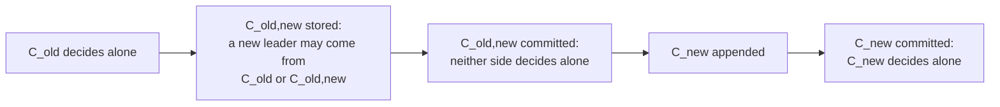

## Learning Objectives

- Explain why changing the set of servers is a safety problem, using the actual sets that form two disjoint majorities during a direct switch.
- Describe how a Paxos-based state machine carries its own configuration, and what the parameter α buys.
- State Raft's two mechanisms, joint consensus and single-server changes, and check the quorum overlap each one depends on.
- Trace the 2015 bug in single-server changes and explain why its fix works.
- Name the availability problems that remain once a change is safe: empty new servers, a removed leader, and removed servers that disrupt elections.

## Context & Motivation

Step 3 of the proof in `raft-safety-the-election-restriction-and-log-completeness` says the committing majority and the electing majority overlap because both come from the same fixed cluster. The argument in `paxos-the-original-consensus-protocol` rests on the same fact, and that lesson set reconfiguration aside. Real clusters do not stay fixed: servers fail and get replaced, and the degree of replication changes. Taking the cluster offline to edit configuration files stops service, and manual steps invite operator error, which is why the [Raft](/papers/raft-understandable-consensus-algorithm) authors automated changes inside the algorithm.

Reconfiguration cannot sit outside consensus, because a new configuration changes what "majority" means. `fast-paxos-and-flexible-quorums` asked which quorums must intersect within one configuration. This lesson asks the same question across two.

## Core Theory

### Why a direct switch is unsafe

Servers cannot all switch at the same instant. While some use the old configuration and others the new one, a majority of each can form with no server in common, and two leaders can be elected for the same term (Example 1). Every mechanism below prevents that state, by one of three routes: decide the configuration through the log itself, require both majorities at once, or restrict changes to pairs of configurations whose majorities always overlap.

### Paxos: the state machine names its own acceptors

[Paxos Made Simple](/papers/paxos-made-simple) ends with a single paragraph on this, and Lamport, Malkhi, and Zhou expand it in "Reconfiguring a State Machine". Consensus assumes a fixed configuration, so each instance in the log (`multi-paxos-from-one-decision-to-a-replicated-log`) must run under exactly one configuration, and every process must agree on which. The easy method makes the configuration a component `cfg` of the replicated state, changed by a command `rcfg(C)`. The configuration at command `i` is the value of `cfg` after command `i - 1`.

If `rcfg` takes effect immediately (method R1), command `i + 1` cannot start until command `i` is chosen, since `i` might change who runs `i + 1`. Method Rα delays the effect: `rcfg(C)` at command `i` changes `cfg` after command `i + α - 1`, which allows up to α commands in flight. A client that wants the change now proposes α - 1 noops, and batching makes those cheap, so α can be large.

Safety follows by a simple induction. The configuration of an instance is a function of the chosen prefix, so no instance ever has two candidate configurations. Liveness is the harder part: during the transition, progress needs enough nonfaulty servers from both configurations, and state held by the old servers must reach the new ones. The paper also builds reconfiguration from a sequence of separate state machines, each stopped and then restarted under the next configuration, a view that returns in `group-membership-and-view-synchrony`.

### Raft: a configuration takes effect when stored

Raft also stores configurations as log entries, with one difference that drives everything below: "a server always uses the latest configuration in its log, regardless of whether the entry is committed". A leader therefore never needs to track who has learned about a commitment. The price is that a configuration can be in force and then be erased when leadership changes, so a server must fall back to the previous one. Servers also process RPCs without consulting their own configuration: the caller's configuration decides, otherwise a new server could never accept its first entries.

### Joint consensus

The Raft paper uses two phases. The leader appends `C_old,new`, and until that entry commits a leader may be elected under either `C_old` or `C_old,new`. Under `C_old,new`:

- Entries replicate to all servers of both configurations.
- Any server from either configuration may lead.
- Agreement, for elections and commitment, requires separate majorities of `C_old` and of `C_new`. Going from 3 servers to 9 needs 2 of the 3 and 5 of the 9.

Once `C_old,new` commits, Leader Completeness ensures only servers holding it can win, so the leader appends `C_new`. There is no moment when `C_old` and `C_new` can both decide alone.



### Single-server changes

Ongaro's dissertation recommends a simpler rule: add or remove one server at a time. A majority of `n` servers and a majority of `n + 1` servers have sizes summing to exactly `n + 2`, and both are drawn from `n + 1` servers, so they share at least one. The new configuration can then take effect directly, with no joint phase, and larger changes become a series of steps. Each server adopts `C_new` on storing it, and the leader starts no further change until `C_new` commits.

### The 2015 bug

In July 2015 Ongaro announced on the raft-dev list a bug found by hand by Huanchen Zhang, working with Brandon Amos on a class project at CMU. Within one term, a leader keeps consecutive configurations one server apart. Across terms, two competing leaders can each create a change from the same `C`. Those two configurations are each one server from `C`, but may be two servers from each other, and their quorums need not overlap. The bug needs an even-sized starting cluster, concurrent changes, and lost leadership, and the outcome can be data loss and permanent split brain (Example 3).

The fix adds one rule: "a leader may not append a new configuration entry until it has committed an entry from its current term". In practice, a leader delays membership changes until the no-op it appends on election has committed. By then it knows the latest committed configuration, and servers storing its entry will refuse votes to any candidate holding an older uncommitted configuration, so that configuration can no longer commit. Joint consensus is unaffected, since competing joint configurations share `C_old` and competing simple ones share `C_new`.

**Book vs today:** chapter 4 of the 2014 dissertation still prints the algorithm without this rule. The errata live in the repository's README.

### Safe is not yet available

The dissertation treats three availability problems:

- **Empty new servers.** Add an empty S4 to a three-server cluster and lose S3: commitment needs 3 of 4, but S4 cannot store new entries until it catches up. Raft first adds new servers as non-voting members, and the dissertation suggests how to judge catch-up: replicate in rounds, wait a fixed number of them (such as 10), add the server if the last round lasted less than an election timeout, and otherwise abort the change with an error.
- **A removed leader.** It steps down only once `C_new` commits, and until then it manages a cluster it does not count itself in. Leadership transfer is the alternative.
- **Disruptive servers.** A removed server stops getting heartbeats, times out, and sends higher terms that depose the leader. Pre-Vote does not solve this, because the removed server's log can be up-to-date enough. Raft's answer is that a server ignores RequestVote within the minimum election timeout of hearing from a current leader.

Order matters too: to replace one of three servers, add first. The cluster goes 3, 4, 3 and always tolerates one failure. Removing first passes through 2 servers, which tolerate none.

## Worked Examples

### Example 1: a direct switch from 3 to 5 servers, and the joint rule

```text
C_old = {S1,S2,S3}, majority size 2: 3 possible minimal quorums
C_new = {S1,S2,S3,S4,S5}, majority size 3: 10 possible minimal quorums

Of the 30 pairs, 3 are disjoint:
  {S1,S2} and {S3,S4,S5}
  {S1,S3} and {S2,S4,S5}
  {S2,S3} and {S1,S4,S5}

Joint rule: at least 2 of C_old AND at least 3 of C_new.
Minimal joint quorums: 7, for example {S1,S2,S4} and {S2,S3,S5}.
{S3,S4,S5} no longer qualifies alone: it has only 1 of C_old.
Every joint quorum intersects every majority of C_old, of C_new,
and every other joint quorum.
```

### Example 2: which pairs of configurations must overlap

Exhaustive enumeration of the minimum intersection between any two majorities:

```text
n   C vs C+1   C vs C-1   C vs C+2   siblings of C (+x/-y, +x/+y, -x/-y)
3      1          1          0           1
4      1          1          1           0
5      1          1          0           1
6      1          1          1           0
7      1          1          0           1
8      1          1          1           0
```

One step always overlaps, which is the dissertation's claim. Two steps fail from odd sizes (`n = 3` is Example 1). The last column is what the bug exploits: two siblings of `C` overlap only when `n` is odd, which matches the even-sized condition in the announcement.

### Example 3: replaying the bug, then the fix

The first counterexample from the announcement, step by step under Raft's voting rule. `C = {S1,S2,S3,S4}`, `D = C + S5`, `E = {S2,S3,S4}`.

```text
term 1  S1 leads, appends D, copies it to S5 only, goes offline.
        S1 [C,D]  S2 [C]    S3 [C]    S4 [C]  S5 [C,D]
term 2  S2 wins with {S2,S3,S4}, 3 of 4, a majority of C.
        S2 appends E and copies it to S3.
        S1 [C,D]  S2 [C,E]  S3 [C,E]  S4 [C]  S5 [C,D]
        E commits on {S2,S3}, 2 of 3, a majority of E.
term 3  S1 returns. Its latest configuration is D: it needs 3 of 5.
        S2, S3 refuse: their last entry has term 2, S1's has term 1.
        S4, S5 grant: neither log is ahead of [C,D].
        S1 wins with {S1,S4,S5} and overwrites the committed E.

{S2,S3} ∩ {S1,S4,S5} = {}
D and E differ by two servers, S1 and S5.

With the fix, S2 first commits a no-op on {S2,S3,S4}, then appends E.
term 3  S2, S3, S4 all end in term 2 and refuse S1.
        Votes {S1,S5}: 2, and 3 are needed. S1 cannot win.
```

### Example 4: α in Rα

```text
α = 3, configuration A, rcfg(B) chosen as command 5.
rcfg takes effect after command 5 + 3 - 1 = 7.
Commands 1 to 7 run under A. Command 8 onward runs under B.

A leader that knows commands 1 to 4 can run 5, 6, and 7 at once:
their configuration is A whatever command 5 turns out to be.

With α = 1, command 6 already runs under B, so a leader cannot
start command 6 until command 5 is chosen.
```

## Common Misconceptions & Pitfalls

- **"The old and new configurations must share servers."** The quorums used for one decision must intersect, not the member lists. Joint consensus can replace `{S1,S2,S3}` with `{S4,S5,S6}`: the smallest joint quorum has 4 servers, 2 from each side. Direct majorities of those two sets never meet, and that is exactly what the joint rule repairs.
- **"One server at a time is safe by itself."** It is safe between consecutive configurations. Example 3 shows two siblings of the same configuration failing, which is why the rule needs the commit-in-this-term condition.
- **"A configuration takes effect when committed."** In Raft it takes effect when stored. In Rα it takes effect at a position fixed by the log, α commands later. Only the first puts an uncommitted configuration to work, which is what makes competing changes possible.
- **"Automatically removing failed servers is a free win."** The dissertation warns that this can leave too few replicas for the intended durability. A safer policy fixes a target size and replaces servers within it.

## Summary

A direct switch between configurations can produce two disjoint majorities and two leaders in one term. Paxos-based state machines avoid this by making the configuration of each instance a function of the chosen prefix, delayed by α commands to allow concurrency. Raft applies a configuration as soon as it is stored, so it needs overlap by construction: joint consensus demands majorities of both configurations, and single-server changes rely on adjacent configurations overlapping. That second argument missed competing changes across terms, and the 2015 fix requires a leader to commit an entry from its own term before starting a change. Availability then needs non-voting catch-up, a careful exit for a removed leader, and ignoring disruptive vote requests.

## Documentation Links

- [Lamport, Malkhi, and Zhou (2010): Reconfiguring a State Machine](https://lamport.azurewebsites.net/pubs/reconfiguration-tutorial.pdf): the methods R1 and Rα, stoppable state machines, and the liveness caveat during a transition.
- [Lamport (2001): Paxos Made Simple](https://lamport.azurewebsites.net/pubs/paxos-simple.pdf): the closing paragraph that puts the set of servers in the state machine, with the α window.
- [Ongaro and Ousterhout (2014): In Search of an Understandable Consensus Algorithm](https://raft.github.io/raft.pdf): section 6, on joint consensus, non-voting servers, and disruptive servers.
- [Ongaro (2014): Consensus: Bridging Theory and Practice](https://github.com/ongardie/dissertation): chapter 4, on single-server changes and availability, in a repository whose README lists the errata.
- [Ongaro (2015): bug in single-server membership changes](https://groups.google.com/g/raft-dev/c/t4xj6dJTP6E): the announcement with the three counterexamples, the scope, and the fix.
