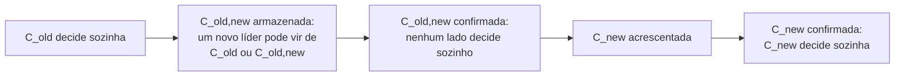

## Objetivos de Aprendizagem

- Explicar por que mudar o conjunto de servidores é um problema de segurança, usando os conjuntos reais que formam duas maiorias disjuntas numa troca direta.
- Descrever como uma máquina de estados baseada em Paxos carrega a própria configuração, e o que o parâmetro α compra.
- Enunciar os dois mecanismos do Raft, joint consensus e mudanças de um servidor por vez, e conferir a sobreposição de quóruns da qual cada um depende.
- Acompanhar o bug de 2015 nas mudanças de um servidor por vez e explicar por que a correção funciona.
- Nomear os problemas de disponibilidade que sobram depois que a mudança é segura: servidores novos vazios, um líder removido e servidores removidos que atrapalham eleições.

## Contexto e Motivação

O passo 3 da prova em `raft-safety-the-election-restriction-and-log-completeness` diz que a maioria que confirma e a maioria que elege se sobrepõem porque as duas vêm do mesmo cluster fixo. O argumento de `paxos-the-original-consensus-protocol` se apoia no mesmo fato, e aquela lição deixou a reconfiguração de lado. Clusters reais não ficam fixos: servidores falham e são substituídos, e o grau de replicação muda. Tirar o cluster do ar para editar arquivos de configuração interrompe o serviço, e passos manuais convidam erro de operador, e é por isso que os autores do [Raft](/papers/raft-understandable-consensus-algorithm) automatizaram as mudanças dentro do algoritmo.

A reconfiguração não pode ficar fora do consenso, porque uma configuração nova muda o que "maioria" significa. `fast-paxos-and-flexible-quorums` perguntou quais quóruns precisam se intersectar dentro de uma configuração. Esta lição faz a mesma pergunta entre duas.

## Teoria Central

### Por que uma troca direta é insegura

Os servidores não conseguem trocar todos no mesmo instante. Enquanto uns usam a configuração antiga e outros a nova, uma maioria de cada uma pode se formar sem nenhum servidor em comum, e dois líderes podem ser eleitos no mesmo termo (Exemplo 1). Cada mecanismo abaixo impede esse estado por um de três caminhos: decidir a configuração pelo próprio log, exigir as duas maiorias ao mesmo tempo, ou restringir as mudanças a pares de configurações cujas maiorias sempre se sobrepõem.

### Paxos: a máquina de estados nomeia os próprios aceitadores

[Paxos Made Simple](/papers/paxos-made-simple) termina com um único parágrafo sobre o tema, e Lamport, Malkhi e Zhou o expandem em "Reconfiguring a State Machine". O consenso assume uma configuração fixa, então cada instância do log (`multi-paxos-from-one-decision-to-a-replicated-log`) precisa rodar sob exatamente uma configuração, e todo processo precisa concordar sobre qual. O método fácil faz da configuração um componente `cfg` do estado replicado, alterado por um comando `rcfg(C)`. A configuração do comando `i` é o valor de `cfg` depois do comando `i - 1`.

Se `rcfg` vale imediatamente (método R1), o comando `i + 1` não pode começar antes de o comando `i` ser escolhido, já que `i` pode mudar quem executa `i + 1`. O método Rα atrasa o efeito: `rcfg(C)` no comando `i` muda `cfg` depois do comando `i + α - 1`, o que permite até α comandos em andamento. Um cliente que quer a mudança agora propõe α - 1 noops, e o batching os torna baratos, então α pode ser grande.

A segurança sai de uma indução simples. A configuração de uma instância é função do prefixo escolhido, então nenhuma instância tem duas configurações candidatas. A vivacidade é a parte difícil: durante a transição, o progresso exige servidores não falhos suficientes das duas configurações, e o estado guardado nos servidores antigos precisa chegar aos novos. O artigo também constrói a reconfiguração a partir de uma sequência de máquinas de estados separadas, cada uma parada e depois reiniciada sob a configuração seguinte, visão que volta em `group-membership-and-view-synchrony`.

### Raft: a configuração vale quando é armazenada

O Raft também guarda configurações como entradas do log, com uma diferença que comanda todo o resto: "a server always uses the latest configuration in its log, regardless of whether the entry is committed". Assim o líder nunca precisa rastrear quem já soube de uma confirmação. O preço é que uma configuração pode estar em vigor e depois ser apagada quando a liderança muda, e o servidor precisa voltar à anterior. Os servidores também processam RPCs sem consultar a própria configuração: quem decide é a configuração de quem chama, senão um servidor novo nunca aceitaria as primeiras entradas.

### Joint consensus

O artigo do Raft usa duas fases. O líder acrescenta `C_old,new`, e até essa entrada ser confirmada um líder pode ser eleito sob `C_old` ou sob `C_old,new`. Sob `C_old,new`:

- As entradas são replicadas para todos os servidores das duas configurações.
- Qualquer servidor de qualquer uma das duas pode ser líder.
- O acordo, para eleições e confirmação, exige maiorias separadas de `C_old` e de `C_new`. Ir de 3 para 9 servidores exige 2 dos 3 e 5 dos 9.

Quando `C_old,new` é confirmada, a Leader Completeness garante que só servidores que a têm podem vencer, e o líder acrescenta `C_new`. Não existe momento em que `C_old` e `C_new` possam decidir sozinhas.



### Mudanças de um servidor por vez

A tese de Ongaro recomenda uma regra mais simples: adicionar ou remover um servidor de cada vez. Uma maioria de `n` servidores e uma maioria de `n + 1` servidores têm tamanhos que somam exatamente `n + 2`, e as duas saem de `n + 1` servidores, então compartilham pelo menos um. A configuração nova pode então valer direto, sem fase conjunta, e mudanças maiores viram uma série de passos. Cada servidor adota `C_new` ao armazená-la, e o líder não começa outra mudança até `C_new` ser confirmada.

### O bug de 2015

Em julho de 2015, Ongaro anunciou na lista raft-dev um bug achado à mão por Huanchen Zhang, que trabalhava com Brandon Amos num projeto de disciplina na CMU. Dentro de um termo, o líder mantém configurações consecutivas a um servidor de distância. Entre termos, dois líderes concorrentes podem criar cada um uma mudança a partir do mesmo `C`. Essas duas configurações estão cada uma a um servidor de `C`, mas podem estar a dois servidores uma da outra, e os quóruns delas não precisam se sobrepor. O bug exige um cluster inicial de tamanho par, mudanças concorrentes e perda de liderança, e o resultado pode ser perda de dados e split brain permanente (Exemplo 3).

A correção acrescenta uma regra: "a leader may not append a new configuration entry until it has committed an entry from its current term". Na prática, o líder atrasa mudanças de composição até o no-op que ele acrescenta ao ser eleito estar confirmado. A partir daí ele conhece a última configuração confirmada, e os servidores que guardam a entrada dele recusam voto a qualquer candidato com uma configuração antiga não confirmada, que assim não pode mais ser confirmada. O joint consensus não é afetado, já que configurações conjuntas concorrentes compartilham `C_old` e configurações simples concorrentes compartilham `C_new`.

**Livro vs hoje:** o capítulo 4 da tese de 2014 ainda imprime o algoritmo sem essa regra. A errata fica no README do repositório.

### Seguro ainda não é disponível

A tese trata de três problemas de disponibilidade:

- **Servidores novos vazios.** Adicione um S4 vazio a um cluster de três e perca o S3: a confirmação exige 3 de 4, mas o S4 não consegue armazenar entradas novas até alcançar o log. O Raft primeiro adiciona servidores novos como membros sem voto, e a tese sugere como julgar se eles alcançaram o log: replicar em rodadas, esperar um número fixo delas (como 10), adicionar o servidor se a última rodada durou menos que um timeout de eleição e, caso contrário, abortar a mudança com erro.
- **Um líder removido.** Ele só deixa a liderança quando `C_new` é confirmada, e até lá gerencia um cluster no qual não se conta. Leadership transfer é a alternativa.
- **Servidores que atrapalham.** Um servidor removido para de receber heartbeats, estoura o timeout e envia termos maiores que derrubam o líder. O Pre-Vote não resolve, porque o log do servidor removido pode estar atualizado o bastante. A resposta do Raft é que um servidor ignora RequestVote dentro do timeout de eleição mínimo depois de ouvir um líder atual.

A ordem também importa: para trocar um de três servidores, adicione primeiro. O cluster passa por 3, 4, 3 e sempre tolera uma falha. Remover primeiro passa por 2 servidores, que não toleram nenhuma.

## Exemplos Resolvidos

### Exemplo 1: uma troca direta de 3 para 5 servidores, e a regra conjunta

```text
C_old = {S1,S2,S3}, maioria de tamanho 2: 3 quóruns mínimos possíveis
C_new = {S1,S2,S3,S4,S5}, maioria de tamanho 3: 10 quóruns mínimos possíveis

Dos 30 pares, 3 são disjuntos:
  {S1,S2} e {S3,S4,S5}
  {S1,S3} e {S2,S4,S5}
  {S2,S3} e {S1,S4,S5}

Regra conjunta: pelo menos 2 de C_old E pelo menos 3 de C_new.
Quóruns conjuntos mínimos: 7, por exemplo {S1,S2,S4} e {S2,S3,S5}.
{S3,S4,S5} sozinho não serve mais: tem só 1 de C_old.
Todo quórum conjunto intersecta toda maioria de C_old, toda de C_new
e todo outro quórum conjunto.
```

### Exemplo 2: quais pares de configurações precisam se sobrepor

Enumeração exaustiva da interseção mínima entre duas maiorias quaisquer:

```text
n   C vs C+1   C vs C-1   C vs C+2   irmãs de C (+x/-y, +x/+y, -x/-y)
3      1          1          0           1
4      1          1          1           0
5      1          1          0           1
6      1          1          1           0
7      1          1          0           1
8      1          1          1           0
```

Um passo sempre se sobrepõe, que é a afirmação da tese. Dois passos falham a partir de tamanhos ímpares (`n = 3` é o Exemplo 1). A última coluna é o que o bug explora: duas irmãs de `C` só se sobrepõem quando `n` é ímpar, o que bate com a condição de tamanho par do anúncio.

### Exemplo 3: reproduzindo o bug, depois a correção

O primeiro contraexemplo do anúncio, passo a passo sob a regra de voto do Raft. `C = {S1,S2,S3,S4}`, `D = C + S5`, `E = {S2,S3,S4}`.

```text
termo 1  S1 lidera, acrescenta D, copia só para S5 e sai do ar.
        S1 [C,D]  S2 [C]    S3 [C]    S4 [C]  S5 [C,D]
termo 2  S2 vence com {S2,S3,S4}, 3 de 4, uma maioria de C.
        S2 acrescenta E e copia para S3.
        S1 [C,D]  S2 [C,E]  S3 [C,E]  S4 [C]  S5 [C,D]
        E é confirmada em {S2,S3}, 2 de 3, uma maioria de E.
termo 3  S1 volta. A última configuração dele é D: precisa de 3 de 5.
        S2, S3 recusam: a última entrada deles é do termo 2, a de S1 do termo 1.
        S4, S5 concedem: nenhum dos dois logs está à frente de [C,D].
        S1 vence com {S1,S4,S5} e sobrescreve a E confirmada.

{S2,S3} ∩ {S1,S4,S5} = {}
D e E diferem por dois servidores, S1 e S5.

Com a correção, S2 primeiro confirma um no-op em {S2,S3,S4} e só então acrescenta E.
termo 3  S2, S3, S4 terminam todos no termo 2 e recusam S1.
        Votos {S1,S5}: 2, e são necessários 3. S1 não pode vencer.
```

### Exemplo 4: o α de Rα

```text
α = 3, configuração A, rcfg(B) escolhido como comando 5.
rcfg vale depois do comando 5 + 3 - 1 = 7.
Os comandos de 1 a 7 rodam sob A. Do comando 8 em diante, sob B.

Um líder que conhece os comandos de 1 a 4 pode rodar 5, 6 e 7 juntos:
a configuração deles é A, seja qual for o comando 5.

Com α = 1, o comando 6 já roda sob B, então o líder não pode
começar o comando 6 antes de o comando 5 ser escolhido.
```

## Equívocos Comuns e Armadilhas

- **"A configuração antiga e a nova precisam compartilhar servidores."** Precisam se intersectar os quóruns usados numa decisão, não as listas de membros. O joint consensus consegue trocar `{S1,S2,S3}` por `{S4,S5,S6}`: o menor quórum conjunto tem 4 servidores, 2 de cada lado. Maiorias diretas desses dois conjuntos nunca se encontram, e é exatamente isso que a regra conjunta conserta.
- **"Um servidor por vez é seguro por si só."** É seguro entre configurações consecutivas. O Exemplo 3 mostra duas irmãs da mesma configuração falhando, e por isso a regra precisa da condição de confirmar no próprio termo.
- **"Uma configuração vale quando é confirmada."** No Raft ela vale quando é armazenada. Em Rα ela vale numa posição fixada pelo log, α comandos depois. Só o primeiro põe uma configuração não confirmada para trabalhar, e é isso que torna possíveis as mudanças concorrentes.
- **"Remover servidores falhos automaticamente é ganho de graça."** A tese avisa que isso pode deixar réplicas de menos para a durabilidade pretendida. Uma política mais segura fixa um tamanho-alvo e substitui servidores dentro dele.

## Resumo

Uma troca direta entre configurações pode produzir duas maiorias disjuntas e dois líderes num termo. Máquinas de estados baseadas em Paxos evitam isso fazendo da configuração de cada instância uma função do prefixo escolhido, atrasada em α comandos para permitir concorrência. O Raft aplica a configuração assim que ela é armazenada, então precisa da sobreposição por construção: o joint consensus exige maiorias das duas configurações, e as mudanças de um servidor por vez contam com a sobreposição de configurações adjacentes. Esse segundo argumento deixou escapar mudanças concorrentes entre termos, e a correção de 2015 exige que o líder confirme uma entrada do próprio termo antes de iniciar uma mudança. A disponibilidade ainda pede catch-up sem voto, uma saída cuidadosa para o líder removido e ignorar pedidos de voto que atrapalham.

## Documentation Links

- [Lamport, Malkhi, and Zhou (2010): Reconfiguring a State Machine](https://lamport.azurewebsites.net/pubs/reconfiguration-tutorial.pdf): os métodos R1 e Rα, máquinas de estados paráveis e a ressalva de vivacidade durante a transição.
- [Lamport (2001): Paxos Made Simple](https://lamport.azurewebsites.net/pubs/paxos-simple.pdf): o parágrafo final que põe o conjunto de servidores na máquina de estados, com a janela α.
- [Ongaro and Ousterhout (2014): In Search of an Understandable Consensus Algorithm](https://raft.github.io/raft.pdf): seção 6, sobre joint consensus, servidores sem voto e servidores que atrapalham.
- [Ongaro (2014): Consensus: Bridging Theory and Practice](https://github.com/ongardie/dissertation): capítulo 4, sobre mudanças de um servidor por vez e disponibilidade, num repositório cujo README lista a errata.
- [Ongaro (2015): bug in single-server membership changes](https://groups.google.com/g/raft-dev/c/t4xj6dJTP6E): o anúncio com os três contraexemplos, o escopo e a correção.
