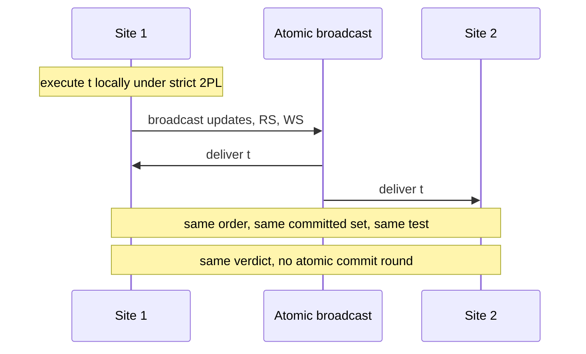

## Learning Objectives

- Place a replication protocol on the two classic axes, and describe it as a sequence of the five generic phases.
- Derive how deadlock and reconciliation rates grow with nodes in Gray's model, and state the assumptions behind the growth.
- Explain deferred update replication with certification over atomic broadcast, and why every site reaches the same verdict without two-phase commit.
- Run the certification test and the reordering test by hand on a small workload.
- Separate the Database State Machine from Postgres-R, and read the 1996 pessimism as a statement about a stated model.

## Context & Motivation

`transactional-causal-consistency` stayed available by giving up a single order. This lesson asks what it takes to keep it: **one-copy serializability** (1SR), where a replicated database behaves like one serializable copy. `single-leader-replication` and `multi-leader-and-leaderless-replication` already cover logs, failover, lag, and conflict resolution at the system level, and this lesson works one level down, with whole transactions that read and write several items.

## Core Theory

### Two axes

Gray, Helland, O'Neil and Shasha classify replication by when updates propagate and who may originate them. **Eager** applies updates to all replicas inside the original transaction. **Lazy** commits at one replica and propagates afterward. **Master** (primary copy) gives each object an owner. **Group** (update everywhere) lets any node with a copy update it.

```text
          Lazy                         Eager
Group     N transactions, N owners     1 transaction, N owners
Master    N transactions, 1 owner      1 transaction, 1 owner
```

### Five phases

Wiesmann, Pedone, Schiper, Kemme and Alonso describe any protocol through five phases: request (RE), server coordination (SC), execution (EX), agreement coordination (AC), and response (END). Figure 14 of their paper sets the techniques side by side:

```text
Eager primary copy                RE     EX AC END
Eager update everywhere, locking  RE SC  EX AC END
Eager update everywhere, ABCAST   RE SC  EX    END
Certification-based               RE     EX AC END
Lazy primary copy                 RE     EX END AC
Lazy update everywhere            RE     EX END AC
```

Three facts can be read off this table. Every eager row synchronizes through SC or AC before END, and the lazy rows do not. Only for primary copy is the difference a plain swap of AC and END: lazy update everywhere also has no SC, and the ABCAST row has no AC. Primary copy has no SC, because the primary alone processes the update. Eager update everywhere needs SC before execution, with certification as the exception: it executes optimistically and aborts afterward to keep consistency. The paper's prose states this SC rule for update everywhere in general, but its own figure shows lazy update everywhere without SC. The paper groups the two lazy rows as weak consistency and the rest as strong. It also treats quorums as orthogonal: they decide how many sites participate, not which phases run.

### The dangers

Gray et al. model N nodes, each replicating every object, with TPS transactions per node and Actions updates per transaction, on uniformly accessed objects. Message delay and processing are ignored, reads are ignored, and only sequential updating of replicas is counted. An eager transaction then grows N times larger and N times longer:

```text
Total_Transactions = TPS x Actions x Action_Time x N^2         (7)
Eager deadlocks  ≈ TPS^2 x Action_Time x Actions^5 x N^3
                   / (4 x DB_Size^2)                           (12)
Lazy group recon ≈ TPS^2 x Action_Time x (Actions x N)^3
                   / (2 x DB_Size)                             (14)
Disconnected recon ≈ Disconnect_Time x (TPS x Actions x N)^2
                   / DB_Size                                   (18)
Lazy master deadlocks ≈ (TPS x N)^2 x Actions^4
                   / (4 x DB_Size^2)                           (19)
```

Lazy group replication follows the wait rate of equation 10, because a transaction that would wait under eager faces reconciliation under lazy, and waits are far more frequent than deadlocks. Lazy master has no reconciliation, but it needs contact with the object's owner. The abstract's headline is that update-anywhere replication shows "a ten-fold increase in nodes and traffic gives a thousand fold increase in deadlocks or reconciliations". Two assumptions soften the result. If the database grows with the nodes, equation 13 is linear in N, which the paper calls "still an unstable situation", and if replica updates run concurrently, the eager growth is quadratic. The ignored message delay points the other way: the model "ignores many issues that would make the predicted behavior even worse", and for eager replication the paper concludes "We see no solution to this problem".

Timestamps give convergence without serializability. Gray et al. call them vulnerable to lost updates, and their proposal is **two-tier replication**: mobile nodes run tentative transactions, and base nodes re-execute them against master copies under an acceptance criterion. If all transactions commute and none fails its acceptance criterion, there are no reconciliations, because failed acceptance criteria drive the reconciliation rate.

### Deferred update and certification

Pedone, Guerraoui and Schiper's **Database State Machine** targets a cluster on a local network. A transaction runs at one site under strict two-phase locking with no inter-site interaction, and a read-only transaction commits there. At commit, an update transaction's updates, read set, and write set are atomically broadcast. Every site certifies t_a on delivery:

```text
commit t_a iff for all committed t_b:
    t_b precedes t_a   or   WS(t_b) ∩ RS(t_a) = ∅
```

t_b precedes t_a when t_b had committed at t_a's site before t_a requested commit (for two transactions of one site, when t_b requested commit first). So t_a aborts if something it could not have seen overwrote what it read.



Atomic broadcast supplies agreement and total order, the primitive built in `total-order-broadcast-built-on-consensus`. Certification is deterministic, so identical inputs in identical order yield identical decisions, and atomic broadcast is the only interaction between sites. That removes the voting round of `two-phase-commit-and-the-blocking-problem`. The paper proves every history is 1SR. The cost moves: no distributed deadlocks, but optimistic execution can abort at certification.

The **reordering certification test** lets a committed transaction wait in a bounded Reorder List before its updates are applied, and inserts t_a at any position that keeps the result serializable. In the paper's simulation, serialization aborts fell from 20% to under 5% with 8 sites. With n sites, reorder factors of 4n or more made things worse, because held locks add data contention.

### Postgres-R: same family, different mechanism

Kemme and Alonso build eager update everywhere into PostgreSQL. Writes go to shadow copies, and only the write set is multicast in total order. On delivery, a site acquires all its locks in one atomic step in that order, and a conflicting local reader in its read or send phase is aborted. Read sets stay local, so a second, unordered commit-or-abort message follows, which the paper notes is not a 2PC. Their thesis answers Gray directly: if consistency is the goal and the environment allows it, use eager, and clusters allow it. Shadow copies, a single bundled write set, and pre-ordering change the assumptions behind equation 12 rather than refute it.

### Book versus today

Gray's 1996 remark that no high-update replicated database has globally serializable transactions, and Wiesmann's 2000 remark that eager primary copy serves only for hot standby, describe their dates. `single-leader-replication` lists consensus-based single-leader systems in production, and the MySQL 8.4 manual describes Group Replication as atomic broadcast plus certification. That certification compares write sets at row level, a narrower test than the Database State Machine's, as Example 4 shows.

## Worked Examples

In Example 2 the parameter values are invented, and the formulas are Gray's. The transactions in Examples 3 and 4 are constructed for illustration and do not come from the papers.

### Example 1: Gray's checkbook

A joint account holds $1,000, and each spouse writes a $1,000 check.

```text
Eager or master:            second check rejected, balance 0
Lazy group, timestamped
replacement of the value:   both books write 0, one is "stale"
                            balance 0, $2,000 paid   (lost update)
Commutative debits:         balance -1000, $2,000 paid
Two-tier, balance >= 0:     second base transaction rejected,
                            reconciled by its owner
```

### Example 2: growth, with symbolic verification

Substituting (6), (7) and (11) symbolically yields equation 12 exactly. Take TPS = 10, Action_Time = 0.01 s, Actions = 5, DB_Size = 10^6.

```text
                         N=1        N=10       growth
(12) eager deadlocks/s   7.8e-10    7.8e-07    x1,000
(13) DB scaled with N    7.8e-10    7.8e-09    x10
(14) lazy group recon/s  6.3e-05    0.0625     x1,000
(18) disconnected        -          -          x100
(19) lazy master         -          -          x100

Ten times more Actions in (12):  x100,000
```

At N = 10, the wait rate shared by (10) and (14) exceeds the deadlock rate of (12) by 80,000 to 1, which matches the paper's point that waits drive reconciliation. Equation 19 as printed lacks the Action_Time and fifth power of Actions that appear in equation 5, so compare its growth in N and not its absolute value with equation 12.

### Example 3: certification, order, and reordering

Three transactions run concurrently on one snapshot at three sites, so none precedes another.

```text
T1: RS{x} WS{x}    T2: RS{x} WS{y}    T3: RS{y} WS{z}

Basic test, delivery T1,T2,T3:
  T1 commit.  T2 abort (WS(T1) meets RS(T2) on x).  T3 commit.
Basic test, delivery T2,T1,T3:
  T2 commit.  T1 commit.  T3 abort (WS(T2) meets RS(T3) on y).

The two orders commit {T1,T3} and {T2,T1}. A site seeing each
order would hold different data, which is why total order matters.

Reordering test, delivery T1,T2,T3, nothing yet applied:
  T1 at position 0.          list: T1
  T2 fails after T1, fits before it.   list: T2, T1
  T3 fails after T2, fits before it.   list: T3, T2, T1
All 3 commit. Of the 6 serial orders, only T3,T2,T1 lets every
transaction read the initial values it actually read.
```

### Example 4: why read sets matter

Ta reads x and writes y. Tb reads y and writes x. Both start from x = y = 1 and set their item to 0.

```text
Database State Machine test: Ta commit, Tb abort (WS(Ta) meets RS(Tb))
Write sets only:             both commit (writes do not intersect)
Both read 1. Order Ta,Tb gives Tb a read of 0.
             Order Tb,Ta gives Ta a read of 0.
```

The second rule is the same-row comparison the MySQL page describes, applied here to an abstract pair. It admits a non-serializable result that the read-set test rejects.

## Common Misconceptions & Pitfalls

- **"Gray et al. proved eager replication cannot scale."** The paper gives an average-case analysis of a stated model, not a proof about every design. Sequential replica updates and a fixed database size raise the exponent: equation 13 and the parallel-update remark lower it, although the paper still calls the linear case unstable. Ignored message delay works the opposite way, since adding it would worsen the rates. Postgres-R changes the mechanism being modeled.
- **"Lazy avoids the problem by avoiding locks."** Gray's summary says lazy group replication converts waits and deadlocks into reconciliations.
- **"Certification needs 2PC to agree on the outcome."** Example 3 needs only total order and a deterministic test. Postgres-R does send a decision message, but it is not a vote.
- **"Certification is free of cost because nothing waits."** Example 3 aborts a transaction that was serializable, and the cure, reordering, adds lock contention at high factors.
- **"Certification-based means serializable."** That depends on the test. Example 4 runs two tests with different results.

## Summary

Database replication is classified by when updates propagate and who originates them, and Wiesmann's five phases show eager techniques synchronizing before END and lazy ones not, which is a plain swap of AC and END only for primary copy. Gray's model gives cubic deadlock and reconciliation growth for eager and lazy group replication under stated assumptions, and it motivates two-tier replication and commutative updates. Certification takes a different route: execute locally, atomically broadcast read and write sets, and let a deterministic test decide the same thing everywhere, proving 1SR with no atomic commitment. Postgres-R reaches eager replication through ordered write sets and local lock rules. These protocols pay in aborts and a total-order primitive. An update commits only after its broadcast is delivered, so they also give up the local answer during a partition that `transactional-causal-consistency` preserved.

## Documentation Links

- [Gray, Helland, O'Neil and Shasha: The Dangers of Replication and a Solution (SIGMOD 1996)](https://pages.cs.wisc.edu/~yxy/cs764-f20/papers/replication.pdf): the taxonomy, equations 7 to 19, the checkbook example, and two-tier replication.
- [Wiesmann, Pedone, Schiper, Kemme and Alonso: Understanding Replication in Databases and Distributed Systems (ICDCS 2000)](https://classpages.cselabs.umn.edu/Spring-2018/csci8980/Papers/ProcessReplication/Understanding-Replication-icdcs2000.pdf): the five-phase functional model and the Figure 14 comparison.
- [Pedone, Guerraoui and Schiper: The Database State Machine Approach (report version of the 2003 article)](https://www.cs.cornell.edu/courses/cs734/2000FA/cached%20papers/pgs99.pdf): deferred update, the certification and reordering tests, the 1SR proof, and the simulation.
- [Kemme and Alonso: Don't Be Lazy, Be Consistent: Postgres-R (VLDB 2000)](https://www.vldb.org/conf/2000/P134.pdf): the four-phase protocol with ordered write sets and its implementation in PostgreSQL.
- [MySQL 8.4 Reference Manual: Group Replication](https://dev.mysql.com/doc/refman/8.4/en/group-replication-summary.html): a current system built on atomic broadcast and write-set certification.
