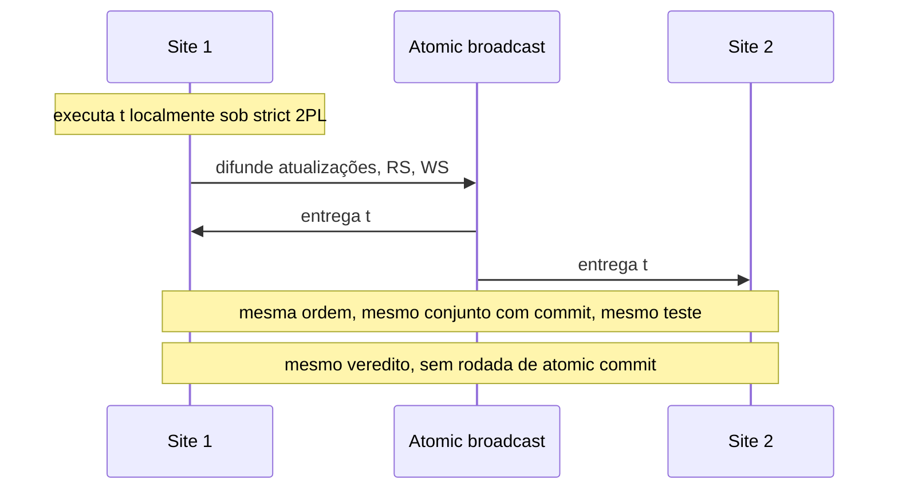

## Objetivos de Aprendizagem

- Situar um protocolo de replicação nos dois eixos clássicos e descrevê-lo como uma sequência das cinco fases genéricas.
- Derivar como as taxas de deadlock e de reconciliação crescem com os nós no modelo de Gray, e enunciar as hipóteses por trás desse crescimento.
- Explicar a replicação deferred update com certificação sobre atomic broadcast, e por que todo site chega ao mesmo veredito sem two-phase commit.
- Rodar à mão o teste de certificação e o teste de reordenação numa carga pequena.
- Separar o Database State Machine do Postgres-R, e ler o pessimismo de 1996 como afirmação sobre um modelo declarado.

## Contexto e Motivação

`transactional-causal-consistency` continuou disponível abrindo mão de uma ordem única. Aqui a pergunta é o que custa mantê-la: **one-copy serializability** (1SR), em que um banco replicado se comporta como uma única cópia serializável. `single-leader-replication` e `multi-leader-and-leaderless-replication` já cobrem logs, failover, lag e resolução de conflitos no nível de sistema, e esta lição desce um nível, para transações inteiras que leem e escrevem vários itens.

## Teoria Central

### Dois eixos

Gray, Helland, O'Neil e Shasha classificam a replicação por quando as atualizações se propagam e por quem pode originá-las. **Eager** aplica as atualizações em todas as réplicas dentro da transação original. **Lazy** faz commit em uma réplica e propaga depois. **Master** (primary copy) dá um dono a cada objeto. **Group** (update everywhere) deixa qualquer nó com cópia atualizar.

```text
          Lazy                         Eager
Group     N transações, N donos        1 transação, N donos
Master    N transações, 1 dono         1 transação, 1 dono
```

### Cinco fases

Wiesmann, Pedone, Schiper, Kemme e Alonso descrevem qualquer protocolo por cinco fases: request (RE), server coordination (SC), execution (EX), agreement coordination (AC) e response (END). A Figura 14 do paper põe as técnicas lado a lado:

```text
Eager primary copy                RE     EX AC END
Eager update everywhere, locking  RE SC  EX AC END
Eager update everywhere, ABCAST   RE SC  EX    END
Baseada em certificação           RE     EX AC END
Lazy primary copy                 RE     EX END AC
Lazy update everywhere            RE     EX END AC
```

Três fatos saem dessa tabela. Eager e lazy só diferem em AC vir antes ou depois de END. Primary copy não tem SC, porque só o primário processa a atualização. Update everywhere precisa de SC antes da execução, e a certificação é a exceção: ela executa de forma otimista e aborta depois para manter a consistência. O paper agrupa as duas linhas lazy como consistência fraca e as demais como forte. Ele também trata quóruns como ortogonais: eles decidem quantos sites participam, não quais fases rodam.

### Os perigos

Gray et al. modelam N nós, cada um replicando todos os objetos, com TPS transações por nó e Actions atualizações por transação, sobre objetos de acesso uniforme. Atraso e processamento de mensagens ficam de fora, leituras também, e só a atualização sequencial das réplicas é contada. Uma transação eager fica então N vezes maior e N vezes mais longa:

```text
Total_Transactions = TPS x Actions x Action_Time x N^2         (7)
Deadlocks eager  ≈ TPS^2 x Action_Time x Actions^5 x N^3
                   / (4 x DB_Size^2)                           (12)
Recon lazy group ≈ TPS^2 x Action_Time x (Actions x N)^3
                   / (2 x DB_Size)                             (14)
Recon desconectada ≈ Disconnect_Time x (TPS x Actions x N)^2
                   / DB_Size                                   (18)
Deadlocks lazy master ≈ (TPS x N)^2 x Actions^4
                   / (4 x DB_Size^2)                           (19)
```

A replicação lazy group segue a taxa de espera da equação 10, porque uma transação que esperaria no eager enfrenta reconciliação no lazy, e esperas são muito mais frequentes que deadlocks. Lazy master não tem reconciliação, mas exige contato com o dono do objeto. A manchete do abstract é que a replicação update-anywhere mostra "a ten-fold increase in nodes and traffic gives a thousand fold increase in deadlocks or reconciliations". O paper também mostra o quanto isso depende das hipóteses: se o banco cresce junto com os nós, a equação 13 é linear em N, e se as atualizações de réplica rodam em paralelo, o crescimento eager é quadrático.

Timestamps dão convergência sem serializabilidade. Gray et al. os chamam de vulneráveis a lost updates, e a proposta deles é a **replicação two-tier**: nós móveis rodam transações tentativas, e nós base as reexecutam sobre as cópias mestras sob um critério de aceitação. Transações comutativas dispensam reconciliação.

### Deferred update e certificação

O **Database State Machine** de Pedone, Guerraoui e Schiper mira um cluster em rede local. Uma transação roda em um site sob strict two-phase locking, sem interação entre sites, e uma transação só de leitura faz commit ali. No commit, as atualizações, o read set e o write set de uma transação de atualização são difundidos por atomic broadcast. Todo site certifica t_a na entrega:

```text
commit de t_a sse para todo t_b com commit:
    t_b precede t_a   ou   WS(t_b) ∩ RS(t_a) = ∅
```

t_b precede t_a quando t_b já tinha feito commit no site de t_a antes de t_a pedir commit (para duas transações do mesmo site, quando t_b pediu commit primeiro). Assim, t_a aborta se algo que ela não podia ter visto sobrescreveu o que ela leu.



O atomic broadcast fornece acordo e ordem total, a primitiva construída em `total-order-broadcast-built-on-consensus`. A certificação é determinística, então entradas iguais na mesma ordem dão decisões iguais, e o atomic broadcast é a única interação entre sites. Isso elimina a rodada de votos de `two-phase-commit-and-the-blocking-problem`. O paper prova que todo histórico é 1SR. O custo muda de lugar: não há deadlocks distribuídos, mas a execução otimista pode abortar na certificação.

O **teste de certificação com reordenação** faz uma transação com commit esperar numa Reorder List limitada antes de ter as atualizações aplicadas, e insere t_a em qualquer posição que mantenha o resultado serializável. Na simulação do paper, os aborts por serialização caíram de 20% para menos de 5% com 8 sites. Com n sites, fatores de reordenação de 4n ou mais pioraram o quadro, porque os locks retidos aumentam a contenção de dados.

### Postgres-R: mesma família, outro mecanismo

Kemme e Alonso embutem eager update everywhere no PostgreSQL. As escritas vão para shadow copies, e só o write set é enviado por multicast em ordem total. Na entrega, um site adquire todos os locks num passo atômico, nessa ordem, e um leitor local em conflito na fase de leitura ou de envio é abortado. Os read sets ficam locais, então uma segunda mensagem de commit ou abort, sem ordem, vem em seguida, e o paper observa que isso não é um 2PC. A tese deles responde a Gray diretamente: se o objetivo é consistência e o ambiente permite, use eager, e clusters permitem. Shadow copies, um único write set agrupado e a pré-ordenação mudam as hipóteses da equação 12 em vez de refutá-la.

### Livro vs hoje

A observação de Gray em 1996 de que nenhum banco replicado de alto tráfego de atualização tem transações globalmente serializáveis, e a de Wiesmann em 2000 de que eager primary copy só serve para hot standby, descrevem as suas épocas. `single-leader-replication` lista sistemas single-leader baseados em consenso em produção, e o manual do MySQL 8.4 descreve a Group Replication como atomic broadcast mais certificação. Essa certificação compara write sets no nível de linha, um teste mais estreito que o do Database State Machine, como mostra o Exemplo 4.

## Exemplos Resolvidos

No Exemplo 2, os valores dos parâmetros são inventados e as fórmulas são de Gray. As transações dos Exemplos 3 e 4 foram construídas para ilustração e não vêm dos papers.

### Exemplo 1: o talão de cheques de Gray

Uma conta conjunta tem $1.000, e cada cônjuge emite um cheque de $1.000.

```text
Eager ou master:            segundo cheque rejeitado, saldo 0
Lazy group, substituição
com timestamp do valor:     os dois talões gravam 0, um fica "stale"
                            saldo 0, $2.000 pagos   (lost update)
Débitos comutativos:        saldo -1000, $2.000 pagos
Two-tier, saldo >= 0:       segunda transação base rejeitada,
                            reconciliada pelo dono
```

### Exemplo 2: crescimento, com verificação simbólica

Substituir (6), (7) e (11) simbolicamente produz exatamente a equação 12. Tome TPS = 10, Action_Time = 0,01 s, Actions = 5, DB_Size = 10^6.

```text
                             N=1        N=10       crescimento
(12) deadlocks eager/s       7.8e-10    7.8e-07    x1.000
(13) banco cresce com N      7.8e-10    7.8e-09    x10
(14) recon lazy group/s      6.3e-05    0.0625     x1.000
(18) desconectada            -          -          x100
(19) lazy master             -          -          x100

Dez vezes mais Actions em (12):  x100.000
```

Com N = 10, a taxa de espera comum a (10) e (14) supera a taxa de deadlock de (12) em 80.000 para 1, o que combina com o argumento do paper de que esperas comandam a reconciliação. A equação 19, como impressa, não tem o Action_Time nem a quinta potência de Actions que aparecem na equação 5, então compare o crescimento dela em N, não o valor absoluto com o da equação 12.

### Exemplo 3: certificação, ordem e reordenação

Três transações rodam concorrentemente sobre um snapshot em três sites, então nenhuma precede outra.

```text
T1: RS{x} WS{x}    T2: RS{x} WS{y}    T3: RS{y} WS{z}

Teste básico, entrega T1,T2,T3:
  T1 commit.  T2 abort (WS(T1) cruza RS(T2) em x).  T3 commit.
Teste básico, entrega T2,T1,T3:
  T2 commit.  T1 commit.  T3 abort (WS(T2) cruza RS(T3) em y).

As duas ordens fazem commit de {T1,T3} e {T2,T1}. Um site em cada
ordem ficaria com dados diferentes, e por isso a ordem total importa.

Teste com reordenação, entrega T1,T2,T3, nada aplicado ainda:
  T1 na posição 0.                       lista: T1
  T2 falha depois de T1, cabe antes.     lista: T2, T1
  T3 falha depois de T2, cabe antes.     lista: T3, T2, T1
As 3 fazem commit. Das 6 ordens seriais, só T3,T2,T1 deixa cada
transação ler os valores iniciais que de fato leu.
```

### Exemplo 4: por que read sets importam

Ta lê x e escreve y. Tb lê y e escreve x. As duas partem de x = y = 1 e zeram o próprio item.

```text
Teste do Database State Machine: Ta commit, Tb abort (WS(Ta) cruza RS(Tb))
Só write sets:                   ambas commit (escritas não se cruzam)
As duas leram 1. A ordem Ta,Tb daria a Tb uma leitura de 0.
                 A ordem Tb,Ta daria a Ta uma leitura de 0.
```

A segunda regra é a comparação por linha que a página do MySQL descreve, aplicada aqui a um par abstrato. Ela admite um resultado não serializável que o teste com read set rejeita.

## Equívocos Comuns e Armadilhas

- **"Gray et al. provaram que replicação eager não escala."** O paper deriva crescimento num modelo declarado, que ignora atraso de mensagem e aplica atualizações em sequência. A equação 13 e a observação sobre atualizações paralelas mudam o expoente, e o Postgres-R muda o mecanismo.
- **"Lazy evita o problema porque evita locks."** O resumo de Gray diz que a replicação lazy group converte esperas e deadlocks em reconciliações.
- **"Certificação precisa de 2PC para chegar a um resultado."** O Exemplo 3 só precisa de ordem total e de um teste determinístico. O Postgres-R envia uma mensagem de decisão, mas ela não é um voto.
- **"Certificação não custa nada porque ninguém espera."** O Exemplo 3 aborta uma transação que era serializável, e o remédio, a reordenação, aumenta a contenção de locks em fatores altos.
- **"Baseada em certificação significa serializável."** Depende do teste. O Exemplo 4 roda dois testes com resultados diferentes.

## Resumo

A replicação de bancos de dados se classifica por quando as atualizações se propagam e por quem as origina, e as cinco fases de Wiesmann mostram eager e lazy como uma troca de AC e END. O modelo de Gray dá crescimento cúbico de deadlocks e reconciliações para eager e lazy group sob hipóteses declaradas, e motiva a replicação two-tier e as atualizações comutativas. A certificação segue outro caminho: executa localmente, difunde read set e write set por atomic broadcast e deixa um teste determinístico decidir o mesmo em todo lugar, com 1SR provado e sem atomic commit. O Postgres-R chega à replicação eager por meio de write sets ordenados e regras locais de lock. Esses protocolos pagam em aborts e numa primitiva de ordem total. Uma atualização só faz commit depois de entregue pelo broadcast, então eles também abrem mão da resposta local durante uma partição que `transactional-causal-consistency` preservou.

## Documentation Links

- [Gray, Helland, O'Neil and Shasha: The Dangers of Replication and a Solution (SIGMOD 1996)](https://pages.cs.wisc.edu/~yxy/cs764-f20/papers/replication.pdf): a taxonomia, as equações 7 a 19, o exemplo do talão de cheques e a replicação two-tier.
- [Wiesmann, Pedone, Schiper, Kemme and Alonso: Understanding Replication in Databases and Distributed Systems (ICDCS 2000)](https://classpages.cselabs.umn.edu/Spring-2018/csci8980/Papers/ProcessReplication/Understanding-Replication-icdcs2000.pdf): o modelo funcional de cinco fases e a comparação da Figura 14.
- [Pedone, Guerraoui and Schiper: The Database State Machine Approach (report version of the 2003 article)](https://www.cs.cornell.edu/courses/cs734/2000FA/cached%20papers/pgs99.pdf): deferred update, os testes de certificação e de reordenação, a prova de 1SR e a simulação.
- [Kemme and Alonso: Don't Be Lazy, Be Consistent: Postgres-R (VLDB 2000)](https://www.vldb.org/conf/2000/P134.pdf): o protocolo de quatro fases com write sets ordenados e a implementação no PostgreSQL.
- [MySQL 8.4 Reference Manual: Group Replication](https://dev.mysql.com/doc/refman/8.4/en/group-replication-summary.html): um sistema atual construído sobre atomic broadcast e certificação por write sets.
