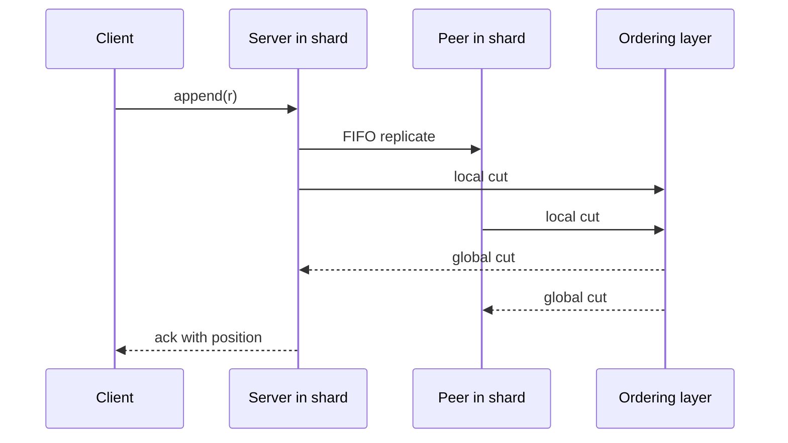

## Learning Objectives

- Separate the two complaints against a sequencer: the cost of a total order, and the cost of ordering before persisting.
- Define FuzzyLog's colors, chains and cross-edges, and state the guarantee at each scope.
- Trace a multi-color append through Skeen's algorithm and explain what a crashed client blocks.
- Compute a Scalog global cut from local cuts and derive record positions from it.
- Compare both designs by what they give up, and place FuzzyLog's maps on the PACELC axes.

## Context & Motivation

`the-shared-log-abstraction-corfu-tango-and-vcorfu` ended with every design tied to one sequencer. Two papers read that limit differently. [FuzzyLog](/papers/fuzzylog-partially-ordered-shared-log) (OSDI 2018) argues that a system-wide total order is "expensive, often impossible, and typically unnecessary", so it weakens the order. [Scalog](/papers/scalog-seamless-reconfiguration-and-total-order) (NSDI 2020) keeps the total order and blames the sequence of steps: positions assigned before records are durable. One changes what is promised, the other changes when the promise is computed.

## Core Theory

### Two complaints

In FuzzyLog's motivation section, "expensive" is arithmetic over assumptions, set against published sequencer speeds, not an experiment; the paper's experiment appears below. Take 20 servers at 30K 4KB appends/s per Gbps:

```text
  1 Gbps 20 servers 4096 B payload ->      0.60 M tokens/s
 40 Gbps 20 servers 4096 B payload ->     24.00 M tokens/s
 40 Gbps 20 servers  100 B payload ->    983.04 M tokens/s
 40 Gbps 40 servers  100 B payload ->   1966.08 M tokens/s
```

Its "impossible" is narrower than it sounds: a total order consistent with linearizability is subject to unavailability during a network partition. Its "unnecessary" is the observation that updates to disjoint data need no order.

Scalog's complaint is structural. If a position exists before its record does, a failure can leave a hole, and resolving holes requires system-wide agreement on a mapping from positions to storage. By Scalog's account, this is why any change in Corfu's storage servers makes the log unavailable until the new configuration is committed everywhere.

### FuzzyLog: a DAG of colors and chains

FuzzyLog replaces the sequence with a directed acyclic graph. A **color** is an application shard. Each color is a set of totally ordered **chains**, one per region, joined by **cross-edges** that record causality. Every region holds a full copy: current for its own chain, a possibly stale prefix for the others. A new node goes to the tail of the local chain, with cross-edges to the last node the client saw in each remote chain, so it is ordered after everything of that color the client has seen.

`sync` plays one color in an order that respects the edges, and returns a snapshot ID. Concurrent nodes may play in different orders in different regions. Each region writes only its own chain, so copies never conflict structurally, but the application must make concurrent updates commute. With one color in one region, FuzzyLog degenerates to an ordinary shared log.

| Scope | Guarantee |
|---|---|
| One color, one region | Linearizable |
| Many colors, one region | Serializable, may not respect real time |
| One color, across regions | Causally consistent, in the sense of `causal-consistency` |

The API offers no `sync` across colors, so the global snapshot that vCorfu draws from its total order has no direct equivalent here.

### Multi-color appends: Skeen's algorithm

An append to several colors must reach several partitions atomically. Dapple, the implementation, stores each color on one chain-replicated partition and uses a variant of Skeen's algorithm. The client collects a timestamp from each partition and sends back the maximum. A partition holds an append until nothing with a lower timestamp could still arrive. Single-color appends compress this to one phase, multi-color appends take two, and recovery takes three.

Plain Skeen does not survive participant failure, and here the clients are the fragile part. Leases, fencing and a write-ahead entry stored at the servers let another client finish a stuck append. Until then, the involved colors block.

### The evidence for FuzzyLog

Emulated Tango stops scaling at four clients because of its sequencer. Dapple scales near-linearly at 0% multi-color appends, is 2X faster at 1%, matches at 10%, and falls behind at 100%, where the required partial order is nearly a total order. That is Tango's protocol emulated inside Dapple, not Tango itself. The headline 5.5M puts/s for AtomicMap ran on 16 servers without replication, because of EC2 instance limits, and scaling assumes load balanced evenly across colors.

### Scalog: replicate first, order later

Scalog clients send a record to a storage server of their choice without knowing its position. Each server appends to its own log segment and forwards it over FIFO channels to the rest of its shard, so every backup segment is a prefix of the primary.

Periodically each server reports a **local cut**, a vector counting the records it holds per segment. Because channels are FIFO, a count is enough. The ordering layer takes the minimum across a shard's servers to learn what is durable, assembles a **global cut**, and returns it to all servers. A deterministic function then orders the records between two consecutive cuts: lower-numbered shards first, then lower-numbered servers.



The ordering layer is Paxos above a tree of soft-state aggregators, and it never sees records. Its load depends on the number of servers and the reporting frequency, not on write throughput. The cost is that an ack waits for a cut, and the paper states that Scalog is not well suited to ultra-low latency, highly predictable latency or low tail latencies.

A record that is not durable has no position, so a crashed client leaves no hole. A new shard joins by registering. Three policies handle a failed server: Finalize & Add and Remove & Replace need f + 1 servers per shard, Mask needs 2f + 1. Under Finalize & Add, the shard stops at its last cut, clients resend records outside it, and throughput returned after slightly more than a second, given a one-second timeout.

### The numbers behind 52M

Each figure comes from a different setup: 255K writes/s is 17 real shards at 15K each; 2.34M uses emulated storage servers with real aggregators; 52M is about 3,500 emulated shards times 15K, the capacity of the ordering layer, with an estimated latency of about 1.6 ms. A footnote says other scaling issues, such as the network, could not be assessed. Corfu's 530K is the sequencer limit of the authors' own reimplementation, so the comparison is between capacity limits, not deployed logs.

### What each one gives up

The table is a synthesis across the papers, not a result from any of them.

| | CORFU | FuzzyLog | Scalog |
|---|---|---|---|
| Order | Total | Partial, total per chain | Total |
| Position decided | Before the write | At the chain tail | After replication, at a cut |
| Main limit | Sequencer rate | Hot colors, multi-color share | Cut rate, then reader bandwidth |
| Typical stall | Hole, global reconfiguration | Crashed client wedges its colors | One shard; ack delay |
| Pays with | Availability during change | Weaker semantics, app-level design | Latency floor from cuts |

The papers do not use PACELC labels, so this reading of `pacelc-the-latency-consistency-trade-off-beyond-cap` is an inference. CRDTMap appends locally and replicates lazily: PA/EL. CAPMap routes appends through a primary region when healthy, so a secondary paid a 168 ms round trip in the paper's run, and during a partition the secondary forks locally: PA/EC, the combination that lesson's Example 2 classifies.

## Worked Examples

### Example 1: one color, two regions

Two concurrent puts, then a delete in NYC that has seen both, while SF concurrently writes C. A simulation compares a naive map with an OR-set, the CRDT behind the paper's CRDTMap:

```text
append NYC: n1 ('put', 'A') cross-edge-> None
append SF: s1 ('put', 'B') cross-edge-> None
NYC plays [n1, s1]  SF plays [s1, n1]
last play wins: NYC B  SF A
OR-set:         NYC ['A', 'B']  SF ['A', 'B']
append NYC: n2 ('del', ['n1', 's1']) cross-edge-> s1
append SF: s2 ('put', 'C') cross-edge-> n1
before sync: NYC []  SF ['A', 'B', 'C']
NYC plays [n1, s1, n2, s2]  SF plays [s1, n1, s2, n2]
OR-set:         NYC ['C']  SF ['C']
```

Both play orders respect every edge, yet naive puts diverge, because the DAG does not order concurrent nodes. The OR-set converges because a delete removes only the puts it observed, and n2 did not observe s2.

### Example 2: Skeen with a crash

The timestamps reproduce Figure 5 of the paper, then a third client crashes after phase 1:

```text
S1 phase1 C1 -> 2.1
S2 phase1 C2 -> 1.2
S2 phase1 C1 -> 2.2
S1 phase1 C2 -> 3.1
S1 phase2 C2 max=3.1
  S1 holds C2: pending ['C1'] has lower ts
S2 phase2 C2 max=3.1
  S2 holds C2: pending ['C1'] has lower ts
S2 phase2 C1 max=2.2
  S2 delivers C1
  S2 delivers C2
S1 phase2 C1 max=2.2
  S1 delivers C1
  S1 delivers C2
order S1 ['C1', 'C2']  S2 ['C1', 'C2']
-- origin crashes after phase 1 --
S1 phase1 C3 -> 4.1
S2 phase1 C3 -> 4.2
S1 phase1 C4 -> 5.1
S2 phase1 C4 -> 5.2
S1 phase2 C4 max=5.2
  S1 holds C4: pending ['C3'] has lower ts
S2 phase2 C4 max=5.2
  S2 holds C4: pending ['C3'] has lower ts
colors wedged; recovery client reads WAL, fences, rolls forward
S1 phase2 C3 max=4.2
  S1 delivers C3
  S1 delivers C4
S2 phase2 C3 max=4.2
  S2 delivers C3
  S2 delivers C4
order S1 ['C1', 'C2', 'C3', 'C4']  S2 ['C1', 'C2', 'C3', 'C4']
```

C2's phase 2 reached S1 before C1's, but S1 held it: C1 was pending there at 2.1, so its final timestamp could still be lower. C4 finished both phases and still blocked behind C3: the paper's latency spike, not a cascade of recoveries.

### Example 3: cuts, using Figure 2 of the Scalog paper

Two shards of two servers, positions from 1:

```text
shard 1: local cuts (3, 3) (2, 4) -> min (2, 3)
shard 2: local cuts (8, 4) (6, 5) -> min (6, 4)
cut 1: global cut (2, 3, 6, 4) sum=15 orders ['a', 'b', 'd', 'e', 'f', '...'] -> positions 1..15
ack b at 2  ack f at 5  c ordered? False  g ordered? False
cut 2: global cut (3, 4, 6, 4) sum=17 orders ['c', 'g'] -> positions 16..17
server 2 fails; shard 1 finalized at (3, 4); h on server 1 only, not in any cut
client resends h to server 3
cut 3: global cut (3, 4, 9, 6) sum=22 orders ['p7', 'p8', 'h', 'q5', 'q6'] -> positions 18..22
h at 20 ; gaps in positions: []
```

The sum of a cut counts the ordered records, and c waits until its backup exists. The failure leaves no hole: h never had a position, so its client resends it to shard 2. CORFU's `fill` exists because a position outlived its writer.

## Common Misconceptions & Pitfalls

- **"Scalog removes the sequencer's bottleneck entirely."** The paper says it cannot scale write throughput indefinitely. The limit moves to the ordering layer, and consuming the order remains limited by a client's bandwidth.
- **"Scalog does 52M writes per second."** That is emulated ordering-layer capacity. The largest result with real storage servers is 255K.
- **"Partial order always wins."** At 100% multi-color appends, Dapple lost to emulated Tango.
- **"A FuzzyLog application gets causal consistency across its whole state."** Causality holds within a color. Across shards the authors sketch COPSMap and leave it for future work.

## Summary

FuzzyLog and Scalog escape the single sequencer by opposite routes. FuzzyLog gives up the global order: colors shard state, per-region chains absorb geo-replication, cross-edges keep causality and Skeen's algorithm covers multi-color appends, leaving convergence and hot colors to the application. Scalog keeps the total order and reverses the steps: cuts over FIFO segments order records already replicated, which removes holes and makes reconfiguration local, at a cost in latency. `stateful-serverless-on-shared-logs-boki-and-flexlog` puts Scalog's protocol beneath serverless functions, and `low-latency-shared-logs-lazylog-and-speclog` returns to the latency it left open.

## Documentation Links

- [Lockerman et al.: The FuzzyLog, A Partially Ordered Shared Log (OSDI 2018)](https://www.usenix.org/system/files/osdi18-lockerman.pdf): colors and chains, the sequencer arithmetic, the map designs, Dapple and the variant of Skeen's algorithm.
- [Ding et al.: Scalog, Seamless Reconfiguration and Total Order in a Scalable Shared Log (NSDI 2020)](https://www.usenix.org/system/files/nsdi20-paper-ding.pdf): persistence-first ordering, local and global cuts, failure policies, emulation limits and stated limitations.
