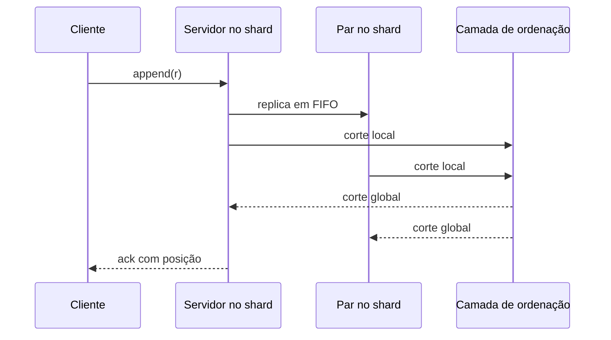

## Objetivos de Aprendizagem

- Separar as duas queixas contra um sequenciador: o custo de uma ordem total e o custo de ordenar antes de persistir.
- Definir cores, cadeias e cross-edges do FuzzyLog, e enunciar a garantia em cada escopo.
- Traçar um append multicor pelo algoritmo de Skeen e explicar o que um cliente caído bloqueia.
- Calcular um corte global do Scalog a partir de cortes locais e derivar dele as posições dos registros.
- Comparar os dois projetos pelo que abrem mão, e situar os mapas do FuzzyLog nos eixos do PACELC.

## Contexto e Motivação

`the-shared-log-abstraction-corfu-tango-and-vcorfu` terminou com todo projeto preso a um sequenciador. Dois papers leem esse limite de formas diferentes. O [FuzzyLog](/papers/fuzzylog-partially-ordered-shared-log) (OSDI 2018) argumenta que uma ordem total em todo o sistema é "expensive, often impossible, and typically unnecessary", e por isso enfraquece a ordem. O [Scalog](/papers/scalog-seamless-reconfiguration-and-total-order) (NSDI 2020) mantém a ordem total e culpa a sequência dos passos: posições atribuídas antes de os registros serem duráveis. Um muda o que é prometido, o outro muda quando a promessa é calculada.

## Teoria Central

### Duas queixas

Na seção de motivação do FuzzyLog, "expensive" é aritmética sobre premissas, comparada com velocidades publicadas de sequenciadores, e não um experimento; o experimento do paper aparece mais abaixo. Tome 20 servidores a 30K appends de 4KB/s por Gbps:

```text
  1 Gbps 20 servers 4096 B payload ->      0.60 M tokens/s
 40 Gbps 20 servers 4096 B payload ->     24.00 M tokens/s
 40 Gbps 20 servers  100 B payload ->    983.04 M tokens/s
 40 Gbps 40 servers  100 B payload ->   1966.08 M tokens/s
```

O "impossible" é mais estreito do que parece: uma ordem total consistente com linearizabilidade fica sujeita à indisponibilidade durante uma partição de rede. O "unnecessary" é a observação de que atualizações em dados disjuntos não precisam de ordem.

A queixa do Scalog é estrutural. Se uma posição existe antes do seu registro, uma falha pode deixar um buraco, e resolver buracos exige acordo em todo o sistema sobre um mapeamento de posições para armazenamento. Segundo o Scalog, é por isso que qualquer mudança nos servidores de armazenamento do Corfu deixa o log indisponível até a nova configuração ser confirmada em todos.

### FuzzyLog: um DAG de cores e cadeias

O FuzzyLog troca a sequência por um grafo acíclico dirigido. Uma **cor** é um shard da aplicação. Cada cor é um conjunto de **cadeias** totalmente ordenadas, uma por região, ligadas por **cross-edges** que registram causalidade. Toda região tem uma cópia completa: atualizada para a própria cadeia, e um prefixo possivelmente defasado das outras. Um nó novo entra na cauda da cadeia local, com cross-edges para o último nó que o cliente viu em cada cadeia remota, e assim fica ordenado depois de tudo daquela cor que o cliente já viu.

`sync` toca uma cor numa ordem que respeita as arestas e devolve um ID de snapshot. Nós concorrentes podem tocar em ordens diferentes em regiões diferentes. Cada região escreve só a própria cadeia, então as cópias nunca conflitam estruturalmente, mas a aplicação precisa fazer as atualizações concorrentes comutarem. Com uma cor em uma região, o FuzzyLog degenera num shared log comum.

| Escopo | Garantia |
|---|---|
| Uma cor, uma região | Linearizável |
| Várias cores, uma região | Serializável, pode não respeitar o tempo real |
| Uma cor, entre regiões | Causalmente consistente, no sentido de `causal-consistency` |

A API não oferece `sync` entre cores, então o snapshot global que o vCorfu tira da sua ordem total não tem equivalente direto aqui.

### Appends multicor: o algoritmo de Skeen

Um append para várias cores precisa alcançar várias partições de forma atômica. O Dapple, a implementação, guarda cada cor em uma partição com chain replication e usa uma variante do algoritmo de Skeen. O cliente coleta um timestamp de cada partição e devolve o máximo. Uma partição segura um append até que nada com timestamp menor possa mais chegar. Appends de uma cor comprimem isso em uma fase, os multicor levam duas e a recuperação leva três.

O Skeen puro não sobrevive à falha de um participante, e aqui a parte frágil são os clientes. Leases, fencing e uma entrada de write-ahead guardada nos servidores permitem que outro cliente termine um append travado. Até lá, as cores envolvidas ficam bloqueadas.

### A evidência do FuzzyLog

O Tango emulado para de escalar em quatro clientes por causa do sequenciador. O Dapple escala quase linearmente com 0% de appends multicor, é 2X mais rápido com 1%, empata com 10% e fica para trás com 100%, quando a ordem parcial exigida é quase uma ordem total. Isso é o protocolo do Tango emulado dentro do Dapple, não o próprio Tango. Os 5,5M puts/s do AtomicMap rodaram em 16 servidores sem replicação, por limites de instância no EC2, e a escalabilidade pressupõe carga balanceada entre as cores.

### Scalog: replicar primeiro, ordenar depois

Clientes do Scalog enviam um registro a um servidor de armazenamento à sua escolha, sem saber a posição. Cada servidor anexa ao próprio segmento de log e o repassa por canais FIFO ao resto do shard, de modo que todo segmento de backup é um prefixo do primário.

Periodicamente, cada servidor informa um **corte local** (local cut), um vetor que conta os registros que ele guarda por segmento. Como os canais são FIFO, uma contagem basta. A camada de ordenação tira o mínimo entre os servidores de um shard para saber o que é durável, monta um **corte global** (global cut) e o devolve a todos os servidores. Uma função determinística ordena então os registros entre dois cortes consecutivos: primeiro shards de número menor, depois servidores de número menor.



A camada de ordenação é Paxos sobre uma árvore de agregadores com estado descartável, e ela nunca vê registros. Sua carga depende do número de servidores e da frequência dos relatos, não do throughput de escrita. O custo é que um ack espera um corte, e o paper afirma que o Scalog não é adequado para latência ultrabaixa, latência muito previsível ou caudas baixas.

Um registro que não é durável não tem posição, então um cliente caído não deixa buraco. Um shard novo entra se registrando. Três políticas tratam um servidor com falha: Finalize & Add e Remove & Replace pedem f + 1 servidores por shard, e Mask pede 2f + 1. No Finalize & Add, o shard para no último corte, os clientes reenviam o que ficou fora dele, e o throughput voltou em pouco mais de um segundo, com um timeout de um segundo.

### Os números por trás de 52M

Cada número vem de uma montagem diferente: 255K escritas/s são 17 shards reais a 15K cada; 2,34M usa servidores de armazenamento emulados com agregadores reais; 52M são cerca de 3.500 shards emulados vezes 15K, a capacidade da camada de ordenação, com latência estimada de cerca de 1,6 ms. Uma nota de rodapé diz que outras questões de escala, como a rede, não puderam ser avaliadas. Os 530K do Corfu são o limite do sequenciador na reimplementação dos próprios autores, então a comparação é entre limites de capacidade, não entre logs em produção.

### O que cada um abre mão

A tabela é uma síntese entre os papers, não um resultado de nenhum deles.

| | CORFU | FuzzyLog | Scalog |
|---|---|---|---|
| Ordem | Total | Parcial, total por cadeia | Total |
| Posição decidida | Antes da escrita | Na cauda da cadeia | Depois da replicação, num corte |
| Limite principal | Taxa do sequenciador | Cores quentes, fração multicor | Taxa de cortes, depois banda do leitor |
| Parada típica | Buraco, reconfiguração global | Cliente caído trava suas cores | Um shard; atraso do ack |
| Paga com | Disponibilidade durante mudanças | Semântica mais fraca, projeto na aplicação | Piso de latência vindo dos cortes |

Os papers não usam os rótulos do PACELC, então esta leitura de `pacelc-the-latency-consistency-trade-off-beyond-cap` é uma inferência. O CRDTMap faz append local e replica de forma preguiçosa: PA/EL. O CAPMap roteia appends por uma região primária quando saudável, então uma secundária pagou uma ida e volta de 168 ms na execução do paper, e durante uma partição a secundária bifurca localmente: PA/EC, a combinação que o Exemplo 2 daquela lição classifica.

## Exemplos Resolvidos

### Exemplo 1: uma cor, duas regiões

Dois puts concorrentes e depois um delete em NYC que já viu os dois, enquanto SF escreve C ao mesmo tempo. Uma simulação compara um mapa ingênuo com um OR-set, o CRDT por trás do CRDTMap do paper:

```text
append NYC: n1 ('put', 'A') cross-edge-> None
append SF: s1 ('put', 'B') cross-edge-> None
NYC plays [n1, s1]  SF plays [s1, n1]
last play wins: NYC B  SF A
OR-set:         NYC ['A', 'B']  SF ['A', 'B']
append NYC: n2 ('del', ['n1', 's1']) cross-edge-> s1
append SF: s2 ('put', 'C') cross-edge-> n1
before sync: NYC []  SF ['A', 'B', 'C']
NYC plays [n1, s1, n2, s2]  SF plays [s1, n1, s2, n2]
OR-set:         NYC ['C']  SF ['C']
```

As duas ordens respeitam todas as arestas, e mesmo assim os puts ingênuos divergem, porque o DAG não ordena nós concorrentes. O OR-set converge porque um delete remove só os puts que observou, e n2 não observou s2.

### Exemplo 2: Skeen com uma queda

Os timestamps reproduzem a Figura 5 do paper, e depois um terceiro cliente cai após a fase 1:

```text
S1 phase1 C1 -> 2.1
S2 phase1 C2 -> 1.2
S2 phase1 C1 -> 2.2
S1 phase1 C2 -> 3.1
S1 phase2 C2 max=3.1
  S1 holds C2: pending ['C1'] has lower ts
S2 phase2 C2 max=3.1
  S2 holds C2: pending ['C1'] has lower ts
S2 phase2 C1 max=2.2
  S2 delivers C1
  S2 delivers C2
S1 phase2 C1 max=2.2
  S1 delivers C1
  S1 delivers C2
order S1 ['C1', 'C2']  S2 ['C1', 'C2']
-- origin crashes after phase 1 --
S1 phase1 C3 -> 4.1
S2 phase1 C3 -> 4.2
S1 phase1 C4 -> 5.1
S2 phase1 C4 -> 5.2
S1 phase2 C4 max=5.2
  S1 holds C4: pending ['C3'] has lower ts
S2 phase2 C4 max=5.2
  S2 holds C4: pending ['C3'] has lower ts
colors wedged; recovery client reads WAL, fences, rolls forward
S1 phase2 C3 max=4.2
  S1 delivers C3
  S1 delivers C4
S2 phase2 C3 max=4.2
  S2 delivers C3
  S2 delivers C4
order S1 ['C1', 'C2', 'C3', 'C4']  S2 ['C1', 'C2', 'C3', 'C4']
```

A fase 2 de C2 chegou a S1 antes da de C1, mas S1 a segurou: C1 estava pendente ali em 2.1, então seu timestamp final ainda podia ser menor. C4 terminou as duas fases e ainda assim ficou atrás de C3: o pico de latência do paper, não uma cascata de recuperações.

### Exemplo 3: cortes, com a Figura 2 do paper do Scalog

Dois shards de dois servidores, posições a partir de 1:

```text
shard 1: local cuts (3, 3) (2, 4) -> min (2, 3)
shard 2: local cuts (8, 4) (6, 5) -> min (6, 4)
cut 1: global cut (2, 3, 6, 4) sum=15 orders ['a', 'b', 'd', 'e', 'f', '...'] -> positions 1..15
ack b at 2  ack f at 5  c ordered? False  g ordered? False
cut 2: global cut (3, 4, 6, 4) sum=17 orders ['c', 'g'] -> positions 16..17
server 2 fails; shard 1 finalized at (3, 4); h on server 1 only, not in any cut
client resends h to server 3
cut 3: global cut (3, 4, 9, 6) sum=22 orders ['p7', 'p8', 'h', 'q5', 'q6'] -> positions 18..22
h at 20 ; gaps in positions: []
```

A soma de um corte conta os registros ordenados, e c espera até seu backup existir. A falha não deixa buraco: h nunca teve posição, então seu cliente o reenvia ao shard 2. O `fill` do CORFU existe porque uma posição sobreviveu a quem ia escrevê-la.

## Equívocos Comuns e Armadilhas

- **"O Scalog elimina por completo o gargalo do sequenciador."** O paper diz que ele não escala a escrita indefinidamente. O limite vai para a camada de ordenação, e consumir a ordem continua limitado pela banda de um cliente.
- **"O Scalog faz 52M escritas por segundo."** Isso é capacidade emulada da camada de ordenação. O maior resultado com servidores de armazenamento reais é 255K.
- **"Ordem parcial sempre ganha."** Com 100% de appends multicor, o Dapple perdeu para o Tango emulado.
- **"Uma aplicação FuzzyLog tem consistência causal em todo o estado."** A causalidade vale dentro de uma cor. Entre shards, os autores esboçam o COPSMap e o deixam para trabalho futuro.

## Resumo

FuzzyLog e Scalog escapam do sequenciador único por caminhos opostos. O FuzzyLog abre mão da ordem global: cores dividem o estado, cadeias por região absorvem a geo-replicação, cross-edges preservam a causalidade e o algoritmo de Skeen cobre os appends multicor, deixando convergência e cores quentes para a aplicação. O Scalog mantém a ordem total e inverte os passos: cortes sobre segmentos FIFO ordenam registros já replicados, o que elimina buracos e torna a reconfiguração local, com custo em latência. `stateful-serverless-on-shared-logs-boki-and-flexlog` coloca o protocolo do Scalog embaixo de funções serverless, e `low-latency-shared-logs-lazylog-and-speclog` volta à latência que ele deixou em aberto.

## Documentation Links

- [Lockerman et al.: The FuzzyLog, A Partially Ordered Shared Log (OSDI 2018)](https://www.usenix.org/system/files/osdi18-lockerman.pdf): cores e cadeias, a aritmética do sequenciador, os projetos de mapa, o Dapple e a variante do algoritmo de Skeen.
- [Ding et al.: Scalog, Seamless Reconfiguration and Total Order in a Scalable Shared Log (NSDI 2020)](https://www.usenix.org/system/files/nsdi20-paper-ding.pdf): ordenação com persistência primeiro, cortes locais e globais, políticas de falha, limites da emulação e limitações declaradas.
