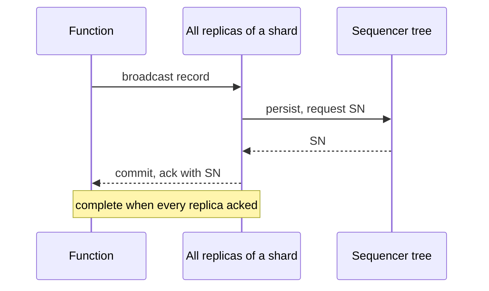

## Learning Objectives

- Explain why the shared log designs built on client views do not carry over to functions unchanged.
- Describe Boki's LogBook API and how one metalog handles ordering, read consistency and reconfiguration.
- Trace how BokiFlow gets exactly-once effects from an append-only API with no conditional append.
- Explain what auxiliary data is for and why its placement matters.
- Describe FlexLog's colors, sequencer tree and append protocol, and read its comparison with Boki under the conditions it was measured.

## Context & Motivation

`serverless-computing-and-the-function-as-a-service-model` ended on the Berkeley critique: FaaS bundles autoscaling with statelessness, and functions cannot keep state. In the Boki paper's example, a travel reservation calls one function for hotels and another for flights, and either can fail midway, leaving inconsistent state behind.

A shared log looks like the natural fit, since `the-shared-log-abstraction-corfu-tango-and-vcorfu` built consistent, durable objects from appends and reads. But the setting breaks three assumptions. Function memory is not guaranteed to survive between invocations, so Tango's local views vanish. Storage is disaggregated from compute, so reads lose locality. And a provider must host many logs on shared hardware. [Boki](/papers/boki-stateful-serverless-computing-with-shared-logs) (SOSP 2021) addresses these directly. [FlexLog](/papers/flexlog-shared-log-for-stateful-serverless-computing) (HPDC 2023) starts from Boki and questions two of its choices: SSD storage and total order.

## Core Theory

### LogBooks: many logs on few

Each function invocation is bound to one **LogBook**, with `logAppend`, `logReadNext`, `logReadPrev`, `logTrim` and `logSetAuxData`. Records carry tags, and records sharing a tag form a sub-stream, the same selective-read idea as Tango streams. Sequence numbers are monotonic but not consecutive, because many LogBooks are multiplexed on one physical log and a LogBook's records may land in any shard. Reading such a book would mean consulting every shard, so LogBook engines on the function nodes keep a compact **log index** grouped by (book, tag), plus a record cache. Writes go to dedicated storage nodes, and reads can stay on the function's own node.

### The metalog

Every shared log must answer three questions: how to order records, how to keep reads consistent when data is distributed, and how to survive failures. Boki answers all three with one structure, which the paper calls "the Answer to Everything":

```text
APPENDING to the metalog   decides the total order
COMPARING positions in it  enforces read consistency
SEALING it                 pauses the log for reconfiguration
```

Ordering comes from Scalog, as covered in `scaling-shared-logs-fuzzylog-and-scalog`. A LogBook engine numbers a record locally and replicates it to the storage nodes of its shard. Storage nodes report progress vectors; the primary sequencer takes the element-wise minimum and appends it to the metalog. Between consecutive vectors lies a **delta set**, ordered by (shard, local id).

Only the primary sequencer appends, and each entry waits for a quorum of sequencers before the next is issued. Entries are compact, so this primary-driven protocol is enough. In the prototype they live in sequencer DRAM, which assumes a quorum stays alive.

Consistency is checked lazily. Each index reflects some metalog position, and indexes advance independently. Each function tracks its own position, and a read through an index behind that position is suspended until the index catches up. That gives monotonic reads and read-your-writes without keeping indexes in lockstep, and a child function inherits its parent's position. Reconfiguration seals the current metalogs and starts new ones in the next term.

### Libraries: what the log buys

**BokiFlow** adapts Beldi's fault-tolerant workflows: every step with external effects is logged, and a failed workflow re-executes. The LogBook API has no conditional append, so BokiFlow tags each step, appends, reads back the first record of that tag, and honors only that record. The database write uses that record's sequence number as a version, so a replay fails the update condition. Locks follow the same pattern: an update names the position it builds on, and replay honors the first update to each position.

**BokiStore** adapts Tango's transactions, with snapshot isolation on JSON objects. **BokiQueue** adapts vCorfu's composable state machine replication, one shard per consumer.

### Auxiliary data: a view that survives the function

Without views, each read replays the object's records. Auxiliary data is a per-record, best-effort cache: BokiStore attaches a snapshot of the object to a record, and a reader seeks back from the tail to the nearest snapshot. On a Retwis workload, the paper measured 939 Op/s without it at three minutes, against 11,078 with it. The design stores it only on the function node; at a 16 MB cache that gave 3,561 Op/s, and backing it up on storage nodes restored 11,358.

### FlexLog: regions and a tree

FlexLog argues that many serverless jobs need less than total order: a chained analytics job must serialize its phases, not the tasks within a phase. A **color** here is a region of the log made of shards, with its own total order and its own sequencer in an n-ary tree. Records of different colors are ordered arbitrarily. Appending within one color gives linearizability, and writing across colors gives eventual consistency.

An order request climbs the tree only as far as the root sequencer of its color, and inner sequencers merge same-color requests. Sequence numbers combine a 32-bit epoch and a 32-bit counter, and 2f backups replicate only the epoch, so agreement stays out of normal execution. An append has four rounds:



Each replica keeps a DRAM cache, a crash-consistent log in Intel Optane persistent memory, and SSD for old segments. Because every replica commits before the append returns, one replica can serve a linearizable read. The cost is that a replica failure blocks appends, and a replica lost for good leaves its shard readable but not writable. FlexLog also has no index: a read contacts one replica of every shard of the color.

### Comparing them, with conditions

| | Boki | FlexLog |
|---|---|---|
| Order | Total per physical log | Total per color, tree of regions |
| Ordering step | Periodic vectors in a metalog | Per-request, merged in the tree |
| Read path | Index and cache on function node | One replica of each shard |
| Replica failure | Reconfigure by sealing | Appends block |
| Applications | Three libraries evaluated | None evaluated |

Boki's 1.2M Ops/s is an append-only microbenchmark: 1 KB records, 2,560 concurrent functions, 64 nodes, 2.03 ms median and 6.42 ms p99. Its 4.7× is median latency at 200 requests/s on one workload, against Beldi's logging layer on DynamoDB. Exactly-once itself costs 3.0× and 1.8× in median latency against an unsafe baseline.

FlexLog's comparisons are its own claims under its own setup, layer by layer. The 10× storage result sets its persistent memory layer against RocksDB under `db_bench`, not Boki's nodes. The 2.5× to 4× ordering latency writes no data and uses a single client, because the authors could not run a multi-client Boki ordering layer. The ordering throughput gain of up to 3× is measured against libpaxos, not Boki. No experiment runs a replicated, ordered append through both systems, and no serverless application runs on FlexLog. The authors' own takeaway: "The performance gains come from the fast ordering protocol (in appends) rather than the use of PM." Skipping the root adds 10% throughput. The paper implemented only single-log append and read, so the multi-color protocol is specified, not tested, and Optane has been discontinued.

## Worked Examples

### Example 1: delta sets and a suspended read

The vectors reproduce Figure 3 of the Boki paper, with shards a, b and c. Then two indexes sit at different positions:

```text
entry 0 (2, 1, 1): delta 0a 1a 0b 0c
entry 1 (3, 1, 3): delta 2a 1c 2c
entry 2 (5, 3, 4): delta 3a 4a 1b 2b 3c
entry 3 (5, 4, 6): delta 3b 4c 5c
total order: 0a 1a 0b 0c 2a 1c 2c 3a 4a 1b 2b 3c 3b 4c 5c
f read via A (pos 1): served, fn pos=1
f read via B (pos 3): served, fn pos=3
f appends a record ordered by entry 3
g, child of f, inherits pos 3
g (pos 3) read via A (pos 1): suspended
index A catches up to 3
g read via A (pos 3): served, fn pos=3
```

Index A was not wrong, only behind. Serving g from it would have hidden a record its parent had already seen.

### Example 2: exactly-once through re-execution

A workflow with two database steps crashes between the log append and the write of step 2. The rule is Figure 6 of the paper: honor the first record of the step, and condition the write on `Version < rec.seqnum`.

```text
run 1 step 1: appended seq 101, first record for step is seq 101
run 1: DB write with Version 101: applied
run 1 step 2: appended seq 102, first record for step is seq 102
run 1: crash before the DB write
re-run step 1: appended seq 103, first record for step is seq 101
re-run: DB write with Version 101: rejected
re-run step 2: appended seq 104, first record for step is seq 102
re-run: DB write with Version 102: applied
db: {'Value': '14C', 'Version': 102}
effective DB writes: 2
```

Duplicates reach the log (seq 103 and 104), but only first records count, so each step takes effect once. Log order does the job of a conditional append.

### Example 3: auxiliary data lives on one node

An object with 10,000 writes, read from two function nodes whose caches start empty:

```text
invocation on node1, empty cache: replays 10000
5 new writes; invocation on node1: replays 5
invocation on node2, whose cache is empty: replays 10005
```

The cache solves replay only where it sits. The same cost returns when a small cache evicts views, which is what the storage-node backup above repaired.

### Example 4: FlexLog's sequencer tree

Two leaves below a root, using the counter rule of the paper's Algorithm 1:

```text
3 appends red: answered by L1, last SN (0, 3), 1 sequencer hop
2 appends blue: answered by L2, last SN (0, 2), 1 sequencer hop
master color, one batching interval: L1 merges 3 requests, L2 merges 2
  L1->root n=3: root counter 3, SNs 1..3
  L2->root n=2: root counter 5, SNs 4..5
  5 records reached root as 2 messages
root fails, backup takes epoch 1: next SN (1, 1) = 4294967297
```

Red and blue never touch the root, and their SNs are not comparable with each other. An epoch bump keeps numbers increasing but not consecutive, which the paper accepts as a hole that does not violate correctness. Merging protects the root's throughput, not latency: the paper reports about 110 µs for one sequencer, growing linearly with tree height.

## Common Misconceptions & Pitfalls

- **"Boki and FlexLog are the same kind of color-based log."** Boki has no colors. And a FlexLog color is not a FuzzyLog color: FuzzyLog's is a shard with per-region chains and causal links, while FlexLog's is a log region with a single total order inside a tree.
- **"FlexLog is ten times faster than Boki."** That is a storage-layer microbenchmark against RocksDB, and the authors say appends gain from ordering, not from persistent memory.
- **"Boki reads take 1 to 3 ms."** FlexLog cites that range. Boki's own table gives medians of 0.12 to 0.79 ms, and p99s of 0.72 to 2.90 ms.
- **"A shared log makes functions stateful."** Functions stay stateless. State moves to the log, and tags, indexes and auxiliary data exist to contain the cost of rebuilding it.
- **"Boki's sequencers run multi-proposer Paxos."** FlexLog's test configures them to "run Paxos" and discusses livelock, but the Boki paper describes a primary-driven metalog where only the primary appends.

## Summary

Serverless breaks the client views that earlier shared logs rely on. Boki answers with LogBooks multiplexed on physical logs, an index and cache beside the functions, and a metalog that orders records, anchors read consistency and seals for reconfiguration. Its libraries reuse Beldi, Tango and vCorfu techniques, with auxiliary data standing in for views. FlexLog bets on faster storage and a tree of per-region sequencers, and blocks appends when a replica fails. Its comparisons with Boki are its own, layer by layer, and its multi-color protocol is unimplemented. `low-latency-shared-logs-lazylog-and-speclog` takes up the question both raise: how long an append really has to wait for ordering.

## Documentation Links

- [Jia and Witchel: Boki, Stateful Serverless Computing with Shared Logs (SOSP 2021)](https://www.cs.utexas.edu/~witchel/pubs/jia21sosp-boki.pdf): LogBooks, the metalog, the log index, auxiliary data, the three support libraries and their evaluation.
- [Giantsidi et al.: FlexLog, A Shared Log for Stateful Serverless Computing (HPDC 2023)](https://dse.in.tum.de/wp-content/uploads/2023/05/FlexLog_HPDC23.pdf): colors, the sequencer tree, the append protocol, tiered persistent memory storage and the layer-by-layer comparison with Boki.
- [Hellerstein et al.: Serverless Computing, One Step Forward, Two Steps Back (CIDR 2019)](https://www.cidrdb.org/cidr2019/papers/p119-hellerstein-cidr19.pdf): the critique of statelessness that motivates state management for functions.
