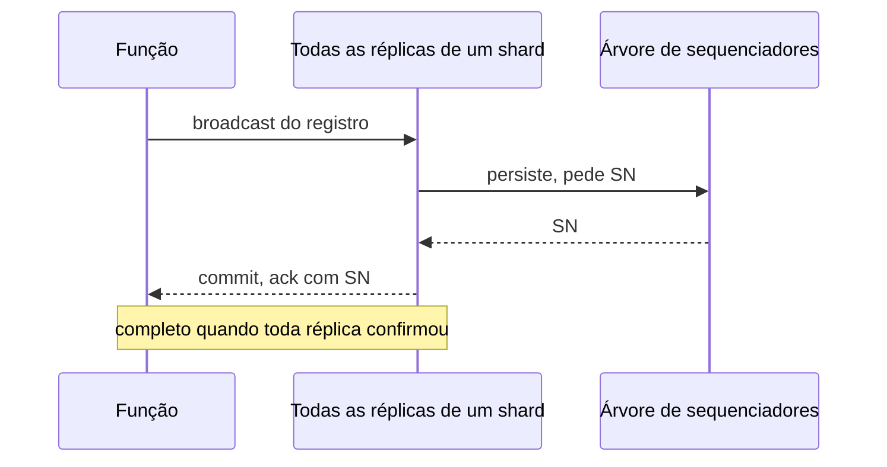

## Objetivos de Aprendizagem

- Explicar por que os projetos de shared log baseados em views no cliente não valem sem mudanças para funções.
- Descrever a API LogBook do Boki e como um único metalog cuida de ordenação, consistência de leitura e reconfiguração.
- Traçar como o BokiFlow obtém efeitos exactly-once de uma API só de append, sem append condicional.
- Explicar para que servem os dados auxiliares e por que o lugar onde ficam importa.
- Descrever as cores, a árvore de sequenciadores e o protocolo de append do FlexLog, e ler sua comparação com o Boki nas condições em que foi medida.

## Contexto e Motivação

`serverless-computing-and-the-function-as-a-service-model` terminou na crítica de Berkeley: FaaS empacota autoscaling com ausência de estado, e funções não conseguem guardar estado. No exemplo do paper do Boki, uma reserva de viagem chama uma função para hotéis e outra para voos, e qualquer uma pode falhar no meio, deixando estado inconsistente.

Um shared log parece a escolha natural, já que `the-shared-log-abstraction-corfu-tango-and-vcorfu` construiu objetos consistentes e duráveis com appends e leituras. Mas o cenário quebra três premissas. A memória de uma função não tem garantia de sobreviver entre invocações, então as views locais do Tango desaparecem. O armazenamento é separado da computação, então as leituras perdem localidade. E um provedor precisa hospedar muitos logs em hardware compartilhado. O [Boki](/papers/boki-stateful-serverless-computing-with-shared-logs) (SOSP 2021) ataca isso diretamente. O [FlexLog](/papers/flexlog-shared-log-for-stateful-serverless-computing) (HPDC 2023) parte do Boki e questiona duas de suas escolhas: armazenamento em SSD e ordem total.

## Teoria Central

### LogBooks: muitos logs sobre poucos

Cada invocação de função fica ligada a um **LogBook**, com `logAppend`, `logReadNext`, `logReadPrev`, `logTrim` e `logSetAuxData`. Registros carregam tags, e os que compartilham uma tag formam um sub-stream, a mesma ideia de leitura seletiva dos streams do Tango. Os números de sequência são monotônicos, mas não consecutivos, porque muitos LogBooks são multiplexados em um log físico e os registros de um LogBook podem cair em qualquer shard. Ler um livro assim exigiria consultar todos os shards, então os LogBook engines nos nós de função mantêm um **índice de log** compacto, agrupado por (livro, tag), mais um cache de registros. As escritas vão para nós de armazenamento dedicados, e as leituras podem ficar no próprio nó da função.

### O metalog

Todo shared log precisa responder a três perguntas: como ordenar registros, como manter leituras consistentes com dados distribuídos e como sobreviver a falhas. O Boki responde às três com uma estrutura só, que o paper chama de "the Answer to Everything":

```text
FAZER APPEND no metalog      decide a ordem total
COMPARAR posições nele       impõe a consistência de leitura
SELAR o metalog              pausa o log para reconfiguração
```

A ordenação vem do Scalog, como visto em `scaling-shared-logs-fuzzylog-and-scalog`. Um LogBook engine numera um registro localmente e o replica nos nós de armazenamento do seu shard. Esses nós informam vetores de progresso; o sequenciador primário tira o mínimo elemento a elemento e o anexa ao metalog. Entre vetores consecutivos fica um **delta set**, ordenado por (shard, id local).

Só o sequenciador primário faz append, e cada entrada espera um quórum de sequenciadores antes da próxima. As entradas são compactas, então esse protocolo conduzido pelo primário basta. No protótipo, elas ficam na DRAM dos sequenciadores, o que pressupõe que um quórum continue vivo.

A consistência é verificada de forma preguiçosa. Cada índice reflete alguma posição do metalog, e os índices avançam de forma independente. Cada função acompanha a própria posição, e uma leitura por um índice atrás dessa posição fica suspensa até o índice alcançar. Isso dá leituras monotônicas e read-your-writes sem manter os índices em sincronia, e uma função filha herda a posição da mãe. A reconfiguração sela os metalogs atuais e começa outros no termo seguinte.

### Bibliotecas: o que o log compra

O **BokiFlow** adapta os workflows tolerantes a falhas do Beldi: todo passo com efeitos externos é registrado, e um workflow que falhou é reexecutado. A API LogBook não tem append condicional, então o BokiFlow marca cada passo com uma tag, faz append, lê de volta o primeiro registro daquela tag e só honra esse registro. A escrita no banco usa o número de sequência desse registro como versão, então um replay falha na condição do update. Os locks seguem o mesmo padrão: uma atualização nomeia a posição sobre a qual foi construída, e o replay honra a primeira atualização de cada posição.

O **BokiStore** adapta as transações do Tango, com snapshot isolation sobre objetos JSON. O **BokiQueue** adapta a replicação de máquina de estados componível do vCorfu, com um shard por consumidor.

### Dados auxiliares: uma view que sobrevive à função

Sem views, cada leitura refaz o replay dos registros do objeto. Dados auxiliares são um cache por registro, de melhor esforço: o BokiStore anexa um snapshot do objeto a um registro, e um leitor busca para trás, a partir da cauda, o snapshot mais próximo. Numa carga Retwis, o paper mediu 939 Op/s sem eles aos três minutos, contra 11.078 com eles. O projeto os guarda só no nó da função; com cache de 16 MB isso deu 3.561 Op/s, e o backup nos nós de armazenamento devolveu 11.358.

### FlexLog: regiões e uma árvore

O FlexLog argumenta que muitos jobs serverless precisam de menos do que ordem total: um job encadeado de análise de dados precisa serializar suas fases, não as tarefas dentro de uma fase. Aqui, uma **cor** é uma região do log feita de shards, com ordem total própria e sequenciador próprio numa árvore n-ária. Registros de cores diferentes são ordenados arbitrariamente. Fazer append dentro de uma cor dá linearizabilidade, e escrever entre cores dá consistência eventual.

Uma requisição de ordem sobe a árvore só até o sequenciador raiz da sua cor, e os sequenciadores internos juntam requisições da mesma cor. Os números de sequência combinam uma época de 32 bits e um contador de 32 bits, e 2f backups replicam só a época, de modo que o acordo fica fora da execução normal. Um append tem quatro rodadas:



Cada réplica tem um cache em DRAM, um log crash-consistent em memória persistente Intel Optane e SSD para segmentos antigos. Como toda réplica confirma antes de o append retornar, uma réplica sozinha pode servir uma leitura linearizável. O custo é que a falha de uma réplica bloqueia os appends, e uma réplica perdida de vez deixa seu shard legível, mas não gravável. O FlexLog também não tem índice: uma leitura contata uma réplica de cada shard da cor.

### Comparando os dois, com condições

| | Boki | FlexLog |
|---|---|---|
| Ordem | Total por log físico | Total por cor, árvore de regiões |
| Passo de ordenação | Vetores periódicos num metalog | Por requisição, juntadas na árvore |
| Caminho de leitura | Índice e cache no nó da função | Uma réplica de cada shard |
| Falha de réplica | Reconfigura selando | Appends bloqueiam |
| Aplicações | Três bibliotecas avaliadas | Nenhuma avaliada |

O 1,2M Ops/s do Boki é um microbenchmark só de append: registros de 1 KB, 2.560 funções concorrentes, 64 nós, mediana de 2,03 ms e p99 de 6,42 ms. O 4,7× é latência mediana a 200 requisições/s em uma carga, contra a camada de log do Beldi sobre DynamoDB. O próprio exactly-once custa 3,0× e 1,8× em latência mediana contra uma linha de base insegura.

As comparações do FlexLog são afirmações dele, na montagem dele, camada por camada. O resultado de 10× em armazenamento coloca sua camada de memória persistente contra o RocksDB sob `db_bench`, não contra os nós do Boki. Os 2,5× a 4× de latência de ordenação não gravam dados e usam um único cliente, porque os autores não conseguiram rodar uma camada de ordenação do Boki com vários clientes. O ganho de até 3× em throughput de ordenação foi medido contra o libpaxos, não contra o Boki. Nenhum experimento passa um append replicado e ordenado pelos dois sistemas, e nenhuma aplicação serverless roda sobre o FlexLog. A conclusão dos próprios autores: "The performance gains come from the fast ordering protocol (in appends) rather than the use of PM." Pular a raiz acrescenta 10% de throughput. O paper implementou só append e leitura de log único, então o protocolo multicor está especificado, não testado, e o Optane foi descontinuado.

## Exemplos Resolvidos

### Exemplo 1: delta sets e uma leitura suspensa

Os vetores reproduzem a Figura 3 do paper do Boki, com shards a, b e c. Depois, dois índices estão em posições diferentes:

```text
entry 0 (2, 1, 1): delta 0a 1a 0b 0c
entry 1 (3, 1, 3): delta 2a 1c 2c
entry 2 (5, 3, 4): delta 3a 4a 1b 2b 3c
entry 3 (5, 4, 6): delta 3b 4c 5c
total order: 0a 1a 0b 0c 2a 1c 2c 3a 4a 1b 2b 3c 3b 4c 5c
f read via A (pos 1): served, fn pos=1
f read via B (pos 3): served, fn pos=3
f appends a record ordered by entry 3
g, child of f, inherits pos 3
g (pos 3) read via A (pos 1): suspended
index A catches up to 3
g read via A (pos 3): served, fn pos=3
```

O índice A não estava errado, só atrasado. Servir g por ele esconderia um registro que a função mãe já tinha visto.

### Exemplo 2: exactly-once por reexecução

Um workflow com dois passos de banco cai entre o append e a escrita do passo 2. A regra é a da Figura 6 do paper: honrar o primeiro registro do passo e condicionar a escrita a `Version < rec.seqnum`.

```text
run 1 step 1: appended seq 101, first record for step is seq 101
run 1: DB write with Version 101: applied
run 1 step 2: appended seq 102, first record for step is seq 102
run 1: crash before the DB write
re-run step 1: appended seq 103, first record for step is seq 101
re-run: DB write with Version 101: rejected
re-run step 2: appended seq 104, first record for step is seq 102
re-run: DB write with Version 102: applied
db: {'Value': '14C', 'Version': 102}
effective DB writes: 2
```

Duplicatas chegam ao log (seq 103 e 104), mas só os primeiros registros contam, então cada passo tem efeito uma vez. A ordem do log faz o papel de um append condicional.

### Exemplo 3: dados auxiliares moram em um nó

Um objeto com 10.000 escritas, lido de dois nós de função cujos caches começam vazios:

```text
invocation on node1, empty cache: replays 10000
5 new writes; invocation on node1: replays 5
invocation on node2, whose cache is empty: replays 10005
```

O cache resolve o replay só onde ele está. O mesmo custo volta quando um cache pequeno descarta views, e foi isso que o backup nos nós de armazenamento consertou.

### Exemplo 4: a árvore de sequenciadores do FlexLog

Duas folhas abaixo de uma raiz, usando a regra de contador do Algoritmo 1 do paper:

```text
3 appends red: answered by L1, last SN (0, 3), 1 sequencer hop
2 appends blue: answered by L2, last SN (0, 2), 1 sequencer hop
master color, one batching interval: L1 merges 3 requests, L2 merges 2
  L1->root n=3: root counter 3, SNs 1..3
  L2->root n=2: root counter 5, SNs 4..5
  5 records reached root as 2 messages
root fails, backup takes epoch 1: next SN (1, 1) = 4294967297
```

Red e blue nunca tocam a raiz, e seus SNs não são comparáveis entre si. Um salto de época mantém os números crescentes, mas não consecutivos, e o paper aceita isso como um buraco que não viola a correção. Juntar requisições protege o throughput da raiz, não a latência: o paper relata cerca de 110 µs com um sequenciador, crescendo linearmente com a altura da árvore.

## Equívocos Comuns e Armadilhas

- **"Boki e FlexLog são o mesmo tipo de log com cores."** O Boki não tem cores. E uma cor do FlexLog não é uma cor do FuzzyLog: a do FuzzyLog é um shard com cadeias por região e ligações causais, e a do FlexLog é uma região do log com uma única ordem total, dentro de uma árvore.
- **"O FlexLog é dez vezes mais rápido que o Boki."** Isso é um microbenchmark da camada de armazenamento contra o RocksDB, e os autores dizem que os appends ganham com a ordenação, não com a memória persistente.
- **"Leituras do Boki levam de 1 a 3 ms."** O FlexLog cita essa faixa. A tabela do próprio Boki dá medianas de 0,12 a 0,79 ms e p99s de 0,72 a 2,90 ms.
- **"Os sequenciadores do Boki rodam Paxos com vários proponentes."** O teste do FlexLog os configura para "run Paxos" e discute livelock, mas o paper do Boki descreve um metalog conduzido pelo primário, em que só o primário faz append.
- **"Um shared log torna as funções stateful."** As funções continuam sem estado. O estado vai para o log, e tags, índices e dados auxiliares existem para conter o custo de reconstruí-lo.

## Resumo

Serverless quebra as views no cliente das quais os shared logs anteriores dependem. O Boki responde com LogBooks multiplexados em logs físicos, um índice e um cache ao lado das funções, e um metalog que ordena registros, ancora a consistência de leitura e sela para reconfigurar. Suas bibliotecas reutilizam técnicas do Beldi, do Tango e do vCorfu, com dados auxiliares no lugar das views. O FlexLog aposta em armazenamento mais rápido e numa árvore de sequenciadores por região, e bloqueia appends quando uma réplica falha. Suas comparações com o Boki são dele, camada por camada, e seu protocolo multicor não foi implementado. `low-latency-shared-logs-lazylog-and-speclog` retoma a pergunta que os dois levantam: quanto um append realmente precisa esperar pela ordenação.

## Documentation Links

- [Jia and Witchel: Boki, Stateful Serverless Computing with Shared Logs (SOSP 2021)](https://www.cs.utexas.edu/~witchel/pubs/jia21sosp-boki.pdf): LogBooks, o metalog, o índice de log, dados auxiliares, as três bibliotecas de suporte e sua avaliação.
- [Giantsidi et al.: FlexLog, A Shared Log for Stateful Serverless Computing (HPDC 2023)](https://dse.in.tum.de/wp-content/uploads/2023/05/FlexLog_HPDC23.pdf): cores, a árvore de sequenciadores, o protocolo de append, o armazenamento em camadas com memória persistente e a comparação camada por camada com o Boki.
- [Hellerstein et al.: Serverless Computing, One Step Forward, Two Steps Back (CIDR 2019)](https://www.cidrdb.org/cidr2019/papers/p119-hellerstein-cidr19.pdf): a crítica à ausência de estado que motiva o gerenciamento de estado para funções.
