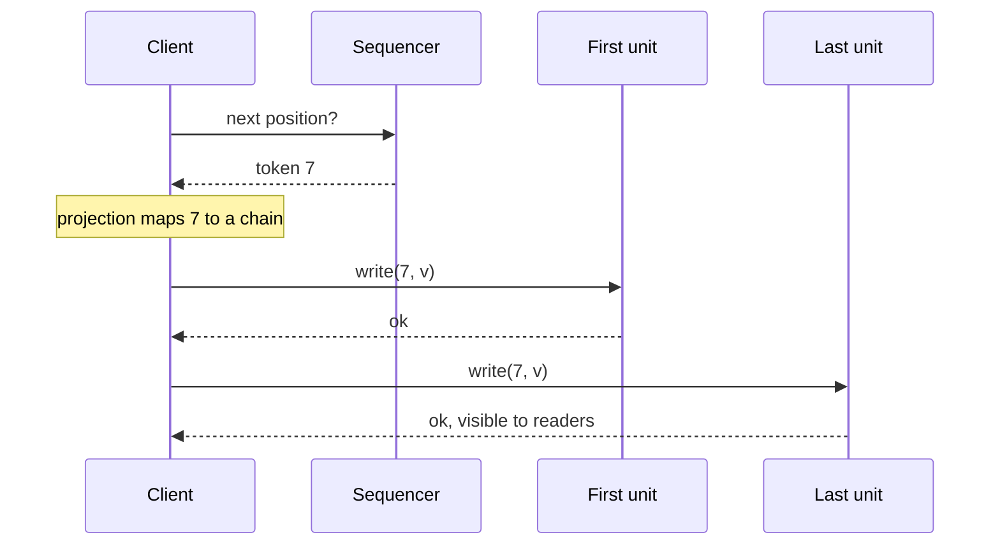

## Learning Objectives

- Explain what a shared log gives that a partitioned log does not, and what it costs.
- Trace a CORFU append through the projection, the sequencer and the client-driven chain, including what readers see when a client crashes midway.
- Explain why CORFU's sequencer is an optimization, and what changes once Tango stores backpointers in it.
- Trace a Tango transaction and show why replicas reach the same decision without exchanging messages.
- State the playback bottleneck and compare Tango streams with vCorfu's materialized streams and conditional tokens.

## Context & Motivation

`message-brokers-queues-vs-logs` scales a log by partitioning it: order holds inside a partition and nowhere else, so moving an item between partitions atomically needs a protocol on top. `raft-log-replication-and-commitment` keeps one order by sending everything through a leader, so appends stop at that leader's bandwidth. A shared log takes a third position: one total order over all updates, with no storage node limiting the append rate.

Three systems built this idea in layers. [CORFU](/papers/corfu-shared-log-design-for-flash-clusters) (NSDI 2012) made the log. [Tango](/papers/tango-distributed-data-structures-over-a-shared-log) (SOSP 2013) made data structures out of it. [vCorfu](/papers/vcorfu-cloud-scale-object-store-on-a-shared-log) (NSDI 2017) attacked the cost that Tango exposed.

## Core Theory

### CORFU: ordering without carrying the data

CORFU exposes `append`, `read`, `trim` and `fill` over a cluster of flash units, and all of its logic lives in a client library. Units are passive: they offer write-once pages and a seal command, and never talk to each other. The paper's phrase is that the design "decouples ordering from I/O". Three functions do the work:

```text
MAPPING      a projection maps log ranges to flash extents,
             round-robin by default, held by every client
TAIL         a sequencer, a networked counter, grants the next
             position as a token
REPLICATION  the client writes each replica in a fixed order,
             waiting for each unit before the next
```

Each successive position lands on a different replica chain, so CORFU scales by "partitioning over time, not space". The append rate is limited by how fast tokens are granted, not by the bandwidth of any unit.



### The sequencer is optional, the holes are not

Write-once pages already decide contention: if two clients race for a position, the first unit of the chain accepts one and returns an error to the other. The sequencer only removes that race in the common case, so the paper calls it "merely an optimization". A replacement learns its counter from the highest page each unit reports when sealed.

The price is a failure mode. A client can take a token and crash, leaving a hole, and applications that play the log strictly in order stall there. Any client can call `fill`: if the first unit holds a value, the client finishes the chain; otherwise it writes junk. A slow client that was not really dead then races the filler, so the sequencer "does not eliminate" contention entirely.

### Client-driven chain replication

`chain-replication-for-high-throughput-storage` has servers forward along the chain and commits at the tail. CORFU keeps the fixed order and the commit point, but the client does the forwarding, because units are passive. A write is complete only when the last unit has it, which tolerates f failures with f + 1 replicas. A reader that does not know whether a write finished must ask the last unit; one that knows may use any replica.

Replacing a failed unit changes the projection. A client seals the current epoch on the affected units, which then reject older messages, and writes the new projection to the next slot of an auxiliary store, which only one proposer can win. On 32 drives the median seal took about 5 ms and the auxiliary write 25 ms more, but that clock starts after detection: in the failure run, the appending client first waited a 1-second timeout.

### Tango: the log is the object

A Tango object has two forms: a history of updates in the log and any number of views, ordinary data structures in the RAM of application servers. In the paper's words, "the shared log is the object". A mutator only appends. An accessor checks the tail, plays forward, then reads its view. That is `the-replicated-state-machine-approach` with linearizable operations, durability by replay, and rollback by playing a prefix.

Transactions apply `optimistic-concurrency-control-and-mvcc` to the log. A commit record lists the objects read and their versions, where a version is the last offset that changed the object. Every client that reaches the record checks those versions and decides commit or abort on its own, and all of them agree because they replay the same prefix. A multi-object transaction is one record at one position.

### Playback, streams and their price

Tango names the catch: a client learns the order only at the speed of its NIC, however fast the log runs. Its answer is a stream per object, where `readnext` skips other entries and `multiappend` places one entry on several streams, so a cross-object transaction keeps a single commit record. This is layered partitioning: shards above, one order below, and "a cap on aggregate throughput across all partitions" once the log saturates.

Streams need metadata. Each entry carries backpointers to earlier entries of its stream, and the sequencer tracks them per stream. So the sequencer stops being a plain optimization: "we can no longer tolerate the existence of multiple sequencers", and a new one rebuilds its state by scanning the log. A client hosting a written object but not the read set also cannot decide alone, so the generating client appends a decision record, and developers mark by hand which objects need it.

### vCorfu: give each stream a home

vCorfu observes that Tango streams are "merely tags within a shared log": reading one is still client work, sequential along backpointers. It writes each update twice, to a log replica indexed by global address and to a stream replica indexed by stream id and stream address. A write takes four round trips: token, log replica, stream replica, commit. Replicas serve only committed data, so a stream replica holds a history with no holes and can play it itself, answering clients directly (a remote view).

The sequencer gains a job too. It issues tokens conditionally: if the affected streams changed since the transaction's snapshot, it refuses, the client aborts, and the log holds only committed transactions. Conflicts are detected per object, which is why composable state machine replication builds a large map from small child maps.

What vCorfu gives up: about a 40% write penalty against a backpointer variant (32-byte entries), a sequencer that does more and still sets the write limit, and data at risk if a log replica and a stream replica fail together. Its results ran in memory with persistence disabled.

### Reading the numbers

| Claim | Condition |
|---|---|
| CORFU, 200K appends/s (abstract) | Measured ceiling about 180K, set by a user-space sequencer; SSD writes were emulated |
| About 570K requests/s (Tango paper) | A rewritten CORFU sequencer alone, no batching |
| Tango, 180K linearizable reads/s | 18 clients against a 10K/s write load: offered load, not log capacity |

## Worked Examples

### Example 1: the append path with a crash and a stall

Two mirrored pairs, four clients. C2 crashes between replicas, C3 stalls holding its token, and a simulation of the protocol prints:

```text
C1 token=0 maps to (('F0', 'F1'), 0)
  F0:0 <- A: ok
  F1:0 <- A: ok
C2 token=1 maps to (('F2', 'F3'), 0)
  F2:0 <- B: ok
  crash before F3:0
C3 token=2 maps to (('F0', 'F1'), 1)
  stall before F0:1
C4 token=3 maps to (('F2', 'F3'), 1)
  F2:1 <- D: ok
  F3:1 <- D: ok
reads at tail: ['A', 'err_unwritten', 'err_unwritten', 'D']
  fill(1): head had B, chain now holds B
  fill(2): head had err_unwritten, chain now holds <junk>
C3 wakes up, retries token 2
  F0:1 <- C: err_trimmed
C3 new token=4 maps to (('F0', 'F1'), 2)
  F0:2 <- C: ok
  F1:2 <- C: ok
log: ['A', 'B', 'err_trimmed', 'D', 'C']
seal(epoch 0) highest page per unit: {'F0': 2, 'F1': 2, 'F2': 1, 'F3': 1}
new sequencer starts at 5
late write in epoch 0: err_badepoch
```

B reached the first unit, yet readers got an error until `fill` finished the chain: visibility follows the last unit. Position 2 had nothing, so it became junk, which CORFU trims in the same operation: later reads and C3's late write get `err_trimmed`, and C3 retries with a new token. Page 2 on the first pair is position 4, so a new sequencer starts at 5 from the seal replies alone.

### Example 2: two replicas decide alone

The log holds `put owners=alice` at offset 0, then three commit records: T2 reads owners at version 0 and writes it; T1 read the same version; T3 read version 1. Replicas replay it independently, and R3 stops at offset 2:

```text
R1 upto 4 {'T2': 'commit', 'T1': 'abort', 'T3': 'commit'} {'owners': 'bob', 'list': 'y'} {'owners': 1, 'list': 3}
R2 rebuilt later upto 4 {'T2': 'commit', 'T1': 'abort', 'T3': 'commit'} {'owners': 'bob', 'list': 'y'} {'owners': 1, 'list': 3}
R3 prefix upto 2 {'T2': 'commit'} {'owners': 'bob'} {'owners': 1}
```

T1 aborts because T2 changed owners inside its conflict window, and no message was needed. R3 shows rollback: a prefix is a past state.

### Example 3: who pays for playback

A 400-entry log with four objects, and a client that wants one of them:

```text
log=400 entries, u1 has 107 updates
full playback reads: 400
stream play reads: 107 ; cold offset list, K=4 strides: 27
remote view: client reads 1 reply; stream replica applied 107 updates once
conditional tokens, one map as one stream:
 TA write key a: 1
 TB write key b: None (no log entry)
same keys in two CSMR buckets:
 TA write key a in b0: 2
 TB write key b in b1: 3
```

Streams shrink the work and the remote view relocates it. The last lines show the per-object cost: TA and TB touch different keys, yet one stream makes them conflict, while two child objects do not.

## Common Misconceptions & Pitfalls

- **"All data passes through the sequencer."** Data never does, and in CORFU a replacement needs only the seal replies. Backpointers make it harder to replace, not part of the data path.
- **"A log-based broker is already a shared log."** `message-brokers-queues-vs-logs` orders only within a partition. A shared log orders everything, which makes one commit record enough for a cross-object transaction and also caps throughput.
- **"Tango streams partition the log."** They partition what each client reads. All streams still share one order and one sequencer.
- **"vCorfu removes playback."** It moves playback from the client to the stream replica, and pays for it on every write.

## Summary

A shared log gives one total order without one storage bottleneck. CORFU separates ordering from I/O: a sequencer grants positions, clients write chains directly, and write-once pages settle races, at the price of holes and a global mapping. Tango turns the log into objects and transactions decided by replay, then adds streams against the playback bottleneck, which binds it to one sequencer. vCorfu materializes streams so servers can play them, at a cost in writes. All three keep a single sequencer, the assumption that `scaling-shared-logs-fuzzylog-and-scalog` questions.

## Documentation Links

- [Balakrishnan et al.: CORFU, A Shared Log Design for Flash Clusters (NSDI 2012)](https://www.usenix.org/system/files/conference/nsdi12/nsdi12-final30.pdf): projections, the sequencer, client-driven chains, hole filling, reconfiguration and the throughput evaluation.
- [Balakrishnan et al.: Tango, Distributed Data Structures over a Shared Log (SOSP 2013)](https://www.cs.cornell.edu/~taozou/sosp13/tangososp.pdf): objects as histories and views, commit records, streams, decision records and backpointers.
- [Wei et al.: vCorfu, A Cloud-Scale Object Store on a Shared Log (NSDI 2017)](https://www.usenix.org/system/files/conference/nsdi17/nsdi17-wei-michael.pdf): materialized streams, remote views, conditional tokens and composable state machine replication.
