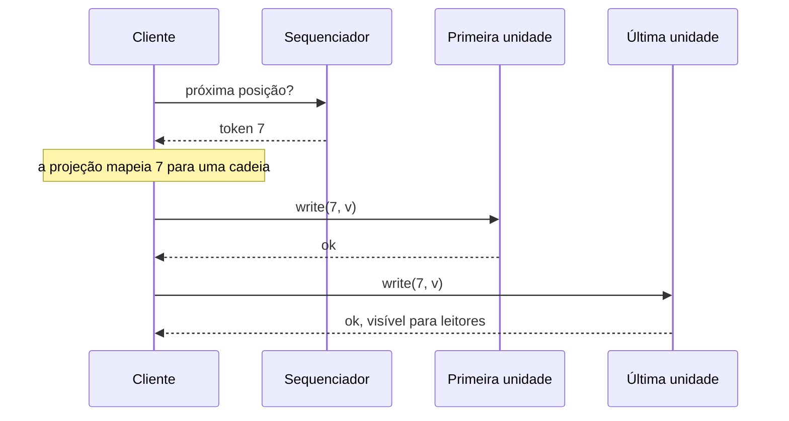

## Objetivos de Aprendizagem

- Explicar o que um shared log oferece e um log particionado não oferece, e quanto isso custa.
- Traçar um append do CORFU pela projeção, pelo sequenciador e pela cadeia conduzida pelo cliente, incluindo o que os leitores veem quando um cliente cai no meio do caminho.
- Explicar por que o sequenciador do CORFU é uma otimização, e o que muda quando o Tango guarda backpointers nele.
- Traçar uma transação do Tango e mostrar por que as réplicas chegam à mesma decisão sem trocar mensagens.
- Enunciar o gargalo de playback e comparar os streams do Tango com os streams materializados e os tokens condicionais do vCorfu.

## Contexto e Motivação

`message-brokers-queues-vs-logs` escala um log particionando-o: a ordem vale dentro de uma partição e em nenhum outro lugar, então mover um item entre partições de forma atômica exige um protocolo por cima. `raft-log-replication-and-commitment` mantém uma ordem só fazendo tudo passar por um líder, e os appends param na largura de banda desse líder. Um shared log ocupa uma terceira posição: uma ordem total sobre todas as atualizações, sem que nenhum nó de armazenamento limite a taxa de append.

Três sistemas construíram essa ideia em camadas. O [CORFU](/papers/corfu-shared-log-design-for-flash-clusters) (NSDI 2012) fez o log. O [Tango](/papers/tango-distributed-data-structures-over-a-shared-log) (SOSP 2013) fez estruturas de dados a partir dele. O [vCorfu](/papers/vcorfu-cloud-scale-object-store-on-a-shared-log) (NSDI 2017) atacou o custo que o Tango expôs.

## Teoria Central

### CORFU: ordenar sem carregar os dados

O CORFU expõe `append`, `read`, `trim` e `fill` sobre um cluster de unidades flash, e toda a lógica fica numa biblioteca do cliente. As unidades são passivas: oferecem páginas write-once e um comando de seal, e nunca falam entre si. Na expressão do paper, o projeto "decouples ordering from I/O". Três funções fazem o trabalho:

```text
MAPEAMENTO   uma projeção mapeia faixas do log para extents de
             flash, round-robin por padrão, e todo cliente a guarda
CAUDA        um sequenciador, um contador em rede, concede a
             próxima posição como um token
REPLICAÇÃO   o cliente grava cada réplica numa ordem fixa,
             esperando cada unidade antes da seguinte
```

Cada posição sucessiva cai numa cadeia de réplicas diferente, então o CORFU escala por "partitioning over time, not space". A taxa de append é limitada pela velocidade de concessão de tokens, não pela largura de banda de uma unidade.



### O sequenciador é opcional, os buracos não

As páginas write-once já resolvem a disputa: se dois clientes correm por uma posição, a primeira unidade da cadeia aceita um e devolve erro ao outro. O sequenciador só elimina essa corrida no caso comum, e por isso o paper o chama de "merely an optimization". Um substituto descobre seu contador pela página mais alta que cada unidade informa ao ser selada.

O preço é um modo de falha. Um cliente pode pegar um token e cair, deixando um buraco, e aplicações que tocam o log estritamente em ordem travam ali. Qualquer cliente pode chamar `fill`: se a primeira unidade tem um valor, ele termina a cadeia; se não, grava lixo. Um cliente lento que não tinha morrido passa então a disputar com quem preenche, e assim o sequenciador "does not eliminate" a contenção por inteiro.

### Replicação em cadeia conduzida pelo cliente

Em `chain-replication-for-high-throughput-storage`, os servidores repassam ao longo da cadeia e o commit acontece na cauda. O CORFU mantém a ordem fixa e o ponto de commit, mas quem repassa é o cliente, porque as unidades são passivas. Uma escrita só está completa quando a última unidade a tem, o que tolera f falhas com f + 1 réplicas. Um leitor que não sabe se a escrita terminou precisa perguntar à última unidade; quem sabe pode usar qualquer réplica.

Trocar uma unidade com falha muda a projeção. Um cliente sela a época atual nas unidades afetadas, que passam a rejeitar mensagens antigas, e grava a nova projeção no próximo slot de um armazenamento auxiliar, que só um proponente consegue ganhar. Em 32 drives, a mediana do seal foi de cerca de 5 ms e a escrita no auxiliar levou mais 25 ms, mas esse relógio só começa depois da detecção: na execução com falha, o cliente que fazia append esperou antes um timeout de 1 segundo.

### Tango: o log é o objeto

Um objeto Tango tem duas formas: um histórico de atualizações no log e qualquer número de views, estruturas de dados comuns na RAM dos servidores de aplicação. Nas palavras do paper, "the shared log is the object". Um mutador apenas faz append. Um acessor consulta a cauda, toca o log até ali e então lê sua view. Isso é `the-replicated-state-machine-approach` com operações linearizáveis, durabilidade por replay e rollback tocando um prefixo.

As transações aplicam `optimistic-concurrency-control-and-mvcc` ao log. Um registro de commit lista os objetos lidos e suas versões, e a versão é o último offset que alterou o objeto. Todo cliente que alcança o registro confere essas versões e decide sozinho entre commit e abort, e todos concordam porque tocam o mesmo prefixo. Uma transação sobre vários objetos é um registro em uma posição.

### Playback, streams e seu preço

O Tango nomeia o problema: um cliente aprende a ordem só na velocidade da sua placa de rede, por mais rápido que o log seja. A resposta é um stream por objeto, em que `readnext` pula as outras entradas e `multiappend` coloca uma entrada em vários streams, de modo que uma transação entre objetos continua com um único registro de commit. Isso é o particionamento em camadas: shards em cima, uma ordem embaixo, e "a cap on aggregate throughput across all partitions" quando o log satura.

Streams pedem metadados. Cada entrada carrega backpointers para entradas anteriores do seu stream, e o sequenciador os acompanha por stream. Com isso, ele deixa de ser uma simples otimização: "we can no longer tolerate the existence of multiple sequencers", e um sequenciador novo reconstrói seu estado varrendo o log. Um cliente que hospeda um objeto escrito, mas não o conjunto de leitura, também não consegue decidir sozinho, então o cliente que gerou a transação anexa um registro de decisão, e os desenvolvedores marcam à mão quais objetos precisam disso.

### vCorfu: dar um endereço a cada stream

O vCorfu observa que os streams do Tango são "merely tags within a shared log": ler um deles continua sendo trabalho do cliente, sequencial ao longo dos backpointers. Ele grava cada atualização duas vezes, numa réplica de log indexada pelo endereço global e numa réplica de stream indexada pelo id do stream e pelo endereço no stream. Uma escrita leva quatro idas e voltas: token, réplica de log, réplica de stream, commit. As réplicas só servem dados confirmados, então uma réplica de stream guarda um histórico sem buracos e pode tocá-lo ela mesma, respondendo direto aos clientes (uma remote view).

O sequenciador também ganha uma tarefa. Ele emite tokens de forma condicional: se os streams afetados mudaram desde o snapshot da transação, ele recusa, o cliente aborta e o log guarda só transações confirmadas. Os conflitos são detectados por objeto, e é por isso que a replicação de máquina de estados componível monta um mapa grande a partir de mapas filhos pequenos.

O que o vCorfu abre mão: cerca de 40% de penalidade de escrita contra uma variante com backpointers (entradas de 32 bytes), um sequenciador que faz mais e continua definindo o limite de escrita, e dados em risco se uma réplica de log e uma de stream falharem juntas. Seus resultados rodaram em memória, com a persistência desligada.

### Lendo os números

| Afirmação | Condição |
|---|---|
| CORFU, 200K appends/s (abstract) | Teto medido de cerca de 180K, definido por um sequenciador em espaço de usuário; as escritas em SSD foram emuladas |
| Cerca de 570K requisições/s (paper do Tango) | Um sequenciador do CORFU reescrito, sozinho, sem batching |
| Tango, 180K leituras linearizáveis/s | 18 clientes contra uma carga de 10K escritas/s: carga oferecida, não capacidade do log |

## Exemplos Resolvidos

### Exemplo 1: o caminho do append com uma queda e uma pausa

Dois pares espelhados, quatro clientes. C2 cai entre as réplicas, C3 fica parado com seu token, e uma simulação do protocolo imprime:

```text
C1 token=0 maps to (('F0', 'F1'), 0)
  F0:0 <- A: ok
  F1:0 <- A: ok
C2 token=1 maps to (('F2', 'F3'), 0)
  F2:0 <- B: ok
  crash before F3:0
C3 token=2 maps to (('F0', 'F1'), 1)
  stall before F0:1
C4 token=3 maps to (('F2', 'F3'), 1)
  F2:1 <- D: ok
  F3:1 <- D: ok
reads at tail: ['A', 'err_unwritten', 'err_unwritten', 'D']
  fill(1): head had B, chain now holds B
  fill(2): head had err_unwritten, chain now holds <junk>
C3 wakes up, retries token 2
  F0:1 <- C: err_overwritten
C3 new token=4 maps to (('F0', 'F1'), 2)
  F0:2 <- C: ok
  F1:2 <- C: ok
log: ['A', 'B', '<junk>', 'D', 'C']
seal(epoch 0) highest page per unit: {'F0': 2, 'F1': 2, 'F2': 1, 'F3': 1}
new sequencer starts at 5
late write in epoch 0: err_badepoch
```

B chegou à primeira unidade, mas os leitores receberam erro até `fill` terminar a cadeia: a visibilidade segue a última unidade. A posição 2 não tinha nada e virou lixo, e o write-once transformou a escrita atrasada de C3 numa nova tentativa. A página 2 do primeiro par é a posição 4, então um sequenciador novo começa em 5 só com as respostas do seal.

### Exemplo 2: duas réplicas decidem sozinhas

O log tem `put owners=alice` no offset 0 e depois três registros de commit: T2 lê owners na versão 0 e a escreve; T1 leu a mesma versão; T3 leu a versão 1. As réplicas tocam o log de forma independente, e R3 para no offset 2:

```text
R1 upto 4 {'T2': 'commit', 'T1': 'abort', 'T3': 'commit'} {'owners': 'bob', 'list': 'y'} {'owners': 1, 'list': 3}
R2 rebuilt later upto 4 {'T2': 'commit', 'T1': 'abort', 'T3': 'commit'} {'owners': 'bob', 'list': 'y'} {'owners': 1, 'list': 3}
R3 prefix upto 2 {'T2': 'commit'} {'owners': 'bob'} {'owners': 1}
```

T1 aborta porque T2 mudou owners dentro da sua janela de conflito, e nenhuma mensagem foi necessária. R3 mostra o rollback: um prefixo é um estado passado.

### Exemplo 3: quem paga pelo playback

Um log de 400 entradas com quatro objetos, e um cliente que quer um deles:

```text
log=400 entries, u1 has 107 updates
full playback reads: 400
stream play reads: 107 ; cold offset list, K=4 strides: 27
remote view: client reads 1 reply; stream replica applied 107 updates once
conditional tokens, one map as one stream:
 TA write key a: 1
 TB write key b: None (no log entry)
same keys in two CSMR buckets:
 TA write key a in b0: 2
 TB write key b in b1: 3
```

Os streams encolhem o trabalho e a remote view o muda de lugar. As últimas linhas mostram o custo por objeto: TA e TB mexem em chaves diferentes, mas um stream único as faz conflitar, e dois objetos filhos não.

## Equívocos Comuns e Armadilhas

- **"Todos os dados passam pelo sequenciador."** Nunca passam, e no CORFU um substituto só precisa das respostas do seal. Os backpointers o tornam mais difícil de substituir, não parte do caminho de dados.
- **"Um broker baseado em log já é um shared log."** `message-brokers-queues-vs-logs` ordena só dentro de uma partição. Um shared log ordena tudo, e isso faz um registro de commit bastar para uma transação entre objetos, além de limitar o throughput.
- **"Os streams do Tango particionam o log."** Eles particionam o que cada cliente lê. Todos os streams continuam dividindo uma ordem e um sequenciador.
- **"O vCorfu elimina o playback."** Ele move o playback do cliente para a réplica de stream, e paga por isso em toda escrita.

## Resumo

Um shared log dá uma ordem total sem um gargalo único de armazenamento. O CORFU separa ordenação de I/O: um sequenciador concede posições, os clientes gravam cadeias diretamente e páginas write-once resolvem as corridas, ao preço de buracos e de um mapeamento global. O Tango transforma o log em objetos e transações decididas por replay, depois acrescenta streams contra o gargalo de playback, o que o prende a um sequenciador. O vCorfu materializa os streams para que servidores os toquem, com custo nas escritas. Os três mantêm um único sequenciador, a premissa que `scaling-shared-logs-fuzzylog-and-scalog` questiona.

## Documentation Links

- [Balakrishnan et al.: CORFU, A Shared Log Design for Flash Clusters (NSDI 2012)](https://www.usenix.org/system/files/conference/nsdi12/nsdi12-final30.pdf): projeções, sequenciador, cadeias conduzidas pelo cliente, preenchimento de buracos, reconfiguração e a avaliação de throughput.
- [Balakrishnan et al.: Tango, Distributed Data Structures over a Shared Log (SOSP 2013)](https://www.cs.cornell.edu/~taozou/sosp13/tangososp.pdf): objetos como históricos e views, registros de commit, streams, registros de decisão e backpointers.
- [Wei et al.: vCorfu, A Cloud-Scale Object Store on a Shared Log (NSDI 2017)](https://www.usenix.org/system/files/conference/nsdi17/nsdi17-wei-michael.pdf): streams materializados, remote views, tokens condicionais e replicação de máquina de estados componível.
