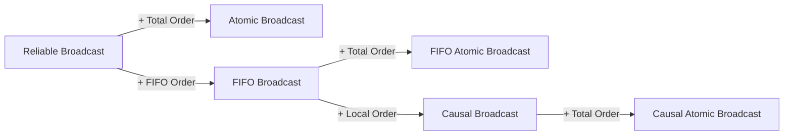

## Learning Objectives

- Define Reliable Broadcast and Atomic (total-order) Broadcast by their properties, and state what the uniform variants add.
- Walk through the Chandra-Toueg reduction from total-order broadcast to a sequence of consensus instances, and explain why it needs Reliable Broadcast.
- Give the reverse reduction, and state exactly what "equivalent" means, including its conditions.
- Say what total order does not promise, and what the equivalence does not say about cost.

## Context & Motivation

`the-replicated-state-machine-approach` reduced replication to every replica applying the same commands in the same order, and `the-consensus-problem-agreement-validity-and-termination` said that running consensus once per log position delivers that order. Both statements were informal. A replicated service does not really want consensus, which decides one value and stops. It wants a communication primitive that keeps delivering messages to everyone in one order. This lesson names that primitive, builds it from consensus, and shows that the two problems are equivalent.

## Core Theory

### The specification

Hadzilacos and Toueg build a family of broadcasts from a small set of properties. Atomic Broadcast, also called total-order broadcast, is one member. Reliable Broadcast comes first:

```text
VALIDITY:  if a correct process broadcasts m, it eventually
           delivers m.
AGREEMENT: if a correct process delivers m, all correct
           processes eventually deliver m.
INTEGRITY: every correct process delivers m at most once, and
           only if sender(m) previously broadcast it.
```

Atomic Broadcast is Reliable Broadcast plus one requirement:

```text
TOTAL ORDER: if correct processes p and q both deliver m and
             m', then p delivers m before m' if and only if
             q delivers m before m'.
```

Agreement and Total Order together imply that correct processes eventually deliver the same sequence. These match the two properties of `the-replicated-state-machine-approach`: Agreement gives the same set, Total Order the same sequence.

### Uniformity: what a crashed process did

All of those properties speak only about correct processes. That leaves a gap. A process may deliver messages in some order, answer a client, and then crash, and the definition places no constraint on what it did. Hadzilacos and Toueg define stronger versions that remove the word "correct" where it matters. Uniform Total Order, for example, applies to any processes, "whether correct or faulty". A replicated service that exposes results wants the uniform version, because an answer given by a replica that later crashed is still an answer the client saw. In the reduction below, a process delivers only what consensus decided, so consensus with uniform agreement keeps a crashed process's deliveries on the agreed sequence.

### From consensus to total order

The reduction is due to Chandra and Toueg, and Hadzilacos and Toueg present the same construction. It uses repeated, independent consensus executions, tagged by a counter k, where the kth execution decides the kth batch of messages.

```text
To A-broadcast m:          R-broadcast m

When R-deliver(m):         add m to R_delivered

Loop, while R_delivered - A_delivered is not empty:
    k := k + 1
    propose(k, R_delivered - A_delivered)
    wait for decide(k, msgSet)
    batch := msgSet - A_delivered
    A-deliver batch in a deterministic order agreed in advance
    A_delivered := A_delivered + batch
```

Three details carry the proof.

- **The proposed value is a set, not a message.** Consensus decides one proposal, and a set lets one instance order many messages.
- **The deterministic order inside a batch.** Agreement gives all processes the same set, and sorting it, for instance lexicographically, turns a set into a sequence with no further communication.
- **Reliable Broadcast comes first.** The consensus specification assumes every correct process proposes. Agreement of Reliable Broadcast guarantees that a message known to one correct process eventually reaches every other, so if p enters instance k, every correct process eventually does too.

Validity is the subtle property. A message can lose instance after instance, since consensus decides only one proposal. The proof handles this directly: if a correct process broadcast m and m were never delivered, every correct process would keep m in its undelivered set. After some instance, all correct processes propose sets containing m and no faulty process proposes anymore. Whatever consensus then decides contains m, which is a contradiction.

The reduction tolerates as many faulty processes as the consensus algorithm it is given. Chandra and Toueg state the result for any system, "synchronous or asynchronous", subject to crash failures in which Reliable Broadcast can be implemented.

### From total order to consensus

The other direction takes two lines. To propose v, A-broadcast v. To decide, take the value of the first message you A-deliver. Total Order and Agreement mean all correct processes see the same first message, so they decide the same value, and that value was proposed by someone.

### What "equivalent" means

Each problem can be transformed into the other, so a solution to one yields a solution to the other. The two directions are not symmetric in their assumptions:

```text
Atomic Broadcast -> Consensus:
    tolerates any number of benign failures; assumes nothing
    about the network's type or synchrony.

Consensus -> Atomic Broadcast:
    assumes Reliable Broadcast is available and only crash
    failures occur; assumes nothing about synchrony.
```

Hadzilacos and Toueg note that a more complex transformation works for any type of failure, and Chandra and Toueg state the same equivalence for arbitrary failures without giving the construction.

The first consequence is that impossibility transfers. Atomic Broadcast cannot be solved deterministically in an asynchronous system with even one crash, because that would solve consensus and contradict `the-flp-impossibility-result`. Hadzilacos and Toueg call this seemingly paradoxical, since real group communication systems of the time offered the primitive. Their resolution is that such systems rely at some level on a mechanism like failure detection through timeouts. The second consequence is that any technique that solves consensus (randomization, failure detectors) also solves Atomic Broadcast.

### What total order leaves out

Total order is a statement about pairs of delivered messages, and nothing more. It does not imply FIFO order. Hadzilacos and Toueg give the scenario: a process suffers a transient failure while broadcasting m, then broadcasts m', and correct processes deliver only m'. It does not imply causal order either, which is why they define FIFO Atomic Broadcast and Causal Atomic Broadcast as separate, stronger primitives. Nothing in the definition mentions real time.



## Worked Examples

### Example 1: Reliable Broadcast is not enough

Three replicas hold a balance of 1000. Messages are m1 = add 100, m2 = double, m3 = subtract 50. Reliable Broadcast delivers all three everywhere, in no particular order:

```text
p: m1 m2 m3   (1000 + 100) * 2 - 50 = 2150
q: m2 m1 m3   (1000 * 2) + 100 - 50 = 2050
r: m3 m1 m2   (1000 - 50 + 100) * 2 = 2100
```

Every message is delivered exactly once at every replica, and the replicas still diverge.

### Example 2: the reduction, including a proposal that loses

Same replicas and messages. The consensus outcomes below are a chosen schedule: consensus may pick any process's proposal.

```text
k = 1   p proposes {m1, m2}
        q proposes {m2}
        r proposes {m3}
        decision: {m1, m2}   (p's proposal)
        everyone A-delivers m1, m2

k = 2   by now all three have R-delivered m3
        p, q, r each propose {m3}
        decision: {m3}
        everyone A-delivers m3

all replicas: m1 m2 m3 -> 2150
```

Three things are visible. Agreement on a set became a sequence through sorting. The message m1 was delivered at q even though q never proposed it, because the decision carries it. And r's proposal lost instance 1 without harm: m3 stayed in r's undelivered set and went into the next proposal, which is the Validity argument in miniature.

### Example 3: consensus from total order

Processes propose x, y, and z by A-broadcasting them, and suppose the proposer of y crashes right after its broadcast. If the agreed sequence is y, x, z, then every correct process decides y. The proposer's crash changes nothing, because Agreement of the broadcast already covers m once a correct process delivers it. Validity holds, since y was proposed.

### Example 4: the cost hidden by "equivalent"

Theorem 7.1.6 of Chandra and Toueg applies to synchronous systems too, so the coordinator protocol of `leader-based-consensus-in-the-synchronous-model` can drive this reduction. Take n = 5 and f = 2, so each instance costs 3 rounds and up to 12 messages. To order 1000 messages:

```text
batch size    instances    rounds    consensus messages
1             1000         3000      12000
10            100          300       1200
100           10           30        120
```

These figures count consensus traffic only and assume full batches. Larger batches cost fewer instances but carry larger messages and make a message wait for its batch. The equivalence says nothing about any of this. Making the per-instance cost small is the job of `multi-paxos-from-one-decision-to-a-replicated-log`.

## Common Misconceptions & Pitfalls

- **"Total order implies FIFO order."** It does not. The two are independent properties, and FIFO Atomic Broadcast exists because Atomic Broadcast alone permits a sender's later message to be delivered without its earlier one.
- **"Equivalent problems cost the same."** Equivalence here is about solvability. Example 4 shows a factor of 100 between two ways of using the same reduction.
- **"Each message needs its own consensus instance."** The reduction proposes sets. One decision in Example 2 ordered two messages.
- **"A message whose proposal loses is dropped."** Example 2 shows the opposite: it stays undelivered and is proposed again. Validity depends on exactly this behavior.
- **"Group communication systems do Atomic Broadcast asynchronously, so FLP must not apply."** They rely, at some level, on timing or failure detection, which is the same departure from the asynchronous model that `the-flp-impossibility-result` describes for Paxos and Raft.

## Summary

Atomic Broadcast is Reliable Broadcast plus Total Order, and it is the abstraction a replicated state machine needs: all correct processes deliver the same sequence. Chandra and Toueg build it from consensus by reliably disseminating messages, proposing the undelivered set in instance k, and delivering each decided batch in a fixed order; a message that loses is proposed again, which gives Validity. In the other direction, deciding the first delivered message solves consensus. The two problems are therefore equivalent under stated conditions, so FLP's impossibility and every way around it apply to both. The equivalence concerns solvability, not cost, and total order alone promises neither FIFO nor causal order.

## Documentation Links

- [Hadzilacos & Toueg: A Modular Approach to Fault-Tolerant Broadcasts and Related Problems (Cornell TR 94-1425, 1994)](https://www.cs.toronto.edu/~vassos/research/publications/HT94/paper.ps.gz): the property definitions, uniform variants, FIFO and causal hierarchy, and both transformations with their assumptions (compressed PostScript).
- [Chandra & Toueg: Unreliable Failure Detectors for Reliable Distributed Systems (JACM 1996)](https://www.cs.utexas.edu/~lorenzo/corsi/cs380d/papers/p225-chandra.pdf): Section 7, the reduction from Atomic Broadcast to consensus, its lemmas, and Theorem 7.1.6.
- [Fischer, Lynch & Paterson: Impossibility of Distributed Consensus with One Faulty Process (JACM 1985)](https://groups.csail.mit.edu/tds/papers/Lynch/jacm85.pdf): the impossibility result that transfers to Atomic Broadcast through the equivalence.
