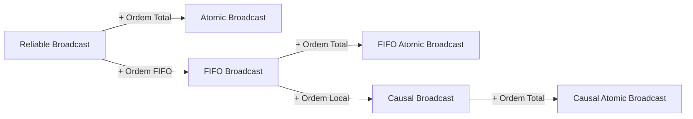

## Objetivos de Aprendizagem

- Definir Reliable Broadcast e Atomic Broadcast (broadcast de ordem total) pelas suas propriedades, e dizer o que as variantes uniformes acrescentam.
- Percorrer a redução de Chandra e Toueg do broadcast de ordem total a uma sequência de instâncias de consenso, e explicar por que ela precisa de Reliable Broadcast.
- Dar a redução inversa e dizer exatamente o que "equivalente" significa, com as suas condições.
- Dizer o que a ordem total não promete, e o que a equivalência não diz sobre custo.

## Contexto e Motivação

`the-replicated-state-machine-approach` reduziu a replicação a toda réplica aplicar os mesmos comandos na mesma ordem, e `the-consensus-problem-agreement-validity-and-termination` disse que rodar consenso uma vez por posição do log entrega essa ordem. As duas afirmações eram informais. Um serviço replicado não quer exatamente consenso, que decide um valor e para. Ele quer uma primitiva de comunicação que continue entregando mensagens a todos numa única ordem. Esta lição dá nome a essa primitiva, a constrói a partir do consenso e mostra que os dois problemas são equivalentes.

## Teoria Central

### A especificação

Hadzilacos e Toueg constroem uma família de broadcasts a partir de um pequeno conjunto de propriedades. O Atomic Broadcast, também chamado de broadcast de ordem total, é um dos membros. O Reliable Broadcast vem primeiro:

```text
VALIDADE:   se um processo correto faz broadcast de m, ele
            acaba entregando m.
ACORDO:     se um processo correto entrega m, todos os processos
            corretos acabam entregando m.
INTEGRIDADE: todo processo correto entrega m no máximo uma vez, e
            só se sender(m) tiver feito o broadcast de m antes.
```

O Atomic Broadcast é o Reliable Broadcast mais um requisito:

```text
ORDEM TOTAL: se os processos corretos p e q entregam m e m',
             então p entrega m antes de m' se e somente se
             q entrega m antes de m'.
```

Acordo e Ordem Total juntos implicam que os processos corretos acabam entregando a mesma sequência. Isso corresponde às duas propriedades de `the-replicated-state-machine-approach`: o Acordo dá o mesmo conjunto, a Ordem Total dá a mesma sequência.

### Uniformidade: o que um processo que caiu fez

Todas essas propriedades falam só de processos corretos. Isso deixa uma lacuna. Um processo pode entregar mensagens em alguma ordem, responder a um cliente e depois cair, e a definição não impõe nenhuma restrição ao que ele fez. Hadzilacos e Toueg definem versões mais fortes, que retiram a palavra "correto" onde ela importa. A Uniform Total Order, por exemplo, se aplica a quaisquer processos, "whether correct or faulty". Um serviço replicado que expõe resultados quer a versão uniforme, porque a resposta dada por uma réplica que depois caiu continua sendo uma resposta que o cliente viu. Na redução a seguir, um processo só entrega o que o consenso decidiu, então um consenso com acordo uniforme mantém as entregas de um processo que caiu dentro da sequência acordada.

### Do consenso à ordem total

A redução é de Chandra e Toueg, e Hadzilacos e Toueg apresentam a mesma construção. Ela usa execuções de consenso repetidas e independentes, marcadas por um contador k, em que a k-ésima execução decide o k-ésimo lote de mensagens.

```text
Para fazer A-broadcast de m:   R-broadcast de m

Ao R-deliver(m):               adiciona m a R_delivered

Para sempre:
    espera até R_delivered - A_delivered não estar vazio
    k := k + 1
    propose(k, R_delivered - A_delivered)
    espera decide(k, msgSet)
    lote := msgSet - A_delivered
    A-deliver do lote numa ordem determinística combinada antes
    A_delivered := A_delivered + lote
```

Três detalhes sustentam a prova.

- **O valor proposto é um conjunto, não uma mensagem.** O consenso decide uma proposta, e um conjunto permite que uma instância ordene muitas mensagens.
- **A ordem determinística dentro do lote.** O Acordo dá a todos os processos o mesmo conjunto, e ordená-lo, por exemplo lexicograficamente, transforma o conjunto em sequência sem nenhuma comunicação adicional.
- **O Reliable Broadcast vem primeiro.** A especificação do consenso supõe que todo processo correto propõe. O Acordo do Reliable Broadcast garante que uma mensagem conhecida por um processo correto acaba chegando a todos os outros, então, se p entra na instância k, todo processo correto acaba entrando também.

A Validade é a propriedade sutil. Uma mensagem pode perder instância após instância, já que o consenso decide uma única proposta. A prova trata disso diretamente: se um processo correto fez broadcast de m e m nunca fosse entregue, todo processo correto manteria m no seu conjunto de não entregues. Depois de alguma instância, todos os processos corretos propõem conjuntos com m e nenhum processo falho propõe mais. O que quer que o consenso decida contém m, o que é uma contradição.

A redução tolera tantos processos falhos quanto o algoritmo de consenso que recebe. Chandra e Toueg enunciam o resultado para qualquer sistema, "synchronous or asynchronous", sujeito a crashes e em que o Reliable Broadcast possa ser implementado.

### Da ordem total ao consenso

A outra direção cabe em duas linhas. Para propor v, faça A-broadcast de v. Para decidir, pegue o valor da primeira mensagem que você entregar por A-deliver. Ordem Total e Acordo significam que todos os processos corretos veem a mesma primeira mensagem, então decidem o mesmo valor, e esse valor foi proposto por alguém.

### O que "equivalente" significa

Cada problema pode ser transformado no outro, então uma solução de um rende uma solução do outro. As duas direções não são simétricas nas suas hipóteses:

```text
Atomic Broadcast -> Consenso:
    tolera qualquer número de falhas benignas; não supõe nada
    sobre o tipo ou a sincronia da rede.

Consenso -> Atomic Broadcast:
    supõe Reliable Broadcast disponível e apenas crashes;
    não supõe nada sobre sincronia.
```

Hadzilacos e Toueg observam que uma transformação mais complexa funciona para qualquer tipo de falha, e Chandra e Toueg afirmam a mesma equivalência para falhas arbitrárias sem dar a construção.

A primeira consequência é que a impossibilidade se transfere. O Atomic Broadcast não pode ser resolvido deterministicamente num sistema assíncrono com um único crash, porque isso resolveria o consenso e contradiria `the-flp-impossibility-result`. Hadzilacos e Toueg dizem que isso parece paradoxal, já que sistemas reais de comunicação em grupo da época ofereciam a primitiva. A resolução deles é que esses sistemas dependem, em algum nível, de um mecanismo como detecção de falhas por timeouts. A segunda consequência é que qualquer técnica que resolve o consenso (randomização, detectores de falhas) também resolve o Atomic Broadcast.

### O que a ordem total deixa de fora

A ordem total é uma afirmação sobre pares de mensagens entregues, e nada mais. Ela não implica ordem FIFO. Hadzilacos e Toueg dão o cenário: um processo sofre uma falha transitória enquanto faz broadcast de m, depois faz broadcast de m', e os processos corretos entregam só m'. Ela também não implica ordem causal, e é por isso que eles definem FIFO Atomic Broadcast e Causal Atomic Broadcast como primitivas separadas e mais fortes. Nada na definição menciona tempo real.



## Exemplos Resolvidos

### Exemplo 1: Reliable Broadcast não basta

Três réplicas têm saldo 1000. As mensagens são m1 = soma 100, m2 = dobra, m3 = subtrai 50. O Reliable Broadcast entrega as três em todo lugar, sem ordem definida:

```text
p: m1 m2 m3   (1000 + 100) * 2 - 50 = 2150
q: m2 m1 m3   (1000 * 2) + 100 - 50 = 2050
r: m3 m1 m2   (1000 - 50 + 100) * 2 = 2100
```

Toda mensagem é entregue exatamente uma vez em toda réplica, e mesmo assim as réplicas divergem.

### Exemplo 2: a redução, com uma proposta que perde

Mesmas réplicas e mensagens. Os resultados do consenso abaixo são uma escala escolhida: o consenso pode ficar com a proposta de qualquer processo.

```text
k = 1   p propõe {m1, m2}
        q propõe {m2}
        r propõe {m3}
        decisão: {m1, m2}   (a proposta de p)
        todos fazem A-deliver de m1, m2

k = 2   a esta altura os três já fizeram R-deliver de m3
        p, q, r propõem {m3}
        decisão: {m3}
        todos fazem A-deliver de m3

todas as réplicas: m1 m2 m3 -> 2150
```

Três coisas ficam visíveis. O acordo sobre um conjunto virou sequência pela ordenação. A mensagem m1 foi entregue em q mesmo sem q tê-la proposto, porque a decisão a carrega. E a proposta de r perdeu a instância 1 sem prejuízo: m3 ficou no conjunto de não entregues de r e entrou na proposta seguinte, que é o argumento da Validade em miniatura.

### Exemplo 3: consenso a partir da ordem total

Os processos propõem x, y e z por A-broadcast, e suponha que o proponente de y caia logo depois do broadcast. Se a sequência acordada é y, x, z, todo processo correto decide y. O crash do proponente não muda nada, porque o Acordo do broadcast já cobre a mensagem assim que um processo correto a entrega. A Validade vale, já que y foi proposto.

### Exemplo 4: o custo escondido em "equivalente"

O Teorema 7.1.6 de Chandra e Toueg também cobre sistemas síncronos, mas o protocolo com coordenador de `leader-based-consensus-in-the-synchronous-model` não pode ser encaixado sem mudanças. Ele supõe que todo processo começa a rodada 1 junto, enquanto na redução os processos entram na instância k em momentos diferentes. É preciso uma adaptação, como iniciar cada instância numa rodada combinada, com o processo que não tem nada a entregar propondo o conjunto vazio. Com essa adaptação, tome n = 5 e f = 2, de modo que cada instância custa 3 rodadas e até 12 mensagens. Para ordenar 1000 mensagens:

```text
tamanho do lote   instâncias   rodadas   mensagens de consenso
1                 1000         3000      12000
10                100          300       1200
100               10           30        120
```

Esses números contam só o tráfego de consenso e supõem lotes cheios. Lotes maiores custam menos instâncias, mas carregam mensagens maiores e fazem cada mensagem esperar pelo seu lote. A equivalência não diz nada sobre isso. Tornar pequeno o custo por instância é o trabalho de `multi-paxos-from-one-decision-to-a-replicated-log`.

## Equívocos Comuns e Armadilhas

- **"Ordem total implica ordem FIFO."** Não implica. São propriedades independentes, e o FIFO Atomic Broadcast existe porque o Atomic Broadcast sozinho permite que a mensagem posterior de um remetente seja entregue sem a anterior.
- **"Problemas equivalentes custam o mesmo."** A equivalência aqui é sobre solubilidade. O Exemplo 4 mostra um fator de 100 entre dois usos da mesma redução.
- **"Cada mensagem precisa da sua própria instância de consenso."** A redução propõe conjuntos. Uma decisão no Exemplo 2 ordenou duas mensagens.
- **"Uma mensagem cuja proposta perde é descartada."** O Exemplo 2 mostra o contrário: ela continua não entregue e é proposta de novo. A Validade depende exatamente desse comportamento.
- **"Sistemas de comunicação em grupo fazem Atomic Broadcast de forma assíncrona, então o FLP não se aplica."** Eles dependem, em algum nível, de tempo ou de detecção de falhas, o mesmo afastamento do modelo assíncrono que `the-flp-impossibility-result` descreve para Paxos e Raft.

## Resumo

O Atomic Broadcast é o Reliable Broadcast mais a Ordem Total, e é a abstração de que uma máquina de estados replicada precisa: todos os processos corretos entregam a mesma sequência. Chandra e Toueg o constroem a partir do consenso disseminando as mensagens de forma confiável, propondo o conjunto de não entregues na instância k e entregando cada lote decidido numa ordem fixa; uma mensagem que perde é proposta de novo, o que dá a Validade. Na outra direção, decidir a primeira mensagem entregue resolve o consenso. Os dois problemas são, portanto, equivalentes sob condições enunciadas, e a impossibilidade do FLP e todos os caminhos em torno dela valem para os dois. A equivalência trata de solubilidade, não de custo, e a ordem total sozinha não promete nem ordem FIFO nem ordem causal.

## Documentation Links

- [Hadzilacos & Toueg: A Modular Approach to Fault-Tolerant Broadcasts and Related Problems (Cornell TR 94-1425, 1994)](https://www.cs.toronto.edu/~vassos/research/publications/HT94/paper.ps.gz): as definições das propriedades, as variantes uniformes, a hierarquia FIFO e causal, e as duas transformações com as suas hipóteses (PostScript comprimido).
- [Chandra & Toueg: Unreliable Failure Detectors for Reliable Distributed Systems (JACM 1996)](https://www.cs.utexas.edu/~lorenzo/corsi/cs380d/papers/p225-chandra.pdf): a Seção 7, com a redução de Atomic Broadcast a consenso, os seus lemas e o Teorema 7.1.6.
- [Fischer, Lynch & Paterson: Impossibility of Distributed Consensus with One Faulty Process (JACM 1985)](https://groups.csail.mit.edu/tds/papers/Lynch/jacm85.pdf): o resultado de impossibilidade que se transfere ao Atomic Broadcast pela equivalência.
