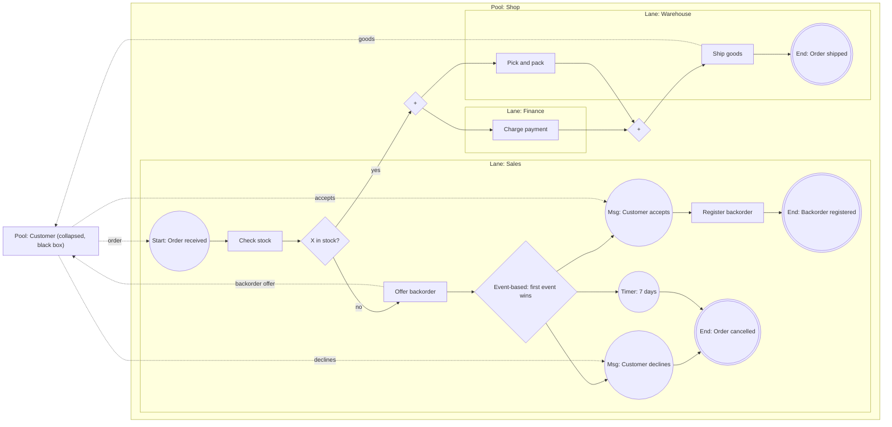

## Learning Objectives

- Name the BPMN 2.0 elements used in most models (events, activities, gateways, sequence flows, message flows, pools, and lanes) and say what each one means.
- Apply the token semantics of the exclusive, parallel, and inclusive gateways, and predict what happens when a split and its merge do not match.
- Model a business process that crosses several roles, deciding what belongs in a lane, what in a separate pool, and what in a message flow.
- Contrast BPMN with the sequence diagram from `sequence-diagrams`: what each notation is for, and when to choose one.

## Context & Motivation

`sequence-diagrams` modeled the order of messages between software participants for one scenario. A business process is a different object. It is the set of activities an organization performs to reach a result (fulfil an order, approve a loan, onboard an employee), it crosses people and departments as well as systems, it has decisions and parallel work, and it may run for days with waiting in between. Analysts and developers need a shared notation for it, and the OMG standard is the Business Process Model and Notation, BPMN. This lesson follows BPMN 2.0.2 (OMG formal/2013-12-09, December 2013); modeling tools may support other versions, so confirm which one yours implements.

The specification states its scope plainly: BPMN covers business process modeling and interchange, and it is not a data flow language. Organizational models, strategy models, business rules models, and data models are out of scope. A BPMN diagram says who does what, in which order, under which conditions, not how the data are structured.

## Core Theory

### Tokens: how BPMN defines behavior

The specification explains behavior with a theoretical device, the token, which traverses sequence flows and passes through the elements of a process. A start event creates a token, activities and gateways consume and produce tokens, and an end event consumes them. A token does not travel along a message flow: a message does. Every gateway rule below is a rule about tokens.

### The core elements

| Element | Notation | Meaning (BPMN 2.0.2) |
|---|---|---|
| Start event | thin circle | Where a process starts. It has no incoming sequence flow. |
| End event | thick circle | Where a path of the process ends. It has no outgoing sequence flow, and a process can have several. The process completes when all its tokens are consumed. |
| Intermediate event | double circle | Something that happens during the process: a message arriving, a timer elapsing. |
| Task | rounded rectangle | An atomic activity, used when the work is not broken down further. Types include user, service, send, receive, manual, and business rule. |
| Sub-process | rounded rectangle, expandable | An activity that contains a process of its own. |
| Gateway | diamond with a marker | Controls how sequence flows diverge and converge. |
| Sequence flow | solid arrow | Order of flow elements inside one process. |
| Message flow | dashed arrow with an open circle at the start | A message between two separate participants. |
| Pool | rectangle | A participant in a collaboration. May be a white box (process shown) or a black box (hidden). |
| Lane | sub-partition of a pool | Organizes the activities of a pool. The meaning is up to the modeler. |

Two rules of the specification separate good models from broken ones. A sequence flow can cross the boundary between lanes, but it cannot cross the boundary of a pool: the process is fully contained in its pool. And a message flow must connect two separate pools; it must not connect two objects in the same pool. Interaction between organizations is therefore messages, and the work inside one organization is sequence flows.

### Pools versus lanes

A pool represents a participant, such as a company or a role like buyer or seller. A lane subdivides a pool and, as the specification puts it, BPMN does not specify the usage of lanes: they are often internal roles, systems, or departments, and they can be nested. The practical rule: use lanes for "who inside our organization does this step", and a separate pool when the other party has its own process that you do not control, so that you can only exchange messages with it. A customer is typically a black-box pool.

### Gateways and their token semantics

A gateway, per the specification, does not represent work: it has zero effect on cost or time and only controls tokens. The three common types differ in marker and rule:

| Gateway | Marker | Diverging (split) | Converging (merge) |
|---|---|---|---|
| Exclusive | `X`, optional | Evaluates the conditions in order; the first true one takes the token. If none is true, the default flow takes it; with no default, an exception is thrown. | Passes every arriving token through, without synchronization. |
| Parallel | `+` | Sends one token down every outgoing flow, checking no conditions. | Waits until there is a token on every incoming flow, consumes one from each, and emits one. |
| Inclusive | `O` | Evaluates all conditions; every flow whose condition is true gets a token (from one to all). If none is true, the default flow gets the token; with no default flow, an exception is thrown. | Waits for the tokens that can still arrive from upstream branches, then continues once. |

There is also an event-based gateway, whose outgoing flows lead to events or receive tasks. The paths race: the first event triggered wins and the other paths are no longer valid. It models "wait for the customer's reply or for a timeout, whichever comes first".

### BPMN versus the sequence diagram

A sequence diagram follows message order between objects, services, or actors in one scenario, and branches with `alt`, `opt`, and `par` fragments. A BPMN process follows the whole process across organizations and roles (pools and lanes), with decisions, waiting, and parallel work expressed as gateways with token rules, and it is read by analysts and stakeholders as well as developers.

The two meet at message flows, which loosely correspond to the messages of a sequence diagram. A sensible split is BPMN for the end-to-end process and a sequence diagram to detail one service interaction inside a task.

### How to read the Mermaid diagrams here

Mermaid has no BPMN notation. The diagrams below are flowcharts that approximate BPMN: a circular node for an event, a rectangle for a task, a diamond with `X`, `+`, or `O` for a gateway, nested subgraphs for a pool and its lanes, a plain rectangle for a collapsed (black box) pool, and dotted arrows for message flows. A BPMN tool would draw the real symbols; here the markers inside the diamonds are plain text. Mermaid cannot draw the BPMN line weights, so the event labels carry the kind: Start, Msg (an intermediate message event), Timer, and End. In BPMN a start event is a thin circle, an intermediate event a double circle, and an end event a single thick circle, but every end event below is drawn as a double circle.

## Worked Examples

### Example 1: an order process that crosses three lanes and two pools

The shop receives an order from a customer and checks stock. If the item is out of stock, it offers a backorder and waits for the customer's answer. If it is in stock, it charges the payment and prepares the goods in parallel, then ships.

Reading it: the `X` gateway is an exclusive decision, so one token goes either to the backorder branch or to the parallel split. The offer is a message to the customer, and the answer is decided by the customer, outside the shop's data, which is why the branch after it uses an event-based gateway: the first of "accepts", "declines", or seven days wins and the other paths are no longer valid. On the parallel side, the first `+` creates two tokens, one in Finance and one in Warehouse, with no conditions. The second `+` is the join: it waits for both and emits one, so "Ship goods" runs once, after payment is charged and goods are packed. Sequence flows cross lanes freely but never leave the Shop pool; the dotted arrows are message flows between the pools. The Customer pool is collapsed into a black box, so message flows attach to its boundary and nothing of its process is shown.

### Example 2: matching a split with its merge

Take "start, split into branches A and B, merge, then task C". Applying the token rules above by hand (this table is derived from the execution semantics, it is not a table from the specification), the number of times C executes is:

| Split | Merge | Times C runs | Why |
|---|---|---|---|
| Parallel | Parallel | 1 | Two tokens are synchronized into one. |
| Parallel | Exclusive | 2 | The exclusive merge passes each token through without synchronization, so C runs once per branch. |
| Parallel | Inclusive | 1 | The merge waits for the token still on its way from the other branch, then fires once. |
| Exclusive | Parallel | 0 | Only one branch has a token, so the parallel join waits forever: a deadlock. |
| Exclusive | Exclusive | 1 | One token passes through. |
| Exclusive | Inclusive | 1 | No token can still arrive on the other branch, so the merge fires at once. |

Two rows deserve care. Exclusive then parallel is a deadlock, a bug whenever it occurs. Parallel then exclusive is not necessarily a bug: it is a supported pattern (the specification lists the exclusive gateway as supporting the Multi-Merge workflow pattern), useful when C should run once per branch. It is a bug only when you expected C to run once. The inclusive gateway exists for the case where you cannot know how many branches were activated, because its merge waits for the tokens that can still arrive instead of for a fixed number.

### Example 3: inclusive notification

After shipping, the shop notifies the customer by email, SMS, and push, but only on the channels the customer enabled. With 3 independent conditions there are 2^3 = 8 combinations of channels. The empty combination is not a legal outcome by itself: if no condition is true and the gateway has no default flow, the inclusive gateway throws an exception. So the design adds a default flow (for example, show the notice inside the app), which leaves 7 non-empty combinations handled by the conditional flows. An inclusive split covers all of them with one diamond, and an inclusive merge waits for exactly the flows that received a token. An exclusive gateway would force you to enumerate seven paths plus the default.

## Common Misconceptions & Pitfalls

- **"Pools and lanes are the same thing."** A lane is a subdivision of one process inside one pool, and sequence flows cross lanes freely. A pool is a separate participant, and only message flows connect pools. Putting a customer in a lane of your own organization hides the fact that you cannot control their steps.
- **"Every diamond is an if-statement."** The diamond only means a gateway. The exclusive gateway is a decision, but the parallel gateway checks no conditions and creates concurrent paths, and the inclusive gateway can take several paths at once.
- **"A merge can be any gateway."** As Example 2 shows, an exclusive split followed by a parallel join deadlocks, and a parallel split followed by an exclusive merge runs the next task once per branch, which is right only if you meant it. Match the types, or use the inclusive gateway deliberately.
- **"A gateway is a step in the process."** The specification gives gateways no effect on cost or time. If a decision needs a person or an API call, model that as a task before the gateway.
- **"The exclusive gateway always shows an X."** The `X` marker is optional for the exclusive gateway, unlike the markers of the others, though a diagram should use it consistently. An empty diamond is an exclusive gateway.
- **"Mermaid draws BPMN."** It does not. The diagrams in this lesson are flowchart approximations. Use a BPMN-aware tool for interchange or execution.

## Summary

BPMN 2.0.2 models a business process as tokens moving along sequence flows between events, activities, and gateways. Pools represent separate participants and are linked only by message flows, while lanes organize the activities of one pool by role, system, or department, with no fixed meaning in the standard. Gateways control tokens: the exclusive gateway takes exactly one path and merges without synchronization, the parallel gateway takes all paths without conditions and joins by waiting for every incoming flow, and the inclusive gateway takes any non-empty subset of paths (or its default flow) and synchronizes on the branches actually taken. Some split and merge pairings go wrong: an exclusive split into a parallel join deadlocks, and a parallel split into an exclusive merge runs the next task once per branch. BPMN complements the sequence diagram: it captures the end-to-end process across roles, and a sequence diagram can detail one interaction inside a task. Mermaid can only approximate the notation with flowcharts.

## Documentation Links

- [OMG: Business Process Model and Notation (BPMN) 2.0.2](https://www.omg.org/spec/BPMN/2.0.2/PDF): the normative specification; it defines pools and lanes, message flows, events, tasks, and the gateway notation and token execution semantics used above.
- [Mermaid: Flowcharts](https://mermaid.js.org/syntax/flowchart.html): the syntax for the flowchart approximations of BPMN in this lesson, including node shapes, subgraphs, and dotted links.
