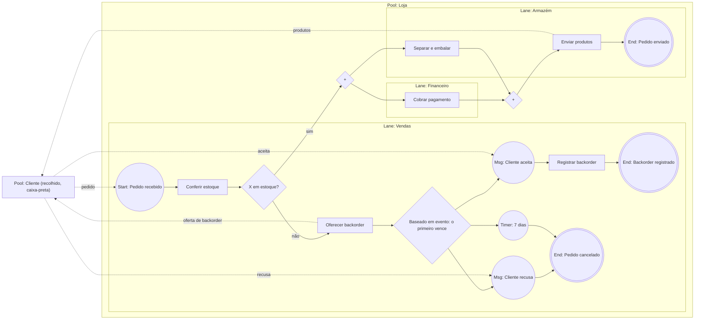

## Objetivos de Aprendizagem

- Nomear os elementos do BPMN 2.0 usados na maioria dos modelos (eventos, atividades, gateways, fluxos de sequência, fluxos de mensagem, pools e lanes) e dizer o que cada um significa.
- Aplicar a semântica de tokens dos gateways exclusivo, paralelo e inclusivo, e prever o que acontece quando uma divisão e a sua junção não combinam.
- Modelar um processo de negócio que atravessa vários papéis, decidindo o que vai em uma lane, o que vai em um pool separado e o que vai em um fluxo de mensagem.
- Contrastar o BPMN com o diagrama de sequência de `sequence-diagrams`: para que serve cada notação e quando escolher uma ou outra.

## Contexto e Motivação

`sequence-diagrams` modelou a ordem das mensagens entre participantes de software em um cenário. Um processo de negócio é outro tipo de objeto. É o conjunto de atividades que uma organização realiza para chegar a um resultado (atender um pedido, aprovar um empréstimo, integrar um funcionário), atravessa pessoas e departamentos além de sistemas, tem decisões e trabalho paralelo, e pode durar dias com esperas no meio. Analistas e desenvolvedores precisam de uma notação comum para ele, e o padrão da OMG para isso é o Business Process Model and Notation, o BPMN. Esta lição segue o BPMN 2.0.2 (OMG formal/2013-12-09, dezembro de 2013), as ferramentas de modelagem podem suportar outras versões, então confirme qual a sua implementa.

A especificação declara o escopo com clareza: o BPMN cobre modelagem e intercâmbio de processos de negócio, e não é uma linguagem de fluxo de dados. Modelos organizacionais, de estratégia, de regras de negócio e de dados ficam fora do escopo. Um diagrama BPMN diz quem faz o quê, em que ordem, sob quais condições, e não como os dados são estruturados.

## Teoria Central

### Tokens: como o BPMN define comportamento

A especificação explica o comportamento com um recurso teórico, o token, que percorre os fluxos de sequência e passa pelos elementos de um processo. Um evento de início cria um token, atividades e gateways consomem e produzem tokens, e um evento de fim os consome. Um token não viaja por um fluxo de mensagem: quem viaja é a mensagem. Toda regra de gateway abaixo é uma regra sobre tokens.

### Os elementos centrais

| Elemento | Notação | Significado (BPMN 2.0.2) |
|---|---|---|
| Evento de início | círculo de linha fina | Onde um processo começa. Não tem fluxo de sequência de entrada. |
| Evento de fim | círculo de linha grossa | Onde um caminho do processo termina. Não tem fluxo de sequência de saída, e um processo pode ter vários. O processo se completa quando todos os seus tokens são consumidos. |
| Evento intermediário | círculo de linha dupla | Algo que acontece durante o processo: uma mensagem chegando, um temporizador expirando. |
| Tarefa (task) | retângulo arredondado | Uma atividade atômica, usada quando o trabalho não é detalhado mais a fundo. Os tipos incluem usuário, serviço, envio, recebimento, manual e regra de negócio. |
| Subprocesso | retângulo arredondado, expansível | Uma atividade que contém um processo próprio. |
| Gateway | losango com um marcador | Controla como fluxos de sequência divergem e convergem. |
| Fluxo de sequência | seta sólida | Ordem dos elementos de fluxo dentro de um processo. |
| Fluxo de mensagem | seta tracejada com círculo aberto no início | Uma mensagem entre dois participantes separados. |
| Pool | retângulo | Um participante em uma colaboração. Pode ser caixa-branca (processo visível) ou caixa-preta (oculto). |
| Lane | subpartição de um pool | Organiza as atividades de um pool. O significado fica a critério de quem modela. |

Duas regras da especificação separam bons modelos de modelos quebrados. Um fluxo de sequência pode cruzar a fronteira entre lanes, mas não pode cruzar a fronteira de um pool: o processo está totalmente contido no seu pool. E um fluxo de mensagem deve conectar dois pools separados; ele não pode conectar dois objetos do mesmo pool. A interação entre organizações é, portanto, mensagem, e o trabalho dentro de uma organização é fluxo de sequência.

### Pools versus lanes

Um pool representa um participante, como uma empresa ou um papel como comprador ou vendedor. Uma lane subdivide um pool e, nas palavras da especificação, o BPMN não define o uso das lanes: elas costumam ser papéis internos, sistemas ou departamentos, e podem ser aninhadas. A regra prática: use lanes para "quem, dentro da nossa organização, faz este passo", e um pool separado quando a outra parte tem um processo próprio que você não controla, de modo que só dá para trocar mensagens com ela. Um cliente costuma ser um pool caixa-preta.

### Gateways e sua semântica de tokens

Um gateway, segundo a especificação, não representa trabalho: ele não tem efeito sobre custo ou tempo e apenas controla tokens. Os três tipos comuns diferem no marcador e na regra:

| Gateway | Marcador | Divergente (divisão) | Convergente (junção) |
|---|---|---|---|
| Exclusivo | `X`, opcional | Avalia as condições em ordem; a primeira verdadeira recebe o token. Se nenhuma é verdadeira, o fluxo padrão (default) o recebe; sem fluxo padrão, uma exceção é lançada. | Deixa passar cada token que chega, sem sincronização. |
| Paralelo | `+` | Envia um token por todos os fluxos de saída, sem verificar condições. | Espera haver um token em cada fluxo de entrada, consome um de cada e emite um. |
| Inclusivo | `O` | Avalia todas as condições; cada fluxo cuja condição é verdadeira recebe um token (de um a todos). Se nenhuma é verdadeira, o fluxo padrão (default) recebe o token; sem fluxo padrão, uma exceção é lançada. | Espera os tokens que ainda podem chegar dos ramos a montante e então segue uma vez. |

Há também o gateway baseado em evento, cujos fluxos de saída levam a eventos ou tarefas de recebimento. Os caminhos disputam uma corrida: o primeiro evento disparado vence e os outros caminhos deixam de ser válidos. Ele modela "esperar a resposta do cliente ou um timeout, o que vier primeiro".

### BPMN versus o diagrama de sequência

Um diagrama de sequência acompanha a ordem das mensagens entre objetos, serviços ou atores em um cenário, e ramifica com fragmentos `alt`, `opt` e `par`. Um processo BPMN acompanha o processo inteiro entre organizações e papéis (pools e lanes), com decisões, esperas e trabalho paralelo expressos como gateways com regras de tokens, e é lido por analistas e stakeholders além de desenvolvedores. Os dois se encontram nos fluxos de mensagem, que correspondem, de forma aproximada, às mensagens de um diagrama de sequência. Uma divisão sensata é usar BPMN para o processo ponta a ponta e um diagrama de sequência para detalhar uma interação entre serviços dentro de uma tarefa.

### Como ler os diagramas Mermaid aqui

O Mermaid não tem notação BPMN. Os diagramas abaixo são fluxogramas que aproximam o BPMN: nó circular para evento, retângulo para tarefa, losango com `X`, `+` ou `O` para gateway, subgraphs aninhados para um pool e suas lanes, um retângulo simples para um pool recolhido (caixa-preta) e setas pontilhadas para fluxos de mensagem. Uma ferramenta BPMN desenharia os símbolos reais; aqui os marcadores dentro dos losangos são texto simples. O Mermaid não desenha as espessuras de linha do BPMN, então os rótulos dos eventos dizem o tipo: Start, Msg (evento intermediário de mensagem), Timer e End. No BPMN o evento de início é um círculo de linha fina, o intermediário um círculo de linha dupla e o de fim um círculo de linha grossa única, mas todo evento de fim abaixo é desenhado como círculo duplo.

## Exemplos Resolvidos

### Exemplo 1: um processo de pedido que cruza três lanes e dois pools

A loja recebe um pedido de um cliente e confere o estoque. Se o item não está em estoque, oferece uma reposição pendente (backorder) e espera a resposta do cliente. Se está, cobra o pagamento e prepara os produtos em paralelo, e depois envia.

Lendo o diagrama: o gateway `X` é uma decisão exclusiva, então um token vai para o ramo do backorder ou para a divisão paralela. A oferta é uma mensagem ao cliente, e a resposta é decidida pelo cliente, fora dos dados da loja, e por isso o ramo seguinte usa um gateway baseado em evento: o primeiro entre "aceita", "recusa" ou sete dias vence, e os outros caminhos deixam de ser válidos. No lado paralelo, o primeiro `+` cria dois tokens, um no Financeiro e um no Armazém, sem condições. O segundo `+` é a junção: espera os dois e emite um, então "Enviar produtos" roda uma vez, depois que o pagamento é cobrado e os produtos estão embalados. Fluxos de sequência cruzam lanes livremente mas nunca saem do pool Loja; as setas pontilhadas são fluxos de mensagem entre os pools. O pool Cliente está recolhido como caixa-preta, então os fluxos de mensagem se ligam à fronteira dele e nada do processo dele é mostrado.

### Exemplo 2: casando uma divisão com a sua junção

Tome "início, divisão em ramos A e B, junção, depois a tarefa C". Aplicando as regras de tokens acima à mão (esta tabela é derivada da semântica de execução, não é uma tabela da especificação), o número de vezes que C executa é:

| Divisão | Junção | Vezes que C executa | Por quê |
|---|---|---|---|
| Paralela | Paralela | 1 | Dois tokens são sincronizados em um. |
| Paralela | Exclusiva | 2 | A junção exclusiva deixa passar cada token sem sincronizar, então C roda uma vez por ramo. |
| Paralela | Inclusiva | 1 | A junção espera o token que ainda está a caminho do outro ramo e então dispara uma vez. |
| Exclusiva | Paralela | 0 | Só um ramo tem token, então a junção paralela espera para sempre: um deadlock. |
| Exclusiva | Exclusiva | 1 | Um token passa. |
| Exclusiva | Inclusiva | 1 | Nenhum token pode ainda chegar ao outro ramo, então a junção dispara de imediato. |

Duas linhas pedem cuidado. Exclusiva seguida de paralela é um deadlock, um bug sempre que ocorre. Paralela seguida de exclusiva não é necessariamente um bug: é um padrão suportado (a especificação lista o gateway exclusivo como suporte ao padrão de workflow Multi-Merge), útil quando C deve rodar uma vez por ramo. Só é bug quando você esperava que C rodasse uma única vez. O gateway inclusivo existe para o caso em que não se sabe quantos ramos foram ativados, porque a junção dele espera os tokens que ainda podem chegar em vez de um número fixo.

### Exemplo 3: notificação inclusiva

Depois de enviar, a loja avisa o cliente por e-mail, SMS e push, mas só nos canais que o cliente habilitou. Com 3 condições independentes há 2^3 = 8 combinações de canais. A combinação vazia não é um resultado legal por si só: se nenhuma condição é verdadeira e o gateway não tem fluxo padrão, o gateway inclusivo lança uma exceção. Por isso o projeto acrescenta um fluxo padrão (por exemplo, mostrar o aviso dentro do app), o que deixa 7 combinações não vazias atendidas pelos fluxos condicionais. Uma divisão inclusiva cobre todas com um só losango, e uma junção inclusiva espera exatamente os fluxos que receberam token. Um gateway exclusivo obrigaria a enumerar sete caminhos mais o padrão.

## Equívocos Comuns e Armadilhas

- **"Pool e lane são a mesma coisa."** Uma lane é uma subdivisão de um processo dentro de um pool, e fluxos de sequência cruzam lanes livremente. Um pool é um participante separado, e só fluxos de mensagem ligam pools. Colocar o cliente em uma lane da sua própria organização esconde o fato de que você não controla os passos dele.
- **"Todo losango é um if."** O losango só significa gateway. O exclusivo é uma decisão, mas o paralelo não verifica condição alguma e cria caminhos concorrentes, e o inclusivo pode tomar vários caminhos ao mesmo tempo.
- **"Qualquer gateway serve como junção."** Como o Exemplo 2 mostra, uma divisão exclusiva seguida de uma junção paralela trava, e uma divisão paralela seguida de uma junção exclusiva executa a tarefa seguinte uma vez por ramo, o que só está certo se foi isso que você quis. Combine os tipos, ou use o inclusivo de propósito.
- **"Um gateway é um passo do processo."** A especificação não dá aos gateways efeito sobre custo ou tempo. Se uma decisão precisa de uma pessoa ou de uma chamada de API, modele isso como uma tarefa antes do gateway.
- **"O gateway exclusivo sempre mostra um X."** O marcador `X` é opcional no exclusivo, ao contrário dos marcadores dos outros, embora o diagrama deva ser consistente no uso. Um losango vazio é um gateway exclusivo.
- **"O Mermaid desenha BPMN."** Não desenha. Os diagramas desta lição são aproximações em fluxograma. Use uma ferramenta que entenda BPMN para intercâmbio ou execução.

## Resumo

O BPMN 2.0.2 modela um processo de negócio como tokens que se movem por fluxos de sequência entre eventos, atividades e gateways. Pools representam participantes separados e só se ligam por fluxos de mensagem, enquanto lanes organizam as atividades de um pool por papel, sistema ou departamento, sem significado fixo no padrão. Os gateways controlam tokens: o exclusivo toma exatamente um caminho e une sem sincronização, o paralelo toma todos os caminhos sem condições e une esperando todos os fluxos de entrada, e o inclusivo toma qualquer subconjunto não vazio de caminhos (ou o fluxo padrão) e sincroniza nos ramos de fato tomados. Alguns pareamentos de divisão e junção dão errado: uma divisão exclusiva em uma junção paralela trava, e uma divisão paralela em uma junção exclusiva executa a tarefa seguinte uma vez por ramo. O BPMN complementa o diagrama de sequência: captura o processo ponta a ponta entre papéis, e um diagrama de sequência pode detalhar uma interação dentro de uma tarefa. O Mermaid só consegue aproximar a notação com fluxogramas.

## Documentation Links

- [OMG: Business Process Model and Notation (BPMN) 2.0.2](https://www.omg.org/spec/BPMN/2.0.2/PDF): a especificação normativa; define pools e lanes, fluxos de mensagem, eventos, tarefas, e a notação de gateways e a semântica de execução por tokens usadas acima.
- [Mermaid: Flowcharts](https://mermaid.js.org/syntax/flowchart.html): a sintaxe das aproximações em fluxograma do BPMN nesta lição, incluindo formas de nó, subgraphs e ligações pontilhadas.
