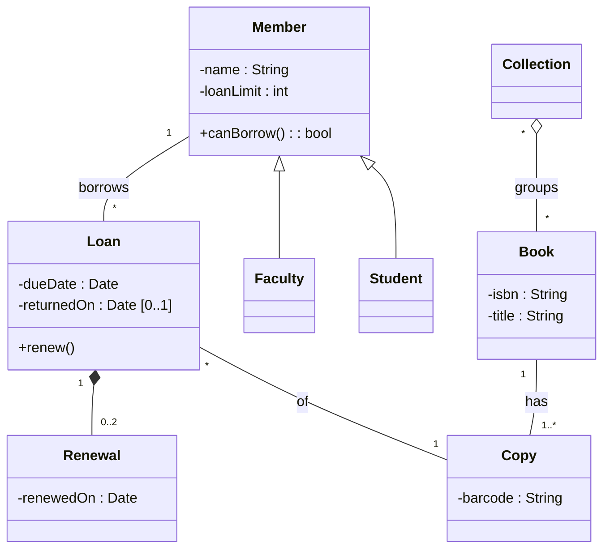

## Learning Objectives

- Read and draw a class: its name, attributes, and operations, with the visibility markers UML defines.
- Express an association with multiplicity, and say what "no multiplicity shown" does and does not mean.
- Tell aggregation from composition by the diamond (hollow versus filled) and by the rule each one actually carries, and draw generalization with the arrow pointing to the general class.
- Draw an object diagram as a concrete snapshot of a class diagram, and use it to test whether the model allows or forbids a particular situation.

## Context & Motivation

`why-model-uml-in-practice` presented UML as a set of diagram types to draw when a question calls for one. The most common question is structural: which concepts does this system deal with, and how are they connected? The class diagram answers it, and small notational details in it carry real meaning: a filled versus hollow diamond, a `1` versus a `0..1`, a triangle that points one way and not the other.

This lesson uses a campus library throughout (members borrow physical copies of books) and follows the notation of the OMG UML 2.5.1 specification. In Petre's interviews (see `why-model-uml-in-practice`), class diagrams were the most frequently reported diagram among the 11 selective UML users (7 of 11), which is one more reason to learn the notation precisely. The object diagram, the class diagram's concrete counterpart, comes last: a class diagram states what is allowed in general, and an object diagram shows one specific situation so you can check it.

## Core Theory

### Classes: name, attributes, operations

A class is drawn as a rectangle that shows its name, its attributes (the data an instance holds), and its operations (what it can be asked to do), usually in three compartments. The specification defines more: a Class has four mandatory compartments (attributes, operations, receptions, and internal structure) and may have optional ones, so three is the common sketch form, not an upper bound. Each attribute and operation may carry a visibility marker, which the specification defines as one of `+` (public), `-` (private), `#` (protected), or `~` (package). An attribute reads `visibility name : Type`, and a type can carry a multiplicity in brackets; an operation reads `visibility name(parameters) : ReturnType`. The name of an abstract class is shown in italics.

A sketch usually omits most of this: drawing only the class name is legitimate when the question is "which concepts exist".

### Associations and multiplicity

An association is a line between two classes meaning that instances of one can be linked to instances of the other. Each end can carry a multiplicity, written `lower..upper` (or just `upper`), where `*` means unlimited: `1`, `0..1`, `0..*` (often just `*`), `1..*`. An open arrowhead on an end marks that end as navigable, meaning the model lets you get from the other class to this one; a small x marks it as not navigable.

One sentence in the specification deserves to be memorized: if no multiplicity is shown on a diagram, no conclusion may be drawn about the multiplicity in the model. A missing `1` does not mean "exactly one", and a missing `*` does not mean "many". It means the diagram is silent.

### Aggregation and composition

Both are special kinds of association for a whole and its parts, and both are drawn with a diamond **at the whole's end** of the line.

- **Shared aggregation** (hollow diamond). The specification says only that its "precise semantics ... varies by application area and modeler". It signals "part of" without promising anything about lifetime or exclusivity.
- **Composite aggregation**, or **composition** (filled diamond). The specification gives it real rules: the part can be in at most one composite at a time, the composite is responsible for the existence and storage of its parts, and if the composite object is deleted, its part objects are deleted with it. The multiplicity at the composite end therefore cannot exceed 1.

The practical test is two questions: if the whole disappears, should its parts disappear with it, and can a part belong to only one whole at a time? If both answers are yes, use composition. If a part is shared between several wholes, or must survive the deletion of its whole, a plain association (or at most a hollow diamond) is the honest choice. Note that the specification lets a part be removed from its composite before the composite is deleted, so outliving the whole is not by itself a reason to avoid composition, as long as the part is detached first and never shared. Because the specification leaves its meaning open, the hollow diamond adds a signal with no checkable meaning, and a plain association is often the clearer choice.

### Generalization

Generalization is a line with a hollow triangle at the end, and the triangle points to the **general** class. A `Student` that is a kind of `Member` is drawn with the triangle touching `Member`. In Mermaid text this is `Member <|-- Student`. The subclass inherits the general class's attributes and operations and may add its own. Whether to model a difference between kinds of member as a subclass or as a plain attribute (`category`) is a judgment call, and attributes are often the simpler answer.

### Reading a diagram in text

Mermaid maps the symbols to compact arrows: `<|--` generalization, `*--` composition, `o--` aggregation, `-->` navigable association, `--` plain association. The diamond or triangle appears on the side where the symbol is written, so `Loan "1" *-- "0..2" Renewal` puts the filled diamond on `Loan`'s end.

### Object diagrams: one concrete snapshot

An object diagram shows instances at one moment. In the specification, an instance is shown with an underlined name of the form `instanceName : ClassName`, and its attribute values appear as slots written `attribute = value`. Links between instances use the association notation, connecting objects instead of classes. The class diagram says "a Member may have many Loans"; the object diagram says "alice has this loan on this copy right now".

## Worked Examples

### Example 1: from a requirement paragraph to a class diagram

The requirement: "A member can borrow copies of books. A book can have several copies. A loan records one member and one copy, has a due date, records when the copy is returned, and can be renewed at most twice. A course reserve collection groups books. Students and faculty are members; faculty have a higher loan limit."

Underline the nouns for candidate classes, then read the verbs and counts for associations and multiplicities:



Only some multiplicities come from a phrase in the paragraph: "one member and one copy" gives `1` on the member and copy ends of `Loan`, and "at most twice" gives `0..2`. The others are modeling decisions the paragraph never states: the `*` on the `Loan` ends (how many loans may a member or a copy have over time?), the `1` on `Book` (does a copy belong to exactly one book?), the lower bound of `1..*` (may a book exist in the catalogue with no copy?), and both ends of `Collection` to `Book` (may a collection be empty, and may a book be in no collection?). Each is a question to confirm with the librarian and then write down, which is exactly where a missing multiplicity does its damage.

### Example 2: choosing the diamond

Three "has" relationships in the library, three different answers:

| Relationship | Question | Answer |
|---|---|---|
| `Loan` and `Renewal` | If the loan is deleted, do its renewal records mean anything? | No, and a renewal belongs to exactly one loan: **composition** (filled diamond) |
| `Collection` and `Book` | If a reserve collection is deleted, should the books vanish? | No, and a book can be in several collections: **hollow diamond**, or a plain association |
| `Member` and `Loan` | Is a loan a "part" of a member? | No, it is a record about both a member and a copy: **plain association** |

The third row is the common mistake. "Has" in English is not "part of" in UML, and drawing a diamond on every line tells the reader nothing.

### Example 3: an object diagram that tests the model

Take this snapshot of the library at one moment, an instance of the diagram in Example 1. Underlines are omitted in plain text, so read each `name : Class` as an underlined instance label. Each line lists the slots, which exist only for attributes the class declares; a missing slot (here, `returnedOn`) means the attribute has no value.

```text
alice : Member      name = "Alice", loanLimit = 3
bruno : Member      name = "Bruno", loanLimit = 2
algo  : Book        isbn = "978-0-00-000001-0", title = "Algorithms"
c1 : Copy           barcode = "B-001"
c2 : Copy           barcode = "B-002"
l1 : Loan           dueDate = 2026-11-24         (no returnedOn: open)
l2 : Loan           dueDate = 2026-12-01         (no returnedOn: open)
r1 : Renewal        renewedOn = 2026-11-10
r2 : Renewal        renewedOn = 2026-11-17

Links: alice-l1, l1-c1, bruno-l2, l2-c2, algo-c1, algo-c2,
       l2 owns r1, l2 owns r2
```

**Multiplicity check.** Every `Loan` is linked to exactly one `Member` and one `Copy`, `algo` is linked to two `Copy` instances (within `1..*`), and `l1` and `l2` own 0 and 2 `Renewal` instances (within `0..2`). The snapshot is a valid instance. Adding a third renewal `r3` owned by `l2` would break `0..2`, so the diagram forbids it.

**Rule check.** Now add `l3 : Loan`, linked to `alice` and `c1`, with no `returnedOn`. Every multiplicity still holds, because `Copy` to `Loan` and `Member` to `Loan` have no upper bound. Yet `c1` now has two open loans at once, and the rule "a copy has at most one open loan" is broken. The same gap hides behind `loanLimit`: it is a slot value, and nothing in the multiplicity of `Member "1" -- "*" Loan` stops `alice` from holding more open loans than her limit.

The lesson of the snapshot is that multiplicity constrains links, not rules. Rules such as "one open loan per copy" and "open loans do not exceed `loanLimit`" have to be stated separately, as UML constraints attached to the diagram or as requirements in the specification.

## Common Misconceptions & Pitfalls

- **"Every 'has a' relationship gets a diamond."** Example 2 shows most of them are plain associations. A diamond is a claim about whole and part, and the filled one carries deletion semantics defined by the specification.
- **"The arrowhead on a generalization points at the subclass."** The hollow triangle touches the general class. Reading it backwards reverses every inheritance relationship in the diagram.
- **"No multiplicity means one."** The specification says no conclusion may be drawn. If a count matters, write it.
- **"A class diagram models behavior."** It shows operations as names, not their order or logic. Order over time belongs to `sequence-diagrams`.
- **"More associations mean a richer model."** A class connected to many others is a hint to ask the questions from `coupling-and-cohesion`: is it doing several jobs, and would the others change if it did?

## Summary

A class diagram records the concepts of a system and their relationships. A class has name, attributes, and operations with `+ - # ~` visibility; associations carry multiplicities, and an absent multiplicity means the diagram is silent. Aggregation and composition are drawn with a diamond at the whole's end, with the hollow diamond's semantics left open by the specification and the filled diamond meaning exclusive ownership and deletion with the whole. Generalization is a hollow triangle pointing at the general class. An object diagram is a snapshot of instances with underlined `name : Class` labels and attribute slots, and it is the cheapest way to test a model, including the discovery that multiplicity alone cannot express every business rule.

## Documentation Links

- [OMG: Unified Modeling Language 2.5.1](https://www.omg.org/spec/UML/2.5.1/PDF): the normative source for class and association notation, aggregation kinds, multiplicity, and instance specifications.
- [Mermaid: Class diagrams](https://mermaid.js.org/syntax/classDiagram.html): the text syntax for classes, relationships, cardinality, and visibility used in this lesson.
- [Fowler: UML As Sketch](https://martinfowler.com/bliki/UmlAsSketch.html): forward and reverse sketching, which draw only the classes worth discussing.
- [Petre (2013): UML in Practice](https://web.archive.org/web/20201031213923/http://oro.open.ac.uk/35805/8/UML%20in%20practice%208.pdf): the ICSE 2013 interview study; Table II lists the diagrams used by the 11 selective UML users, with class diagrams the most frequent.
