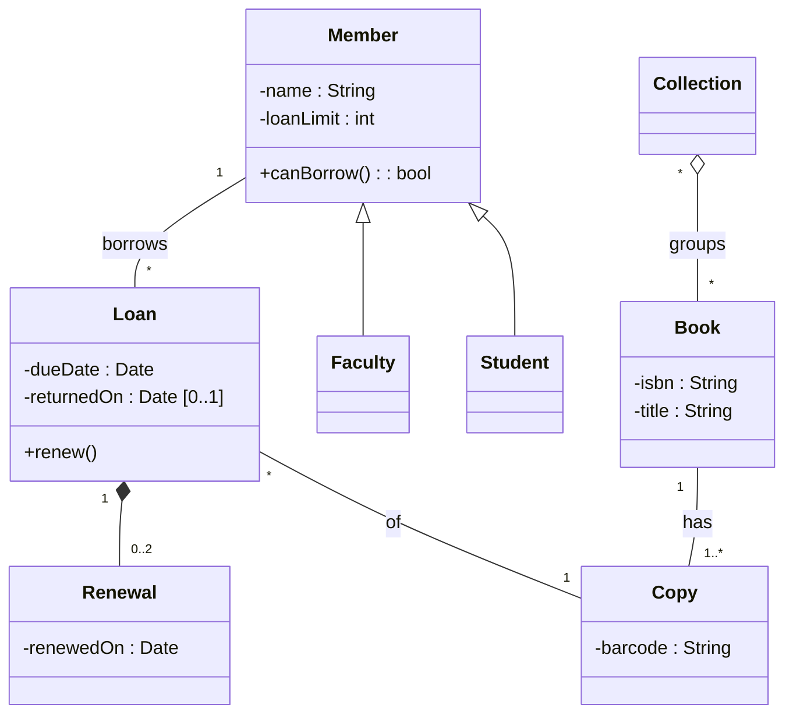

## Objetivos de Aprendizagem

- Ler e desenhar uma classe: nome, atributos e operações, com os marcadores de visibilidade que a UML define.
- Expressar uma associação com multiplicidade e dizer o que "nenhuma multiplicidade mostrada" significa e não significa.
- Distinguir agregação de composição pelo losango (vazio versus cheio) e pela regra que cada um realmente carrega, e desenhar a generalização com a seta apontando para a classe geral.
- Desenhar um diagrama de objetos como um retrato concreto de um diagrama de classes e usá-lo para testar se o modelo permite ou proíbe uma situação.

## Contexto e Motivação

`why-model-uml-in-practice` apresentou a UML como um conjunto de tipos de diagrama a desenhar quando uma pergunta pede um. A pergunta mais comum é estrutural: com quais conceitos este sistema lida, e como eles se conectam? O diagrama de classes a responde, e pequenos detalhes de notação nele carregam significado real: um losango cheio ou vazio, um `1` versus um `0..1`, um triângulo que aponta para um lado e não para o outro.

Esta lição usa uma biblioteca de campus do começo ao fim (membros pegam emprestados exemplares físicos de livros) e segue a notação da especificação UML 2.5.1 da OMG. Nas entrevistas de Petre (veja `why-model-uml-in-practice`), os diagramas de classes foram o tipo mais relatado entre os 11 usuários seletivos de UML (7 de 11), mais um motivo para aprender a notação com precisão. O diagrama de objetos, a contraparte concreta do diagrama de classes, vem por último: o diagrama de classes diz o que é permitido em geral, e o diagrama de objetos mostra uma situação específica para que você possa conferi-la.

## Teoria Central

### Classes: nome, atributos, operações

Uma classe é desenhada como um retângulo que mostra seu nome, seus atributos (os dados que uma instância guarda) e suas operações (o que se pode pedir a ela), em geral em três compartimentos. A especificação define mais: uma Class tem quatro compartimentos obrigatórios (atributos, operações, recepções e estrutura interna) e pode ter compartimentos opcionais, então três é a forma comum de rascunho, não um limite superior. Cada atributo e operação pode levar um marcador de visibilidade, que a especificação define como `+` (público), `-` (privado), `#` (protegido) ou `~` (pacote). Um atributo se lê `visibilidade nome : Tipo`, e o tipo pode levar uma multiplicidade entre colchetes; uma operação se lê `visibilidade nome(parâmetros) : TipoDeRetorno`. O nome de uma classe abstrata aparece em itálico.

Um rascunho costuma omitir quase tudo isso: desenhar só o nome da classe é legítimo quando a pergunta é "quais conceitos existem".

### Associações e multiplicidade

Uma associação é uma linha entre duas classes, significando que instâncias de uma podem estar ligadas a instâncias da outra. Cada ponta pode levar uma multiplicidade, escrita `inferior..superior` (ou só `superior`), em que `*` significa ilimitado: `1`, `0..1`, `0..*` (muitas vezes só `*`), `1..*`. Uma ponta de seta aberta numa extremidade marca essa extremidade como navegável, ou seja, o modelo permite chegar até ela a partir da outra classe; um pequeno x marca a extremidade como não navegável.

Uma frase da especificação merece ser decorada: se nenhuma multiplicidade é mostrada num diagrama, nenhuma conclusão pode ser tirada sobre a multiplicidade no modelo. A ausência de um `1` não significa "exatamente um", e a ausência de um `*` não significa "muitos". Significa que o diagrama está em silêncio.

### Agregação e composição

As duas são tipos especiais de associação entre um todo e suas partes, e as duas são desenhadas com um losango **na extremidade do todo**.

- **Agregação compartilhada** (losango vazio). A especificação diz apenas que sua "semântica precisa ... varia conforme a área de aplicação e o modelador" (no original, "precise semantics ... varies by application area and modeler"). Ela sinaliza "parte de" sem prometer nada sobre tempo de vida ou exclusividade.
- **Agregação composta**, ou **composição** (losango cheio). A especificação lhe dá regras reais: a parte pode estar em no máximo um composto por vez, o composto é responsável pela existência e pelo armazenamento de suas partes, e, se o objeto composto é apagado, seus objetos-parte são apagados junto. A multiplicidade na extremidade do composto, portanto, não pode passar de 1.

O teste prático são duas perguntas: se o todo desaparece, suas partes devem desaparecer junto, e uma parte pode pertencer a só um todo por vez? Se as duas respostas são sim, use composição. Se uma parte é compartilhada entre vários todos, ou precisa sobreviver à remoção do seu todo, uma associação simples (ou no máximo um losango vazio) é a escolha honesta. Note que a especificação permite retirar uma parte do seu composto antes de ele ser apagado, então sobreviver ao todo não é, por si só, motivo para evitar a composição, desde que a parte seja destacada antes e nunca compartilhada. Como a especificação deixa o significado em aberto, o losango vazio acrescenta um sinal sem significado verificável, e uma associação simples costuma ser a escolha mais clara.

### Generalização

A generalização é uma linha com um triângulo vazio na ponta, e o triângulo aponta para a classe **geral**. Um `Student` que é um tipo de `Member` é desenhado com o triângulo encostado em `Member`. No texto do Mermaid isso é `Member <|-- Student`. A subclasse herda os atributos e operações da classe geral e pode acrescentar os seus. Modelar a diferença entre tipos de membro como subclasse ou como um simples atributo (`category`) é uma decisão de julgamento, e o atributo costuma ser a resposta mais simples.

### Lendo um diagrama em texto

O Mermaid mapeia os símbolos para setas compactas: `<|--` generalização, `*--` composição, `o--` agregação, `-->` associação navegável, `--` associação simples. O losango ou o triângulo aparece do lado em que o símbolo é escrito, então `Loan "1" *-- "0..2" Renewal` coloca o losango cheio na extremidade de `Loan`.

### Diagramas de objetos: um retrato concreto

Um diagrama de objetos mostra instâncias em um instante. Na especificação, uma instância aparece com um nome sublinhado da forma `nomeDaInstância : NomeDaClasse`, e os valores de seus atributos aparecem como slots escritos `atributo = valor`. Os vínculos entre instâncias usam a notação de associação, ligando objetos em vez de classes. O diagrama de classes diz "um Member pode ter muitos Loans"; o diagrama de objetos diz "alice tem este empréstimo neste exemplar agora".

## Exemplos Resolvidos

### Exemplo 1: de um parágrafo de requisito a um diagrama de classes

O requisito: "Um membro pode pegar emprestados exemplares de livros. Um livro pode ter vários exemplares. Um empréstimo registra um membro e um exemplar, tem uma data de devolução prevista, registra quando o exemplar volta e pode ser renovado no máximo duas vezes. Uma coleção de reserva de curso agrupa livros. Estudantes e docentes são membros; docentes têm um limite de empréstimos maior."

Sublinhe os substantivos para achar as classes candidatas, depois leia os verbos e as quantidades para achar as associações e multiplicidades:



Só algumas multiplicidades vêm de uma frase do parágrafo: "um membro e um exemplar" dá `1` nas extremidades de membro e exemplar de `Loan`, e "no máximo duas vezes" dá `0..2`. As outras são decisões de modelagem que o parágrafo nunca enuncia: o `*` nas extremidades de `Loan` (quantos empréstimos um membro ou um exemplar pode ter ao longo do tempo?), o `1` em `Book` (um exemplar pertence a exatamente um livro?), o limite inferior de `1..*` (um livro pode existir no catálogo sem nenhum exemplar?) e as duas extremidades de `Collection` para `Book` (uma coleção pode estar vazia, e um livro pode estar em nenhuma coleção?). Cada uma é uma pergunta a confirmar com a bibliotecária e depois registrar, que é exatamente onde uma multiplicidade ausente causa dano.

### Exemplo 2: escolhendo o losango

Três relações de "tem" na biblioteca, três respostas diferentes:

| Relação | Pergunta | Resposta |
|---|---|---|
| `Loan` e `Renewal` | Se o empréstimo é apagado, os registros de renovação ainda significam algo? | Não, e uma renovação pertence a exatamente um empréstimo: **composição** (losango cheio) |
| `Collection` e `Book` | Se uma coleção de reserva é apagada, os livros devem sumir? | Não, e um livro pode estar em várias coleções: **losango vazio**, ou uma associação simples |
| `Member` e `Loan` | Um empréstimo é "parte" de um membro? | Não, é um registro sobre um membro e um exemplar: **associação simples** |

A terceira linha é o erro comum. O "tem" do português não é o "parte de" da UML, e desenhar um losango em toda linha não diz nada ao leitor.

### Exemplo 3: um diagrama de objetos que testa o modelo

Considere este retrato da biblioteca em um instante, uma instância do diagrama do Exemplo 1. Sem os sublinhados, no texto puro, leia cada `nome : Classe` como um rótulo de instância sublinhado. Cada linha lista os slots, que só existem para atributos que a classe declara; um slot ausente (aqui, `returnedOn`) significa que o atributo não tem valor.

```text
alice : Member      name = "Alice", loanLimit = 3
bruno : Member      name = "Bruno", loanLimit = 2
algo  : Book        isbn = "978-0-00-000001-0", title = "Algorithms"
c1 : Copy           barcode = "B-001"
c2 : Copy           barcode = "B-002"
l1 : Loan           dueDate = 2026-11-24         (no returnedOn: open)
l2 : Loan           dueDate = 2026-12-01         (no returnedOn: open)
r1 : Renewal        renewedOn = 2026-11-10
r2 : Renewal        renewedOn = 2026-11-17

Links: alice-l1, l1-c1, bruno-l2, l2-c2, algo-c1, algo-c2,
       l2 owns r1, l2 owns r2
```

**Conferência de multiplicidades.** Todo `Loan` está ligado a exatamente um `Member` e um `Copy`, `algo` está ligado a duas instâncias de `Copy` (dentro de `1..*`), e `l1` e `l2` possuem 0 e 2 instâncias de `Renewal` (dentro de `0..2`). O retrato é uma instância válida. Acrescentar uma terceira renovação `r3` pertencente a `l2` violaria `0..2`, então o diagrama a proíbe.

**Conferência de regras.** Agora acrescente `l3 : Loan`, ligado a `alice` e `c1`, sem `returnedOn`. Todas as multiplicidades continuam valendo, porque `Copy` para `Loan` e `Member` para `Loan` não têm limite superior. Mesmo assim, `c1` agora tem dois empréstimos abertos ao mesmo tempo, e a regra "um exemplar tem no máximo um empréstimo aberto" foi quebrada. A mesma lacuna se esconde atrás de `loanLimit`: ele é um valor de slot, e nada na multiplicidade de `Member "1" -- "*" Loan` impede `alice` de ter mais empréstimos abertos do que o seu limite.

A lição do retrato é que a multiplicidade restringe vínculos, não regras. Regras como "um empréstimo aberto por exemplar" e "os empréstimos abertos não passam de `loanLimit`" precisam ser ditas à parte, como restrições (constraints) da UML anexadas ao diagrama ou como requisitos na especificação.

## Equívocos Comuns e Armadilhas

- **"Toda relação de 'tem um' ganha um losango."** O Exemplo 2 mostra que a maioria são associações simples. O losango é uma afirmação sobre todo e parte, e o cheio carrega a semântica de remoção definida pela especificação.
- **"A ponta da seta de generalização aponta para a subclasse."** O triângulo vazio encosta na classe geral. Ler ao contrário inverte todas as relações de herança do diagrama.
- **"Sem multiplicidade significa um."** A especificação diz que nenhuma conclusão pode ser tirada. Se uma contagem importa, escreva-a.
- **"Um diagrama de classes modela comportamento."** Ele mostra operações como nomes, não a ordem nem a lógica delas. A ordem no tempo pertence a `sequence-diagrams`.
- **"Mais associações significam um modelo mais rico."** Uma classe ligada a muitas outras é um sinal para fazer as perguntas de `coupling-and-cohesion`: ela faz vários trabalhos, e as outras mudariam se ela mudasse?

## Resumo

Um diagrama de classes registra os conceitos de um sistema e suas relações. Uma classe tem nome, atributos e operações com visibilidade `+ - # ~`; as associações carregam multiplicidades, e uma multiplicidade ausente significa que o diagrama está em silêncio. Agregação e composição são desenhadas com um losango na extremidade do todo, com a semântica do losango vazio deixada em aberto pela especificação e o losango cheio significando posse exclusiva e remoção junto com o todo. A generalização é um triângulo vazio apontando para a classe geral. Um diagrama de objetos é um retrato de instâncias com rótulos sublinhados `nome : Classe` e slots de atributos, e é a forma mais barata de testar um modelo, inclusive para descobrir que a multiplicidade sozinha não expressa toda regra de negócio.

## Documentation Links

- [OMG: Unified Modeling Language 2.5.1](https://www.omg.org/spec/UML/2.5.1/PDF): a fonte normativa para a notação de classes e associações, os tipos de agregação, a multiplicidade e as especificações de instância.
- [Mermaid: Class diagrams](https://mermaid.js.org/syntax/classDiagram.html): a sintaxe em texto para classes, relações, cardinalidade e visibilidade usada nesta lição.
- [Fowler: UML As Sketch](https://martinfowler.com/bliki/UmlAsSketch.html): rascunho para frente e reverso, que desenham só as classes que valem a conversa.
- [Petre (2013): UML in Practice](https://web.archive.org/web/20201031213923/http://oro.open.ac.uk/35805/8/UML%20in%20practice%208.pdf): o estudo de entrevistas do ICSE 2013; a Tabela II lista os diagramas usados pelos 11 usuários seletivos de UML, com os diagramas de classes como os mais frequentes.
