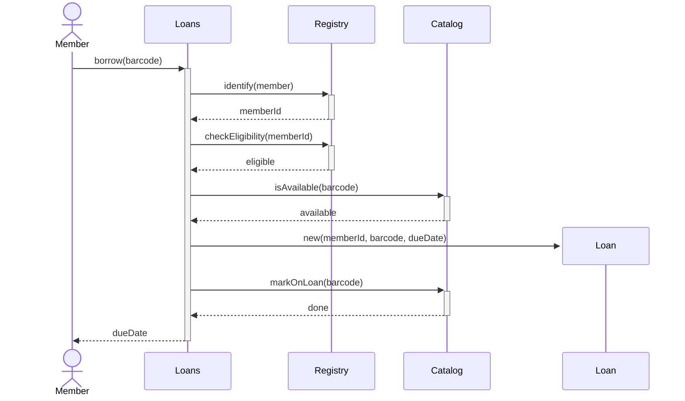
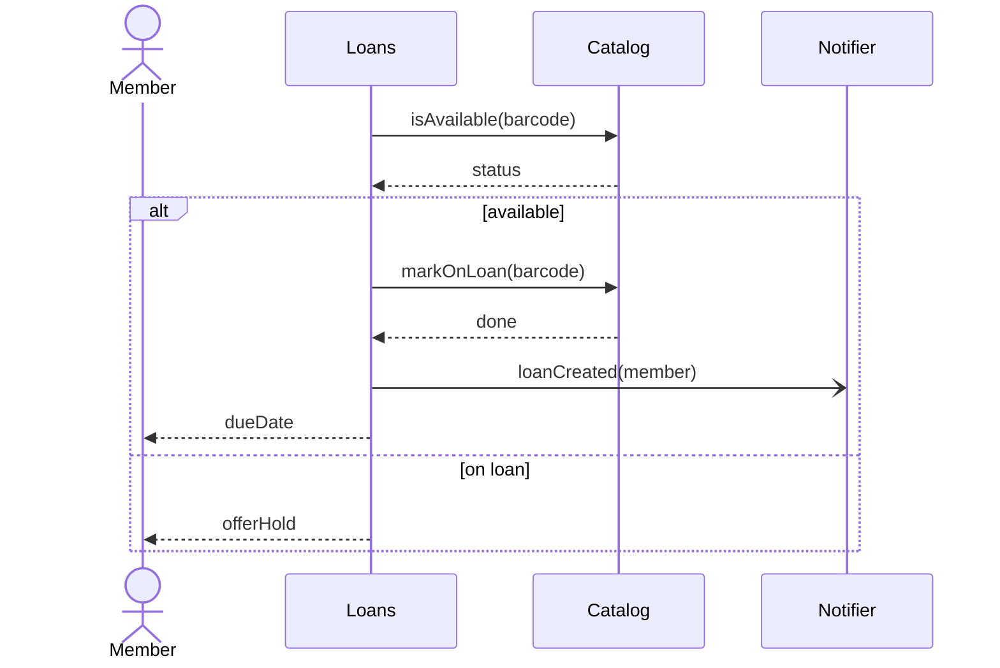
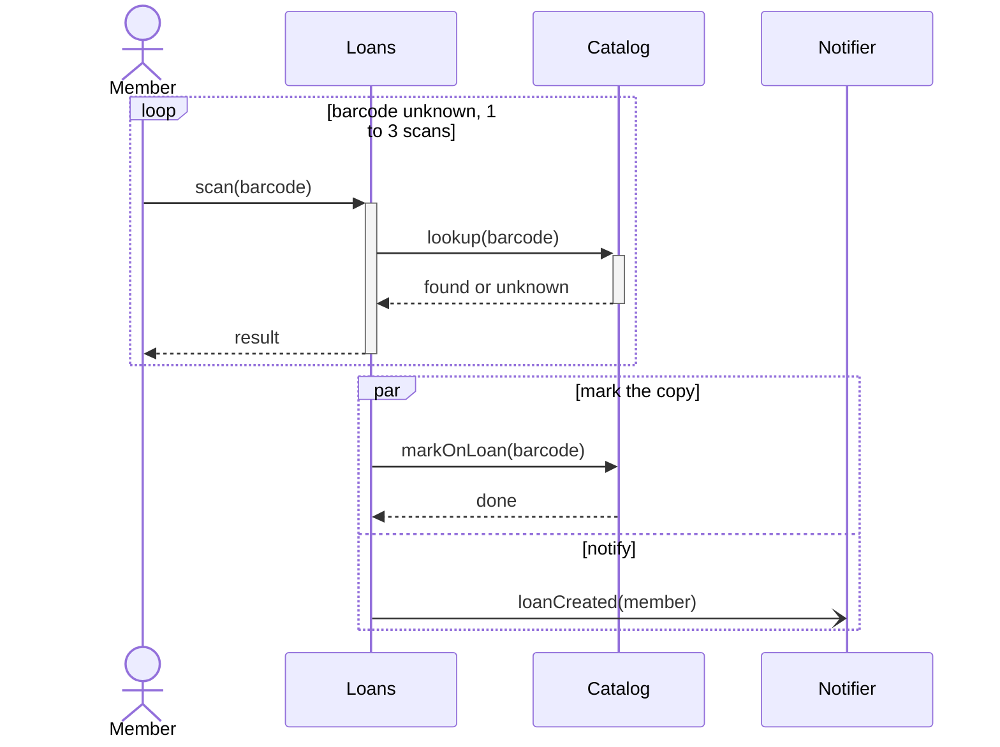

## Learning Objectives

- Read a sequence diagram as a set of allowed orderings of events, not as a program listing: lifelines, messages, activations, and what the vertical axis does and does not promise.
- Distinguish synchronous calls, asynchronous messages, replies, and object creation and destruction by their notation and by their meaning.
- Apply the combined fragment operators `alt`, `opt`, `loop`, and `par` correctly, including what happens when no guard is true and what "parallel" means in UML.
- Draw a sequence diagram from one use case scenario and decide which scenarios deserve a diagram at all.

## Context & Motivation

`use-cases-and-use-case-descriptions` ended with a numbered main scenario and a list of extensions: a story told between an actor and "the system". That story keeps the system a black box; the running example there was `Borrow Copy` in a campus library. Once design starts, the next question is internal: which objects or services take part, who calls whom, and in what order? A class diagram (`class-and-object-diagrams`) shows what exists and how it is related, but says nothing about time. The sequence diagram answers "what happens, step by step, when this scenario runs".

The OMG UML 2.5.1 specification groups sequence, communication, interaction overview, and timing diagrams under one concept, the Interaction. It says interactions serve to reach a common understanding of a situation, to set up precise inter-process communication during detailed design, and to describe traces of a running system for comparison with earlier phases. This lesson covers the sequence diagram, the variant most teams actually draw.

## Core Theory

### Lifelines and the time axis

A lifeline is the timeline of one participant (an object, a service, a component, or an actor). It is drawn as a rectangle, the head, with a vertical line below it. Time increases down the page, but UML is explicit that the distance between two events does not measure any duration: only that non-zero time has passed. Along one lifeline, events are ordered top to bottom, except inside a `par` fragment or a coregion (a shorthand for parallel operands on one lifeline), where no order between the operands is imposed. Across lifelines, events are ordered by messages (a message is sent before it is received) or by the generalized ordering mechanism, and the `strict` operator orders events across lifelines too. The order is transitive, so a message from A to B followed by a message from B to C puts A's send before C's receive even though A and C exchange nothing directly. Beyond that nothing is ordered, which is why the specification describes an interaction as a partial order over events.

This is the first thing to internalize: a sequence diagram does not claim that event X on one lifeline happens before event Y on another just because X is drawn higher on the page. "Before" comes from order along a lifeline, from chains of messages, and from the explicit ordering constructs.

### Messages: what the arrow means

A message is a line from a send event to a receive event. UML defines the arrowhead notation:

| Kind | Notation (UML 2.5.1) | Mermaid |
|---|---|---|
| Synchronous call | solid line, filled arrowhead | `A->>B: op()` |
| Asynchronous call or signal | solid line, open arrowhead | `A-)B: signal` |
| Reply | dashed line, open or filled arrowhead | `B-->>A: result` |
| Object creation | dashed line, open arrowhead | `create participant C` then `A->>C: new` |
| Object destruction | message ending in an X at the bottom of the lifeline | `destroy C` |
| Lost or found message | a small black circle at the arrow end (lost: receiver outside the scope) or start (found: sender outside the scope) | no direct equivalent |

A label is a message name with optional arguments, such as `reserve(items)`; a reply may carry the returned value after a colon. A message references either an operation or a signal, and a signal message must be asynchronous. The distinction matters in design: after a synchronous call the caller waits for the reply, after an asynchronous message the sender continues.

### Execution specifications (activation bars)

The thin rectangle on a lifeline is an execution specification: the period during which that participant is executing a behavior, usually from receiving a call to sending its reply. Overlapping rectangles on the same lifeline show nested or re-entrant execution. They make "who is blocked waiting on whom" visible. In Mermaid, `activate`/`deactivate` or the `+` and `-` arrow suffixes draw them.

### Combined fragments

A combined fragment is a rectangle drawn over some lifelines, with an operator in a small pentagon at the upper left. Operands are separated by dashed horizontal lines, and each can have a guard in square brackets. The four operators you will use daily:

| Operator | Meaning in UML 2.5.1 | Mermaid |
|---|---|---|
| `alt` | A choice: at most one operand is chosen, and the chosen operand's guard must evaluate to true at that point. An operand with no guard has an implicit true guard. `else` means the negation of all other guards. | `alt` / `else` / `end` |
| `opt` | Either the single operand happens or nothing happens. Equivalent to an `alt` with one operand and an empty second operand. | `opt` / `end` |
| `loop` | The operand repeats at least `minint` and at most `maxint` times. After the minimum, it stops when the Boolean guard is false. `loop` alone means 0 to unlimited. | `loop` / `end` |
| `par` | A parallel merge: the events of different operands can be interleaved in any way, as long as the order inside each operand is preserved. | `par` / `and` / `end` |

Other operators exist (`break`, `neg`, `critical`, `ignore`, `consider`, `assert`, `seq`, `strict`), and a `ref` frame lets one diagram reuse another. Two details surprise people. If no operand of an `alt` has a true guard, none runs and the interaction continues after the fragment, which is not an error. And UML gives `par` interleaving semantics: it does not say two things occur at the same instant, only that no order between the operands is imposed.

Mermaid is an approximation of UML. It has no `sd` frame with parameters, no coregion, and no lost or found messages, the text next to `loop` is free-form rather than the `minint,maxint` syntax, and its `critical` block, which the Mermaid documentation describes as showing actions that must happen automatically with conditional handling of circumstances, is not UML's `critical` region (a region that other events cannot interleave into).

### What a diagram deliberately leaves out

The specification notes that interactions normally do not tell the complete story: other legal traces usually exist, and the focus is the order of messages, not data manipulation. A sequence diagram is a scenario, not a specification of all behavior, so it is judged by whether it answers a specific design question.

## Worked Examples

These examples continue the `Borrow Copy` use case from `use-cases-and-use-case-descriptions`. Its main success scenario and extensions become sequence diagrams here. The participants (`Loans`, `Registry`, `Catalog`) are an internal design chosen for this lesson, not something the use case dictates.

### Example 1: the main success scenario of "Borrow Copy"

The member presents a barcode (step 1); the system identifies the member (2), checks eligibility (3) and availability (4), creates a loan with a due date (5), and marks the copy on loan and shows the due date (6). One lifeline per responsibility.

Reading it: every call except the creation has a reply, so `Loans` stays active the whole time, waiting first on `Registry` and then on `Catalog`. The `Loan` lifeline appears mid-diagram, where the creation message occurs (UML draws that arrow dashed with an open head; Mermaid draws it its own way). The number of lifelines is a design decision: if `Registry` and `Catalog` were one component, you would draw one.

### Example 2: alternatives for availability, plus an asynchronous notice

Extension `4b` of the use case says that when the copy is already on loan, the system offers a hold. That is an `alt` on the availability reply. The e-mail notice is an addition for this example (the use case does not mention one); it is not on the critical path, so it is an asynchronous message.

The `alt` has two guarded operands, `available` and `on loan`, and only one runs. The open arrowhead on `loanCreated` tells the reader that `Loans` does not wait for the notifier. For "notify only if the member opted in, otherwise do nothing", `opt` is more honest, because it states that the other branch is empty.

### Example 3: loop and par, with the trace counts

Extension `4a` says an unknown barcode lets the member re-enter it. Suppose the design allows 1 to 3 scans. Afterward, marking the copy and the notice happen in parallel.

For the `loop`, the operand (scan, lookup, reply, result) has a single trace. A `loop` with `minint` 1 and `maxint` 3 over a single-trace operand therefore has three valid traces: the operand once, twice, or three times. With several traces in the operand, the count would be larger, because `loop` is a recursive application of weak sequencing.

For the `par`, count the events of each operand. The first operand has four (send and receive of `markOnLoan`, send and receive of `done`), in a fixed order; the second has two (send and receive of `loanCreated`). Interleavings that preserve each operand's order are the ways to choose 2 positions out of 6 for the second operand, C(6,2) = 15. Note what this does to the page order: on the `Loans` lifeline, the send of `loanCreated` may come before the send of `markOnLoan`, which is the exception to top-to-bottom order inside a `par`. That is the precise meaning of "parallel" in UML: all 15 interleavings are valid, so a reviewer should ask whether every one is safe.

## Common Misconceptions & Pitfalls

- **"A sequence diagram is a flowchart."** A flowchart shows control flow through one process. A sequence diagram shows messages exchanged between participants, with ordering only along each lifeline and across each message. Decisions appear only as `alt`/`opt` fragments, not as diamonds.
- **"Higher on the page means earlier in time, globally."** Order comes from position along a lifeline (outside `par` and coregions), from chains of messages, and from explicit ordering constructs such as `strict`. Two events on different lifelines with no such connection have no defined order, however they are placed on the page.
- **"Every message is a method call."** A message can reference an operation or a signal. Asynchronous messages and signals have no reply and no waiting, and drawing them with filled arrowheads misleads the reader about blocking.
- **"`par` means threads running at the same time."** UML's `par` is an interleaving: any order that respects each operand's internal order is valid. It does not say how the operands are scheduled, and it does not make the code thread-safe.
- **"The diagram describes all behavior."** The specification says interactions usually leave other traces undescribed. Prefer one diagram per scenario over one giant diagram.
- **"`alt` without a matching guard is an error."** In UML, if no operand's guard is true, nothing in the fragment runs and the interaction continues. If your design requires one branch to always run, add an explicit `else` guard.

## Summary

In UML 2.5.1 terms a sequence diagram is an Interaction: a set of valid event orderings among lifelines, where "before" comes only from position along a lifeline (outside `par` and coregions), chains of messages, and explicit ordering constructs. Arrowheads distinguish synchronous calls (filled) from asynchronous messages (open), a dashed line marks replies (and creation messages), and activation bars show who is executing. The fragments `alt`, `opt`, `loop`, and `par` express choice (at most one operand), optionality, repetition (`minint` to `maxint`), and interleaving (all order-preserving orderings). Mermaid renders a useful subset but only approximates the notation. Draw one diagram per use case scenario and name the design question it answers.

## Documentation Links

- [OMG: Unified Modeling Language (UML) 2.5.1](https://www.omg.org/spec/UML/2.5.1/PDF): the normative specification; Clause 17 defines Interactions, lifelines, messages, execution specifications, and every combined fragment operator used above.
- [Mermaid: Sequence diagrams](https://mermaid.js.org/syntax/sequenceDiagram.html): the syntax for the text-based diagrams in this lesson, including arrow types, activation, create and destroy, and the `alt`, `opt`, `loop`, and `par` blocks.
