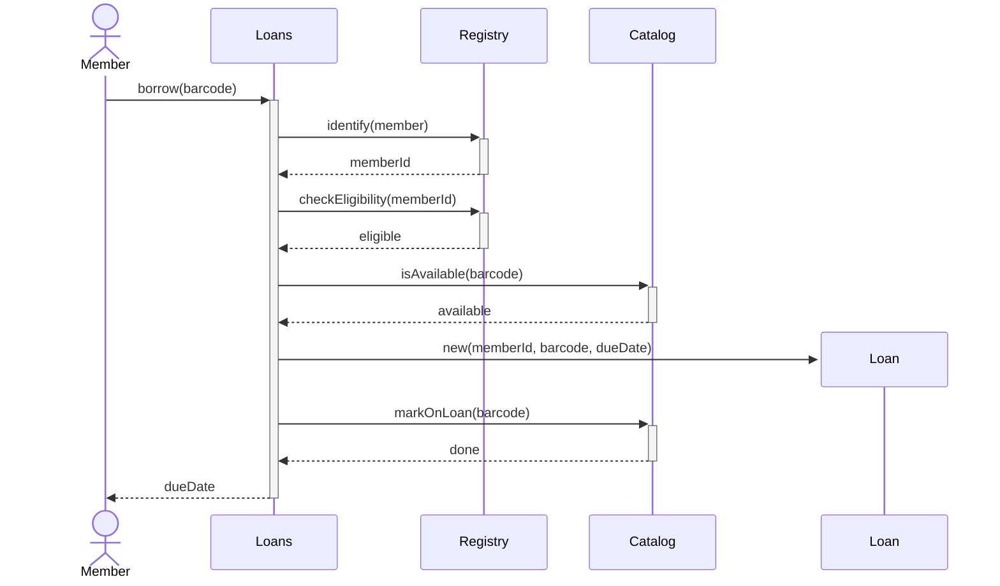
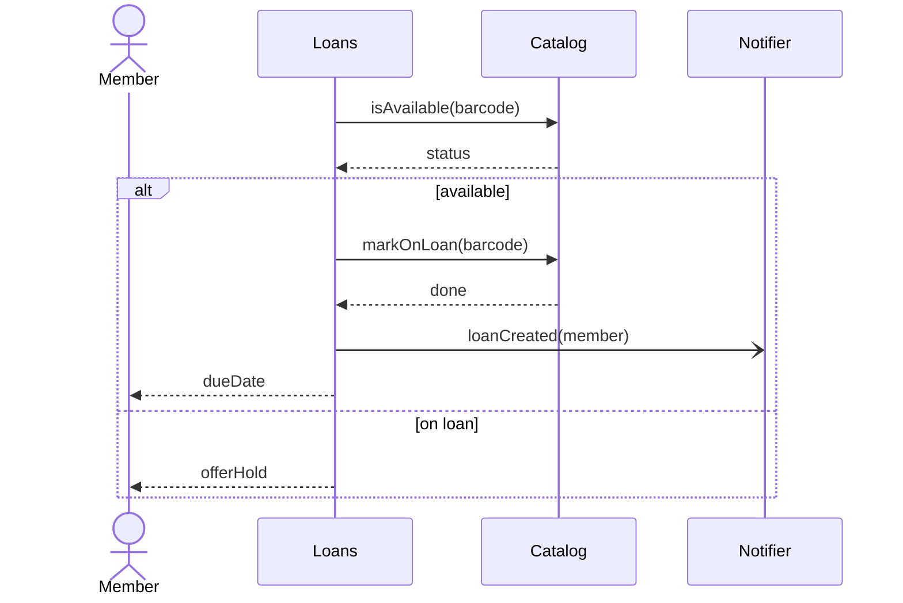
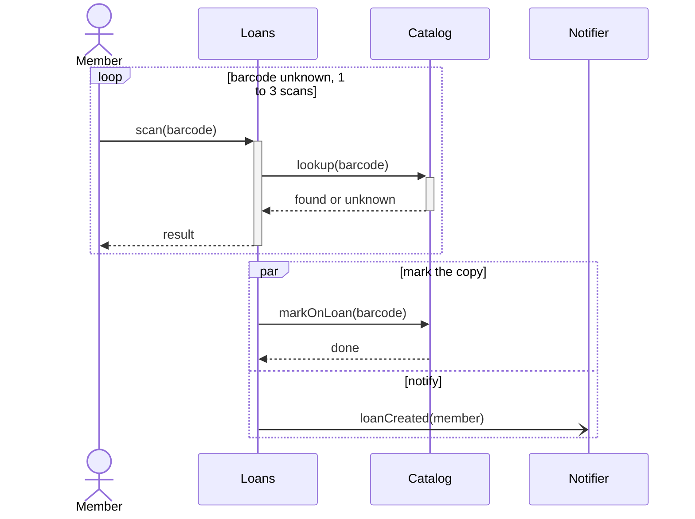

## Objetivos de Aprendizagem

- Ler um diagrama de sequência como um conjunto de ordenações permitidas de eventos, e não como a listagem de um programa: linhas de vida, mensagens, ativações, e o que o eixo vertical promete e não promete.
- Distinguir chamadas síncronas, mensagens assíncronas, respostas e criação e destruição de objetos, pela notação e pelo significado.
- Aplicar corretamente os operadores de fragmento combinado `alt`, `opt`, `loop` e `par`, incluindo o que acontece quando nenhuma guarda é verdadeira e o que "paralelo" significa na UML.
- Desenhar um diagrama de sequência a partir de um cenário de caso de uso e decidir quais cenários merecem um diagrama.

## Contexto e Motivação

`use-cases-and-use-case-descriptions` terminou com um cenário principal numerado e uma lista de extensões: uma história contada entre um ator e "o sistema". Essa história mantém o sistema como caixa-preta; o exemplo corrente ali era `Borrow Copy`, em uma biblioteca de campus. Quando o projeto começa, a pergunta seguinte é interna: quais objetos ou serviços participam, quem chama quem e em que ordem? Um diagrama de classes (`class-and-object-diagrams`) mostra o que existe e como se relaciona, mas não diz nada sobre tempo. O diagrama de sequência responde "o que acontece, passo a passo, quando este cenário roda".

A especificação OMG UML 2.5.1 reúne diagramas de sequência, de comunicação, de visão geral de interação e de tempo sob um só conceito, a Interação. Ela diz que interações servem para chegar a um entendimento comum de uma situação, para definir com precisão a comunicação entre processos no projeto detalhado e para descrever traços de um sistema em execução e compará-los com fases anteriores. Esta lição cobre o diagrama de sequência, a variante que a maioria das equipes realmente desenha.

## Teoria Central

### Linhas de vida e o eixo do tempo

Uma linha de vida (lifeline) é a linha do tempo de um participante (um objeto, um serviço, um componente ou um ator). Ela é desenhada como um retângulo, a cabeça, com uma linha vertical abaixo. O tempo cresce de cima para baixo, mas a UML deixa explícito que a distância entre dois eventos não mede nenhuma duração: indica apenas que passou um tempo diferente de zero. Ao longo de uma linha de vida, os eventos são ordenados de cima para baixo, exceto dentro de um fragmento `par` ou de uma coregion (uma abreviação para operandos paralelos em uma linha de vida), onde nenhuma ordem entre os operandos é imposta. Entre linhas de vida, os eventos são ordenados por mensagens (uma mensagem é enviada antes de ser recebida) ou pelo mecanismo de ordenação generalizada, e o operador `strict` também ordena eventos entre linhas de vida. A ordem é transitiva: uma mensagem de A para B seguida de uma mensagem de B para C põe o envio de A antes do recebimento de C, mesmo que A e C não troquem nada diretamente. Fora disso nada é ordenado, e por isso a especificação descreve uma interação como uma ordem parcial sobre eventos.

Este é o primeiro ponto a internalizar: um diagrama de sequência não afirma que o evento X em uma linha de vida acontece antes do evento Y em outra só porque X foi desenhado mais acima. O "antes" vem da ordem ao longo de uma linha de vida, de cadeias de mensagens e das construções explícitas de ordenação.

### Mensagens: o que a seta significa

Uma mensagem é uma linha de um evento de envio a um evento de recebimento. A UML define a notação das pontas de seta:

| Tipo | Notação (UML 2.5.1) | Mermaid |
|---|---|---|
| Chamada síncrona | linha sólida, ponta de seta preenchida | `A->>B: op()` |
| Chamada assíncrona ou sinal | linha sólida, ponta de seta aberta | `A-)B: signal` |
| Resposta | linha tracejada, ponta aberta ou preenchida | `B-->>A: result` |
| Criação de objeto | linha tracejada, ponta aberta | `create participant C` e depois `A->>C: new` |
| Destruição de objeto | mensagem que termina em um X no fim da linha de vida | `destroy C` |
| Mensagem perdida ou encontrada | pequeno círculo preto no fim (perdida: receptor fora do escopo) ou no início (encontrada: emissor fora do escopo) da seta | sem equivalente direto |

O rótulo é um nome de mensagem com argumentos opcionais, como `reserve(items)`; uma resposta pode carregar o valor retornado depois de dois-pontos. Uma mensagem referencia uma operação ou um sinal, e uma mensagem de sinal precisa ser assíncrona. A distinção importa no projeto: depois de uma chamada síncrona o chamador espera a resposta, depois de uma mensagem assíncrona o emissor segue em frente.

### Especificações de execução (barras de ativação)

O retângulo fino sobre uma linha de vida é uma especificação de execução: o período em que aquele participante está executando um comportamento, normalmente do recebimento de uma chamada até o envio da resposta. Retângulos sobrepostos na mesma linha de vida mostram execução aninhada ou reentrante. Eles tornam visível "quem está bloqueado esperando quem". No Mermaid, `activate`/`deactivate` ou os sufixos `+` e `-` na seta desenham essas barras.

### Fragmentos combinados

Um fragmento combinado é um retângulo desenhado sobre algumas linhas de vida, com um operador em um pequeno pentágono no canto superior esquerdo. Os operandos são separados por linhas tracejadas horizontais, e cada um pode ter uma guarda entre colchetes. Os quatro operadores de uso diário:

| Operador | Significado na UML 2.5.1 | Mermaid |
|---|---|---|
| `alt` | Uma escolha: no máximo um operando é escolhido, e a guarda do operando escolhido deve ser verdadeira naquele ponto. Um operando sem guarda tem guarda verdadeira implícita. `else` é a negação de todas as outras guardas. | `alt` / `else` / `end` |
| `opt` | Ou o único operando acontece, ou nada acontece. Equivale a um `alt` com um operando e um segundo operando vazio. | `opt` / `end` |
| `loop` | O operando se repete no mínimo `minint` e no máximo `maxint` vezes. Depois do mínimo, para quando a guarda booleana é falsa. `loop` sozinho significa de 0 a ilimitado. | `loop` / `end` |
| `par` | Uma mescla paralela: os eventos de operandos diferentes podem ser intercalados de qualquer forma, desde que a ordem dentro de cada operando seja preservada. | `par` / `and` / `end` |

Existem outros operadores (`break`, `neg`, `critical`, `ignore`, `consider`, `assert`, `seq`, `strict`), e um quadro `ref` permite que um diagrama reutilize outro. Dois detalhes surpreendem. Se nenhum operando de um `alt` tem guarda verdadeira, nenhum executa e a interação continua depois do fragmento, o que não é um erro. E a UML dá ao `par` semântica de intercalação: ela não diz que duas coisas ocorrem no mesmo instante, apenas que nenhuma ordem entre os operandos é imposta.

O Mermaid é uma aproximação da UML. Ele não tem o quadro `sd` com parâmetros, nem coregion, nem mensagens perdidas ou encontradas; o texto ao lado de `loop` é livre, e não a sintaxe `minint,maxint`; e o bloco `critical` dele, que a documentação do Mermaid descreve como uma forma de mostrar ações que precisam acontecer automaticamente com tratamento condicional de circunstâncias, não é a região `critical` da UML (uma região na qual outros eventos não podem se intercalar).

### O que um diagrama deixa de fora de propósito

A especificação observa que interações normalmente não contam a história completa: costumam existir outros traços legais, e o foco é a ordem das mensagens, não a manipulação de dados. Um diagrama de sequência é um cenário, não a especificação de todo o comportamento, e por isso é julgado por responder ou não a uma pergunta de projeto específica.

## Exemplos Resolvidos

Estes exemplos continuam o caso de uso `Borrow Copy` de `use-cases-and-use-case-descriptions`. O cenário principal de sucesso e as extensões dele viram diagramas de sequência aqui. Os participantes (`Loans`, `Registry`, `Catalog`) são um projeto interno escolhido para esta lição, não algo que o caso de uso dite.

### Exemplo 1: o cenário principal de sucesso de "Borrow Copy"

O membro apresenta um código de barras (passo 1); o sistema identifica o membro (2), verifica a elegibilidade (3) e a disponibilidade (4), cria um empréstimo com data de devolução (5), marca o exemplar como emprestado e mostra a data de devolução (6). Uma linha de vida por responsabilidade.

Lendo o diagrama: toda chamada, exceto a criação, tem resposta, então `Loans` fica ativa o tempo todo, esperando primeiro `Registry` e depois `Catalog`. A linha de vida `Loan` aparece no meio do diagrama, no ponto em que ocorre a mensagem de criação (a UML desenha essa seta tracejada com ponta aberta; o Mermaid a desenha do jeito dele). O número de linhas de vida é uma decisão de projeto: se `Registry` e `Catalog` fossem um só componente, você desenharia uma só.

### Exemplo 2: alternativas para a disponibilidade, mais um aviso assíncrono

A extensão `4b` do caso de uso diz que, quando o exemplar já está emprestado, o sistema oferece uma reserva (hold). Isso é um `alt` sobre a resposta de disponibilidade. O aviso por e-mail é um acréscimo deste exemplo (o caso de uso não menciona nenhum); ele não está no caminho crítico, então é uma mensagem assíncrona.

O `alt` tem dois operandos com guarda, `available` e `on loan`, e só um executa. A ponta aberta em `loanCreated` diz ao leitor que `Loans` não espera o notificador. Para "notificar só se o membro aceitou, senão não fazer nada", `opt` é mais honesto, porque declara que o outro ramo é vazio.

### Exemplo 3: loop e par, com a contagem de traços

A extensão `4a` diz que um código de barras desconhecido deixa o membro digitá-lo de novo. Suponha que o projeto permita de 1 a 3 leituras. Depois, marcar o exemplar e enviar o aviso acontecem em paralelo.

No `loop`, o operando (leitura, consulta, resposta, resultado) tem um único traço. Um `loop` com `minint` 1 e `maxint` 3 sobre um operando de um só traço tem, portanto, três traços válidos: o operando uma, duas ou três vezes. Com vários traços no operando, a contagem seria maior, porque o `loop` é uma aplicação recursiva de sequenciamento fraco (weak sequencing).

No `par`, conte os eventos de cada operando. O primeiro tem quatro (envio e recebimento de `markOnLoan`, envio e recebimento de `done`), em ordem fixa; o segundo tem dois (envio e recebimento de `loanCreated`). As intercalações que preservam a ordem de cada operando são as formas de escolher 2 posições entre 6 para o segundo operando, C(6,2) = 15. Repare no efeito sobre a ordem na página: na linha de vida `Loans`, o envio de `loanCreated` pode vir antes do envio de `markOnLoan`, que é a exceção à ordem de cima para baixo dentro de um `par`. Esse é o significado preciso de "paralelo" na UML: as 15 intercalações são válidas, então o revisor deve perguntar se todas são seguras.

## Equívocos Comuns e Armadilhas

- **"Um diagrama de sequência é um fluxograma."** Um fluxograma mostra o fluxo de controle de um processo. Um diagrama de sequência mostra mensagens trocadas entre participantes, com ordem apenas ao longo de cada linha de vida e através de cada mensagem. Decisões aparecem só como fragmentos `alt`/`opt`, nunca como losangos.
- **"Mais alto na página significa mais cedo no tempo, globalmente."** A ordem vem da posição ao longo de uma linha de vida (fora de `par` e coregions), de cadeias de mensagens e de construções explícitas de ordenação como `strict`. Dois eventos em linhas de vida diferentes sem nenhuma dessas ligações não têm ordem definida, estejam onde estiverem na página.
- **"Toda mensagem é uma chamada de método."** Uma mensagem pode referenciar uma operação ou um sinal. Mensagens assíncronas e sinais não têm resposta nem espera, e desenhá-las com ponta preenchida engana o leitor sobre bloqueio.
- **"`par` significa threads rodando ao mesmo tempo."** O `par` da UML é uma intercalação: qualquer ordem que respeite a ordem interna de cada operando é válida. Ele não diz como os operandos são escalonados e não torna o código thread-safe.
- **"O diagrama descreve todo o comportamento."** A especificação diz que interações geralmente deixam outros traços sem descrever. Prefira um diagrama por cenário a um diagrama gigante.
- **"Um `alt` sem guarda verdadeira é um erro."** Na UML, se a guarda de nenhum operando é verdadeira, nada no fragmento executa e a interação continua. Se o seu projeto exige que um ramo sempre execute, acrescente uma guarda `else` explícita.

## Resumo

Nos termos da UML 2.5.1, um diagrama de sequência é uma Interação: um conjunto de ordenações válidas de eventos entre linhas de vida, em que o "antes" vem apenas da posição ao longo de uma linha de vida (fora de `par` e coregions), de cadeias de mensagens e de construções explícitas de ordenação. As pontas de seta distinguem chamadas síncronas (preenchida) de mensagens assíncronas (aberta), uma linha tracejada marca respostas (e mensagens de criação), e as barras de ativação mostram quem está executando. Os fragmentos `alt`, `opt`, `loop` e `par` expressam escolha (no máximo um operando), opcionalidade, repetição (`minint` a `maxint`) e intercalação (todas as ordenações que preservam a ordem dos operandos). O Mermaid renderiza um subconjunto útil, mas apenas aproxima a notação. Desenhe um diagrama por cenário de caso de uso e dê a ele a pergunta de projeto que responde.

## Documentation Links

- [OMG: Unified Modeling Language (UML) 2.5.1](https://www.omg.org/spec/UML/2.5.1/PDF): a especificação normativa; a Cláusula 17 define Interações, linhas de vida, mensagens, especificações de execução e todos os operadores de fragmento combinado usados acima.
- [Mermaid: Sequence diagrams](https://mermaid.js.org/syntax/sequenceDiagram.html): a sintaxe dos diagramas em texto desta lição, incluindo tipos de seta, ativação, criar e destruir, e os blocos `alt`, `opt`, `loop` e `par`.
