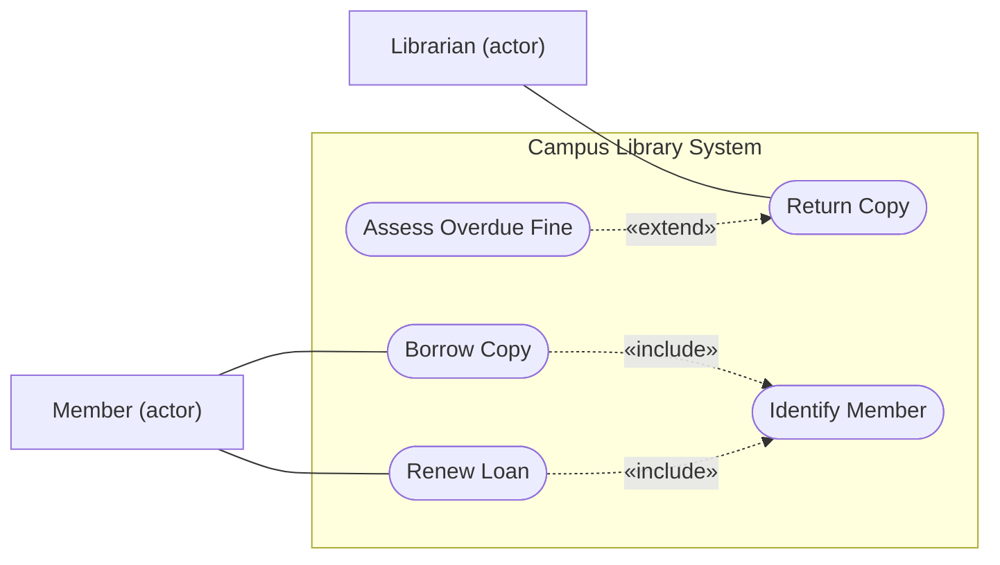

## Learning Objectives

- Define an actor as a role (not a person or a screen) and a use case as a goal an actor pursues with the system, and draw both in a use case diagram with a system boundary.
- Draw `include` and `extend` with the correct arrow direction, and choose between them using the specification's own description of each.
- Write a use-case description with a trigger, preconditions, end conditions, a numbered main success scenario, and extensions keyed to the step they alter.
- Explain what a use case adds to a requirements specification and what it leaves out, in particular the non-functional requirements.

## Context & Motivation

`class-and-object-diagrams` answered a structural question: which concepts exist in the library system. It said nothing about why anyone would use the system. Requirements work asks a different question: who wants what from the system, and what has to happen for them to get it? A class diagram cannot answer that, and a bare list of "the system shall" statements loses the story that connects them.

A use case is the classical answer. It names a goal of someone outside the system, then tells the story of achieving it, including what goes wrong along the way. It is a way to write the functional requirements that `functional-vs-non-functional-requirements` defined, with the story intact. This lesson covers two artifacts: the use case diagram, an index of goals, and the use-case description, where the actual requirements live.

## Core Theory

### Actors, use cases, and the subject

In the UML 2.5.1 specification, an actor "specifies a role played by a user or any other system that interacts with the subject". An actor is therefore a role: one person can play several (a librarian who also borrows books plays both `Librarian` and `Member`), and it may be another system, such as a payment gateway, not only a human.

A use case describes behavior the subject (the system under discussion) performs to give an actor an observable result. The name should be the goal as a short active phrase: `Borrow Copy`, not `Loan screen` and not `Enter barcode`.

The diagram notation is small. An actor is a stick figure (or a rectangle with the keyword `actor`), a use case is an ellipse, and the subject is a rectangle with its name at the top-left, with the ellipses inside it. The specification notes that the rectangle does not mean the subject owns the use cases, only that they apply to it. A line between an actor and a use case means the actor participates in it.

### Include and extend

The two relationships between use cases are the most mixed-up notation in UML, so use the specification's wording.

- **Include.** The behavior of the included use case is inserted into the including (base) use case. It is meant for a common part shared by two or more use cases, extracted so it is written once. The base use case depends on the included one, "but not vice versa". It is drawn as a dashed arrow with an open arrowhead from the **base** to the **included** use case, labeled `«include»`.
- **Extend.** The extending use case adds behavior to the extended use case, possibly conditionally, at a named extension point. The condition is optional: if it is missing or evaluates to true when the first extension point is reached, the extending behavior runs. The extended use case is "meaningful independently" of the extension. It is drawn as a dashed arrow with an open arrowhead from the **extending** use case to the **extended** one, labeled `«extend»`; the condition and extension point can go in an attached note.

A memory aid built from the specification's own wording: with `include`, the arrow points to the thing the base needs. With `extend`, the arrow points to the thing being added to.



This flowchart stands in for a use case diagram: stadium shapes for ellipses, rectangles labeled "(actor)" for stick figures. The arrow directions follow the specification.

### The use-case description

The diagram lists goals and says nothing about behavior. The specification says so itself: the detailed behaviors of a use case are "notated according to the chosen description technique, in a separate diagram or textual document". The text is where the requirements are.

One well-known format is Alistair Cockburn's use case template (1998). Its fields are the name (the goal as a short active verb phrase), goal in context, scope (the system treated as a black box), level, preconditions, success end condition, failed end condition, primary actor, and trigger. Then come the **main success scenario**, numbered steps from the trigger to the delivery of the goal, and the **extensions**, each tied to the step it alters in the form `step altered`, `condition`, `action or sub-use case`. The template also has a **sub-variations** section, for variations on how a step is carried out that eventually split the scenario (for instance, identifying the member by card scan or by campus login), a related-information section with priority, frequency, and performance target, and sections for open issues and schedule.

A useful discipline is separating the happy path from its alternatives. Keep the main success scenario free of conditionals and move every branch to an extension labeled with the step number plus a letter (`3a`, `3b`), as the template's `step altered` form allows. That keeps the main flow readable and makes each failure case a separate, checkable statement. Sub-variations are for differences in how a step is done, extensions are for conditions that change what happens.

### A word that means two things

The template's "extensions" are branches within one use case. UML's `«extend»` is a relationship between two use cases. They share a word and differ in kind: an alternative flow written as `3a` is not an `«extend»` relationship. Writing ordinary error handling as an `«extend»` relationship confuses the two: a failed check inside one scenario belongs in that use case's extensions.

## Worked Examples

### Example 1: reading the diagram

`Borrow Copy` and `Renew Loan` both need the member identified, so that behavior is written once as `Identify Member`, and both base use cases point to it with `«include»`. If the identification rules change, one use case changes.

`Return Copy` is complete without fines: a copy is checked in either way. Assessing an overdue fine happens only when the return is late, so `Assess Overdue Fine` extends `Return Copy`, with the arrow pointing from the fine to the return. The extension point is "after the copy is checked in", and the condition is "the loan is overdue". If fines were later removed, `Return Copy` would still be meaningful unchanged, which follows from the property the specification states: the extended use case is defined independently of the extending one and is meaningful independently of it.

### Example 2: writing the description for Borrow Copy

```text
Use Case: Borrow Copy
Scope: Campus Library System (black box)    Level: Primary task
Primary Actor: Member
Preconditions: The member has a library account.
Success End Condition: A loan exists for the member and the copy, with a
  due date, and the copy is marked on loan.
Failed End Condition: No loan exists, and the copy's status is unchanged.
Trigger: The member asks to borrow a copy, identified by its barcode.

MAIN SUCCESS SCENARIO
1. Member presents the copy's barcode.
2. System identifies the member (includes Identify Member).
3. System checks the member is under the loan limit and has no unpaid fine.
4. System checks the copy is available.
5. System creates a loan with a due date.
6. System marks the copy on loan and shows the due date to the member.

EXTENSIONS
2a. Member cannot be identified: system refuses the request. Use case fails.
3a. Member is at the loan limit: system lists the open loans and refuses.
3b. Member has an unpaid fine: system shows the amount and refuses.
4a. Barcode is unknown: system reports it; member re-enters (resume at 1).
4b. Copy is already on loan: system offers a hold (Place Hold). Use case ends.
```

The main scenario reads as one story, and every extension names the step it interrupts. Each line converts directly into a testable functional requirement: step `3a` becomes "when the member's open loans equal the limit, the system refuses a new loan", ready for the kind of test `unit-integration-and-system-testing` describes.

### Example 3: fixing the size of a use case

A team proposes three use cases: `Enter barcode`, `Manage the library`, and `Borrow Copy`.

- `Enter barcode` is a step inside `Borrow Copy`. No actor pursues it as a goal; it delivers nothing observable on its own.
- `Manage the library` is too broad to have a single main success scenario. It is a collection of goals (add a book, retire a copy, change a loan limit) that need separate use cases.
- `Borrow Copy` is the right size: one actor, one goal, one story that ends in success or failure within a single sitting.

A quick test: would the actor consider the goal complete when the use case ends? If they would say "I'm not done yet", it is too small; if the scenario has no single successful ending, it is too big.

## Common Misconceptions & Pitfalls

- **"The arrow for `include` points from the included to the base."** The specification draws it from the base to the included use case. The common reversal is `extend`'s direction applied to `include`.
- **"A use case diagram is the use case."** The diagram holds only names and relationships. Without descriptions it records no behavior, which the specification places in separate text. Practitioners draw the same line: in Petre's interviews (see `why-model-uml-in-practice`), most of the selective UML users mentioned use cases, but only one of the 11 reported using use case diagrams, and the informants distinguished the two.
- **"An actor is a particular user or a screen."** It is a role, and it may be another system. Naming an actor `Alice` or `Login page` ties the model to one person or interface.
- **"Use cases cover all requirements."** A use case describes behavior as steps. It is a poor place for a quality attribute such as "the loan check must finish within a second for 99% of requests", which `functional-vs-non-functional-requirements` shows is verified as a distribution. The template's performance-target field points at the number but does not replace a proper non-functional requirement.

## Summary

An actor is a role played by a user or another system, and a use case is a goal that role pursues with the system, named as a short active phrase. The use case diagram draws actors, use cases, and the subject boundary, plus two relationships: `«include»` (dashed arrow from the base to the included use case, for a shared part written once) and `«extend»` (dashed arrow from the extending to the extended use case, for optional behavior, possibly under a condition, with the extended case meaningful alone). The diagram is an index; the requirements live in the use-case description, which separates a numbered main success scenario from extensions keyed to step numbers, and states preconditions and end conditions. Good use cases have a goal-sized scope, and they complement rather than replace non-functional requirements. The next step is to turn a scenario like `Borrow Copy` into a timeline of messages between parts, which is the job of `sequence-diagrams`.

## Documentation Links

- [OMG: Unified Modeling Language 2.5.1](https://www.omg.org/spec/UML/2.5.1/PDF): the normative source for actors, use cases, the subject, and the exact definitions and notation of include and extend.
- [Cockburn (1998): Basic Use Case Template](https://cis.bentley.edu/lwaguespack/CS360_Site/Downloads_files/Use%20Case%20Template%20%28Cockburn%29.pdf): the template with the fields, main success scenario, and extensions format used in this lesson, as hosted by Bentley University.
- [Mermaid: Flowcharts](https://mermaid.js.org/syntax/flowchart.html): the text syntax used to draw the stand-in for a use case diagram in this lesson.
- [Petre (2013): UML in Practice](https://web.archive.org/web/20201031213923/http://oro.open.ac.uk/35805/8/UML%20in%20practice%208.pdf): the ICSE 2013 interview study; Table II lists the diagrams used by the 11 selective UML users, with use case diagrams reported by one of the 11.
