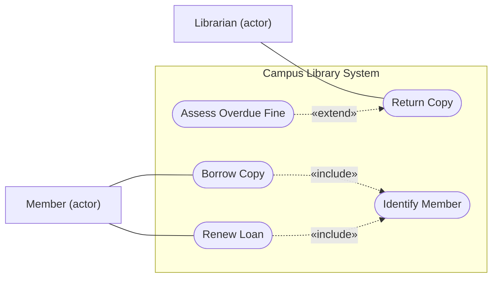

## Objetivos de Aprendizagem

- Definir um ator como um papel (não uma pessoa nem uma tela) e um caso de uso como um objetivo que um ator persegue com o sistema, e desenhar os dois num diagrama de casos de uso com uma fronteira de sistema.
- Desenhar `include` e `extend` com o sentido correto da seta, e escolher entre eles usando a descrição que a própria especificação dá de cada um.
- Escrever uma descrição de caso de uso com gatilho, pré-condições, condições de término, um cenário principal de sucesso numerado e extensões amarradas ao passo que alteram.
- Explicar o que um caso de uso acrescenta a uma especificação de requisitos e o que ele deixa de fora, em particular os requisitos não funcionais.

## Contexto e Motivação

`class-and-object-diagrams` respondeu a uma pergunta estrutural: quais conceitos existem no sistema da biblioteca. Não disse nada sobre por que alguém usaria o sistema. O trabalho de requisitos faz outra pergunta: quem quer o quê do sistema, e o que precisa acontecer para que consiga? Um diagrama de classes não responde a isso, e uma lista crua de afirmações "o sistema deve" perde a história que as conecta.

Um caso de uso é a resposta clássica. Ele nomeia um objetivo de alguém de fora do sistema e conta a história de alcançá-lo, incluindo o que dá errado no caminho. É uma forma de escrever os requisitos funcionais que `functional-vs-non-functional-requirements` definiu, com a história preservada. Esta lição cobre dois artefatos: o diagrama de casos de uso, um índice de objetivos, e a descrição de caso de uso, onde os requisitos de fato moram.

## Teoria Central

### Atores, casos de uso e o sujeito

Na especificação UML 2.5.1, um ator "especifica um papel desempenhado por um usuário ou qualquer outro sistema que interage com o sujeito" (no original, "specifies a role played by a user or any other system that interacts with the subject"). Um ator é, portanto, um papel: uma mesma pessoa pode desempenhar vários (um bibliotecário que também pega livros emprestados desempenha `Librarian` e `Member`), e ele pode ser outro sistema, como um gateway de pagamento, e não só um humano.

Um caso de uso descreve o comportamento que o sujeito (o sistema em discussão) executa para dar a um ator um resultado observável. O nome deve ser o objetivo, como uma frase curta e ativa: `Borrow Copy`, e não `Tela de empréstimo` nem `Digitar código de barras`.

A notação do diagrama é pequena. Um ator é um bonequinho (ou um retângulo com a palavra-chave `actor`), um caso de uso é uma elipse, e o sujeito é um retângulo com seu nome no canto superior esquerdo, com as elipses dentro. A especificação observa que o retângulo não significa que o sujeito possui os casos de uso, apenas que eles se aplicam a ele. Uma linha entre um ator e um caso de uso significa que o ator participa dele.

### Include e extend

As duas relações entre casos de uso são a notação mais confundida da UML, então use as palavras da especificação.

- **Include.** O comportamento do caso de uso incluído é inserido no caso de uso que inclui (a base). Serve para uma parte comum a dois ou mais casos de uso, extraída para ser escrita uma vez só. O caso de uso base depende do incluído, "mas não vice-versa". É desenhado como uma seta tracejada de ponta aberta da **base** para o **incluído**, rotulada `«include»`.
- **Extend.** O caso de uso que estende acrescenta comportamento ao caso de uso estendido, possivelmente de forma condicional, num ponto de extensão nomeado. A condição é opcional: se ela está ausente ou é verdadeira quando o primeiro ponto de extensão é alcançado, o comportamento da extensão é executado. O caso de uso estendido é "significativo independentemente" da extensão. É desenhado como uma seta tracejada de ponta aberta do caso de uso que **estende** para o **estendido**, rotulada `«extend»`; a condição e o ponto de extensão podem ir numa nota anexada.

Um truque de memória a partir das palavras da própria especificação: no `include`, a seta aponta para aquilo de que a base precisa. No `extend`, a seta aponta para aquilo que está recebendo o acréscimo.



Este fluxograma faz as vezes de um diagrama de casos de uso: formas de estádio no lugar das elipses, retângulos rotulados "(actor)" no lugar dos bonequinhos. O sentido das setas segue a especificação.

### A descrição de caso de uso

O diagrama lista objetivos e não diz nada sobre comportamento. A própria especificação afirma isso: os comportamentos detalhados de um caso de uso são "notados conforme a técnica de descrição escolhida, em um diagrama separado ou em um documento textual". O texto é onde estão os requisitos.

Um formato conhecido é o modelo de caso de uso de Alistair Cockburn (1998). Seus campos são o nome (o objetivo como uma frase verbal curta e ativa), objetivo no contexto, escopo (o sistema tratado como caixa-preta), nível, pré-condições, condição de término com sucesso, condição de término com falha, ator primário e gatilho. Depois vêm o **cenário principal de sucesso**, passos numerados do gatilho até a entrega do objetivo, e as **extensões**, cada uma amarrada ao passo que altera, na forma `passo alterado`, `condição`, `ação ou subcaso de uso`. O modelo também tem uma seção de **sub-variações**, para variações de como um passo é executado que acabam bifurcando o cenário (por exemplo, identificar o membro por leitura de cartão ou por login do campus), uma seção de informações relacionadas com prioridade, frequência e meta de desempenho, e seções para questões em aberto e cronograma.

Uma disciplina útil é separar o caminho feliz das alternativas. Mantenha o cenário principal de sucesso livre de condicionais e leve cada ramificação para uma extensão rotulada com o número do passo mais uma letra (`3a`, `3b`), como a forma `passo alterado` do modelo permite. Isso mantém o fluxo principal legível e faz de cada caso de falha uma afirmação separada e verificável. Sub-variações servem para diferenças em como um passo é feito, extensões servem para condições que mudam o que acontece.

### Uma palavra que significa duas coisas

As "extensions" do modelo são ramificações dentro de um único caso de uso. O `«extend»` da UML é uma relação entre dois casos de uso. Compartilham a palavra e diferem em natureza: um fluxo alternativo escrito como `3a` não é uma relação `«extend»`. Escrever o tratamento de erro comum como uma relação `«extend»` confunde os dois: uma checagem que falha dentro de um cenário pertence às extensões desse caso de uso.

## Exemplos Resolvidos

### Exemplo 1: lendo o diagrama

`Borrow Copy` e `Renew Loan` precisam ambos que o membro seja identificado, então esse comportamento é escrito uma vez como `Identify Member`, e os dois casos de uso base apontam para ele com `«include»`. Se as regras de identificação mudarem, um único caso de uso muda.

`Return Copy` está completo sem multas: o exemplar é devolvido de qualquer jeito. Avaliar uma multa por atraso só acontece quando a devolução está atrasada, então `Assess Overdue Fine` estende `Return Copy`, com a seta saindo da multa em direção à devolução. O ponto de extensão é "depois que o exemplar é registrado como devolvido", e a condição é "o empréstimo está atrasado". Se as multas fossem removidas depois, `Return Copy` continuaria significativo sem nenhuma mudança, o que decorre da propriedade que a especificação enuncia: o caso de uso estendido é definido independentemente do que estende e é significativo independentemente dele.

### Exemplo 2: escrevendo a descrição de Borrow Copy

```text
Use Case: Borrow Copy
Scope: Campus Library System (black box)    Level: Primary task
Primary Actor: Member
Preconditions: O membro tem uma conta na biblioteca.
Success End Condition: Existe um empréstimo para o membro e o exemplar, com
  data de devolução, e o exemplar está marcado como emprestado.
Failed End Condition: Nenhum empréstimo existe, e o status do exemplar
  não mudou.
Trigger: O membro pede para pegar um exemplar, identificado pelo código
  de barras.

MAIN SUCCESS SCENARIO
1. O membro apresenta o código de barras do exemplar.
2. O sistema identifica o membro (inclui Identify Member).
3. O sistema verifica se o membro está abaixo do limite e sem multa pendente.
4. O sistema verifica se o exemplar está disponível.
5. O sistema cria um empréstimo com data de devolução.
6. O sistema marca o exemplar como emprestado e mostra a data ao membro.

EXTENSIONS
2a. Membro não identificado: o sistema recusa o pedido. O caso de uso falha.
3a. Membro no limite de empréstimos: o sistema lista os abertos e recusa.
3b. Membro com multa pendente: o sistema mostra o valor e recusa.
4a. Código desconhecido: o sistema avisa; o membro digita de novo (volta ao 1).
4b. Exemplar já emprestado: o sistema oferece uma reserva (Place Hold). Fim.
```

O cenário principal se lê como uma história só, e cada extensão nomeia o passo que interrompe. Cada linha se converte direto num requisito funcional testável: o passo `3a` vira "quando os empréstimos abertos do membro igualam o limite, o sistema recusa um novo empréstimo", pronto para o tipo de teste que `unit-integration-and-system-testing` descreve.

### Exemplo 3: acertando o tamanho de um caso de uso

Uma equipe propõe três casos de uso: `Digitar código de barras`, `Administrar a biblioteca` e `Borrow Copy`.

- `Digitar código de barras` é um passo dentro de `Borrow Copy`. Nenhum ator o persegue como objetivo; ele não entrega nada observável sozinho.
- `Administrar a biblioteca` é amplo demais para ter um único cenário principal de sucesso. É uma coleção de objetivos (cadastrar um livro, retirar um exemplar, mudar um limite de empréstimos) que precisam de casos de uso separados.
- `Borrow Copy` tem o tamanho certo: um ator, um objetivo, uma história que termina em sucesso ou falha numa única sentada.

Um teste rápido: o ator consideraria o objetivo concluído quando o caso de uso termina? Se ele diria "ainda não terminei", o caso é pequeno demais; se o cenário não tem um único final de sucesso, é grande demais.

## Equívocos Comuns e Armadilhas

- **"A seta do `include` aponta do incluído para a base."** A especificação a desenha da base para o caso de uso incluído. A inversão comum é aplicar ao `include` o sentido do `extend`.
- **"O diagrama de casos de uso é o caso de uso."** O diagrama guarda só nomes e relações. Sem as descrições ele não registra comportamento algum, que a especificação coloca em texto separado. Os profissionais traçam a mesma linha: nas entrevistas de Petre (veja `why-model-uml-in-practice`), a maioria dos usuários seletivos de UML mencionou casos de uso, mas só um dos 11 relatou usar diagramas de casos de uso, e os informantes distinguiam os dois.
- **"Um ator é um usuário específico ou uma tela."** É um papel, e pode ser outro sistema. Chamar um ator de `Alice` ou `Tela de login` amarra o modelo a uma pessoa ou a uma interface.
- **"Casos de uso cobrem todos os requisitos."** Um caso de uso descreve comportamento em passos. É um lugar ruim para um atributo de qualidade como "a checagem de empréstimo deve terminar em um segundo para 99% das requisições", que, como `functional-vs-non-functional-requirements` mostra, é verificado como uma distribuição. O campo de meta de desempenho do modelo aponta para o número, mas não substitui um requisito não funcional de verdade.

## Resumo

Um ator é um papel desempenhado por um usuário ou outro sistema, e um caso de uso é um objetivo que esse papel persegue com o sistema, nomeado como uma frase curta e ativa. O diagrama de casos de uso desenha atores, casos de uso e a fronteira do sujeito, mais duas relações: `«include»` (seta tracejada da base para o caso incluído, para uma parte compartilhada escrita uma vez) e `«extend»` (seta tracejada do caso que estende para o estendido, para comportamento opcional, possivelmente sob uma condição, com o caso estendido significativo sozinho). O diagrama é um índice; os requisitos moram na descrição do caso de uso, que separa um cenário principal de sucesso numerado de extensões amarradas aos números dos passos, e declara pré-condições e condições de término. Bons casos de uso têm escopo do tamanho de um objetivo e complementam os requisitos não funcionais, sem substituí-los. O próximo passo é transformar um cenário como `Borrow Copy` numa linha do tempo de mensagens entre as partes, tarefa de `sequence-diagrams`.

## Documentation Links

- [OMG: Unified Modeling Language 2.5.1](https://www.omg.org/spec/UML/2.5.1/PDF): a fonte normativa para atores, casos de uso, o sujeito e as definições e a notação exatas de include e extend.
- [Cockburn (1998): Basic Use Case Template](https://cis.bentley.edu/lwaguespack/CS360_Site/Downloads_files/Use%20Case%20Template%20%28Cockburn%29.pdf): o modelo com os campos, o cenário principal de sucesso e o formato de extensões usados nesta lição, hospedado pela Bentley University.
- [Mermaid: Flowcharts](https://mermaid.js.org/syntax/flowchart.html): a sintaxe em texto usada para desenhar, nesta lição, o substituto de um diagrama de casos de uso.
- [Petre (2013): UML in Practice](https://web.archive.org/web/20201031213923/http://oro.open.ac.uk/35805/8/UML%20in%20practice%208.pdf): o estudo de entrevistas do ICSE 2013; a Tabela II lista os diagramas usados pelos 11 usuários seletivos de UML, com os diagramas de casos de uso relatados por um dos 11.
