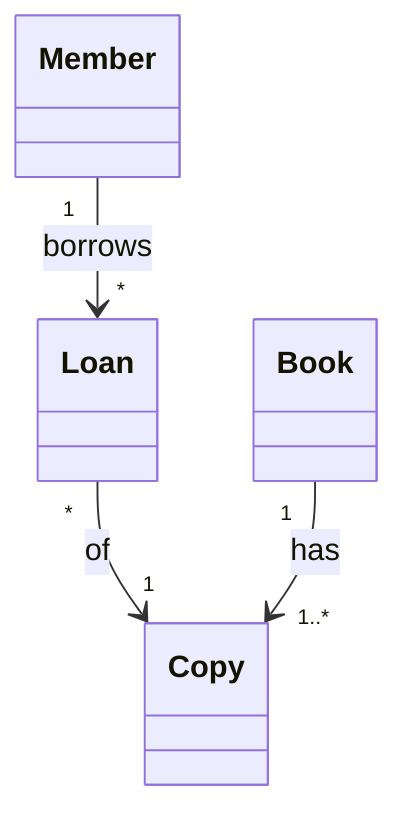

## Learning Objectives

- Explain why a team builds a model before or alongside code: a model is a deliberate simplification that is cheaper to change than the system it describes.
- Distinguish the three ways of using UML (as a sketch, as a blueprint, as a programming language) and report what a 2013 interview study found about how practitioners actually use UML.
- Name the two families of UML diagrams (structure and behavior) and match a concrete question to the diagram that answers it.
- Judge when a diagram is worth drawing and when it is a maintenance cost with no reader.

## Context & Motivation

`functional-vs-non-functional-requirements` ended with a specification that says what a system must do and how well. Prose has a limit, though: two engineers can read the same paragraph and picture different structures behind it. Before anyone writes code, the team needs a cheap way to put a candidate structure or behavior in front of everyone, argue about it, and throw it away if it is wrong. That is what a model is for, and UML (the Unified Modeling Language) is the most widely known notation for it.

UML also has a reputation problem: some engineers remember it as heavyweight ceremony, others as the language every architect must speak. This lesson separates what UML is, what it costs, and how practitioners use it, so that the next lessons (`class-and-object-diagrams`, `use-cases-and-use-case-descriptions`, `sequence-diagrams`, `bpmn-for-business-processes`) read as tools to pick up when a question calls for them, not a notation to apply everywhere.

## Core Theory

### A model is a simplification with a purpose

A model leaves out detail on purpose. A class sketch drops method bodies and database tables because its job is to answer "which concepts exist and how do they relate?". A model that kept every detail would be as large as the code, and as expensive to change.

That cost difference is the economic argument for modeling. Changing a box on a whiteboard takes seconds, while changing a structure already spread across a codebase takes days. The earlier a wrong idea is caught, the cheaper it is to fix, the same direction of argument `the-cost-of-defects-found-late` makes for defects in general (with the caveat that the real multipliers vary by project). A model is a tool for finding mistakes while they are cheap, and for communicating a design to people who have not read the code.

### What UML is

UML is a standard maintained by the Object Management Group (OMG). The current specification, version 2.5.1, was published in December 2017. It defines a graphical notation and, underneath it, a metamodel that says what each element means. The specification's Annex A lists 14 kinds of diagram, grouped into two families:

| Family | What it shows | Diagram types |
|---|---|---|
| Structure | The static elements of a system, "irrespective of time" | Class, Object, Package, Composite Structure, Component, Deployment, Profile |
| Behavior | How the system changes over time | Activity, Use Case, State Machine, Sequence, Communication, Interaction Overview, Timing |

The annex calls this a taxonomy, a logical organization of the kinds of diagram, and adds that it does not preclude mixing kinds in one diagram (its example is a state machine nested inside an internal structure), so the boundaries between diagram types "are not strictly enforced". Nothing in it asks a project to draw all 14; a team draws the ones its questions call for.

### Three modes of using UML

Martin Fowler describes three modes in which people use UML, a taxonomy he says Steve Mellor arrived at independently:

- **UML as sketch:** informal, selective diagrams drawn to communicate an idea, typically on a whiteboard.
- **UML as blueprint:** complete, detailed diagrams handed to programmers who implement them.
- **UML as programming language:** diagrams precise enough to be compiled or executed, so the model is the source.

Fowler describes sketches as selective, informal, and quick, and writes that "comprehensiveness is the enemy of comprehensibility". He also notes that many UML 2 changes added precision serving the blueprint and programming-language modes, which increases the standard's bulk and makes it harder for sketch users to adopt.

Sketches come in two directions. **Forward sketching** happens before coding: a short session (Fowler suggests about ten minutes for a few hours of work) to discuss alternatives for code about to be written. **Reverse sketching** explains an existing system by drawing only the classes worth discussing.

### What practice looks like

Marian Petre's paper "UML in Practice" (ICSE 2013) reports interviews with 50 professional software developers from 50 companies and identifies five patterns of use. Its Table I counts each informant's declared current use: 35 no UML, 11 selective, 3 automated code generation, 1 retrofit, and 0 wholehearted. The headline finding is non-use: in Petre's words, "The majority of those interviewed simply do not use UML, and those who do use it tend to do so selectively and often informally."

Selective use is the largest pattern among the users, not the typical case overall: 11 of the 50 informants (22%), or 11 of the 15 who used UML at all. Petre describes it as personal, informal use that lasts "for as long as it is considered useful, after which it is set aside or even discarded". The counts are per individual informant, not per team. Her Table II lists the diagrams the 11 selective users reported: class (7), sequence (6), activity (6), state machine (3), and use case (1).

This is a dated, small sample: published in 2013, 50 individuals, and tools have moved on (text-based notations such as Mermaid let a diagram live in version control next to the code). Treat it as evidence of how a group of practitioners worked then, not as a measure of current industry practice.

### Matching the question to the diagram

The practical skill is choosing a diagram by the question it answers:

| Question | Diagram | Taught in |
|---|---|---|
| Which concepts exist and how do they relate? | Class (Object for a concrete snapshot) | `class-and-object-diagrams` |
| Who uses the system, and for what goal? | Use case | `use-cases-and-use-case-descriptions` |
| In what order do parts exchange messages? | Sequence | `sequence-diagrams` |
| How does a business process cross several roles? | BPMN (a separate OMG standard, not part of UML) | `bpmn-for-business-processes` |

Once a team starts recognizing recurring shapes in its class sketches, `design-patterns-an-introduction` supplies the shared vocabulary for them.

## Worked Examples

The three lessons in this group share one small domain: a campus library where members borrow physical copies of books.

### Example 1: a forward sketch that finds a missing requirement

A team is about to build "renew a loan". Instead of coding, two developers and a librarian sketch the concepts for ten minutes:

Nothing in the sketch says what happens when another member is waiting for the same book. The librarian points at the empty space and asks, "can a loan be renewed when somebody has a hold on the book?". Nobody had written that rule down. The diagram did not contain the answer, but drawing it exposed the gap at the cheapest possible moment. The team adds a `Hold` concept and a rule to the requirements before any code exists.

### Example 2: choosing a diagram for each question

During the same feature, four different questions come up, and each one calls for a different tool:

1. "Is a hold attached to a book or to a specific copy?" is a structure question, so a class sketch settles it.
2. "What can a librarian do that a member cannot?" is a who-and-why question, so a use case diagram answers it.
3. "When a member renews, in what order do the web page, the loan service and the hold check talk?" is an interaction-over-time question, so it needs a sequence diagram.
4. "Is the nightly overdue-fine run ready to deploy?" is not a modeling question at all. The team just runs the checks, because knowing when not to draw is part of the skill.

### Example 3: a sketch versus an unread blueprint

One developer reverse-engineers the whole codebase into a tool and produces a 62-class diagram. It is correct, complete, and pinned to the wiki, and nobody opens it, because it answers no particular question. Another developer, onboarding a new teammate, draws the six classes of the loan flow on a whiteboard and walks through it in five minutes. The teammate learns the flow that day.

Both diagrams are accurate. The difference is the reader and the question: the sketch has both, the 62-class diagram has neither. When the code changes, the sketch is simply redrawn, while the large diagram must be kept in sync at a recurring cost or left to drift into misinformation.

## Common Misconceptions & Pitfalls

- **"Using UML means drawing all 14 diagram types."** The specification presents the 14 types as a taxonomy and does not ask for all of them. In Petre's study, the 11 selective users reported class, sequence, activity, state machine, and use case diagrams, and communication diagrams were never mentioned.
- **"A diagram is only worth drawing if it is complete."** Example 3 shows the opposite: the six-class sketch was useful because it was deliberately incomplete. Completeness is a cost, worth paying only when someone will rely on it.
- **"Modeling first means waterfall."** The forward sketch in Example 1 took ten minutes, and what the team kept was the finding (a `Hold` concept and a requirements rule), not a design document. Modeling is a thinking activity, with no commitment to a heavy sequential process (see `software-process-models-waterfall-and-its-real-history`).
- **"A model that exists must be kept in sync."** A diagram without a standing reader can be deleted. If it is kept, treat it like code: keep it small, next to the thing it describes, in a text-based source that can be reviewed in a pull request.

## Summary

A model is a purposeful simplification that costs less to change than the system, so it finds mistakes early and shares a design. UML (OMG, version 2.5.1, December 2017) offers 14 diagram types in two families, structure and behavior, and no project is asked to draw them all. Fowler's three modes (sketch, blueprint, programming language) explain why people disagree about it. In Petre's 2013 interviews, most of the 50 developers did not use UML at all, and the 11 who used it selectively favored a few diagram types. The working skill is matching the question to the diagram, drawing forward to expose gaps or in reverse to explain code, and not drawing when no question needs one.

## Documentation Links

- [OMG: Unified Modeling Language 2.5.1](https://www.omg.org/spec/UML/2.5.1/PDF): the normative specification, including Annex A on diagram kinds and the structure and behavior families.
- [Fowler: UML Mode](https://martinfowler.com/bliki/UmlMode.html): the three modes of using UML (sketch, blueprint, programming language) and how UML 2 shifted the standard.
- [Fowler: UML As Sketch](https://martinfowler.com/bliki/UmlAsSketch.html): forward and reverse sketching, and why selectivity beats comprehensiveness.
- [Petre (2013): UML in Practice](https://web.archive.org/web/20201031213923/http://oro.open.ac.uk/35805/8/UML%20in%20practice%208.pdf): the ICSE 2013 interview study of 50 developers in 50 companies, with Table I (declared current use) and Table II (diagrams used by the 11 selective users).
- [Mermaid: Class diagrams](https://mermaid.js.org/syntax/classDiagram.html): the text-based notation used for the diagrams in this lesson.
