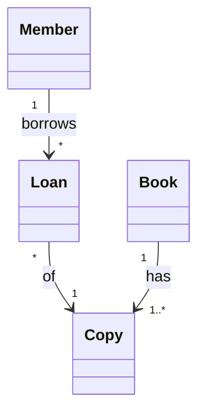

## Objetivos de Aprendizagem

- Explicar por que uma equipe constrói um modelo antes ou junto do código: um modelo é uma simplificação deliberada, mais barata de mudar do que o sistema que ele descreve.
- Distinguir os três modos de usar a UML (como rascunho, como planta de construção, como linguagem de programação) e relatar o que um estudo de entrevistas de 2013 encontrou sobre como os profissionais realmente usam a UML.
- Nomear as duas famílias de diagramas da UML (estrutura e comportamento) e associar uma pergunta concreta ao diagrama que a responde.
- Julgar quando um diagrama vale a pena ser desenhado e quando ele é apenas um custo de manutenção sem leitor.

## Contexto e Motivação

`functional-vs-non-functional-requirements` terminou com uma especificação que diz o que o sistema deve fazer e com que qualidade. Só que a prosa tem um limite: dois engenheiros podem ler o mesmo parágrafo e imaginar estruturas diferentes por trás dele. Antes de alguém escrever código, a equipe precisa de um jeito barato de colocar uma estrutura ou um comportamento candidato diante de todos, discutir e descartar se estiver errado. É para isso que serve um modelo, e a UML (Unified Modeling Language) é a notação mais conhecida para ele.

A UML também tem um problema de reputação: alguns engenheiros lembram dela como cerimônia pesada, outros como a língua que todo arquiteto precisa falar. Esta lição separa o que a UML é, o que ela custa e como os profissionais a usam, para que as próximas lições (`class-and-object-diagrams`, `use-cases-and-use-case-descriptions`, `sequence-diagrams`, `bpmn-for-business-processes`) sejam lidas como ferramentas que se pegam quando uma pergunta pede, e não como uma notação a aplicar em tudo.

## Teoria Central

### Um modelo é uma simplificação com propósito

Um modelo deixa detalhes de fora de propósito. Um rascunho de classes descarta o corpo dos métodos e as tabelas do banco porque seu trabalho é responder "quais conceitos existem e como se relacionam?". Um modelo que guardasse todos os detalhes seria tão grande quanto o código, e tão caro de mudar quanto ele.

Essa diferença de custo é o argumento econômico para modelar. Mudar uma caixa num quadro branco leva segundos; mudar uma estrutura já espalhada por uma base de código leva dias. Quanto mais cedo uma ideia errada é pega, mais barato é corrigi-la, o mesmo sentido de argumento que `the-cost-of-defects-found-late` faz para defeitos em geral (com a ressalva de que os multiplicadores reais variam por projeto). Um modelo é uma ferramenta para achar erros enquanto eles ainda são baratos e para comunicar um design a quem não leu o código.

### O que é a UML

A UML é um padrão mantido pelo Object Management Group (OMG). A especificação atual, versão 2.5.1, foi publicada em dezembro de 2017. Ela define uma notação gráfica e, por baixo dela, um metamodelo que diz o que cada elemento significa. O Anexo A da especificação lista 14 tipos de diagrama, agrupados em duas famílias:

| Família | O que mostra | Tipos de diagrama |
|---|---|---|
| Estrutura | Os elementos estáticos de um sistema, "independentemente do tempo" | Classes, Objetos, Pacotes, Estrutura Composta, Componentes, Implantação, Perfil |
| Comportamento | Como o sistema muda ao longo do tempo | Atividades, Casos de Uso, Máquina de Estados, Sequência, Comunicação, Visão Geral de Interação, Temporização |

O anexo chama isso de taxonomia, uma organização lógica dos tipos de diagrama, e acrescenta que ela não impede misturar tipos num mesmo diagrama (o exemplo dele é uma máquina de estados aninhada numa estrutura interna), de modo que as fronteiras entre os tipos de diagrama "não são estritamente impostas". Nada ali pede que um projeto desenhe os 14; a equipe desenha os que as suas perguntas pedem.

### Três modos de usar a UML

Martin Fowler descreve três modos em que as pessoas usam a UML, uma taxonomia que, segundo ele, Steve Mellor alcançou de forma independente:

- **UML como rascunho (sketch):** diagramas informais e seletivos, desenhados para comunicar uma ideia, tipicamente num quadro branco.
- **UML como planta de construção (blueprint):** diagramas completos e detalhados, entregues a programadores que os implementam.
- **UML como linguagem de programação:** diagramas precisos o bastante para serem compilados ou executados, de modo que o modelo é o código-fonte.

Fowler descreve os rascunhos como seletivos, informais e rápidos, e escreve que "comprehensiveness is the enemy of comprehensibility" (a abrangência é inimiga da compreensão). Ele também observa que muitas mudanças da UML 2 acrescentaram precisão a serviço dos modos planta e linguagem de programação, o que aumenta o volume do padrão e dificulta a adoção por quem faz rascunhos.

Rascunhos têm duas direções. O **rascunho para frente (forward sketching)** acontece antes de codar: uma sessão curta (Fowler sugere cerca de dez minutos para umas poucas horas de trabalho) para discutir alternativas do código que está para ser escrito. O **rascunho reverso (reverse sketching)** explica um sistema existente desenhando só as classes que valem a conversa.

### Como é a prática

O artigo "UML in Practice", de Marian Petre (ICSE 2013), relata entrevistas com 50 desenvolvedores de software profissionais de 50 empresas e identifica cinco padrões de uso. A Tabela I conta o uso atual declarado de cada informante: 35 sem UML, 11 seletivo, 3 geração automática de código, 1 retrofit e 0 integral (wholehearted). O achado principal é o não uso: nas palavras de Petre, "The majority of those interviewed simply do not use UML, and those who do use it tend to do so selectively and often informally" (a maioria dos entrevistados simplesmente não usa UML, e quem a usa tende a fazê-lo de forma seletiva e muitas vezes informal).

O uso seletivo é o maior padrão entre os que usam, não o caso típico no total: 11 dos 50 informantes (22%), ou 11 dos 15 que usavam UML de alguma forma. Petre o descreve como um uso pessoal e informal, mantido "for as long as it is considered useful, after which it is set aside or even discarded" (enquanto for considerado útil, depois do que é posto de lado ou até descartado). As contagens são por informante individual, não por equipe. A Tabela II dela lista os diagramas que os 11 usuários seletivos relataram: classes (7), sequência (6), atividades (6), máquina de estados (3) e casos de uso (1).

Essa é uma amostra pequena e datada: publicada em 2013, com 50 indivíduos, e as ferramentas evoluíram (notações em texto, como o Mermaid, deixam o diagrama viver no controle de versão ao lado do código). Trate-a como evidência de como um grupo de profissionais trabalhava naquela época, não como medida da prática atual da indústria.

### Associando a pergunta ao diagrama

A habilidade prática é escolher o diagrama pela pergunta que ele responde:

| Pergunta | Diagrama | Ensinado em |
|---|---|---|
| Quais conceitos existem e como se relacionam? | Classes (Objetos para um retrato concreto) | `class-and-object-diagrams` |
| Quem usa o sistema, e para quê? | Casos de uso | `use-cases-and-use-case-descriptions` |
| Em que ordem as partes trocam mensagens? | Sequência | `sequence-diagrams` |
| Como um processo de negócio atravessa vários papéis? | BPMN (outro padrão da OMG, fora da UML) | `bpmn-for-business-processes` |

Quando a equipe começa a reconhecer formas recorrentes nos seus rascunhos de classes, `design-patterns-an-introduction` fornece o vocabulário compartilhado para elas.

## Exemplos Resolvidos

As três lições deste grupo compartilham um mesmo domínio pequeno: uma biblioteca de campus em que membros pegam emprestados exemplares físicos de livros.

### Exemplo 1: um rascunho para frente que acha um requisito faltando

Uma equipe vai construir "renovar um empréstimo". Em vez de codar, dois desenvolvedores e uma bibliotecária rascunham os conceitos por dez minutos:

Nada no rascunho diz o que acontece quando outro membro está esperando pelo mesmo livro. A bibliotecária aponta o espaço vazio e pergunta: "dá para renovar um empréstimo quando alguém tem uma reserva para o livro?". Ninguém tinha escrito essa regra. O diagrama não continha a resposta, mas desenhá-lo expôs a lacuna no momento mais barato possível. A equipe acrescenta o conceito `Hold` (reserva) e uma regra aos requisitos antes de existir qualquer código.

### Exemplo 2: escolhendo um diagrama para cada pergunta

Durante a mesma funcionalidade, surgem quatro perguntas diferentes, e cada uma pede uma ferramenta:

1. "A reserva fica presa ao livro ou a um exemplar específico?" é uma pergunta de estrutura, então um rascunho de classes resolve.
2. "O que um bibliotecário pode fazer que um membro não pode?" é uma pergunta de quem-e-para-quê, então um diagrama de casos de uso responde.
3. "Quando um membro renova, em que ordem conversam a página web, o serviço de empréstimos e a checagem de reservas?" é uma pergunta de interação no tempo, então pede um diagrama de sequência.
4. "A rotina noturna de multas por atraso está pronta para o deploy?" não é uma pergunta de modelagem. A equipe só roda as verificações, porque saber quando não desenhar faz parte da habilidade.

### Exemplo 3: um rascunho versus uma planta que ninguém lê

Um desenvolvedor faz engenharia reversa de toda a base de código numa ferramenta e produz um diagrama de 62 classes. Está correto, completo, fixado na wiki, e ninguém o abre, porque ele não responde a pergunta nenhuma. Outra desenvolvedora, integrando um colega novo, desenha no quadro as seis classes do fluxo de empréstimo e o explica em cinco minutos. O colega aprende o fluxo naquele dia.

Os dois diagramas são corretos. A diferença é o leitor e a pergunta: o rascunho tem os dois, o de 62 classes não tem nenhum. Quando o código muda, o rascunho é simplesmente redesenhado, enquanto o diagrama grande precisa ser mantido em sincronia a um custo recorrente ou deixado para virar desinformação.

## Equívocos Comuns e Armadilhas

- **"Usar UML significa desenhar os 14 tipos de diagrama."** A especificação apresenta os 14 tipos como uma taxonomia e não pede todos. No estudo de Petre, os 11 usuários seletivos relataram diagramas de classes, sequência, atividades, máquina de estados e casos de uso, e os diagramas de comunicação nunca foram mencionados.
- **"Um diagrama só vale a pena se for completo."** O Exemplo 3 mostra o contrário: o rascunho de seis classes foi útil porque era deliberadamente incompleto. Completude é um custo, que só vale pagar quando alguém vai depender dela.
- **"Modelar antes é fazer cascata."** O rascunho do Exemplo 1 levou dez minutos, e o que a equipe guardou foi a descoberta (um conceito `Hold` e uma regra de requisitos), não um documento de design. Modelar é uma atividade de pensamento, sem compromisso com um processo pesado e sequencial (veja `software-process-models-waterfall-and-its-real-history`).
- **"Um modelo que existe precisa ser mantido em sincronia."** Um diagrama sem leitor fixo pode ser apagado. Se for mantido, trate-o como código: pequeno, ao lado daquilo que descreve, em uma fonte em texto que possa ser revisada num pull request.

## Resumo

Um modelo é uma simplificação com propósito, mais barata de mudar do que o sistema, e por isso acha erros cedo e compartilha um design. A UML (OMG, versão 2.5.1, dezembro de 2017) oferece 14 tipos de diagrama em duas famílias, estrutura e comportamento, e nenhum projeto é obrigado a desenhá-los todos. Os três modos de Fowler (rascunho, planta, linguagem de programação) explicam por que as pessoas discordam sobre ela. Nas entrevistas de Petre em 2013, a maioria dos 50 desenvolvedores não usava UML, e os 11 que a usavam de forma seletiva preferiam poucos tipos de diagrama. A habilidade de trabalho é associar a pergunta ao diagrama, desenhar para frente para expor lacunas ou em reverso para explicar código, e não desenhar quando nenhuma pergunta pede.

## Documentation Links

- [OMG: Unified Modeling Language 2.5.1](https://www.omg.org/spec/UML/2.5.1/PDF): a especificação normativa, incluindo o Anexo A sobre os tipos de diagrama e as famílias de estrutura e comportamento.
- [Fowler: UML Mode](https://martinfowler.com/bliki/UmlMode.html): os três modos de usar a UML (rascunho, planta, linguagem de programação) e como a UML 2 deslocou o padrão.
- [Fowler: UML As Sketch](https://martinfowler.com/bliki/UmlAsSketch.html): rascunho para frente e reverso, e por que a seletividade vence a abrangência.
- [Petre (2013): UML in Practice](https://web.archive.org/web/20201031213923/http://oro.open.ac.uk/35805/8/UML%20in%20practice%208.pdf): o estudo de entrevistas do ICSE 2013 com 50 desenvolvedores de 50 empresas, com a Tabela I (uso atual declarado) e a Tabela II (diagramas usados pelos 11 usuários seletivos).
- [Mermaid: Class diagrams](https://mermaid.js.org/syntax/classDiagram.html): a notação em texto usada nos diagramas desta lição.
