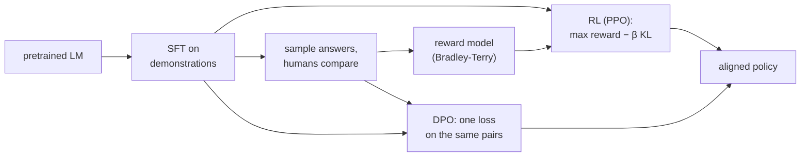

## Learning Objectives

- Explain why a pretrained language model does not, by default, behave like a helpful assistant, and why writing a loss for "helpful" directly is hard.
- Describe the three stages of the InstructGPT recipe: supervised fine-tuning, reward modeling from pairwise comparisons, and reinforcement learning against the reward with a KL penalty.
- Compute a Bradley-Terry preference probability from two reward scores, and explain the role of the KL term in preventing reward hacking.
- Derive, at the level of its key step, why Direct Preference Optimization can optimize the same objective with a simple classification loss and no separate reward model.

## Context & Motivation

A causal language model trained on web text learns to continue documents the way the web does. Asked "How do I reverse a list in Python?", it might continue with more questions in the style of a forum page, because that is a likely continuation. Pretraining optimizes likelihood of text, not usefulness to the person asking.

Supervised fine-tuning on demonstrations (prompts paired with good answers written by people) helps, but has a ceiling: writing an excellent answer is slow and expensive, and the model only imitates the demonstrations. People are much better and faster at **comparing** two answers than at writing a perfect one. Reinforcement learning from human feedback (RLHF) exploits that asymmetry. Christiano and colleagues introduced it in 2017 for control tasks; Ouyang and colleagues at OpenAI applied it to language models in InstructGPT (2022), where labelers preferred the outputs of a 1.3-billion-parameter aligned model over those of the 175-billion-parameter GPT-3 it started from.

The idea connects directly to `utility-theory-and-rational-preferences` in `ai-theory/artificial-intelligence`: if preferences between outcomes are consistent, they can be represented by a numeric utility, and an agent can then maximize it. RLHF learns that utility from comparisons; Direct Preference Optimization (Rafailov and colleagues at Stanford, 2023) shows the explicit utility can be skipped.

## Core Theory

### Stage 1: supervised fine-tuning (SFT)

Fine-tune the pretrained model on a few thousand to tens of thousands of high-quality demonstrations. The result, `π_SFT`, already follows instructions reasonably well and serves as both the starting point and the reference policy `π_ref` for the next stages.

### Stage 2: a reward model from comparisons

For each prompt `x`, sample several answers from `π_SFT` and ask labelers which they prefer. Each comparison yields a pair: a preferred answer `y_w` and a rejected answer `y_l`. A **reward model** `r_φ(x, y)`, usually the SFT model with its output layer replaced by a single scalar head, is trained so that preferred answers score higher, using the **Bradley-Terry** model of pairwise preference:

$$P(y_w \succ y_l \mid x) = \sigma\big(r_\phi(x, y_w) - r_\phi(x, y_l)\big), \qquad \mathcal{L}_{RM} = -\log \sigma\big(r_\phi(x, y_w) - r_\phi(x, y_l)\big)$$

Only differences of rewards matter, so the reward's absolute scale and offset are arbitrary.

### Stage 3: reinforcement learning with a KL leash

Now optimize the policy `π_θ` (initialized from `π_SFT`) to produce answers the reward model scores highly, while staying close to the reference:

$$\max_{\pi_\theta}\ \mathbb{E}_{x,\, y \sim \pi_\theta}\big[r_\phi(x, y)\big] - \beta\, \mathrm{KL}\big(\pi_\theta(\cdot \mid x)\,\|\,\pi_{ref}(\cdot \mid x)\big)$$

The KL penalty is essential. The reward model is an imperfect proxy trained on a finite set of comparisons; a policy that maximizes it without restraint finds outputs the reward model overrates (oddly long answers, repeated flattering phrases, confident nonsense in a favored style), a failure called **reward hacking** or reward overoptimization. Keeping the policy near `π_ref` keeps it in the region where the reward model's judgments are trustworthy. InstructGPT optimized this objective with PPO, the policy-gradient algorithm studied later in this track.

### Direct Preference Optimization

The KL-regularized objective above has a known closed-form optimum:

$$\pi^*(y \mid x) = \frac{1}{Z(x)}\, \pi_{ref}(y \mid x)\, \exp\!\Big(\frac{r(x, y)}{\beta}\Big)$$

where `Z(x)` normalizes over all possible answers and is intractable to compute. DPO's key move is to solve this equation for the reward instead: `r(x, y) = β log( π*(y|x) / π_ref(y|x) ) + β log Z(x)`. Substitute that into the Bradley-Terry loss. Because Bradley-Terry only uses the **difference** of rewards for two answers to the same prompt, the troublesome `β log Z(x)` term cancels. What remains is a loss on the policy alone:

$$\mathcal{L}_{DPO} = -\log \sigma\Big(\beta \log \frac{\pi_\theta(y_w \mid x)}{\pi_{ref}(y_w \mid x)} - \beta \log \frac{\pi_\theta(y_l \mid x)}{\pi_{ref}(y_l \mid x)}\Big)$$

It is a binary classification loss on preference pairs: raise the policy's likelihood of the preferred answer relative to the reference, lower it for the rejected one. No reward model is trained, no answers are sampled during training, and no RL loop is needed, which makes DPO much simpler and more stable to run, at the cost of learning only from a fixed dataset of pairs rather than from fresh samples of the improving policy.

## Worked Examples

### Example 1: reading a reward model

**Problem:** A reward model scores answer A at 2.0 and answer B at 0.5 for the same prompt. What preference probability does it assign, and what changes if every reward is shifted by +10?

**Trace:** `P(A ≻ B) = σ(2.0 − 0.5) = σ(1.5) = 1 / (1 + e^−1.5) ≈ 0.82`. Shifting both rewards by +10 leaves the difference at 1.5, so the probability is unchanged. This is why reward values from different reward models, or even different training runs, cannot be compared directly, and why practitioners often normalize rewards before RL.

### Example 2: one DPO term by hand

**Problem:** With `β = 0.1`, the reference model gives log-probabilities −40 to `y_w` and −38 to `y_l`. The current policy gives −35 to `y_w` and −39 to `y_l`. Compute the DPO loss for this pair and say which way a gradient step pushes.

**Trace:** Log-ratio for the preferred answer: `−35 − (−40) = 5`. For the rejected one: `−39 − (−38) = −1`. Difference: `5 − (−1) = 6`, times `β` gives 0.6. Loss: `−log σ(0.6) = −log(0.646) ≈ 0.44`. The gradient increases the preferred answer's log-ratio and decreases the rejected one's, so the loss falls toward 0 as the margin grows. Note that the reference originally preferred `y_l` (−38 beats −40); DPO measures progress relative to the reference, not in absolute likelihood.

## Common Misconceptions & Pitfalls

- **"RLHF teaches the model the truth."** It teaches the model what labelers prefer. If labelers reward confident, well-formatted answers without checking facts, the model learns to produce confident, well-formatted answers, correct or not. Preference data quality bounds alignment quality.
- **"The KL penalty is a minor regularizer that can be dropped."** Without it, the policy drifts into regions where the reward model is wrong and exploits those errors; measured true quality first rises and then falls as optimization against the proxy continues.
- **"DPO makes RLHF obsolete."** DPO is simpler and widely used, but online methods that sample from the current policy and score fresh outputs can keep improving beyond what a fixed preference dataset contains. Both families are in active use.

## Summary

Pretraining optimizes likelihood of text, not helpfulness. RLHF aligns a model in three stages: supervised fine-tuning on demonstrations, a reward model fitted to pairwise human comparisons with the Bradley-Terry model, and reinforcement learning that maximizes that reward under a KL penalty keeping the policy near the reference to prevent reward hacking. DPO observes that the KL-regularized optimum determines the reward up to a per-prompt constant that cancels in Bradley-Terry, turning alignment into a single classification loss on preference pairs. The next concept addresses a different limitation of a trained model, that its knowledge is frozen at training time.

## Documentation Links

- [Ouyang et al.: Training Language Models to Follow Instructions with Human Feedback (InstructGPT, NeurIPS 2022)](https://arxiv.org/abs/2203.02155): doc
- [Rafailov et al.: Direct Preference Optimization: Your Language Model is Secretly a Reward Model (NeurIPS 2023)](https://arxiv.org/abs/2305.18290): doc
- [Christiano et al.: Deep Reinforcement Learning from Human Preferences (NeurIPS 2017)](https://arxiv.org/abs/1706.03741): doc
