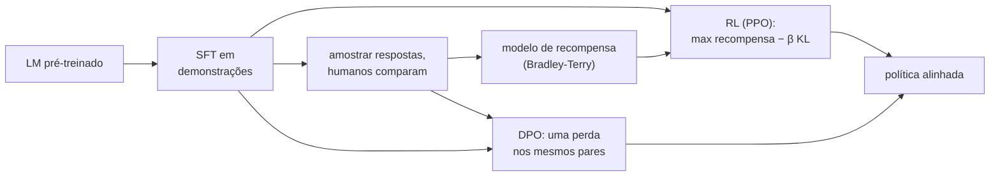

## Objetivos de Aprendizagem

- Explicar por que um modelo de linguagem pré-treinado não se comporta, por padrão, como um assistente útil, e por que escrever diretamente uma perda para "útil" é difícil.
- Descrever as três etapas da receita do InstructGPT: fine-tuning supervisionado, modelagem de recompensa a partir de comparações em pares e aprendizado por reforço contra a recompensa com uma penalidade de KL.
- Calcular uma probabilidade de preferência de Bradley-Terry a partir de dois escores de recompensa, e explicar o papel do termo de KL em impedir o reward hacking.
- Derivar, no nível do passo principal, por que a Direct Preference Optimization consegue otimizar o mesmo objetivo com uma perda de classificação simples e sem modelo de recompensa separado.

## Contexto e Motivação

Um modelo de linguagem causal treinado em texto da web aprende a continuar documentos do jeito que a web faz. Perguntado "Como inverto uma lista em Python?", ele pode continuar com mais perguntas no estilo de uma página de fórum, porque essa é uma continuação provável. O pré-treino otimiza a verossimilhança do texto, não a utilidade para quem pergunta.

O fine-tuning supervisionado em demonstrações (prompts pareados com boas respostas escritas por pessoas) ajuda, mas tem um teto: escrever uma resposta excelente é lento e caro, e o modelo só imita as demonstrações. Pessoas são muito melhores e mais rápidas em **comparar** duas respostas do que em escrever uma perfeita. O aprendizado por reforço a partir de feedback humano (RLHF) explora essa assimetria. Christiano e colegas o introduziram em 2017 para tarefas de controle; Ouyang e colegas na OpenAI o aplicaram a modelos de linguagem no InstructGPT (2022), em que os avaliadores preferiram as saídas de um modelo alinhado de 1,3 bilhão de parâmetros às do GPT-3 de 175 bilhões de onde ele partiu.

A ideia se conecta diretamente a `utility-theory-and-rational-preferences` em `ai-theory/artificial-intelligence`: se as preferências entre resultados são consistentes, elas podem ser representadas por uma utilidade numérica, e um agente pode então maximizá-la. O RLHF aprende essa utilidade a partir de comparações; a Direct Preference Optimization (Rafailov e colegas em Stanford, 2023) mostra que dá para pular a utilidade explícita.

## Teoria Central

### Etapa 1: fine-tuning supervisionado (SFT)

Faça fine-tuning do modelo pré-treinado em alguns milhares a dezenas de milhares de demonstrações de alta qualidade. O resultado, `π_SFT`, já segue instruções razoavelmente bem e serve como ponto de partida e como política de referência `π_ref` para as próximas etapas.

### Etapa 2: um modelo de recompensa a partir de comparações

Para cada prompt `x`, amostre várias respostas de `π_SFT` e pergunte aos avaliadores qual preferem. Cada comparação gera um par: uma resposta preferida `y_w` e uma rejeitada `y_l`. Um **modelo de recompensa** `r_φ(x, y)`, normalmente o modelo SFT com a camada de saída trocada por uma única cabeça escalar, é treinado para que respostas preferidas pontuem mais alto, usando o modelo de preferência em pares de **Bradley-Terry**:

$$P(y_w \succ y_l \mid x) = \sigma\big(r_\phi(x, y_w) - r_\phi(x, y_l)\big), \qquad \mathcal{L}_{RM} = -\log \sigma\big(r_\phi(x, y_w) - r_\phi(x, y_l)\big)$$

Só as diferenças de recompensa importam, então a escala e o deslocamento absolutos da recompensa são arbitrários.

### Etapa 3: aprendizado por reforço com uma coleira de KL

Agora otimize a política `π_θ` (inicializada a partir de `π_SFT`) para produzir respostas que o modelo de recompensa pontue alto, permanecendo perto da referência:

$$\max_{\pi_\theta}\ \mathbb{E}_{x,\, y \sim \pi_\theta}\big[r_\phi(x, y)\big] - \beta\, \mathrm{KL}\big(\pi_\theta(\cdot \mid x)\,\|\,\pi_{ref}(\cdot \mid x)\big)$$

A penalidade de KL é essencial. O modelo de recompensa é um substituto imperfeito treinado num conjunto finito de comparações; uma política que o maximiza sem freio encontra saídas que o modelo de recompensa superestima (respostas estranhamente longas, frases bajuladoras repetidas, bobagens confiantes num estilo favorecido), uma falha chamada **reward hacking** ou superotimização da recompensa. Manter a política perto de `π_ref` a mantém na região em que os julgamentos do modelo de recompensa são confiáveis. O InstructGPT otimizou esse objetivo com PPO, o algoritmo de gradiente de política estudado mais adiante nesta trilha.

### Direct Preference Optimization

O objetivo regularizado por KL acima tem um ótimo conhecido em forma fechada:

$$\pi^*(y \mid x) = \frac{1}{Z(x)}\, \pi_{ref}(y \mid x)\, \exp\!\Big(\frac{r(x, y)}{\beta}\Big)$$

em que `Z(x)` normaliza sobre todas as respostas possíveis e é intratável de calcular. O passo central do DPO é resolver essa equação para a recompensa: `r(x, y) = β log( π*(y|x) / π_ref(y|x) ) + β log Z(x)`. Substitua isso na perda de Bradley-Terry. Como o Bradley-Terry só usa a **diferença** de recompensas de duas respostas ao mesmo prompt, o termo problemático `β log Z(x)` se cancela. O que sobra é uma perda só sobre a política:

$$\mathcal{L}_{DPO} = -\log \sigma\Big(\beta \log \frac{\pi_\theta(y_w \mid x)}{\pi_{ref}(y_w \mid x)} - \beta \log \frac{\pi_\theta(y_l \mid x)}{\pi_{ref}(y_l \mid x)}\Big)$$

É uma perda de classificação binária em pares de preferência: aumente a verossimilhança da resposta preferida em relação à referência e diminua a da rejeitada. Nenhum modelo de recompensa é treinado, nenhuma resposta é amostrada durante o treino e nenhum laço de RL é necessário, o que torna o DPO muito mais simples e estável de executar, ao custo de aprender só a partir de um dataset fixo de pares em vez de amostras novas da política que está melhorando.

## Exemplos Resolvidos

### Exemplo 1: lendo um modelo de recompensa

**Problema:** Um modelo de recompensa dá 2,0 à resposta A e 0,5 à resposta B para o mesmo prompt. Que probabilidade de preferência ele atribui, e o que muda se toda recompensa for deslocada em +10?

**Rastreamento:** `P(A ≻ B) = σ(2,0 − 0,5) = σ(1,5) = 1 / (1 + e^−1,5) ≈ 0,82`. Deslocar as duas recompensas em +10 deixa a diferença em 1,5, então a probabilidade não muda. É por isso que valores de recompensa de modelos de recompensa diferentes, ou até de execuções de treino diferentes, não podem ser comparados diretamente, e por isso praticantes costumam normalizar as recompensas antes do RL.

### Exemplo 2: um termo de DPO à mão

**Problema:** Com `β = 0,1`, o modelo de referência dá log-probabilidades −40 a `y_w` e −38 a `y_l`. A política atual dá −35 a `y_w` e −39 a `y_l`. Calcule a perda DPO desse par e diga para que lado um passo de gradiente empurra.

**Rastreamento:** Log-razão da resposta preferida: `−35 − (−40) = 5`. Da rejeitada: `−39 − (−38) = −1`. Diferença: `5 − (−1) = 6`, vezes `β` dá 0,6. Perda: `−log σ(0,6) = −log(0,646) ≈ 0,44`. O gradiente aumenta a log-razão da resposta preferida e diminui a da rejeitada, então a perda cai em direção a 0 conforme a margem cresce. Note que a referência originalmente preferia `y_l` (−38 vence −40); o DPO mede progresso relativo à referência, não em verossimilhança absoluta.

## Equívocos Comuns e Armadilhas

- **"O RLHF ensina a verdade ao modelo."** Ele ensina ao modelo o que os avaliadores preferem. Se os avaliadores recompensam respostas confiantes e bem formatadas sem checar os fatos, o modelo aprende a produzir respostas confiantes e bem formatadas, corretas ou não. A qualidade dos dados de preferência limita a qualidade do alinhamento.
- **"A penalidade de KL é um regularizador menor que dá para tirar."** Sem ela, a política deriva para regiões em que o modelo de recompensa erra e explora esses erros; a qualidade real medida primeiro sobe e depois cai conforme a otimização contra o substituto continua.
- **"O DPO torna o RLHF obsoleto."** O DPO é mais simples e muito usado, mas métodos online que amostram da política atual e pontuam saídas novas podem continuar melhorando além do que um dataset fixo de preferências contém. As duas famílias estão em uso ativo.

## Resumo

O pré-treino otimiza a verossimilhança do texto, não a utilidade. O RLHF alinha um modelo em três etapas: fine-tuning supervisionado em demonstrações, um modelo de recompensa ajustado a comparações humanas em pares com o modelo de Bradley-Terry e aprendizado por reforço que maximiza essa recompensa sob uma penalidade de KL que mantém a política perto da referência para impedir o reward hacking. O DPO observa que o ótimo regularizado por KL determina a recompensa a menos de uma constante por prompt que se cancela no Bradley-Terry, transformando o alinhamento numa única perda de classificação sobre pares de preferência. O próximo conceito trata de outra limitação de um modelo treinado: o seu conhecimento fica congelado no momento do treino.

## Documentation Links

- [Ouyang et al.: Training Language Models to Follow Instructions with Human Feedback (InstructGPT, NeurIPS 2022)](https://arxiv.org/abs/2203.02155): doc
- [Rafailov et al.: Direct Preference Optimization: Your Language Model is Secretly a Reward Model (NeurIPS 2023)](https://arxiv.org/abs/2305.18290): doc
- [Christiano et al.: Deep Reinforcement Learning from Human Preferences (NeurIPS 2017)](https://arxiv.org/abs/1706.03741): doc
