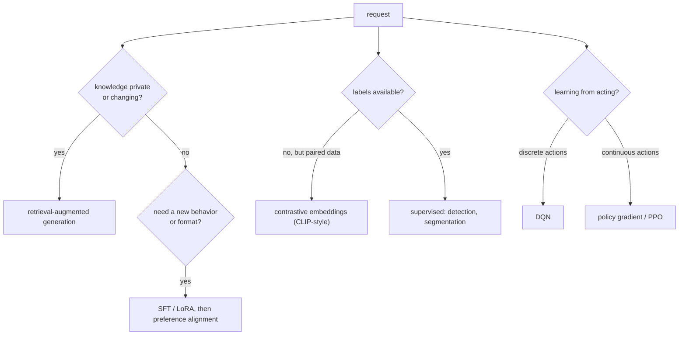

## Learning Objectives

- Translate a vague product request into the constraints that decide an AI design: what data exists, whether labels exist, how often knowledge changes, what an error costs, and what the action space looks like.
- Choose between retrieval, fine-tuning, preference alignment, contrastive embeddings, generative models, and reinforcement learning for a concrete task, and justify the choice with the mechanisms studied in this track.
- Name, for each rejected alternative, the specific property it would have lacked.
- Define an evaluation for each design that measures the failure mode it is most exposed to.

## Context & Motivation

Each concept in this track solved one problem cleanly: tokenization, embeddings, pretraining objectives, scaling, cheap adaptation, alignment, retrieval, detection, vision-language alignment, generative modeling, and two families of reinforcement learning. Real requests do not arrive labeled with the right technique. They arrive as "we want an assistant that knows our docs" or "make the robots learn to pick faster". This capstone, in the spirit of the project-based finals of Stanford CS224N, CS231n, and Berkeley CS285, works through three such requests. The goal is not to recall definitions but to reason from constraints to mechanisms, and to be able to say what each rejected option would have cost.

## Core Theory

### Five questions that drive the design

1. **Where does the knowledge live, and how often does it change?** In public text before a training cutoff (pretrained weights may suffice), in private or fast-changing documents (retrieval), or in behavior and format rather than facts (fine-tuning).
2. **What supervision exists?** Labeled pairs (supervised fine-tuning), comparisons between outputs (preference learning), naturally paired data such as images with captions (contrastive learning), or only a reward signal from acting (reinforcement learning).
3. **What is the output?** A label, a ranking, generated text or images, or a sequence of actions in an environment.
4. **What does an error cost, and can it be checked?** Answers that must be traceable to a source favor retrieval with citations; actions with physical consequences favor training in simulation and conservative updates.
5. **What is the action or decision space?** A few discrete choices fit value-based methods; continuous controls fit policy gradients.

The branches are not exclusive: most real systems combine several, and the point of the questions is to make each component's role explicit.

## Worked Examples

### Example 1: a support assistant over a private, changing knowledge base

**Request:** A software company wants an assistant that answers customer questions using its 20,000-page product documentation, which changes weekly, and must never state a policy the documentation does not contain.

**Design:** A retrieval-augmented generation pipeline. Chunk the documentation, index it with both BM25 (product names, error codes, and version numbers are exact rare tokens) and a dense dual encoder (customers paraphrase), merge the results, and re-rank with a cross-encoder. The generator is an instruction-following model prompted to answer only from the retrieved passages and to cite them. Weekly changes become index updates, with document metadata used to filter out superseded versions. If the model's tone or answer format does not match the company's support style, a small LoRA fine-tune on a few hundred approved answers adjusts format without touching facts.

**Rejected alternatives:** Fine-tuning the documentation into the weights would make facts stale after a week, could not cite sources, and is unreliable for injecting large amounts of new knowledge. Relying on a larger context window alone would cost the full documentation's tokens on every request. Training a new model from scratch is ruled out by the scaling-laws arithmetic: the data is far too small to train a capable model compute-optimally.

**Evaluation:** recall@5 on a set of real questions with known source passages (retrieval), and faithfulness, the fraction of answer claims supported by the cited passages (generation). A drop in either points to the stage to fix.

### Example 2: visual product search with no labeled training set

**Request:** An online marketplace wants shoppers to upload a photo and find visually similar products among 5 million listings, or type a description such as "red leather ankle boots". There is no labeled dataset of product categories.

**Design:** A CLIP-style contrastive model. Embed every listing photo once with the image encoder and store the vectors in an approximate nearest-neighbor index. A photo query is embedded with the same image encoder; a text query with the text encoder, landing in the same shared space. Both search the same index. If off-the-shelf embeddings confuse fine distinctions that matter commercially (two similar sneaker models), continue contrastive training on the marketplace's own listing photos paired with their seller-written titles, which are naturally paired data requiring no annotation effort.

**Rejected alternatives:** A supervised classifier or detector needs category labels that do not exist and would only answer "which category", not "which items look like this". Generating an image from the text query with a diffusion model and then searching with it adds cost and a source of error without adding information the text encoder lacks.

**Evaluation:** recall@k against a small set of human-judged relevant items per query, measured separately for image and text queries, plus checks on categories rarely named in captions, where contrastive models are weakest.

### Example 3: a warehouse controller that must learn from trial and error

**Request:** A robotics team wants an arm to learn to grasp irregular items from a bin. Success is easy to detect (an item is lifted), but nobody can write down the right joint torques, and real-world trials are slow and risk damage.

**Design:** Reinforcement learning in simulation with a policy-gradient method, PPO in particular. The action space is continuous (joint torques or end-effector velocity), which rules out the per-step maximization DQN needs. A shaped reward combines grasp success with small penalties for collisions and excessive force. Thousands of simulated environments run in parallel, which suits PPO's on-policy appetite for fresh samples and its stable clipped updates. Simulator parameters (friction, mass, lighting, camera noise) are randomized during training so the policy does not overfit to one imperfect simulation, a technique studied in Track F of this specialization. Perception can reuse a pretrained vision backbone (a ViT or CNN), fine-tuned or frozen, to turn camera images into features for the policy.

**Rejected alternatives:** DQN would require discretizing a high-dimensional continuous action space, and its sample reuse advantage matters less when simulation makes samples cheap. Training only on the real robot is too slow and risky. Pure imitation from human demonstrations is a strong complement for initialization, but on its own it cannot exceed the demonstrator or recover from states the demonstrations never visited.

**Evaluation:** grasp success rate on held-out object shapes in simulation, then on the real robot, with the gap between them as the measure of how well training transferred.

## Common Misconceptions & Pitfalls

- **"The biggest model solves every request."** Each example's core decision was about data and knowledge flow (retrieval versus weights, labels versus pairs, simulation versus reality), not about model size.
- **"One technique per project."** All three designs combined several concepts from this track. The useful skill is assigning each component a clear job and a clear test.
- **"Evaluation can wait until the system works."** Deciding how to measure the most likely failure (retrieval misses, fine-grained confusion, the simulation-to-reality gap) is part of the design, because it decides which component to improve first.

## Summary

Designing an AI system starts from constraints: where knowledge lives and how fast it changes, what supervision exists, what the output and the action space are, and what an error costs. A private, changing knowledge base calls for retrieval-augmented generation with light fine-tuning for format; search without labels but with naturally paired data calls for contrastive image-text embeddings and nearest-neighbor search; learning continuous control from trial and error calls for policy-gradient reinforcement learning in randomized simulation. For every choice, the rejected alternatives fail on a specific, nameable property, and each design comes with an evaluation aimed at its weakest stage.

## Documentation Links

- [Stanford CS224N: Natural Language Processing with Deep Learning](https://web.stanford.edu/class/cs224n/): doc
- [Stanford CS231n: Deep Learning for Computer Vision](https://cs231n.stanford.edu/): doc
- [UC Berkeley CS285: Deep Reinforcement Learning](https://rail.eecs.berkeley.edu/deeprlcourse/): doc
