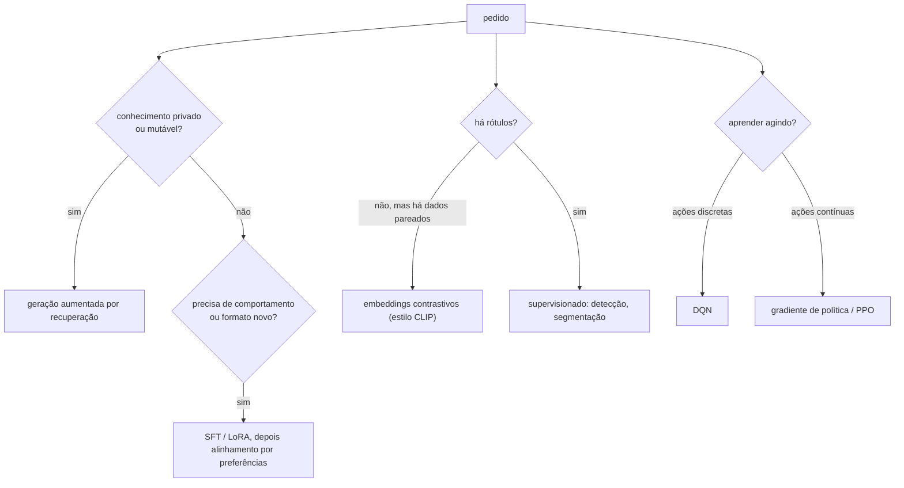

## Objetivos de Aprendizagem

- Traduzir um pedido de produto vago nas restrições que decidem um projeto de IA: que dados existem, se existem rótulos, com que frequência o conhecimento muda, quanto custa um erro e como é o espaço de ações.
- Escolher entre recuperação, fine-tuning, alinhamento por preferências, embeddings contrastivos, modelos generativos e aprendizado por reforço para uma tarefa concreta, e justificar a escolha com os mecanismos estudados nesta trilha.
- Nomear, para cada alternativa rejeitada, a propriedade específica que lhe faltaria.
- Definir uma avaliação para cada projeto que meça o modo de falha a que ele está mais exposto.

## Contexto e Motivação

Cada conceito desta trilha resolveu um problema de forma limpa: tokenização, embeddings, objetivos de pré-treino, escala, adaptação barata, alinhamento, recuperação, detecção, alinhamento visão-linguagem, modelagem generativa e duas famílias de aprendizado por reforço. Pedidos reais não chegam etiquetados com a técnica certa. Eles chegam como "queremos um assistente que conheça a nossa documentação" ou "façam os robôs aprenderem a pegar mais rápido". Este capstone, no espírito das avaliações finais baseadas em projeto do CS224N e do CS231n de Stanford e do CS285 de Berkeley, percorre três pedidos assim. O objetivo não é lembrar definições, e sim raciocinar das restrições para os mecanismos, e saber dizer o que cada opção rejeitada teria custado.

## Teoria Central

### Cinco perguntas que guiam o projeto

1. **Onde vive o conhecimento, e com que frequência ele muda?** Em texto público anterior a um corte de treino (os pesos pré-treinados podem bastar), em documentos privados ou que mudam rápido (recuperação), ou em comportamento e formato em vez de fatos (fine-tuning).
2. **Que supervisão existe?** Pares rotulados (fine-tuning supervisionado), comparações entre saídas (aprendizado por preferências), dados naturalmente pareados como imagens com legendas (aprendizado contrastivo), ou só um sinal de recompensa vindo de agir (aprendizado por reforço).
3. **Qual é a saída?** Um rótulo, um ranqueamento, texto ou imagens gerados, ou uma sequência de ações num ambiente.
4. **Quanto custa um erro, e dá para checá-lo?** Respostas que precisam ser rastreáveis até uma fonte favorecem recuperação com citações; ações com consequências físicas favorecem treino em simulação e atualizações conservadoras.
5. **Qual é o espaço de ações ou de decisões?** Poucas escolhas discretas combinam com métodos baseados em valor; controles contínuos combinam com gradientes de política.

Os ramos não são exclusivos: a maioria dos sistemas reais combina vários, e o propósito das perguntas é deixar explícito o papel de cada componente.

## Exemplos Resolvidos

### Exemplo 1: um assistente de suporte sobre uma base de conhecimento privada e mutável

**Pedido:** Uma empresa de software quer um assistente que responda perguntas de clientes usando a sua documentação de produto de 20.000 páginas, que muda toda semana, e que nunca afirme uma política que a documentação não contém.

**Projeto:** Um pipeline de geração aumentada por recuperação. Divida a documentação em trechos, indexe com BM25 (nomes de produto, códigos de erro e números de versão são tokens exatos e raros) e com um dual encoder denso (clientes parafraseiam), mescle os resultados e faça re-ranking com um cross-encoder. O gerador é um modelo que segue instruções, instruído a responder só a partir dos trechos recuperados e a citá-los. As mudanças semanais viram atualizações do índice, com metadados de documento usados para filtrar versões substituídas. Se o tom ou o formato de resposta do modelo não combinar com o estilo de suporte da empresa, um pequeno fine-tuning com LoRA em algumas centenas de respostas aprovadas ajusta o formato sem mexer nos fatos.

**Alternativas rejeitadas:** Colocar a documentação nos pesos via fine-tuning deixaria os fatos desatualizados em uma semana, não permitiria citar fontes e é pouco confiável para injetar grandes quantidades de conhecimento novo. Confiar só numa janela de contexto maior custaria os tokens da documentação inteira em cada requisição. Treinar um modelo novo do zero é descartado pela aritmética das leis de escala: os dados são pequenos demais para treinar um modelo capaz de forma ótima em computação.

**Avaliação:** recall@5 num conjunto de perguntas reais com trechos de origem conhecidos (recuperação), e fidelidade, a fração das afirmações da resposta sustentadas pelos trechos citados (geração). Uma queda em qualquer uma aponta a etapa a corrigir.

### Exemplo 2: busca visual de produtos sem conjunto de treino rotulado

**Pedido:** Um marketplace online quer que compradores enviem uma foto e encontrem produtos visualmente parecidos entre 5 milhões de anúncios, ou digitem uma descrição como "bota de cano curto de couro vermelho". Não existe dataset rotulado de categorias de produto.

**Projeto:** Um modelo contrastivo no estilo CLIP. Gere uma vez o embedding de toda foto de anúncio com o encoder de imagem e guarde os vetores num índice de vizinhos mais próximos aproximados. Uma consulta por foto passa pelo mesmo encoder de imagem; uma consulta por texto passa pelo encoder de texto, caindo no mesmo espaço compartilhado. As duas buscam no mesmo índice. Se os embeddings prontos confundirem distinções finas que importam comercialmente (dois modelos de tênis parecidos), continue o treino contrastivo com as fotos dos próprios anúncios pareadas com os títulos escritos pelos vendedores, dados naturalmente pareados que não exigem esforço de anotação.

**Alternativas rejeitadas:** Um classificador ou detector supervisionado precisa de rótulos de categoria que não existem e só responderia "qual categoria", não "quais itens se parecem com este". Gerar uma imagem a partir da consulta de texto com um modelo de difusão e depois buscar com ela adiciona custo e uma fonte de erro sem acrescentar informação que o encoder de texto não tenha.

**Avaliação:** recall@k contra um pequeno conjunto de itens julgados relevantes por pessoas para cada consulta, medido separadamente para consultas por imagem e por texto, mais checagens em categorias raramente nomeadas em legendas, onde modelos contrastivos são mais fracos.

### Exemplo 3: um controlador de armazém que precisa aprender por tentativa e erro

**Pedido:** Um time de robótica quer que um braço aprenda a pegar itens irregulares de uma caixa. O sucesso é fácil de detectar (um item foi levantado), mas ninguém consegue escrever os torques de junta certos, e tentativas no mundo real são lentas e arriscam danos.

**Projeto:** Aprendizado por reforço em simulação com um método de gradiente de política, o PPO em particular. O espaço de ações é contínuo (torques de junta ou velocidade do efetuador), o que descarta a maximização por passo de que o DQN precisa. Uma recompensa modelada combina sucesso na preensão com pequenas penalidades por colisões e força excessiva. Milhares de ambientes simulados rodam em paralelo, o que combina com o apetite on-policy do PPO por amostras novas e com as suas atualizações recortadas e estáveis. Os parâmetros do simulador (atrito, massa, iluminação, ruído de câmera) são aleatorizados no treino para que a política não se ajuste demais a uma simulação imperfeita, técnica estudada na Trilha F desta especialização. A percepção pode reaproveitar um backbone de visão pré-treinado (um ViT ou uma CNN), ajustado ou congelado, para transformar imagens da câmera em features para a política.

**Alternativas rejeitadas:** O DQN exigiria discretizar um espaço de ações contínuo de alta dimensão, e a sua vantagem de reuso de amostras importa menos quando a simulação torna as amostras baratas. Treinar só no robô real é lento e arriscado demais. A imitação pura de demonstrações humanas é um ótimo complemento para a inicialização, mas sozinha não consegue superar quem demonstrou nem se recuperar de estados que as demonstrações nunca visitaram.

**Avaliação:** taxa de sucesso de preensão em formatos de objeto separados na simulação, depois no robô real, com a diferença entre as duas como medida de quão bem o treino se transferiu.

## Equívocos Comuns e Armadilhas

- **"O maior modelo resolve todo pedido."** A decisão central de cada exemplo foi sobre dados e fluxo de conhecimento (recuperação versus pesos, rótulos versus pares, simulação versus realidade), não sobre tamanho de modelo.
- **"Uma técnica por projeto."** Os três projetos combinaram vários conceitos desta trilha. A habilidade útil é dar a cada componente um trabalho claro e um teste claro.
- **"A avaliação pode esperar o sistema funcionar."** Decidir como medir a falha mais provável (recuperações perdidas, confusões finas, a diferença entre simulação e realidade) faz parte do projeto, porque decide qual componente melhorar primeiro.

## Resumo

Projetar um sistema de IA começa pelas restrições: onde vive o conhecimento e com que velocidade muda, que supervisão existe, qual é a saída e o espaço de ações, e quanto custa um erro. Uma base de conhecimento privada e mutável pede geração aumentada por recuperação com um fine-tuning leve para formato; busca sem rótulos, mas com dados naturalmente pareados, pede embeddings contrastivos imagem-texto e busca por vizinhos mais próximos; aprender controle contínuo por tentativa e erro pede aprendizado por reforço com gradiente de política em simulação aleatorizada. Para cada escolha, as alternativas rejeitadas falham numa propriedade específica e nomeável, e cada projeto vem com uma avaliação mirada na sua etapa mais fraca.

## Documentation Links

- [Stanford CS224N: Natural Language Processing with Deep Learning](https://web.stanford.edu/class/cs224n/): doc
- [Stanford CS231n: Deep Learning for Computer Vision](https://cs231n.stanford.edu/): doc
- [UC Berkeley CS285: Deep Reinforcement Learning](https://rail.eecs.berkeley.edu/deeprlcourse/): doc
