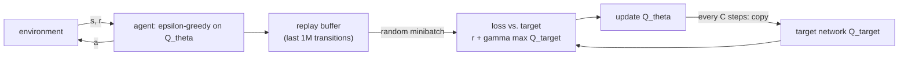

## Learning Objectives

- Explain what value iteration needs (a transition model, a table over all states) and how Q-learning removes the need for a model by learning from sampled transitions.
- Write the Q-learning update and the DQN loss, and identify the bootstrapped target.
- Explain why naive neural Q-learning diverges (correlated samples, a moving target, the "deadly triad") and how the replay buffer and target network address it.
- Describe ε-greedy exploration and the overestimation bias that Double DQN corrects.

## Context & Motivation

`ai-theory/artificial-intelligence` solved Markov decision processes with value iteration and policy iteration. Both assume two things that rarely hold in practice: the transition probabilities $P(s' \mid s, a)$ and rewards are known, and the state space is small enough to store one number per state. An agent playing a video game from pixels violates both: nobody hands it the game's dynamics, and the number of distinct screens is astronomically large.

Q-learning (Watkins, 1989) removes the first assumption: it learns optimal action values from experienced transitions alone, without a model. Replacing its table with a neural network removes the second, but the combination was long known to be unstable. In 2013 and in a 2015 Nature paper, Mnih and colleagues at DeepMind showed that two engineering changes make it work: their Deep Q-Network (DQN) learned to play 49 Atari games from raw pixels and the score alone, with one architecture and one set of hyperparameters, reaching human-level performance on many of them. Berkeley's CS285 and Sutton and Barto's textbook use DQN as the canonical bridge from tabular reinforcement learning to deep RL.

## Core Theory

### Action values and the Bellman optimality equation

The optimal action-value function $Q^*(s, a)$ is the expected discounted return from taking action $a$ in state $s$ and acting optimally afterwards. It satisfies the Bellman optimality equation:

$$Q^*(s, a) = \mathbb{E}_{s'}\Big[\, r + \gamma \max_{a'} Q^*(s', a') \,\Big]$$

Knowing $Q^*$ is enough to act: in any state, pick $\arg\max_a Q^*(s, a)$. No model is needed at decision time, which is why learning $Q$ rather than the state value $V$ is convenient when the dynamics are unknown.

### Q-learning: learning from samples

Q-learning replaces the expectation with a single observed transition $(s, a, r, s')$ and nudges the current estimate toward it:

$$Q(s, a) \leftarrow Q(s, a) + \alpha \Big[\, \underbrace{r + \gamma \max_{a'} Q(s', a')}_{\text{target}} - Q(s, a) \Big]$$

The target uses the current estimate of the next state's value, a technique called **bootstrapping**. Q-learning is **off-policy**: the target uses the greedy $\max$ regardless of which action the agent actually takes next, so it can learn about the optimal policy while behaving exploratorily. With a table, enough exploration, and a suitably decaying step size, it provably converges to $Q^*$.

### From table to network

DQN replaces the table with a network $Q_\theta(s, a)$ that takes a state (for Atari, the last four grayscale frames stacked) and outputs one value per action. Training minimizes the squared difference between prediction and target:

$$\mathcal{L}(\theta) = \mathbb{E}_{(s,a,r,s') \sim \mathcal{D}}\Big[\big(r + \gamma \max_{a'} Q_{\theta^-}(s', a') - Q_\theta(s, a)\big)^2\Big]$$

Two details in that formula are the whole contribution.

**Experience replay** ($\mathcal{D}$). Consecutive frames are almost identical, so training on transitions in the order they occur feeds the network long runs of highly correlated samples, breaking the independence assumption behind stochastic gradient descent and letting the network overfit to whatever part of the game it is currently in. DQN stores the last million transitions in a buffer and trains on random minibatches from it. This decorrelates updates and reuses each transition many times.

**A target network** ($\theta^-$). If the target is computed with the same parameters being updated, every gradient step moves the target too, and the regression chases itself. DQN keeps a frozen copy $\theta^-$ for computing targets and copies $\theta$ into it only every $C$ steps (10,000 in the Nature paper), turning each period into an ordinary supervised regression against fixed labels.

These two fixes target what Sutton and Barto call the **deadly triad**: function approximation, bootstrapping, and off-policy learning together can make value estimates diverge. DQN keeps all three but damps the feedback loop that causes the instability.

### Exploration and overestimation

The agent acts **ε-greedily**: with probability $\varepsilon$ it picks a random action, otherwise the greedy one; $\varepsilon$ anneals from 1.0 to 0.1 over the first million frames. Without exploration, the agent never discovers actions its initial estimates undervalue.

The $\max$ in the target introduces a systematic **overestimation bias**: taking the maximum over noisy estimates favors whichever action's noise happens to be positive. **Double DQN** (van Hasselt et al., 2016) decouples selection from evaluation, choosing $a^* = \arg\max_{a'} Q_\theta(s', a')$ with the online network and evaluating it with the target network, $Q_{\theta^-}(s', a^*)$, which substantially reduces the bias.

## Worked Examples

### Example 1: one Q-learning update

**Problem:** With $\gamma = 0.9$ and $\alpha = 0.5$, the agent is in state $s$, takes action `right`, receives $r = 1$, and lands in $s'$. Current estimates: $Q(s, \text{right}) = 2.0$, $Q(s', \text{left}) = 3.0$, $Q(s', \text{right}) = 4.0$. Compute the update.

**Trace:** Target: $r + \gamma \max_{a'} Q(s', a') = 1 + 0.9 \times 4.0 = 4.6$. Temporal-difference error: $4.6 - 2.0 = 2.6$. New estimate: $2.0 + 0.5 \times 2.6 = 3.3$. The target used $Q(s', \text{right})$ even if the agent's next action, chosen ε-greedily, turns out to be `left`; that is the off-policy property. In DQN, the same computation happens for a minibatch, with $4.0$ read from the target network and the $0.5$ step replaced by a gradient step on the squared error.

### Example 2: why the max overestimates

**Problem:** In some state the true value of all four actions is exactly 0. The network's estimates are true value plus independent noise uniformly distributed in $[-1, 1]$. What is the expected value of $\max_a Q(s, a)$?

**Resolution:** For $n$ independent uniform variables on $[-1, 1]$, the expected maximum is $(n - 1)/(n + 1)$; with $n = 4$, that is $3/5 = 0.6$. So the bootstrapped target overestimates this state's value by 0.6 on average, even though every individual estimate is unbiased. The bias propagates backwards through bootstrapping to earlier states. Double DQN evaluates the selected action with an independent estimate, whose noise is not correlated with the selection, so the expected evaluated value returns close to 0.

## Common Misconceptions & Pitfalls

- **"DQN learned the game's rules."** It learned action values for the states it visited, from reward alone. It can fail badly on games that need long-term exploration with sparse rewards (Montezuma's Revenge, where DQN scored near zero), because ε-greedy rarely stumbles onto the first reward.
- **"The replay buffer is just a memory optimization."** Its main role is statistical: it breaks temporal correlation between training samples. Prioritized replay goes further, sampling transitions with large temporal-difference error more often.
- **"DQN works for any action space."** It needs a $\max$ over actions at every step, which is cheap for a handful of discrete actions and impractical for continuous ones such as joint torques. Continuous control is the domain of the policy-gradient and actor-critic methods in the next concept.

## Summary

Value iteration needs a model and a table; Q-learning removes the model by learning from sampled transitions with a bootstrapped, off-policy target, and DQN removes the table by approximating $Q$ with a neural network. Naive deep Q-learning is unstable because of correlated samples and a target that moves with every update, the "deadly triad" of approximation, bootstrapping, and off-policy learning. Experience replay and a periodically copied target network damp that instability, ε-greedy exploration provides coverage, and Double DQN reduces the overestimation caused by maximizing over noisy estimates. The next concept optimizes the policy directly instead of deriving it from values.

## Documentation Links

- [Mnih et al.: Playing Atari with Deep Reinforcement Learning (2013)](https://arxiv.org/abs/1312.5602): doc
- [Sutton, Barto: Reinforcement Learning: An Introduction (2nd ed.)](http://incompleteideas.net/book/the-book-2nd.html): doc
- [UC Berkeley CS285: Deep Reinforcement Learning](https://rail.eecs.berkeley.edu/deeprlcourse/): doc
