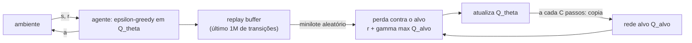

## Objetivos de Aprendizagem

- Explicar do que a iteração de valor precisa (um modelo de transição, uma tabela sobre todos os estados) e como o Q-learning dispensa o modelo aprendendo com transições amostradas.
- Escrever a atualização do Q-learning e a perda do DQN, e identificar o alvo com bootstrapping.
- Explicar por que o Q-learning neural ingênuo diverge (amostras correlacionadas, um alvo que se move, a "tríade mortal") e como o replay buffer e a rede alvo tratam isso.
- Descrever a exploração ε-greedy e o viés de superestimação que o Double DQN corrige.

## Contexto e Motivação

`ai-theory/artificial-intelligence` resolveu processos de decisão de Markov com iteração de valor e iteração de política. Os dois supõem duas coisas que raramente valem na prática: as probabilidades de transição $P(s' \mid s, a)$ e as recompensas são conhecidas, e o espaço de estados é pequeno o bastante para guardar um número por estado. Um agente que joga videogame a partir de pixels viola as duas: ninguém lhe entrega a dinâmica do jogo, e o número de telas distintas é astronomicamente grande.

O Q-learning (Watkins, 1989) remove a primeira suposição: ele aprende valores ótimos de ação só a partir de transições vividas, sem modelo. Trocar a sua tabela por uma rede neural remove a segunda, mas a combinação era conhecida havia tempo por ser instável. Em 2013 e num artigo na Nature em 2015, Mnih e colegas na DeepMind mostraram que duas mudanças de engenharia a fazem funcionar: a sua Deep Q-Network (DQN) aprendeu a jogar 49 jogos de Atari a partir de pixels brutos e só da pontuação, com uma arquitetura e um conjunto de hiperparâmetros, alcançando desempenho humano em muitos deles. O CS285 de Berkeley e o livro de Sutton e Barto usam o DQN como a ponte canônica do aprendizado por reforço tabular para o RL profundo.

## Teoria Central

### Valores de ação e a equação de otimalidade de Bellman

A função ótima de valor de ação $Q^*(s, a)$ é o retorno descontado esperado ao tomar a ação $a$ no estado $s$ e agir de forma ótima depois. Ela satisfaz a equação de otimalidade de Bellman:

$$Q^*(s, a) = \mathbb{E}_{s'}\Big[\, r + \gamma \max_{a'} Q^*(s', a') \,\Big]$$

Conhecer $Q^*$ basta para agir: em qualquer estado, escolha $\arg\max_a Q^*(s, a)$. Nenhum modelo é necessário na hora da decisão, e é por isso que aprender $Q$ em vez do valor de estado $V$ é conveniente quando a dinâmica é desconhecida.

### Q-learning: aprendendo com amostras

O Q-learning troca a esperança por uma única transição observada $(s, a, r, s')$ e empurra a estimativa atual na direção dela:

$$Q(s, a) \leftarrow Q(s, a) + \alpha \Big[\, \underbrace{r + \gamma \max_{a'} Q(s', a')}_{\text{alvo}} - Q(s, a) \Big]$$

O alvo usa a estimativa atual do valor do próximo estado, uma técnica chamada **bootstrapping**. O Q-learning é **off-policy**: o alvo usa o $\max$ guloso não importa qual ação o agente realmente tome em seguida, então ele aprende sobre a política ótima enquanto se comporta de forma exploratória. Com uma tabela, exploração suficiente e um tamanho de passo que decai adequadamente, ele converge comprovadamente para $Q^*$.

### Da tabela para a rede

O DQN troca a tabela por uma rede $Q_\theta(s, a)$ que recebe um estado (no Atari, os últimos quatro quadros em tons de cinza empilhados) e produz um valor por ação. O treino minimiza a diferença quadrática entre previsão e alvo:

$$\mathcal{L}(\theta) = \mathbb{E}_{(s,a,r,s') \sim \mathcal{D}}\Big[\big(r + \gamma \max_{a'} Q_{\theta^-}(s', a') - Q_\theta(s, a)\big)^2\Big]$$

Dois detalhes dessa fórmula são toda a contribuição.

**Experience replay** ($\mathcal{D}$). Quadros consecutivos são quase idênticos, então treinar nas transições na ordem em que ocorrem alimenta a rede com longas sequências de amostras muito correlacionadas, quebrando a suposição de independência por trás da descida de gradiente estocástica e deixando a rede se ajustar demais à parte do jogo em que está no momento. O DQN guarda o último milhão de transições num buffer e treina em minilotes aleatórios tirados dele. Isso descorrelaciona as atualizações e reaproveita cada transição muitas vezes.

**Uma rede alvo** ($\theta^-$). Se o alvo é calculado com os mesmos parâmetros que estão sendo atualizados, cada passo de gradiente move o alvo também, e a regressão persegue a si mesma. O DQN mantém uma cópia congelada $\theta^-$ para calcular os alvos e copia $\theta$ nela só a cada $C$ passos (10.000 no artigo da Nature), transformando cada período numa regressão supervisionada comum contra rótulos fixos.

Essas duas correções miram o que Sutton e Barto chamam de **tríade mortal**: aproximação de função, bootstrapping e aprendizado off-policy juntos podem fazer as estimativas de valor divergirem. O DQN mantém os três, mas amortece o laço de realimentação que causa a instabilidade.

### Exploração e superestimação

O agente age de forma **ε-greedy**: com probabilidade $\varepsilon$ escolhe uma ação aleatória, senão a gulosa; $\varepsilon$ cai de 1,0 para 0,1 ao longo do primeiro milhão de quadros. Sem exploração, o agente nunca descobre ações que as suas estimativas iniciais subvalorizam.

O $\max$ no alvo introduz um **viés de superestimação** sistemático: tomar o máximo sobre estimativas ruidosas favorece a ação cujo ruído por acaso é positivo. O **Double DQN** (van Hasselt et al., 2016) separa seleção de avaliação, escolhendo $a^* = \arg\max_{a'} Q_\theta(s', a')$ com a rede online e avaliando-a com a rede alvo, $Q_{\theta^-}(s', a^*)$, o que reduz bastante o viés.

## Exemplos Resolvidos

### Exemplo 1: uma atualização de Q-learning

**Problema:** Com $\gamma = 0{,}9$ e $\alpha = 0{,}5$, o agente está no estado $s$, toma a ação `right`, recebe $r = 1$ e cai em $s'$. Estimativas atuais: $Q(s, \text{right}) = 2{,}0$, $Q(s', \text{left}) = 3{,}0$, $Q(s', \text{right}) = 4{,}0$. Calcule a atualização.

**Rastreamento:** Alvo: $r + \gamma \max_{a'} Q(s', a') = 1 + 0{,}9 \times 4{,}0 = 4{,}6$. Erro de diferença temporal: $4{,}6 - 2{,}0 = 2{,}6$. Nova estimativa: $2{,}0 + 0{,}5 \times 2{,}6 = 3{,}3$. O alvo usou $Q(s', \text{right})$ mesmo que a próxima ação do agente, escolhida de forma ε-greedy, acabe sendo `left`; essa é a propriedade off-policy. No DQN, o mesmo cálculo acontece para um minilote, com o $4{,}0$ lido da rede alvo e o passo de $0{,}5$ trocado por um passo de gradiente no erro quadrático.

### Exemplo 2: por que o max superestima

**Problema:** Num certo estado, o valor verdadeiro das quatro ações é exatamente 0. As estimativas da rede são o valor verdadeiro mais um ruído independente uniforme em $[-1, 1]$. Qual é o valor esperado de $\max_a Q(s, a)$?

**Resolução:** Para $n$ variáveis uniformes independentes em $[-1, 1]$, o máximo esperado é $(n - 1)/(n + 1)$; com $n = 4$, isso dá $3/5 = 0{,}6$. Então o alvo com bootstrapping superestima o valor desse estado em 0,6 em média, mesmo que cada estimativa individual seja sem viés. O viés se propaga para trás pelo bootstrapping até estados anteriores. O Double DQN avalia a ação escolhida com uma estimativa independente, cujo ruído não está correlacionado com a seleção, então o valor avaliado esperado volta para perto de 0.

## Equívocos Comuns e Armadilhas

- **"O DQN aprendeu as regras do jogo."** Ele aprendeu valores de ação para os estados que visitou, só a partir da recompensa. Ele pode falhar feio em jogos que exigem exploração de longo prazo com recompensas esparsas (Montezuma's Revenge, em que o DQN marcou perto de zero), porque o ε-greedy raramente tropeça na primeira recompensa.
- **"O replay buffer é só uma otimização de memória."** O seu papel principal é estatístico: quebrar a correlação temporal entre amostras de treino. O replay priorizado vai além, amostrando com mais frequência transições com erro de diferença temporal grande.
- **"O DQN serve para qualquer espaço de ações."** Ele precisa de um $\max$ sobre as ações a cada passo, o que é barato para um punhado de ações discretas e impraticável para ações contínuas como torques de juntas. Controle contínuo é o domínio dos métodos de gradiente de política e ator-crítico do próximo conceito.

## Resumo

A iteração de valor precisa de um modelo e de uma tabela; o Q-learning remove o modelo aprendendo com transições amostradas por meio de um alvo off-policy com bootstrapping, e o DQN remove a tabela aproximando $Q$ com uma rede neural. O Q-learning profundo ingênuo é instável por causa de amostras correlacionadas e de um alvo que se move a cada atualização, a "tríade mortal" de aproximação, bootstrapping e aprendizado off-policy. O experience replay e uma rede alvo copiada periodicamente amortecem essa instabilidade, a exploração ε-greedy garante cobertura e o Double DQN reduz a superestimação causada por maximizar sobre estimativas ruidosas. O próximo conceito otimiza a política diretamente em vez de derivá-la dos valores.

## Documentation Links

- [Mnih et al.: Playing Atari with Deep Reinforcement Learning (2013)](https://arxiv.org/abs/1312.5602): doc
- [Sutton, Barto: Reinforcement Learning: An Introduction (2nd ed.)](http://incompleteideas.net/book/the-book-2nd.html): doc
- [UC Berkeley CS285: Deep Reinforcement Learning](https://rail.eecs.berkeley.edu/deeprlcourse/): doc
