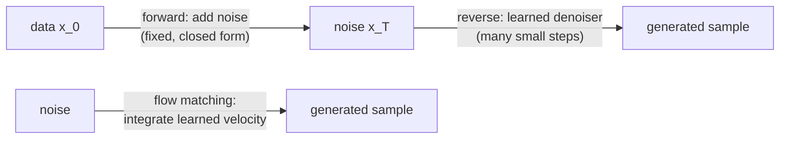

## Learning Objectives

- Describe the forward noising process of a diffusion model and use its closed form to jump from clean data $x_0$ to any noise level $t$ in one step.
- Explain why the DDPM training objective reduces to predicting the added noise with a mean-squared error, and how sampling runs the learned denoiser in reverse.
- Explain conditioning with classifier-free guidance and why large image generators run diffusion in a VAE's latent space.
- Describe flow matching as learning a velocity field along straight paths from noise to data, and generate a sample with Euler steps.

## Context & Motivation

`ai-theory/deep-learning` surveyed GANs and diffusion models at a high level. GANs produce sharp images but train an adversarial game that is notoriously unstable and prone to mode collapse (covering only part of the data distribution). The previous concept's VAEs train stably but produce blurry samples. Diffusion models, made practical by Ho, Jain, and Abbeel's denoising diffusion probabilistic models (DDPM) in 2020, got both: stable training with a plain regression loss, and sample quality that surpassed GANs within two years. They now underlie most image, video, and audio generators.

The core idea is to never ask a network to produce an image in one shot. Instead, define a fixed process that destroys data gradually by adding Gaussian noise over many steps, and train a network to undo one small step at a time. Undoing a little noise is an easy, well-posed problem; chaining a thousand easy steps turns pure noise into data. MIT's 6.S184 (Generative AI with Stochastic Differential Equations) presents the modern view in which diffusion and its successor, flow matching (Lipman and colleagues, 2023), are two ways of learning to transport a simple noise distribution onto the data distribution.

## Core Theory

### The forward process

Choose a schedule $\beta_1, \dots, \beta_T$ of small variances (DDPM used $T = 1000$ with $\beta$ rising linearly from $10^{-4}$ to $0.02$). Each forward step shrinks the signal slightly and adds noise:

$$q(x_t \mid x_{t-1}) = \mathcal{N}\big(\sqrt{1 - \beta_t}\, x_{t-1},\ \beta_t I\big)$$

Because each step is Gaussian, the composition is too, and there is a closed form for any $t$ directly from $x_0$. With $\alpha_t = 1 - \beta_t$ and $\bar\alpha_t = \prod_{s=1}^{t} \alpha_s$:

$$x_t = \sqrt{\bar\alpha_t}\, x_0 + \sqrt{1 - \bar\alpha_t}\, \varepsilon, \qquad \varepsilon \sim \mathcal{N}(0, I)$$

$\bar\alpha_t$ falls from almost 1 at $t = 1$ to almost 0 at $t = T$, so $x_T$ is indistinguishable from pure noise. No learning happens here; the forward process is fixed.

### Training: predict the noise

The reverse process $p_\theta(x_{t-1} \mid x_t)$ is modeled as a Gaussian whose mean comes from a network. Writing the variational bound on the likelihood (the same ELBO idea as in the VAE concept, with $x_1, \dots, x_T$ as latents) and simplifying, Ho et al. found that the best-performing objective is remarkably simple: train a network $\varepsilon_\theta(x_t, t)$ to predict the noise that was added.

$$\mathcal{L}_{simple} = \mathbb{E}_{x_0,\, t,\, \varepsilon}\Big[\big\lVert \varepsilon - \varepsilon_\theta\big(\sqrt{\bar\alpha_t}\, x_0 + \sqrt{1-\bar\alpha_t}\, \varepsilon,\ t\big)\big\rVert^2\Big]$$

Each training step: take a real image, pick a random $t$, add the corresponding noise in one jump using the closed form, and regress the noise. There is no adversary and no sampling chain during training. The network is typically a U-Net (from the detection and segmentation concept) or a transformer over patches, with $t$ fed in as an embedding.

Predicting noise is equivalent to estimating the **score**, the gradient of the log density of noisy data: $\varepsilon_\theta(x_t, t) \approx -\sqrt{1 - \bar\alpha_t}\, \nabla_{x_t} \log q(x_t)$. The network learns, at every noise level, which direction makes a noisy sample more data-like.

### Sampling

Start from $x_T \sim \mathcal{N}(0, I)$ and step backwards:

$$x_{t-1} = \frac{1}{\sqrt{\alpha_t}}\left(x_t - \frac{\beta_t}{\sqrt{1 - \bar\alpha_t}}\, \varepsilon_\theta(x_t, t)\right) + \sigma_t z, \qquad z \sim \mathcal{N}(0, I)$$

The original sampler needs all $T$ network evaluations, which is slow. Later samplers (DDIM and higher-order ODE solvers) reach comparable quality in 20 to 50 steps by treating generation as solving a differential equation with fewer, larger steps.

### Conditioning and latent diffusion

To generate from a text prompt $c$, train $\varepsilon_\theta(x_t, t, c)$ with the condition, randomly replaced by an empty condition a fraction of the time. At sampling, **classifier-free guidance** extrapolates away from the unconditional prediction:

$$\tilde\varepsilon = (1 + w)\, \varepsilon_\theta(x_t, t, c) - w\, \varepsilon_\theta(x_t, t, \varnothing)$$

A guidance weight $w > 0$ trades diversity for adherence to the prompt. Running diffusion on full-resolution pixels is expensive, so **latent diffusion** first trains a VAE-style autoencoder that compresses images (for example 8 times smaller per side), then runs the whole diffusion process in that latent space and decodes only at the end.

### Flow matching

Flow matching starts from the same goal, transport noise $x_0 \sim \mathcal{N}(0, I)$ to data $x_1$, but defines the path directly. In its simplest form, the path is a straight line, $x_t = (1 - t)\, x_0 + t\, x_1$ for $t \in [0, 1]$, whose velocity is constant: $x_1 - x_0$. Train a network $v_\theta(x_t, t)$ to predict that velocity:

$$\mathcal{L}_{FM} = \mathbb{E}_{t,\, x_0,\, x_1}\Big[\big\lVert v_\theta(x_t, t) - (x_1 - x_0)\big\rVert^2\Big]$$

To generate, start at noise and integrate $dx/dt = v_\theta(x, t)$ from $t = 0$ to $t = 1$ with any ODE solver. Averaged over all pairs, the learned field is curved, but the paths it produces are much straighter than a diffusion model's, so fewer integration steps are needed. Diffusion with Gaussian noise turns out to be a special case of this framework with a particular choice of path.

## Worked Examples

### Example 1: one forward jump

**Problem:** A pixel value is $x_0 = 0.8$. At a step where $\bar\alpha_t = 0.36$, the sampled noise is $\varepsilon = -0.5$. Compute $x_t$, then show that a perfect noise predictor recovers $x_0$.

**Trace:** $\sqrt{0.36} = 0.6$ and $\sqrt{1 - 0.36} = 0.8$. So $x_t = 0.6 \times 0.8 + 0.8 \times (-0.5) = 0.48 - 0.40 = 0.08$. If the network predicts $\hat\varepsilon = -0.5$ exactly, invert the closed form: $\hat x_0 = (x_t - \sqrt{1-\bar\alpha_t}\, \hat\varepsilon)/\sqrt{\bar\alpha_t} = (0.08 + 0.40)/0.6 = 0.8$. In practice the prediction is imperfect, especially at high noise, which is why sampling takes many small steps rather than one jump to $\hat x_0$.

### Example 2: Euler steps along a flow

**Problem:** In one dimension, suppose a trained flow-matching model happens to output the constant velocity $v_\theta = 2 - x_0$ for a sample starting at noise $x_0 = -1$ (the exact straight-line velocity toward data point 2). Integrate from $t = 0$ to $t = 1$ with 4 Euler steps.

**Trace:** Velocity is $2 - (-1) = 3$, step size $0.25$. $x$ goes $-1 \to -0.25 \to 0.5 \to 1.25 \to 2.0$. Four steps land exactly on the data point because the path is straight; with a perfectly straight field, even one step would suffice. A diffusion model's paths curve, so a single large step overshoots or undershoots, which is the practical reason flow matching and related "rectified" flows sample in fewer steps.

## Common Misconceptions & Pitfalls

- **"The network generates an image by removing all noise at once."** The network only estimates the noise (or velocity) at the current level; generation emerges from many evaluations. Asking for a one-step prediction from pure noise gives the blurry average of all plausible images, the same failure as the VAE's squared error.
- **"Diffusion models memorize and stitch together training images."** They learn a density, but with small or duplicated datasets they can reproduce training examples nearly exactly; memorization has been demonstrated empirically and depends on data duplication and model size.
- **"Higher guidance weight is always better."** Large $w$ improves prompt adherence but oversaturates images and collapses diversity; typical values are moderate and tuned per model.

## Summary

A diffusion model fixes a forward process that gradually turns data into Gaussian noise, with a closed form that reaches any noise level in one jump, and trains a network to predict the added noise with a mean-squared error. Generation starts from pure noise and repeatedly applies the learned denoiser; fewer-step samplers treat this as solving an ODE. Classifier-free guidance conditions generation on prompts, and latent diffusion moves the process into a compressed VAE latent space. Flow matching learns a velocity field along straight noise-to-data paths and generates by integrating it, often in far fewer steps. The next concept leaves generative modeling for agents that learn by acting, starting with value-based deep reinforcement learning.

## Documentation Links

- [Ho, Jain, Abbeel: Denoising Diffusion Probabilistic Models (NeurIPS 2020)](https://arxiv.org/abs/2006.11239): doc
- [Lipman et al.: Flow Matching for Generative Modeling (ICLR 2023)](https://arxiv.org/abs/2210.02747): doc
- [MIT 6.S184: Generative AI with Stochastic Differential Equations](https://diffusion.csail.mit.edu/): doc
