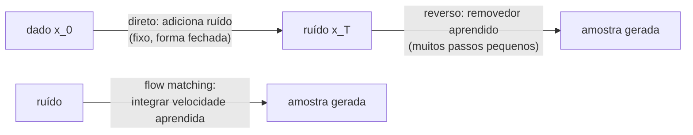

## Objetivos de Aprendizagem

- Descrever o processo direto de adição de ruído de um modelo de difusão e usar a sua forma fechada para pular de um dado limpo $x_0$ para qualquer nível de ruído $t$ num único passo.
- Explicar por que o objetivo de treino do DDPM se reduz a prever o ruído adicionado com um erro quadrático médio, e como a amostragem roda o removedor de ruído aprendido ao contrário.
- Explicar o condicionamento com classifier-free guidance e por que grandes geradores de imagem rodam a difusão no espaço latente de um VAE.
- Descrever o flow matching como aprender um campo de velocidades ao longo de caminhos retos do ruído até os dados, e gerar uma amostra com passos de Euler.

## Contexto e Motivação

`ai-theory/deep-learning` fez um panorama de GANs e modelos de difusão em alto nível. GANs produzem imagens nítidas, mas treinam um jogo adversarial notoriamente instável e propenso a colapso de modos (cobrindo só parte da distribuição dos dados). Os VAEs do conceito anterior treinam de forma estável, mas produzem amostras borradas. Os modelos de difusão, tornados práticos pelos denoising diffusion probabilistic models (DDPM) de Ho, Jain e Abbeel em 2020, conseguiram as duas coisas: treino estável com uma perda de regressão simples e qualidade de amostra que superou os GANs em dois anos. Hoje eles sustentam a maioria dos geradores de imagem, vídeo e áudio.

A ideia central é nunca pedir a uma rede que produza uma imagem de uma vez. Em vez disso, defina um processo fixo que destrói os dados gradualmente adicionando ruído gaussiano ao longo de muitos passos, e treine uma rede para desfazer um passo pequeno de cada vez. Remover um pouco de ruído é um problema fácil e bem definido; encadear mil passos fáceis transforma ruído puro em dados. O 6.S184 do MIT (Generative AI with Stochastic Differential Equations) apresenta a visão moderna em que a difusão e a sua sucessora, o flow matching (Lipman e colegas, 2023), são duas formas de aprender a transportar uma distribuição de ruído simples até a distribuição dos dados.

## Teoria Central

### O processo direto

Escolha uma agenda $\beta_1, \dots, \beta_T$ de variâncias pequenas (o DDPM usou $T = 1000$ com $\beta$ subindo linearmente de $10^{-4}$ a $0{,}02$). Cada passo direto encolhe um pouco o sinal e adiciona ruído:

$$q(x_t \mid x_{t-1}) = \mathcal{N}\big(\sqrt{1 - \beta_t}\, x_{t-1},\ \beta_t I\big)$$

Como cada passo é gaussiano, a composição também é, e existe uma forma fechada para qualquer $t$ direto a partir de $x_0$. Com $\alpha_t = 1 - \beta_t$ e $\bar\alpha_t = \prod_{s=1}^{t} \alpha_s$:

$$x_t = \sqrt{\bar\alpha_t}\, x_0 + \sqrt{1 - \bar\alpha_t}\, \varepsilon, \qquad \varepsilon \sim \mathcal{N}(0, I)$$

$\bar\alpha_t$ cai de quase 1 em $t = 1$ para quase 0 em $t = T$, então $x_T$ é indistinguível de ruído puro. Não há aprendizado aqui; o processo direto é fixo.

### Treino: prever o ruído

O processo reverso $p_\theta(x_{t-1} \mid x_t)$ é modelado como uma gaussiana cuja média vem de uma rede. Escrevendo o limite variacional da verossimilhança (a mesma ideia de ELBO do conceito de VAE, com $x_1, \dots, x_T$ como latentes) e simplificando, Ho et al. descobriram que o objetivo de melhor desempenho é notavelmente simples: treinar uma rede $\varepsilon_\theta(x_t, t)$ para prever o ruído que foi adicionado.

$$\mathcal{L}_{simple} = \mathbb{E}_{x_0,\, t,\, \varepsilon}\Big[\big\lVert \varepsilon - \varepsilon_\theta\big(\sqrt{\bar\alpha_t}\, x_0 + \sqrt{1-\bar\alpha_t}\, \varepsilon,\ t\big)\big\rVert^2\Big]$$

Cada passo de treino: pegue uma imagem real, escolha um $t$ aleatório, adicione o ruído correspondente num salto usando a forma fechada e regrida o ruído. Não há adversário nem cadeia de amostragem durante o treino. A rede costuma ser uma U-Net (do conceito de detecção e segmentação) ou um transformer sobre patches, com $t$ entrando como embedding.

Prever o ruído equivale a estimar o **score**, o gradiente do log da densidade dos dados ruidosos: $\varepsilon_\theta(x_t, t) \approx -\sqrt{1 - \bar\alpha_t}\, \nabla_{x_t} \log q(x_t)$. A rede aprende, em cada nível de ruído, qual direção torna uma amostra ruidosa mais parecida com dados.

### Amostragem

Comece de $x_T \sim \mathcal{N}(0, I)$ e ande para trás:

$$x_{t-1} = \frac{1}{\sqrt{\alpha_t}}\left(x_t - \frac{\beta_t}{\sqrt{1 - \bar\alpha_t}}\, \varepsilon_\theta(x_t, t)\right) + \sigma_t z, \qquad z \sim \mathcal{N}(0, I)$$

O amostrador original precisa de todas as $T$ avaliações da rede, o que é lento. Amostradores posteriores (DDIM e solucionadores de EDO de ordem mais alta) chegam a qualidade comparável em 20 a 50 passos tratando a geração como a solução de uma equação diferencial com passos menos numerosos e maiores.

### Condicionamento e difusão latente

Para gerar a partir de um prompt de texto $c$, treine $\varepsilon_\theta(x_t, t, c)$ com a condição, trocada aleatoriamente por uma condição vazia numa fração das vezes. Na amostragem, o **classifier-free guidance** extrapola para longe da previsão incondicional:

$$\tilde\varepsilon = (1 + w)\, \varepsilon_\theta(x_t, t, c) - w\, \varepsilon_\theta(x_t, t, \varnothing)$$

Um peso de guidance $w > 0$ troca diversidade por aderência ao prompt. Rodar difusão em pixels de resolução cheia é caro, então a **difusão latente** primeiro treina um autoencoder no estilo VAE que comprime as imagens (por exemplo 8 vezes menor por lado), depois roda todo o processo de difusão nesse espaço latente e só decodifica no final.

### Flow matching

O flow matching parte do mesmo objetivo, transportar ruído $x_0 \sim \mathcal{N}(0, I)$ até dados $x_1$, mas define o caminho diretamente. Na forma mais simples, o caminho é uma reta, $x_t = (1 - t)\, x_0 + t\, x_1$ para $t \in [0, 1]$, cuja velocidade é constante: $x_1 - x_0$. Treine uma rede $v_\theta(x_t, t)$ para prever essa velocidade:

$$\mathcal{L}_{FM} = \mathbb{E}_{t,\, x_0,\, x_1}\Big[\big\lVert v_\theta(x_t, t) - (x_1 - x_0)\big\rVert^2\Big]$$

Para gerar, comece no ruído e integre $dx/dt = v_\theta(x, t)$ de $t = 0$ a $t = 1$ com qualquer solucionador de EDO. Na média sobre todos os pares, o campo aprendido é curvo, mas os caminhos que ele produz são muito mais retos do que os de um modelo de difusão, então menos passos de integração são necessários. A difusão com ruído gaussiano acaba sendo um caso particular desse arcabouço, com uma escolha específica de caminho.

## Exemplos Resolvidos

### Exemplo 1: um salto direto

**Problema:** Um valor de pixel é $x_0 = 0{,}8$. Num passo em que $\bar\alpha_t = 0{,}36$, o ruído sorteado é $\varepsilon = -0{,}5$. Calcule $x_t$ e mostre que um preditor de ruído perfeito recupera $x_0$.

**Rastreamento:** $\sqrt{0{,}36} = 0{,}6$ e $\sqrt{1 - 0{,}36} = 0{,}8$. Então $x_t = 0{,}6 \times 0{,}8 + 0{,}8 \times (-0{,}5) = 0{,}48 - 0{,}40 = 0{,}08$. Se a rede prevê $\hat\varepsilon = -0{,}5$ exatamente, inverta a forma fechada: $\hat x_0 = (x_t - \sqrt{1-\bar\alpha_t}\, \hat\varepsilon)/\sqrt{\bar\alpha_t} = (0{,}08 + 0{,}40)/0{,}6 = 0{,}8$. Na prática a previsão é imperfeita, principalmente com muito ruído, e é por isso que a amostragem usa muitos passos pequenos em vez de um salto direto para $\hat x_0$.

### Exemplo 2: passos de Euler ao longo de um fluxo

**Problema:** Em uma dimensão, suponha que um modelo de flow matching treinado produza a velocidade constante $v_\theta = 2 - x_0$ para uma amostra que parte do ruído $x_0 = -1$ (a velocidade exata em linha reta rumo ao ponto de dado 2). Integre de $t = 0$ a $t = 1$ com 4 passos de Euler.

**Rastreamento:** A velocidade é $2 - (-1) = 3$, tamanho de passo $0{,}25$. $x$ vai de $-1 \to -0{,}25 \to 0{,}5 \to 1{,}25 \to 2{,}0$. Quatro passos caem exatamente no ponto de dado porque o caminho é reto; com um campo perfeitamente reto, até um passo bastaria. Os caminhos de um modelo de difusão são curvos, então um único passo grande passa do ponto ou fica aquém, e esse é o motivo prático de o flow matching e os fluxos "retificados" relacionados amostrarem em menos passos.

## Equívocos Comuns e Armadilhas

- **"A rede gera uma imagem removendo todo o ruído de uma vez."** A rede só estima o ruído (ou a velocidade) no nível atual; a geração emerge de muitas avaliações. Pedir uma previsão em um passo a partir de ruído puro dá a média borrada de todas as imagens plausíveis, a mesma falha do erro quadrático do VAE.
- **"Modelos de difusão memorizam e costuram imagens de treino."** Eles aprendem uma densidade, mas com datasets pequenos ou duplicados podem reproduzir exemplos de treino quase exatamente; a memorização já foi demonstrada empiricamente e depende de duplicação de dados e do tamanho do modelo.
- **"Peso de guidance maior é sempre melhor."** Um $w$ grande melhora a aderência ao prompt, mas satura demais as imagens e colapsa a diversidade; valores típicos são moderados e ajustados por modelo.

## Resumo

Um modelo de difusão fixa um processo direto que transforma dados gradualmente em ruído gaussiano, com uma forma fechada que chega a qualquer nível de ruído num salto, e treina uma rede para prever o ruído adicionado com um erro quadrático médio. A geração parte de ruído puro e aplica repetidamente o removedor de ruído aprendido; amostradores com menos passos tratam isso como a solução de uma EDO. O classifier-free guidance condiciona a geração a prompts, e a difusão latente leva o processo para um espaço latente comprimido de VAE. O flow matching aprende um campo de velocidades ao longo de caminhos retos de ruído a dados e gera integrando-o, muitas vezes em bem menos passos. O próximo conceito deixa a modelagem generativa e passa para agentes que aprendem agindo, começando pelo aprendizado por reforço profundo baseado em valor.

## Documentation Links

- [Ho, Jain, Abbeel: Denoising Diffusion Probabilistic Models (NeurIPS 2020)](https://arxiv.org/abs/2006.11239): doc
- [Lipman et al.: Flow Matching for Generative Modeling (ICLR 2023)](https://arxiv.org/abs/2210.02747): doc
- [MIT 6.S184: Generative AI with Stochastic Differential Equations](https://diffusion.csail.mit.edu/): doc
