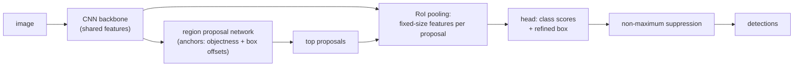

## Learning Objectives

- Distinguish image classification, object detection, semantic segmentation, and instance segmentation by what each one outputs.
- Compute intersection over union (IoU) for two boxes and explain how it defines a correct detection and the mean average precision (mAP) metric.
- Describe the two-stage Faster R-CNN design: a shared CNN backbone, a region proposal network with anchors, and a per-region classification and box-refinement head, followed by non-maximum suppression.
- Explain how U-Net recovers per-pixel resolution from a downsampling CNN with an upsampling path and skip connections.

## Context & Motivation

`ai-theory/deep-learning` trained CNNs to answer one question per image: which class is it? Most real vision tasks need more. A self-driving system must know where each pedestrian is, not just that the scene contains one. A medical tool must outline a tumor's exact boundary. The `image-processing` discipline in this same module approached segmentation classically, with thresholds, region growing, and connected-component labeling driven by hand-chosen rules; those methods break down when the boundary between "object" and "background" depends on meaning rather than on intensity.

Two influential 2015 papers set the templates still used today. Faster R-CNN (Ren, He, Girshick, and Sun, Microsoft Research) made detection end-to-end trainable and close to real time by learning the region proposals that earlier systems computed with slow hand-designed algorithms. U-Net (Ronneberger, Fischer, and Brox, University of Freiburg) showed how to produce sharp per-pixel masks from a CNN, initially for biomedical images with very little training data. Stanford's CS231n teaches both as the canonical answers to "where" questions.

## Core Theory

### Four tasks, four outputs

- **Classification**: one label per image.
- **Object detection**: a variable-length list of (box, class, confidence score) triples, one per object instance.
- **Semantic segmentation**: a class label for every pixel; two touching people are one undifferentiated "person" region.
- **Instance segmentation**: a separate mask per object instance; the two people become two masks. Mask R-CNN (2017) adds a mask branch to Faster R-CNN to do this.

### Intersection over union and mAP

For a predicted box `P` and a ground-truth box `G`, `IoU = area(P ∩ G) / area(P ∪ G)`, a number from 0 (no overlap) to 1 (identical). A prediction counts as a **true positive** if its class matches and its IoU with an unmatched ground-truth box exceeds a threshold, classically 0.5 (PASCAL VOC). Sorting predictions by confidence and sweeping the threshold yields a precision-recall curve, the same trade-off as `evaluation-metrics-precision-recall-and-roc` in `ai-theory/machine-learning`; the area under it is the **average precision** (AP) for a class, and the mean over classes is **mAP**. The COCO benchmark averages mAP over IoU thresholds from 0.5 to 0.95, rewarding precise localization rather than rough overlap.

### Faster R-CNN: proposals, then classification

A CNN backbone (for example a ResNet) computes a feature map once for the whole image. The **region proposal network** (RPN) slides over that feature map; at every location it considers a fixed set of **anchors**, reference boxes of several scales and aspect ratios (the paper uses 3 scales times 3 ratios, 9 anchors per location). For each anchor it predicts an objectness score (object or background) and four offsets that adjust the anchor toward a better-fitting box. The highest-scoring few hundred adjusted anchors become proposals.

**RoI pooling** crops each proposal's region from the shared feature map and resamples it to a fixed size, so a single classification head can process proposals of any shape. The head outputs class probabilities and a class-specific box refinement. Because many proposals overlap the same object, **non-maximum suppression** (NMS) finishes the job: sort detections by score, keep the best, discard any remaining detection of the same class whose IoU with it exceeds a threshold (often 0.5 to 0.7), and repeat.

The whole network trains end-to-end with a multi-task loss: classification cross-entropy plus a box-regression loss, for both the RPN and the head. **One-stage** detectors such as YOLO and SSD skip the proposal step and predict classes and boxes directly from every anchor, trading some accuracy for speed; later designs narrowed that gap considerably.

### U-Net: dense prediction

A classification CNN repeatedly downsamples, so its final feature map might be 1/32 of the input's width: rich in meaning, poor in location. Segmentation needs both. U-Net's **contracting path** is an ordinary CNN encoder. Its **expanding path** upsamples step by step (with transposed convolutions or interpolation followed by convolution) back to full resolution. At each scale, a **skip connection** concatenates the encoder's feature map of the same resolution onto the decoder's, handing the fine spatial detail lost during downsampling directly to the layers that need it. The output is a score per class per pixel, trained with per-pixel cross-entropy, often combined with an overlap-based loss such as Dice when the object of interest covers few pixels.

## Worked Examples

### Example 1: computing IoU

**Problem:** A predicted box spans corners (0, 0) to (10, 10); the ground truth spans (5, 5) to (15, 15). Is this a true positive at IoU threshold 0.5?

**Trace:** Each box has area 100. The intersection is the square from (5, 5) to (10, 10), area `5 × 5 = 25`. The union is `100 + 100 − 25 = 175`. `IoU = 25 / 175 ≈ 0.14`, well below 0.5, so it is a false positive, and the ground-truth object counts as missed unless another prediction matches it. Shifting a box by half its width in both directions leaves only 14% overlap, which shows how strict IoU-based matching is.

### Example 2: non-maximum suppression

**Problem:** Three "car" detections have scores 0.95 (box A), 0.90 (box B), and 0.60 (box C). IoU(A, B) = 0.80, IoU(A, C) = 0.10, IoU(B, C) = 0.15. Apply NMS with threshold 0.5.

**Trace:** Sort by score: A, B, C. Keep A. Compare the rest with A: B has IoU 0.80 > 0.5, so suppress it; C has 0.10, so keep it as a candidate. Next highest remaining is C; keep it. Output: A and C, two cars. B was a duplicate detection of the car A already covers. If the threshold were set to 0.85, B would survive and one car would be reported twice; set too low, two genuinely adjacent cars could be merged into one.

## Common Misconceptions & Pitfalls

- **"Detection is classification plus a box regressor on the whole image."** That handles exactly one object. Detection must output a variable number of objects, which is why anchors, proposals, and NMS exist.
- **"High mAP at IoU 0.5 means precise boxes."** At 0.5, a box can be quite loose and still count. If an application needs tight boundaries (robot grasping, measurement), evaluate at higher IoU thresholds, as COCO's averaged metric does.
- **"Semantic segmentation can count objects."** It labels pixels by class without separating instances; touching objects of the same class merge. Counting requires instance segmentation or detection.

## Summary

Detection outputs a box, class, and score per object; semantic segmentation labels every pixel; instance segmentation separates individual objects. IoU measures box overlap, defines when a detection is correct, and underlies mAP. Faster R-CNN shares one CNN backbone between a region proposal network built on anchors and a per-region classification and refinement head, with non-maximum suppression removing duplicates. U-Net produces per-pixel predictions by upsampling a CNN's coarse features and restoring spatial detail through skip connections. The next concept replaces the CNN backbone itself with a transformer and connects images to language.

## Documentation Links

- [Ren, He, Girshick, Sun: Faster R-CNN: Towards Real-Time Object Detection with Region Proposal Networks (NeurIPS 2015)](https://arxiv.org/abs/1506.01497): doc
- [Ronneberger, Fischer, Brox: U-Net: Convolutional Networks for Biomedical Image Segmentation (MICCAI 2015)](https://arxiv.org/abs/1505.04597): doc
- [Stanford CS231n: Deep Learning for Computer Vision](https://cs231n.stanford.edu/): doc
