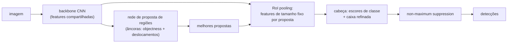

## Objetivos de Aprendizagem

- Distinguir classificação de imagens, detecção de objetos, segmentação semântica e segmentação de instâncias pelo que cada uma produz.
- Calcular a interseção sobre união (IoU) de duas caixas e explicar como ela define uma detecção correta e a métrica de mean average precision (mAP).
- Descrever o projeto em dois estágios do Faster R-CNN: um backbone CNN compartilhado, uma rede de proposta de regiões com âncoras e uma cabeça de classificação e refinamento de caixa por região, seguida de non-maximum suppression.
- Explicar como a U-Net recupera resolução por pixel a partir de uma CNN que reduz a resolução, com um caminho de upsampling e skip connections.

## Contexto e Motivação

`ai-theory/deep-learning` treinou CNNs para responder uma pergunta por imagem: qual é a classe? A maioria das tarefas reais de visão precisa de mais. Um sistema de direção autônoma precisa saber onde está cada pedestre, não só que a cena contém um. Uma ferramenta médica precisa contornar a fronteira exata de um tumor. A disciplina `image-processing` deste mesmo módulo tratou a segmentação de forma clássica, com limiares, crescimento de regiões e rotulagem de componentes conexos guiados por regras escolhidas à mão; esses métodos falham quando a fronteira entre "objeto" e "fundo" depende de significado e não de intensidade.

Dois artigos influentes de 2015 definiram os modelos usados até hoje. O Faster R-CNN (Ren, He, Girshick e Sun, Microsoft Research) tornou a detecção treinável de ponta a ponta e perto do tempo real ao aprender as propostas de região que sistemas anteriores calculavam com algoritmos lentos desenhados à mão. A U-Net (Ronneberger, Fischer e Brox, Universidade de Freiburg) mostrou como produzir máscaras nítidas por pixel a partir de uma CNN, inicialmente para imagens biomédicas com pouquíssimos dados de treino. O CS231n de Stanford ensina os dois como as respostas canônicas a perguntas de "onde".

## Teoria Central

### Quatro tarefas, quatro saídas

- **Classificação**: um rótulo por imagem.
- **Detecção de objetos**: uma lista de tamanho variável de triplas (caixa, classe, confiança), uma por instância de objeto.
- **Segmentação semântica**: um rótulo de classe para cada pixel; duas pessoas encostadas viram uma única região "pessoa" indiferenciada.
- **Segmentação de instâncias**: uma máscara separada por instância; as duas pessoas viram duas máscaras. O Mask R-CNN (2017) acrescenta um ramo de máscara ao Faster R-CNN para fazer isso.

### Interseção sobre união e mAP

Para uma caixa prevista `P` e uma caixa real `G`, `IoU = área(P ∩ G) / área(P ∪ G)`, um número de 0 (sem sobreposição) a 1 (idênticas). Uma previsão conta como **verdadeiro positivo** se a classe bate e a IoU com uma caixa real ainda não casada passa de um limiar, classicamente 0,5 (PASCAL VOC). Ordenar as previsões por confiança e variar o limiar gera uma curva de precisão e recall, o mesmo compromisso de `evaluation-metrics-precision-recall-and-roc` em `ai-theory/machine-learning`; a área sob ela é a **average precision** (AP) de uma classe, e a média entre classes é o **mAP**. O benchmark COCO faz a média do mAP em limiares de IoU de 0,5 a 0,95, recompensando localização precisa em vez de sobreposição grosseira.

### Faster R-CNN: propostas, depois classificação

Um backbone CNN (por exemplo uma ResNet) calcula um mapa de features uma única vez para a imagem inteira. A **rede de proposta de regiões** (RPN) desliza sobre esse mapa; em cada posição ela considera um conjunto fixo de **âncoras**, caixas de referência de várias escalas e proporções (o artigo usa 3 escalas vezes 3 proporções, 9 âncoras por posição). Para cada âncora ela prevê um escore de objectness (objeto ou fundo) e quatro deslocamentos que ajustam a âncora para uma caixa mais justa. As poucas centenas de âncoras ajustadas com maior escore viram propostas.

O **RoI pooling** recorta a região de cada proposta do mapa de features compartilhado e a reamostra para um tamanho fixo, de modo que uma única cabeça de classificação processe propostas de qualquer formato. A cabeça produz probabilidades de classe e um refinamento de caixa específico por classe. Como muitas propostas se sobrepõem ao mesmo objeto, o **non-maximum suppression** (NMS) termina o trabalho: ordene as detecções por escore, mantenha a melhor, descarte qualquer detecção restante da mesma classe cuja IoU com ela passe de um limiar (muitas vezes de 0,5 a 0,7) e repita.

A rede inteira treina de ponta a ponta com uma perda multitarefa: entropia cruzada de classificação mais uma perda de regressão de caixa, tanto para a RPN quanto para a cabeça. Detectores de **um estágio** como YOLO e SSD pulam o passo de proposta e preveem classes e caixas diretamente a partir de toda âncora, trocando um pouco de precisão por velocidade; projetos posteriores reduziram bastante essa diferença.

### U-Net: previsão densa

Uma CNN de classificação reduz a resolução repetidamente, então o seu mapa de features final pode ter 1/32 da largura da entrada: rico em significado, pobre em localização. A segmentação precisa dos dois. O **caminho de contração** da U-Net é um encoder CNN comum. O seu **caminho de expansão** aumenta a resolução passo a passo (com convoluções transpostas ou interpolação seguida de convolução) até a resolução cheia. Em cada escala, uma **skip connection** concatena o mapa de features do encoder de mesma resolução ao do decoder, entregando o detalhe espacial fino perdido na redução diretamente às camadas que precisam dele. A saída é um escore por classe por pixel, treinado com entropia cruzada por pixel, muitas vezes combinada com uma perda baseada em sobreposição como a Dice quando o objeto de interesse cobre poucos pixels.

## Exemplos Resolvidos

### Exemplo 1: calculando a IoU

**Problema:** Uma caixa prevista vai dos cantos (0, 0) a (10, 10); a real vai de (5, 5) a (15, 15). Isto é um verdadeiro positivo com limiar de IoU 0,5?

**Rastreamento:** Cada caixa tem área 100. A interseção é o quadrado de (5, 5) a (10, 10), área `5 × 5 = 25`. A união é `100 + 100 − 25 = 175`. `IoU = 25 / 175 ≈ 0,14`, bem abaixo de 0,5, então é um falso positivo, e o objeto real conta como perdido a menos que outra previsão case com ele. Deslocar uma caixa em metade da sua largura nas duas direções deixa só 14% de sobreposição, o que mostra quão rígido é o casamento por IoU.

### Exemplo 2: non-maximum suppression

**Problema:** Três detecções de "carro" têm escores 0,95 (caixa A), 0,90 (caixa B) e 0,60 (caixa C). IoU(A, B) = 0,80, IoU(A, C) = 0,10, IoU(B, C) = 0,15. Aplique NMS com limiar 0,5.

**Rastreamento:** Ordene por escore: A, B, C. Mantenha A. Compare as demais com A: B tem IoU 0,80 > 0,5, então é suprimida; C tem 0,10, então segue como candidata. A próxima maior restante é C; mantenha-a. Saída: A e C, dois carros. B era uma detecção duplicada do carro que A já cobre. Se o limiar fosse 0,85, B sobreviveria e um carro seria reportado duas vezes; baixo demais, dois carros realmente vizinhos poderiam virar um só.

## Equívocos Comuns e Armadilhas

- **"Detecção é classificação mais um regressor de caixa na imagem inteira."** Isso resolve exatamente um objeto. A detecção precisa produzir um número variável de objetos, e é por isso que existem âncoras, propostas e NMS.
- **"mAP alto com IoU 0,5 significa caixas precisas."** Com 0,5, uma caixa pode estar bem folgada e ainda contar. Se a aplicação precisa de fronteiras justas (preensão robótica, medição), avalie em limiares de IoU mais altos, como faz a métrica média do COCO.
- **"A segmentação semântica consegue contar objetos."** Ela rotula pixels por classe sem separar instâncias; objetos encostados da mesma classe se fundem. Contar exige segmentação de instâncias ou detecção.

## Resumo

A detecção produz uma caixa, uma classe e um escore por objeto; a segmentação semântica rotula todo pixel; a segmentação de instâncias separa objetos individuais. A IoU mede a sobreposição de caixas, define quando uma detecção está correta e sustenta o mAP. O Faster R-CNN compartilha um backbone CNN entre uma rede de proposta de regiões baseada em âncoras e uma cabeça de classificação e refinamento por região, com o non-maximum suppression removendo duplicatas. A U-Net produz previsões por pixel aumentando a resolução das features grosseiras de uma CNN e restaurando o detalhe espacial por meio de skip connections. O próximo conceito troca o próprio backbone CNN por um transformer e conecta imagens à linguagem.

## Documentation Links

- [Ren, He, Girshick, Sun: Faster R-CNN: Towards Real-Time Object Detection with Region Proposal Networks (NeurIPS 2015)](https://arxiv.org/abs/1506.01497): doc
- [Ronneberger, Fischer, Brox: U-Net: Convolutional Networks for Biomedical Image Segmentation (MICCAI 2015)](https://arxiv.org/abs/1505.04597): doc
- [Stanford CS231n: Deep Learning for Computer Vision](https://cs231n.stanford.edu/): doc
