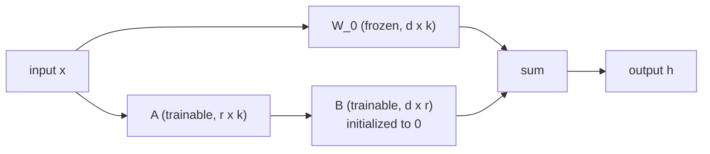

## Learning Objectives

- Explain the memory and storage costs of full fine-tuning for a model with billions of parameters, including optimizer state.
- Describe LoRA: freeze a pretrained weight matrix `W_0` and learn a low-rank update `ΔW = B A`, with the initialization that makes training start exactly at the pretrained model.
- Count the trainable parameters LoRA adds for a given matrix shape and rank, and explain why the adapter can be merged into the weights with no inference overhead.
- Place LoRA among other parameter-efficient methods (adapters, prompt tuning) and explain what QLoRA adds.

## Context & Motivation

A pretrained model knows a lot but does not yet do a specific job: answer in a company's format, classify legal clauses, follow a style guide. The classic answer is **fine-tuning**, continuing gradient descent on a smaller labeled dataset. For a model with billions of parameters, full fine-tuning is expensive in two ways. During training, the Adam optimizer from `ai-theory/deep-learning` keeps two extra numbers per parameter (first and second moment estimates), and gradients need storage too, so memory is several times the size of the model itself. After training, every task produces a complete copy of the weights: ten tasks on a 70B model means ten 140-gigabyte checkpoints.

**Parameter-efficient fine-tuning** (PEFT) trains a tiny number of new parameters and leaves the pretrained weights frozen. LoRA (Low-Rank Adaptation, Hu and colleagues at Microsoft, 2021) is the most widely used PEFT method. On GPT-3 175B it reduced trainable parameters by a factor of about 10,000 and training memory by about 3 times, while matching full fine-tuning quality on the tasks the authors tested.

## Core Theory

### The low-rank hypothesis

Earlier work had shown that pretrained models have a low **intrinsic dimension** for adaptation: fine-tuning can reach most of its benefit while moving the weights within a small random subspace. LoRA turns that observation into a specific structural assumption: the change `ΔW` that a task needs in each weight matrix has low rank.

Recall from linear algebra (and from `principal-component-analysis` in `ai-theory/machine-learning`) that a `d × k` matrix of rank `r` can be written as the product of a `d × r` matrix and an `r × k` matrix. If `r` is much smaller than `d` and `k`, that factorization has far fewer numbers than the full matrix.

### The LoRA update

For a frozen pretrained matrix `W_0` of shape `d × k`, LoRA adds two trainable matrices, `B` of shape `d × r` and `A` of shape `r × k`, and computes the layer's output as:

$$h = W_0 x + \frac{\alpha}{r} B A x$$

`r` is the rank (commonly 4 to 64) and `α` a scaling constant that keeps the update's magnitude stable when `r` changes. Two initialization choices matter: `A` starts with small random values and `B` starts at **zero**. So at step 0, `B A = 0` and the model is exactly the pretrained one; training only ever moves away from a known-good starting point.

Only `A` and `B` receive gradients, so optimizer state is needed only for them. In transformers, LoRA is usually applied to the attention projection matrices (query, key, value, output), and often to the feed-forward layers as well.

### Merging: no inference cost

After training, compute `W = W_0 + (α / r) B A` once and replace `W_0` with it. The model now has exactly its original shape and speed, with no extra layers to run. Alternatively, keep `W_0` shared and swap small `(A, B)` pairs per task, so one served base model can host many tasks, each adapter weighing megabytes instead of gigabytes.

### Other parameter-efficient methods and QLoRA

**Adapters** insert small bottleneck layers between existing ones; they work well but add sequential computation at inference unless removed. **Prompt tuning** and **prefix tuning** learn a few continuous "virtual token" vectors prepended to the input or to each layer's keys and values; they are extremely small but often less effective on smaller models. LoRA's combination of quality, simplicity, and zero inference overhead made it the default.

**QLoRA** (Dettmers and colleagues, University of Washington, 2023) stores the frozen base model in 4-bit precision, using a data type designed for normally distributed weights, and trains LoRA adapters in higher precision on top, backpropagating through the dequantized weights. This allowed fine-tuning a 65-billion-parameter model on a single 48 GB GPU.

## Worked Examples

### Example 1: counting parameters

**Problem:** A transformer layer has a query projection of shape `4096 × 4096`. Compare the trainable parameters for full fine-tuning of that matrix with LoRA at `r = 8`.

**Trace:** Full fine-tuning trains every entry: `4096 × 4096 = 16,777,216` parameters. LoRA trains `B` (`4096 × 8 = 32,768`) and `A` (`8 × 4096 = 32,768`), a total of `65,536`, which is 256 times fewer. If LoRA is applied to the four attention projections in each of 32 layers, the adapter has `4 × 32 × 65,536 ≈ 8.4 million` parameters, about 16 MB in 16-bit precision, while the base model it adapts has around 7 billion.

### Example 2: why B starts at zero

**Problem:** Suppose instead both `A` and `B` were initialized with small random values. What happens at the first forward pass, and why is that worse?

**Resolution:** `B A` would be a random low-rank matrix, so every adapted layer's output would be perturbed by noise before any training. The model would start from a degraded version of the pretrained network, and the first gradient steps would be spent undoing that damage rather than learning the task, sometimes destabilizing training in deep stacks where perturbations compound across layers. With `B = 0`, the product is exactly zero at initialization while `A` still has random values, so gradients with respect to `B` are nonzero (they depend on `A x`) and learning starts immediately from the exact pretrained function.

## Common Misconceptions & Pitfalls

- **"LoRA makes the model learn less, so it is a compromise on quality."** On many tasks LoRA matches full fine-tuning; when it falls short, increasing the rank or adapting more matrices usually closes most of the gap. The constraint mostly limits how far the model can move, which is often desirable on small datasets.
- **"LoRA reduces inference cost."** It reduces the cost of training and of storing per-task variants. A merged model runs at exactly the base model's speed, neither faster nor slower; a quantized base (as in QLoRA) is what makes inference cheaper, and that is a separate choice.
- **"Fine-tuning teaches the model new facts reliably."** Fine-tuning is good at teaching format, style, and task behavior. Injecting large amounts of new factual knowledge this way is unreliable and can increase confident errors; retrieval, covered later in this track, is usually the better tool for facts that change.

## Summary

Full fine-tuning of a large model needs memory for gradients and optimizer state on every parameter and produces a full copy of the weights per task. LoRA freezes the pretrained weights and learns a low-rank update `B A` for selected matrices, starting from exactly the pretrained model because `B` is initialized to zero. It trains orders of magnitude fewer parameters, the adapter can be merged with no inference overhead or kept as a small swappable file, and QLoRA extends it to quantized base models on a single GPU. The next concept uses fine-tuning, in full or with LoRA, as one step of a larger recipe: aligning a model's behavior with human preferences.

## Documentation Links

- [Hu et al.: LoRA: Low-Rank Adaptation of Large Language Models (ICLR 2022)](https://arxiv.org/abs/2106.09685): doc
- [Dettmers et al.: QLoRA: Efficient Finetuning of Quantized LLMs (NeurIPS 2023)](https://arxiv.org/abs/2305.14314): doc
