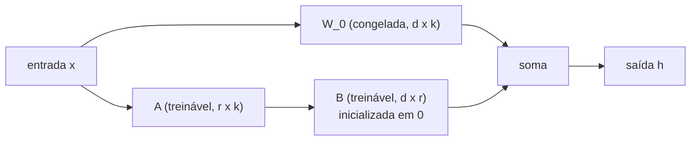

## Objetivos de Aprendizagem

- Explicar os custos de memória e armazenamento do fine-tuning completo para um modelo com bilhões de parâmetros, incluindo o estado do otimizador.
- Descrever o LoRA: congelar uma matriz de pesos pré-treinada `W_0` e aprender uma atualização de baixo posto `ΔW = B A`, com a inicialização que faz o treino começar exatamente no modelo pré-treinado.
- Contar os parâmetros treináveis que o LoRA adiciona para um formato de matriz e um posto dados, e explicar por que o adaptador pode ser fundido nos pesos sem custo extra de inferência.
- Situar o LoRA entre outros métodos eficientes em parâmetros (adapters, prompt tuning) e explicar o que o QLoRA acrescenta.

## Contexto e Motivação

Um modelo pré-treinado sabe muita coisa, mas ainda não faz um trabalho específico: responder no formato de uma empresa, classificar cláusulas jurídicas, seguir um guia de estilo. A resposta clássica é o **fine-tuning**, continuar a descida de gradiente num dataset rotulado menor. Para um modelo com bilhões de parâmetros, o fine-tuning completo é caro de duas formas. Durante o treino, o otimizador Adam de `ai-theory/deep-learning` guarda dois números extras por parâmetro (estimativas do primeiro e do segundo momento), e os gradientes também precisam de espaço, então a memória fica várias vezes maior do que o próprio modelo. Depois do treino, cada tarefa produz uma cópia completa dos pesos: dez tarefas num modelo de 70B significam dez checkpoints de 140 gigabytes.

O **fine-tuning eficiente em parâmetros** (PEFT) treina um número minúsculo de parâmetros novos e deixa os pesos pré-treinados congelados. O LoRA (Low-Rank Adaptation, Hu e colegas na Microsoft, 2021) é o método PEFT mais usado. No GPT-3 175B ele reduziu os parâmetros treináveis por um fator de cerca de 10.000 e a memória de treino em cerca de 3 vezes, igualando a qualidade do fine-tuning completo nas tarefas que os autores testaram.

## Teoria Central

### A hipótese de baixo posto

Trabalhos anteriores mostraram que modelos pré-treinados têm uma **dimensão intrínseca** baixa para adaptação: o fine-tuning consegue alcançar a maior parte do seu benefício movendo os pesos dentro de um pequeno subespaço aleatório. O LoRA transforma essa observação numa suposição estrutural específica: a mudança `ΔW` de que uma tarefa precisa em cada matriz de pesos tem posto baixo.

Lembre da álgebra linear (e de `principal-component-analysis` em `ai-theory/machine-learning`) que uma matriz `d × k` de posto `r` pode ser escrita como o produto de uma matriz `d × r` por uma matriz `r × k`. Se `r` é muito menor do que `d` e `k`, essa fatoração tem bem menos números do que a matriz cheia.

### A atualização do LoRA

Para uma matriz pré-treinada congelada `W_0` de formato `d × k`, o LoRA adiciona duas matrizes treináveis, `B` de formato `d × r` e `A` de formato `r × k`, e calcula a saída da camada como:

$$h = W_0 x + \frac{\alpha}{r} B A x$$

`r` é o posto (normalmente de 4 a 64) e `α` uma constante de escala que mantém a magnitude da atualização estável quando `r` muda. Duas escolhas de inicialização importam: `A` começa com valores aleatórios pequenos e `B` começa em **zero**. Assim, no passo 0, `B A = 0` e o modelo é exatamente o pré-treinado; o treino só se afasta de um ponto de partida sabidamente bom.

Só `A` e `B` recebem gradientes, então o estado do otimizador só é necessário para eles. Em transformers, o LoRA costuma ser aplicado às matrizes de projeção da atenção (query, key, value, output), e muitas vezes também às camadas feed-forward.

### Fusão: sem custo de inferência

Depois do treino, calcule `W = W_0 + (α / r) B A` uma vez e troque `W_0` por ela. O modelo fica exatamente com o formato e a velocidade originais, sem camadas extras para executar. Outra opção é manter `W_0` compartilhada e trocar pares `(A, B)` pequenos por tarefa, de modo que um único modelo base em produção atenda muitas tarefas, cada adaptador pesando megabytes em vez de gigabytes.

### Outros métodos eficientes e o QLoRA

**Adapters** inserem pequenas camadas de gargalo entre as existentes; funcionam bem, mas acrescentam computação sequencial na inferência, a menos que sejam removidos. **Prompt tuning** e **prefix tuning** aprendem alguns vetores contínuos de "tokens virtuais" colocados antes da entrada ou das keys e values de cada camada; são extremamente pequenos, mas costumam ser menos eficazes em modelos menores. A combinação de qualidade, simplicidade e custo zero de inferência do LoRA o tornou o padrão.

O **QLoRA** (Dettmers e colegas, Universidade de Washington, 2023) guarda o modelo base congelado em precisão de 4 bits, usando um tipo de dado pensado para pesos com distribuição normal, e treina adaptadores LoRA em precisão maior por cima, retropropagando através dos pesos desquantizados. Isso permitiu fazer fine-tuning de um modelo de 65 bilhões de parâmetros numa única GPU de 48 GB.

## Exemplos Resolvidos

### Exemplo 1: contando parâmetros

**Problema:** Uma camada de transformer tem uma projeção de query de formato `4096 × 4096`. Compare os parâmetros treináveis do fine-tuning completo dessa matriz com o LoRA em `r = 8`.

**Rastreamento:** O fine-tuning completo treina toda entrada: `4096 × 4096 = 16.777.216` parâmetros. O LoRA treina `B` (`4096 × 8 = 32.768`) e `A` (`8 × 4096 = 32.768`), um total de `65.536`, 256 vezes menos. Se o LoRA for aplicado às quatro projeções de atenção em cada uma de 32 camadas, o adaptador tem `4 × 32 × 65.536 ≈ 8,4 milhões` de parâmetros, cerca de 16 MB em precisão de 16 bits, enquanto o modelo base que ele adapta tem uns 7 bilhões.

### Exemplo 2: por que B começa em zero

**Problema:** Suponha que `A` e `B` fossem inicializadas com valores aleatórios pequenos. O que acontece na primeira passada direta, e por que isso é pior?

**Resolução:** `B A` seria uma matriz aleatória de baixo posto, então a saída de toda camada adaptada seria perturbada por ruído antes de qualquer treino. O modelo começaria de uma versão degradada da rede pré-treinada, e os primeiros passos de gradiente seriam gastos desfazendo esse estrago em vez de aprender a tarefa, às vezes desestabilizando o treino em pilhas profundas, nas quais as perturbações se acumulam de camada em camada. Com `B = 0`, o produto é exatamente zero na inicialização enquanto `A` ainda tem valores aleatórios, então os gradientes em relação a `B` são diferentes de zero (dependem de `A x`) e o aprendizado começa imediatamente a partir da função pré-treinada exata.

## Equívocos Comuns e Armadilhas

- **"O LoRA faz o modelo aprender menos, então é um compromisso na qualidade."** Em muitas tarefas o LoRA iguala o fine-tuning completo; quando fica atrás, aumentar o posto ou adaptar mais matrizes costuma fechar a maior parte da diferença. A restrição limita principalmente o quanto o modelo pode se mover, o que muitas vezes é desejável com datasets pequenos.
- **"O LoRA reduz o custo de inferência."** Ele reduz o custo de treinar e de armazenar variantes por tarefa. Um modelo fundido roda exatamente na velocidade do modelo base, nem mais rápido nem mais devagar; uma base quantizada (como no QLoRA) é o que barateia a inferência, e essa é uma escolha separada.
- **"O fine-tuning ensina fatos novos de forma confiável."** O fine-tuning é bom para ensinar formato, estilo e comportamento de tarefa. Injetar grandes quantidades de conhecimento factual novo assim não é confiável e pode aumentar erros cometidos com confiança; a recuperação, vista mais adiante nesta trilha, costuma ser a ferramenta melhor para fatos que mudam.

## Resumo

O fine-tuning completo de um modelo grande precisa de memória para gradientes e estado do otimizador em todo parâmetro e produz uma cópia completa dos pesos por tarefa. O LoRA congela os pesos pré-treinados e aprende uma atualização de baixo posto `B A` para matrizes selecionadas, começando exatamente do modelo pré-treinado porque `B` é inicializada em zero. Ele treina ordens de grandeza menos parâmetros, o adaptador pode ser fundido sem custo de inferência ou mantido como um arquivo pequeno e intercambiável, e o QLoRA o estende a modelos base quantizados numa única GPU. O próximo conceito usa o fine-tuning, completo ou com LoRA, como um passo de uma receita maior: alinhar o comportamento de um modelo às preferências humanas.

## Documentation Links

- [Hu et al.: LoRA: Low-Rank Adaptation of Large Language Models (ICLR 2022)](https://arxiv.org/abs/2106.09685): doc
- [Dettmers et al.: QLoRA: Efficient Finetuning of Quantized LLMs (NeurIPS 2023)](https://arxiv.org/abs/2305.14314): doc
