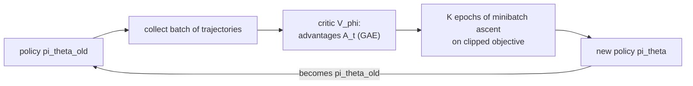

## Learning Objectives

- Explain what a stochastic policy network is and why optimizing the policy directly suits continuous actions and stochastic optimal behavior.
- State the policy gradient theorem in its REINFORCE form and compute one update by hand.
- Explain why a baseline reduces variance without adding bias, and how actor-critic methods estimate the advantage.
- Compute PPO's clipped surrogate objective and explain how clipping limits the size of each policy update.

## Context & Motivation

The previous concept learned action values and acted greedily on them. That works for a few discrete actions but has two limits. For continuous actions (a robot's joint torques, a car's steering angle) the $\max_a Q(s, a)$ at every step is itself an optimization problem. And a greedy policy is deterministic, while some problems are best played stochastically, as in any game where being predictable can be exploited.

**Policy gradient** methods parameterize the policy directly as a network $\pi_\theta(a \mid s)$ that outputs a distribution over actions (a softmax for discrete actions, a Gaussian mean and variance for continuous ones) and adjust $\theta$ by gradient ascent on expected return. Williams introduced the core estimator, REINFORCE, in 1992. Schulman and colleagues at OpenAI introduced Proximal Policy Optimization (PPO) in 2017, which became the default deep RL algorithm in practice because it is simple and robust; it is also the algorithm used to optimize language models against learned reward models in RLHF, as described in the alignment concept earlier in this track.

## Core Theory

### The objective and the policy gradient theorem

The goal is to maximize the expected return $J(\theta) = \mathbb{E}_{\tau \sim \pi_\theta}[R(\tau)]$, where $\tau = (s_0, a_0, r_0, s_1, \dots)$ is a trajectory. The difficulty is that $\theta$ affects which trajectories occur, and the environment's dynamics, which we cannot differentiate, sit in between. The **log-derivative trick**, $\nabla_\theta p = p\, \nabla_\theta \log p$, removes the dynamics: they do not depend on $\theta$, so their log-terms vanish from the gradient, leaving only the policy's terms:

$$\nabla_\theta J(\theta) = \mathbb{E}_{\tau \sim \pi_\theta}\Big[\sum_{t} \nabla_\theta \log \pi_\theta(a_t \mid s_t)\, G_t\Big], \qquad G_t = \sum_{k \geq t} \gamma^{k-t} r_k$$

**REINFORCE** estimates this expectation with sampled episodes: run the policy, compute the return-to-go $G_t$ after each action, and step $\theta$ along $\nabla_\theta \log \pi_\theta(a_t \mid s_t)\, G_t$. Intuitively, every action's log-probability is pushed up in proportion to the return that followed it. Actions followed by high returns become more likely, those followed by low returns less likely.

### Variance and baselines

The REINFORCE estimator is unbiased but extremely noisy: returns vary a lot between episodes, and if all returns are positive, every sampled action is pushed up, only by different amounts. Subtracting a **baseline** $b(s_t)$ that depends only on the state fixes much of this:

$$\nabla_\theta J(\theta) = \mathbb{E}\Big[\sum_{t} \nabla_\theta \log \pi_\theta(a_t \mid s_t)\, \big(G_t - b(s_t)\big)\Big]$$

The baseline adds no bias because $\mathbb{E}_{a \sim \pi}[\nabla_\theta \log \pi_\theta(a \mid s)] = \nabla_\theta \sum_a \pi_\theta(a \mid s) = \nabla_\theta 1 = 0$. The natural choice is the state value $V(s_t)$, so the weight becomes the **advantage** $A_t = G_t - V(s_t)$: how much better this action turned out than what the policy usually gets from this state. Now below-average actions are pushed down.

**Actor-critic** methods learn $V_\phi$ with a second network (the critic) by regression on observed returns, while the policy (the actor) uses advantages computed from it. Advantages can also bootstrap, for example the one-step estimate $r_t + \gamma V_\phi(s_{t+1}) - V_\phi(s_t)$, trading some bias for much lower variance; generalized advantage estimation (GAE) interpolates between the two with a parameter $\lambda$.

### Proximal Policy Optimization

Policy gradient steps are fragile. A step that is too large can collapse the policy into a bad region, and because the policy also generates the next batch of data, a bad policy produces bad data and may never recover. Trust region methods (TRPO) constrained each update's KL divergence, at the cost of a complex second-order optimization. PPO gets most of the benefit with a first-order trick.

Collect a batch with the current policy $\pi_{\theta_{old}}$, compute advantages $\hat A_t$, then optimize several epochs of minibatch updates on the **clipped surrogate objective**:

$$L^{CLIP}(\theta) = \mathbb{E}_t\Big[\min\big(\rho_t(\theta)\, \hat A_t,\ \mathrm{clip}(\rho_t(\theta),\, 1-\epsilon,\, 1+\epsilon)\, \hat A_t\big)\Big], \qquad \rho_t(\theta) = \frac{\pi_\theta(a_t \mid s_t)}{\pi_{\theta_{old}}(a_t \mid s_t)}$$

with $\epsilon$ typically 0.2. For a good action ($\hat A_t > 0$) the objective rewards increasing its probability only until the ratio reaches $1 + \epsilon$; beyond that the gradient is zero. For a bad action ($\hat A_t < 0$), it rewards decreasing the probability only down to $1 - \epsilon$. Taking the minimum makes the objective a pessimistic bound: the policy gets no credit for moving far from the policy that collected the data, so several epochs of reuse do not run away.

## Worked Examples

### Example 1: one REINFORCE step with a baseline

**Problem:** A two-action softmax policy has logits $(z_L, z_R) = (0, 0)$, so $\pi(L) = \pi(R) = 0.5$. The agent samples $L$ and the episode returns $G = 10$. The baseline is $b = 6$, the learning rate 0.1. Update the logits.

**Trace:** For a softmax, $\partial \log \pi(L) / \partial z_L = 1 - \pi(L) = 0.5$ and $\partial \log \pi(L) / \partial z_R = -\pi(R) = -0.5$. The advantage is $10 - 6 = 4$. Updates: $z_L \leftarrow 0 + 0.1 \times 4 \times 0.5 = 0.2$, $z_R \leftarrow 0 - 0.1 \times 4 \times 0.5 = -0.2$. New probability of $L$: $e^{0.2}/(e^{0.2} + e^{-0.2}) \approx 0.60$. Without the baseline the advantage would have been 10, a step 2.5 times larger driven mostly by the fact that returns are positive, not by $L$ being better than usual.

### Example 2: reading the clipped objective

**Problem:** With $\epsilon = 0.2$, compute the per-sample PPO objective for (a) $\rho = 1.5,\ \hat A = 2$ and (b) $\rho = 0.5,\ \hat A = -1$, and say whether the gradient pushes $\rho$ further.

**Trace:** (a) Unclipped: $1.5 \times 2 = 3$. Clipped ratio $\mathrm{clip}(1.5, 0.8, 1.2) = 1.2$, giving $1.2 \times 2 = 2.4$. The minimum is $2.4$, the clipped term, which does not depend on $\theta$, so the gradient is zero: the action is already 50% more likely than under the old policy, and PPO grants no further credit. (b) Unclipped: $0.5 \times (-1) = -0.5$. Clipped: $0.8 \times (-1) = -0.8$. The minimum is $-0.8$, again the constant clipped term, so the gradient is zero: the bad action's probability has already been cut by more than 20%. In both cases clipping stops the update exactly where it would otherwise keep moving the policy away from the data.

## Common Misconceptions & Pitfalls

- **"Policy gradients need a differentiable environment."** The log-derivative trick removes the environment from the gradient entirely; only the policy's log-probabilities are differentiated. That is why the same algorithm trains robot controllers and language models.
- **"PPO is off-policy because it reuses data for several epochs."** It is on-policy: the reuse is limited to the batch just collected, and the clipping exists precisely because the data becomes stale as the policy moves. Data from much older policies is discarded.
- **"Policy gradients are more sample-efficient than DQN."** Usually the opposite: on-policy methods throw away data after each update. They are preferred for stability, continuous actions, and parallel simulation, where samples are cheap.

## Summary

Policy gradient methods parameterize a stochastic policy and ascend the gradient of expected return. The log-derivative trick yields the REINFORCE estimator, which raises each action's log-probability in proportion to the return that followed it, without differentiating the environment. A state-dependent baseline, ideally the value function, reduces variance without bias and turns returns into advantages, and actor-critic methods learn that baseline with a critic network. PPO reuses each batch for several epochs while clipping the probability ratio so no update moves the policy far from the one that collected the data. The capstone that follows asks when each method from this track is the right tool.

## Documentation Links

- [Schulman et al.: Proximal Policy Optimization Algorithms (2017)](https://arxiv.org/abs/1707.06347): doc
- [Sutton, Barto: Reinforcement Learning: An Introduction (2nd ed.), Chapter 13](http://incompleteideas.net/book/the-book-2nd.html): doc
- [UC Berkeley CS285: Deep Reinforcement Learning](https://rail.eecs.berkeley.edu/deeprlcourse/): doc
