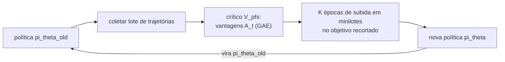

## Objetivos de Aprendizagem

- Explicar o que é uma rede de política estocástica e por que otimizar a política diretamente combina com ações contínuas e com comportamento ótimo estocástico.
- Enunciar o teorema do gradiente de política na forma REINFORCE e calcular uma atualização à mão.
- Explicar por que um baseline reduz a variância sem adicionar viés, e como métodos ator-crítico estimam a vantagem.
- Calcular o objetivo substituto recortado do PPO e explicar como o recorte limita o tamanho de cada atualização da política.

## Contexto e Motivação

O conceito anterior aprendeu valores de ação e agiu de forma gulosa sobre eles. Isso funciona para poucas ações discretas, mas tem dois limites. Para ações contínuas (os torques das juntas de um robô, o ângulo do volante de um carro), o $\max_a Q(s, a)$ a cada passo é ele mesmo um problema de otimização. E uma política gulosa é determinística, enquanto alguns problemas são mais bem jogados de forma estocástica, como em qualquer jogo em que ser previsível pode ser explorado.

Métodos de **gradiente de política** parametrizam a política diretamente como uma rede $\pi_\theta(a \mid s)$ que produz uma distribuição sobre ações (um softmax para ações discretas, a média e a variância de uma gaussiana para contínuas) e ajustam $\theta$ por subida de gradiente no retorno esperado. Williams introduziu o estimador central, o REINFORCE, em 1992. Schulman e colegas na OpenAI introduziram o Proximal Policy Optimization (PPO) em 2017, que virou o algoritmo padrão de RL profundo na prática por ser simples e robusto; ele também é o algoritmo usado para otimizar modelos de linguagem contra modelos de recompensa aprendidos no RLHF, como descrito no conceito de alinhamento, antes nesta trilha.

## Teoria Central

### O objetivo e o teorema do gradiente de política

O objetivo é maximizar o retorno esperado $J(\theta) = \mathbb{E}_{\tau \sim \pi_\theta}[R(\tau)]$, em que $\tau = (s_0, a_0, r_0, s_1, \dots)$ é uma trajetória. A dificuldade é que $\theta$ afeta quais trajetórias ocorrem, e a dinâmica do ambiente, que não conseguimos derivar, fica no meio do caminho. O **truque da derivada do logaritmo**, $\nabla_\theta p = p\, \nabla_\theta \log p$, remove a dinâmica: ela não depende de $\theta$, então os seus termos de log somem do gradiente, sobrando só os termos da política:

$$\nabla_\theta J(\theta) = \mathbb{E}_{\tau \sim \pi_\theta}\Big[\sum_{t} \nabla_\theta \log \pi_\theta(a_t \mid s_t)\, G_t\Big], \qquad G_t = \sum_{k \geq t} \gamma^{k-t} r_k$$

O **REINFORCE** estima essa esperança com episódios amostrados: rode a política, calcule o retorno futuro $G_t$ depois de cada ação e mova $\theta$ ao longo de $\nabla_\theta \log \pi_\theta(a_t \mid s_t)\, G_t$. Intuitivamente, a log-probabilidade de toda ação é empurrada para cima em proporção ao retorno que veio depois dela. Ações seguidas de retornos altos ficam mais prováveis, as seguidas de retornos baixos, menos.

### Variância e baselines

O estimador REINFORCE é sem viés, mas extremamente ruidoso: os retornos variam muito entre episódios, e se todos os retornos forem positivos, toda ação amostrada é empurrada para cima, só que em quantidades diferentes. Subtrair um **baseline** $b(s_t)$ que depende só do estado corrige boa parte disso:

$$\nabla_\theta J(\theta) = \mathbb{E}\Big[\sum_{t} \nabla_\theta \log \pi_\theta(a_t \mid s_t)\, \big(G_t - b(s_t)\big)\Big]$$

O baseline não adiciona viés porque $\mathbb{E}_{a \sim \pi}[\nabla_\theta \log \pi_\theta(a \mid s)] = \nabla_\theta \sum_a \pi_\theta(a \mid s) = \nabla_\theta 1 = 0$. A escolha natural é o valor de estado $V(s_t)$, então o peso vira a **vantagem** $A_t = G_t - V(s_t)$: o quanto essa ação se saiu melhor do que o que a política costuma obter a partir desse estado. Agora ações abaixo da média são empurradas para baixo.

Métodos **ator-crítico** aprendem $V_\phi$ com uma segunda rede (o crítico) por regressão nos retornos observados, enquanto a política (o ator) usa vantagens calculadas a partir dele. As vantagens também podem usar bootstrapping, por exemplo a estimativa de um passo $r_t + \gamma V_\phi(s_{t+1}) - V_\phi(s_t)$, trocando um pouco de viés por variância muito menor; a generalized advantage estimation (GAE) interpola entre as duas com um parâmetro $\lambda$.

### Proximal Policy Optimization

Passos de gradiente de política são frágeis. Um passo grande demais pode colapsar a política numa região ruim, e como a política também gera o próximo lote de dados, uma política ruim produz dados ruins e pode nunca se recuperar. Métodos de região de confiança (TRPO) restringiam a divergência KL de cada atualização, ao custo de uma otimização complexa de segunda ordem. O PPO obtém a maior parte do benefício com um truque de primeira ordem.

Colete um lote com a política atual $\pi_{\theta_{old}}$, calcule as vantagens $\hat A_t$ e então otimize várias épocas de atualizações em minilotes no **objetivo substituto recortado**:

$$L^{CLIP}(\theta) = \mathbb{E}_t\Big[\min\big(\rho_t(\theta)\, \hat A_t,\ \mathrm{clip}(\rho_t(\theta),\, 1-\epsilon,\, 1+\epsilon)\, \hat A_t\big)\Big], \qquad \rho_t(\theta) = \frac{\pi_\theta(a_t \mid s_t)}{\pi_{\theta_{old}}(a_t \mid s_t)}$$

com $\epsilon$ tipicamente 0,2. Para uma ação boa ($\hat A_t > 0$), o objetivo recompensa aumentar a sua probabilidade só até a razão chegar a $1 + \epsilon$; além disso o gradiente é zero. Para uma ação ruim ($\hat A_t < 0$), recompensa diminuir a probabilidade só até $1 - \epsilon$. Tomar o mínimo torna o objetivo um limite pessimista: a política não ganha crédito por se afastar muito da política que coletou os dados, então várias épocas de reuso não disparam.

## Exemplos Resolvidos

### Exemplo 1: um passo de REINFORCE com baseline

**Problema:** Uma política softmax de duas ações tem logits $(z_L, z_R) = (0, 0)$, então $\pi(L) = \pi(R) = 0{,}5$. O agente amostra $L$ e o episódio retorna $G = 10$. O baseline é $b = 6$, a taxa de aprendizado 0,1. Atualize os logits.

**Rastreamento:** Para um softmax, $\partial \log \pi(L) / \partial z_L = 1 - \pi(L) = 0{,}5$ e $\partial \log \pi(L) / \partial z_R = -\pi(R) = -0{,}5$. A vantagem é $10 - 6 = 4$. Atualizações: $z_L \leftarrow 0 + 0{,}1 \times 4 \times 0{,}5 = 0{,}2$, $z_R \leftarrow 0 - 0{,}1 \times 4 \times 0{,}5 = -0{,}2$. Nova probabilidade de $L$: $e^{0{,}2}/(e^{0{,}2} + e^{-0{,}2}) \approx 0{,}60$. Sem o baseline a vantagem teria sido 10, um passo 2,5 vezes maior, guiado principalmente pelo fato de os retornos serem positivos, e não por $L$ ser melhor do que o habitual.

### Exemplo 2: lendo o objetivo recortado

**Problema:** Com $\epsilon = 0{,}2$, calcule o objetivo PPO por amostra para (a) $\rho = 1{,}5,\ \hat A = 2$ e (b) $\rho = 0{,}5,\ \hat A = -1$, e diga se o gradiente empurra $\rho$ ainda mais.

**Rastreamento:** (a) Sem recorte: $1{,}5 \times 2 = 3$. Razão recortada $\mathrm{clip}(1{,}5;\ 0{,}8;\ 1{,}2) = 1{,}2$, dando $1{,}2 \times 2 = 2{,}4$. O mínimo é $2{,}4$, o termo recortado, que não depende de $\theta$, então o gradiente é zero: a ação já está 50% mais provável do que na política antiga, e o PPO não concede mais crédito. (b) Sem recorte: $0{,}5 \times (-1) = -0{,}5$. Recortado: $0{,}8 \times (-1) = -0{,}8$. O mínimo é $-0{,}8$, de novo o termo recortado constante, então o gradiente é zero: a probabilidade da ação ruim já caiu mais de 20%. Nos dois casos o recorte para a atualização exatamente onde ela continuaria afastando a política dos dados.

## Equívocos Comuns e Armadilhas

- **"Gradientes de política precisam de um ambiente diferenciável."** O truque da derivada do logaritmo tira o ambiente do gradiente por completo; só as log-probabilidades da política são derivadas. É por isso que o mesmo algoritmo treina controladores de robôs e modelos de linguagem.
- **"O PPO é off-policy porque reutiliza dados por várias épocas."** Ele é on-policy: o reuso fica limitado ao lote recém-coletado, e o recorte existe justamente porque os dados ficam velhos conforme a política se move. Dados de políticas muito mais antigas são descartados.
- **"Gradientes de política são mais eficientes em amostras do que o DQN."** Normalmente é o contrário: métodos on-policy jogam fora os dados depois de cada atualização. Eles são preferidos por estabilidade, por ações contínuas e por simulação paralela, em que amostras são baratas.

## Resumo

Métodos de gradiente de política parametrizam uma política estocástica e sobem o gradiente do retorno esperado. O truque da derivada do logaritmo gera o estimador REINFORCE, que aumenta a log-probabilidade de cada ação em proporção ao retorno que veio depois dela, sem derivar o ambiente. Um baseline dependente do estado, idealmente a função de valor, reduz a variância sem viés e transforma retornos em vantagens, e métodos ator-crítico aprendem esse baseline com uma rede crítica. O PPO reutiliza cada lote por várias épocas enquanto recorta a razão de probabilidades, para que nenhuma atualização afaste muito a política da que coletou os dados. O capstone a seguir pergunta quando cada método desta trilha é a ferramenta certa.

## Documentation Links

- [Schulman et al.: Proximal Policy Optimization Algorithms (2017)](https://arxiv.org/abs/1707.06347): doc
- [Sutton, Barto: Reinforcement Learning: An Introduction (2nd ed.), Chapter 13](http://incompleteideas.net/book/the-book-2nd.html): doc
- [UC Berkeley CS285: Deep Reinforcement Learning](https://rail.eecs.berkeley.edu/deeprlcourse/): doc
